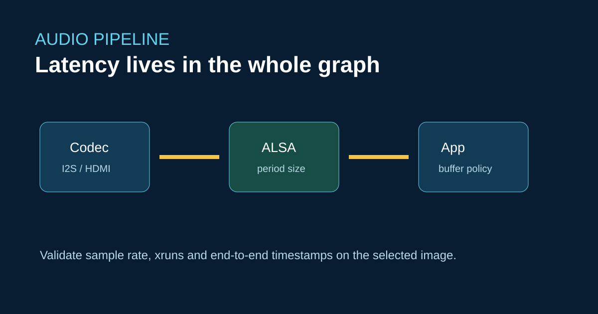

# Задержка звука на ArmSoM Sige7: измерения ALSA и полного тракта



Sige7 предлагает HDMI и звуковые интерфейсы платы, но сквозную задержку определяют частоты кодека, размер периода ALSA, конфигурация микшера, нагрузка планировщика и буфер приложения. Имя устройства ALSA Raspberry Pi или конфигурация PulseAudio Jetson не служат доказательством переносимости.

## Получите базовые данные

```bash
aplay -l
arecord -l
arecord -D hw:0,0 -f S16_LE -r 48000 -c 2 -d 10 capture.wav
```

Регистрируйте xrun (недозаполнение или переполнение буфера), преобразование частоты дискретизации и метки времени при нагрузке CPU, дисплея и сети. Для интерактивного звука проверяйте полный тракт динамика и микрофона с электрической петлёй либо калиброванным акустическим стендом.

## Выбор платформы

Ресурсы CPU/GPU/NPU RK3588 на Sige7 подходят для устройств с развитыми мультимедийными функциями. Однако перенос ПО с Jetson требует нового слоя интеграции звука и AI. Рассмотрите CM5 или Sige5, если интерфейсов и энергетических параметров RK3576 достаточно, а небольшой носитель важнее пиковой мультимедийной производительности.

## Источники

- [Спецификации и документация Sige7](https://docs.armsom.org/armsom-sige7)
- [Руководство по запуску и питанию семейства Sige](https://docs.armsom.org/sige-family-started)

## Проверки перед публикацией

- [ ] Укажите частоту дискретизации, размер периода, кодек и версию образа.
- [ ] Приведите измерения xrun и сквозной задержки.
- [ ] Разделите возможности платы и задержку приложения.
