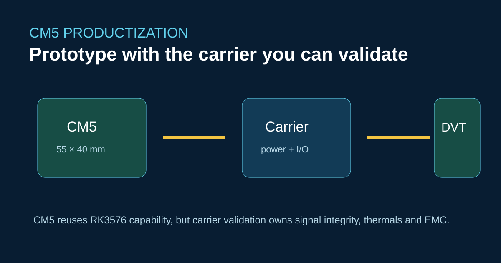
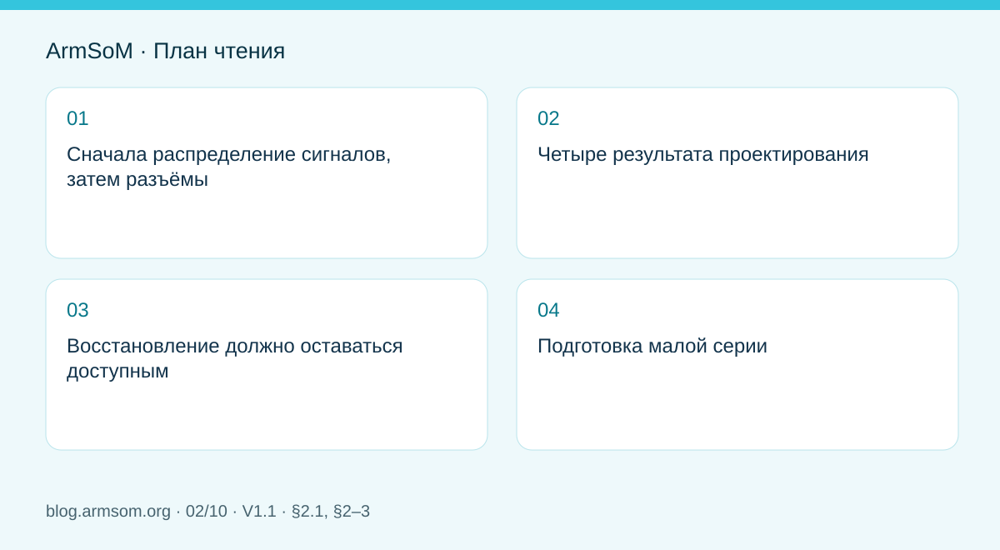
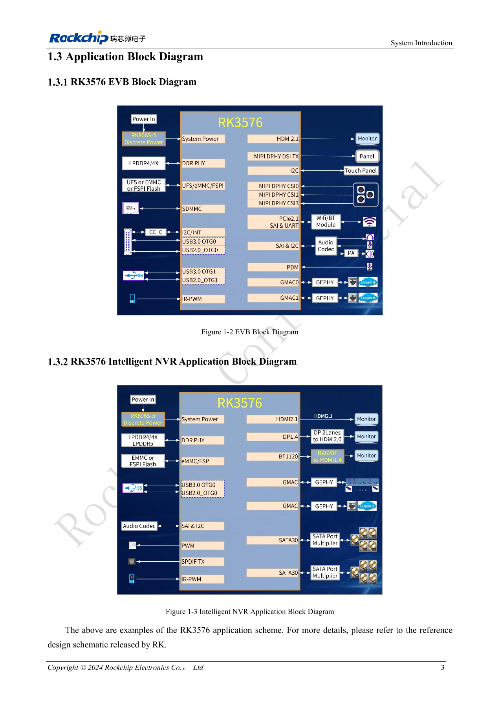

# Носитель ArmSoM CM5: от прототипа Raspberry Pi к продукту



CM5 — вычислительный модуль RK3576 размером 55 × 40 mm. Он может сократить сроки разработки, но переносит риски на носитель: последовательность питания, высокоскоростную разводку, выбор разъёмов, теплопередачу и производственные испытания.

## Порядок запуска

Начните с шин питания и последовательной консоли. Добавляйте по одному высокоскоростному интерфейсу, затем проверяйте USB, PCIe, камеры, дисплей и Ethernet под нагрузкой. Версионируйте распиновку; не копируйте схему Raspberry Pi только по названиям сигналов.

```bash
uname -a
cat /proc/device-tree/model
dmesg | grep -iE 'pcie|usb|dwc3|eth|drm'
```

ArmSoM указывает, что проблема вывода 21 на CM5 v1.2 исправлена в v1.3. Производственная документация должна фиксировать ревизию модуля и проверку затронутой цепи.

## Почему это не прямая замена

Модуль предоставляет вычислительные ресурсы RK3576 и документированные CSI/PCIe/USB, но реальные разъёмы и электрические характеристики определяет собственный носитель. Предположения о носителе Jetson Nano, зависимости CUDA и инструменты загрузки не переносятся автоматически.

## Источники

- [Спецификации и документация CM5](https://docs.armsom.org/armsom-cm5)
- [Плата-носитель CM5-IO](https://docs.armsom.org/armsom-cm5-io)
- [Обзор платформы RK3576](https://docs.armsom.org/blog/rk3576-sbc)

## Проверки перед публикацией

- [ ] Зафиксируйте ревизию модуля и распиновку.
- [ ] Определите ответственность за проверки SI, теплового режима и EMC.
- [ ] Проверьте восстановление и заводское программирование на носителе.

<!-- hardware-design-series expansion -->



## Область применения и источники

Это тематическое инженерное руководство, а не постраничный перевод всего PDF. Примеры источника не являются измерениями ArmSoM. Напряжения, выводы, SDK/BSP и ядро сверяйте с фактической ревизией платы.

**Rockchip:** `RK3576_Hardware_Design_Guide_V1.1_20240528_CN.pdf` · V1.1 · §2.1, §2–3

## Сначала распределение сигналов, затем разъёмы

Для каждого требования запишите функцию, сигнал, вывод модуля, домен питания, программную настройку и метод проверки. Камере нужны не только линии CSI, но и управление, тактирование, сброс и питание. Дисплею нужны также сенсор, подсветка и последовательность включения. Одинаковая форма разъёмов не доказывает электрическую совместимость.

Руководство RK3576 задаёт ограничения чипа, документация CM5 — границы модуля, а схема носителя — реальные соединения. Не повторяйте DDR и питание ядра, уже реализованные на модуле. При переносе проекта Raspberry Pi проверяют выводы, питание, механику, драйверы и образ системы.

## Четыре результата проектирования

| Документ | На какой вопрос отвечает |
| --- | --- |
| Таблица выводов | Есть ли конфликты мультиплексирования, ошибки с резервными выводами и уровнями? |
| Бюджет питания | Учтены ли пики нагрузки и запуск модуля и периферии? |
| Ограничения PCB | Какие импеданс, длина, опорная плоскость и разъём нужны каждому каналу? |
| Матрица испытаний | Как проверить загрузку, восстановление, нагрев, совместную работу и потерю питания? |

Главы 2–3 исходного руководства дают структуру проверки. Численные ограничения выбирают для конкретного интерфейса и топологии. Нельзя отдать носителю весь допустимый бюджет канала: часть расходуют модуль, межплатный разъём и кабель.

## Восстановление должно оставаться доступным

До фиксации корпуса определите UART, органы восстановления и контакты прошивки. Собранное изделие должно сохранять управляемый путь восстановления. Сначала проверьте образ на исправных модуле и IO-плате, затем перенесите тот же комплект на новый носитель.

После первого запуска отдельно испытайте USB hotplug, накопитель, переключение дисплея и камеры, затем объедините их в рабочую нагрузку. Сохраняйте ошибки, условия питания и температуру среды.

## Подготовка малой серии

Зафиксируйте ревизию модуля, BOM, разъёмы, структуру слоёв и образ. Для каждого изделия сохраните серийный номер и результаты. Загрузка, работа интерфейсов и стабильность под длительной нагрузкой — разные проверки. После замены версии модуля или периферии пересмотрите затронутые испытания.

CM5 позволяет сосредоточиться на собственных интерфейсах, корпусе и приложении. Это не означает совместимость с любым сторонним носителем; аппаратные испытания в рамках статьи не выполнялись.

## Иллюстрация из источника

[](/assets/hardware-design-series/rk3576-en.png)

Оригинал английского документа, общий для EN/RU/DE. Эталонный проект, а не схема платы ArmSoM.

`RK3576_Hardware_Design_Guide_V1.1_20240528_EN.pdf` · PDF p. 22.

## Продукты и документация

- **CM5** — [Страница продукта](https://www.armsom.org/cm5) · [Документация](https://docs.armsom.org/armsom-cm5)

## Другие статьи серии

- [Запуск платы RK3576: минимальная система и проверка первого включения](/ru/articles/rk3576-hardware-bringup/)
- [Скоростные интерфейсы RK3576: совместная проверка схемы и PCB](/ru/articles/rk3576-high-speed-interface-design/)
- [Аппаратное проектирование RK3588S: от эталонной схемы к носителю CM7s](/ru/articles/rk3588s-cm7s-carrier-design/)
- [RK3588 для периферийного ИИ: питание, охлаждение и расширение](/ru/articles/rk3588-edge-ai-hardware-design/)
- [Проверка скоростной PCB RK3588: слои, импеданс и трассировка](/ru/articles/rk3588-high-speed-pcb-review/)
- [Аппаратная часть HMI на RK3506: выбор пути с CM1 или Forge1](/ru/articles/rk3506-industrial-hmi-hardware/)
- [Варианты RK3308: аппаратная совместимость для аудиопроектов P2 Pro](/ru/articles/rk3308-hardware-variant-compatibility/)
- [RK3588S и RK3588S2: что проверить перед изменением платы](/ru/articles/rk3588s-rk3588s2-hardware-differences/)
- [От прототипа Rockchip к серии: технологические требования и испытания](/ru/articles/rockchip-hardware-production-checklist/)
