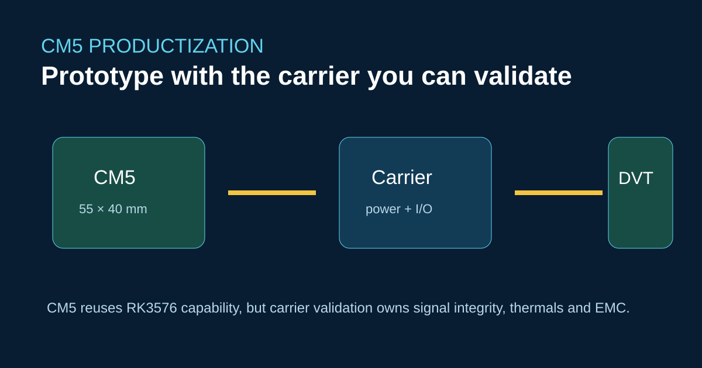

# Носитель ArmSoM CM5: от прототипа Raspberry Pi к продукту



CM5 — вычислительный модуль RK3576 размером 55 × 40 mm. Он может сократить сроки разработки, но переносит риски на носитель: последовательность питания, высокоскоростную разводку, выбор разъёмов, теплопередачу и производственные испытания.

## Порядок запуска

Начните с шин питания и последовательной консоли. Добавляйте по одному высокоскоростному интерфейсу, затем проверяйте USB, PCIe, камеры, дисплей и Ethernet под нагрузкой. Версионируйте распиновку; не копируйте схему Raspberry Pi только по названиям сигналов.

```bash
uname -a
cat /proc/device-tree/model
dmesg | grep -iE 'pcie|usb|dwc3|eth|drm'
```

ArmSoM указывает, что проблема вывода 21 на CM5 v1.2 исправлена в v1.3. Производственная документация должна фиксировать ревизию модуля и проверку затронутой цепи.

## Почему это не прямая замена

Модуль предоставляет вычислительные ресурсы RK3576 и документированные CSI/PCIe/USB, но реальные разъёмы и электрические характеристики определяет собственный носитель. Предположения о носителе Jetson Nano, зависимости CUDA и инструменты загрузки не переносятся автоматически.

## Источники

- [Спецификации и документация CM5](https://docs.armsom.org/armsom-cm5)
- [Плата-носитель CM5-IO](https://docs.armsom.org/armsom-cm5-io)
- [Обзор платформы RK3576](https://docs.armsom.org/blog/rk3576-sbc)

## Проверки перед публикацией

- [ ] Зафиксируйте ревизию модуля и распиновку.
- [ ] Определите ответственность за проверки SI, теплового режима и EMC.
- [ ] Проверьте восстановление и заводское программирование на носителе.
