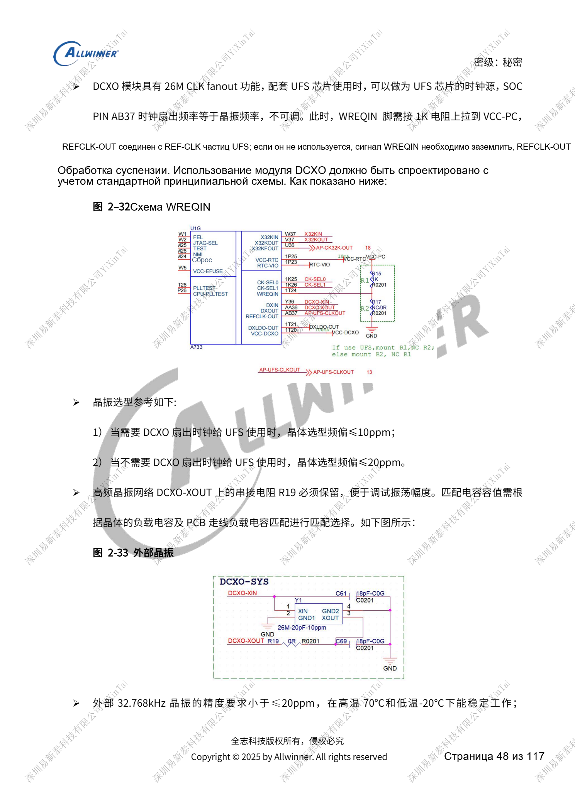
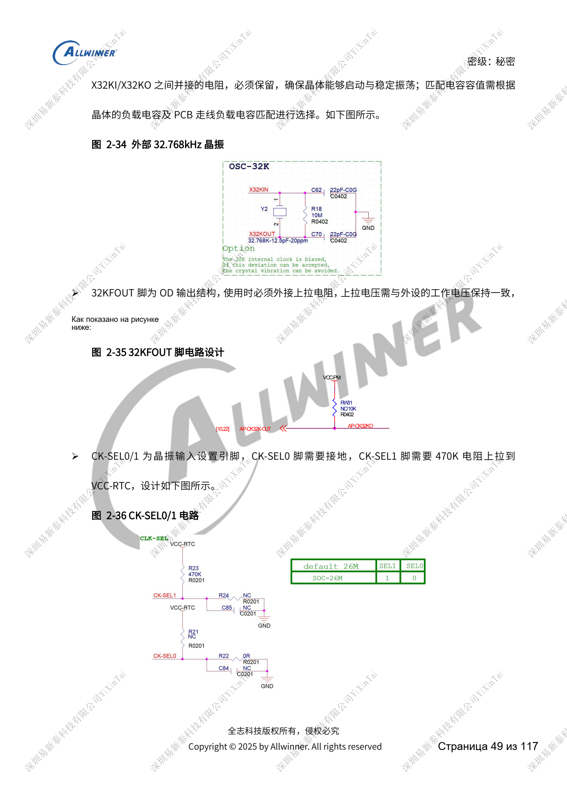
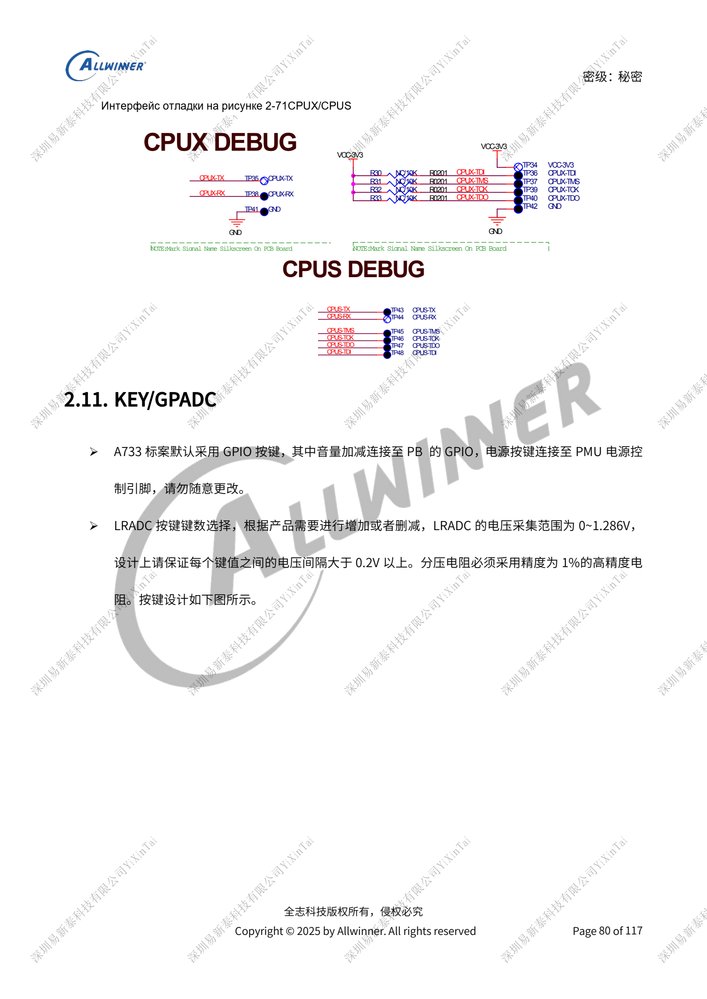

# A733: такты 26MHz, домены GPIO и восстановление FEL

Это тематический материал по исходному руководству, справка по платформе; соответствующая плата ArmSoM не подтверждена. Параметры взяты из источника, не из испытаний ArmSoM. Перед применением проверьте ревизию SoC, PCB, SDK/BSP, ядро, прошивку и периферию.

Источник A733 — черновик V0.9; параметры и поддержка ПО могут меняться. Это не окончательное обязательство для серийного изделия.

**Design draft V0.9 §2.3, §2.10–2.11; PDF 45–54, 80–83**

## Не переносите схему H618 на 24MHz

Черновик A733 задаёт только 26MHz. Выход AB37 равен частоте кварца и не регулируется: ≤10ppm для UFS, иначе ≤20ppm. При REFCLK-OUT WREQIN подтягивается к VCC-PC через 1kΩ, иначе заземляется, REFCLK-OUT свободен. Сохраните резистор XOUT и выбирайте ёмкости по CL и паразитам PCB. CK-SEL0 — земля, CK-SEL1 — 470kΩ к VCC-RTC. Открытый сток 32KFOUT требует подходящей подтяжки. Для точного пробуждения нужен внешний кварц 32.768kHz, ориентир ≤20ppm и устойчивость от -20 до 70°C.

## Загрузка и отладочные выводы

Высокий JTAG-SEL допускает PF/PB программно, низкий выбирает PB. TEST оставляется свободным без длинной трассы. FEL Low включает прошивку; на кнопках FEL/GPADC сохраняется 1nF. AP-RESET/AP-NMI также по 1nF, открытый сток NMI подтянут к VCC-RTC. Сохраните CPUX JTAG либо UART, предпочтительно PF; перемычки PB UART0 и точки CPUS PL/PM нужны для диагностики сна. Оставьте UBOOT/FEL либо комбинацию громкость+POWER. LRADC: 0–1.286V, шаг >0.2V и делители 1%; GPADC отдельно: разрешение 12-bit, точность 10-bit, диапазон 0–AVCC.

## Домены GPIO и загрузочные импульсы

PL/PM — постоянно питаемые CPUS-домены, в эталоне PL=3.3V, PM=1.8V. Прерывания пробуждения и подтяжки должны находиться в правильном активном домене. PL0/1 обслуживает PMIC, charger и Type-C: внутренние 4.7kΩ и эталонные внешние 2.2kΩ, не произвольная шина периферии. PC/PF посылают запросы накопителя при загрузке, поэтому не управляют напрямую усилителем, LED или датчиком. Подтяжки следуют питанию IO; изменения требуют программной настройки уровней против обратного питания и утечек.

## Исходные иллюстрации

Снимки справочных страниц сохраняют китайские подписи. Соответствующий английский выпуск не найден; четыре языка используют китайские оригиналы. Параметры и шаги в тексте копируются, снимки служат сверке. Номера — физические страницы PDF.

## Выбор платформы ArmSoM

Для проекта ArmSoM выбирайте платформу по официальным продуктам и документации, заново проверяя процессор, интерфейсы и ПО. Схемы A733/H618 нельзя автоматически переносить на другой SoC.

- [ArmSoM](https://www.armsom.org/)
- [ArmSoM Docs](https://docs.armsom.org/)

## Материалы серии

- [Питание A733: AXP318W, последовательности и зарядка](/ru/articles/a733-power-sequence-pmic-design/)
- [Память A733: LPDDR4/4X/5, eMMC и UFS](/ru/articles/a733-ddr-emmc-ufs-design/)
- [Дисплеи и камеры A733: мультиплексирование, питание и мосты](/ru/articles/a733-display-camera-interface-design/)
- [Периферия A733: USB, PCIe, Wi-Fi, Ethernet и аудио](/ru/articles/a733-usb-pcie-network-audio-design/)
- [Надёжность A733: ESD, EMI, импульсы и теплоотвод](/ru/articles/a733-esd-emi-thermal-review/)
- [A733 · Обзор серии](/ru/articles/a733-hardware-design-series/)
