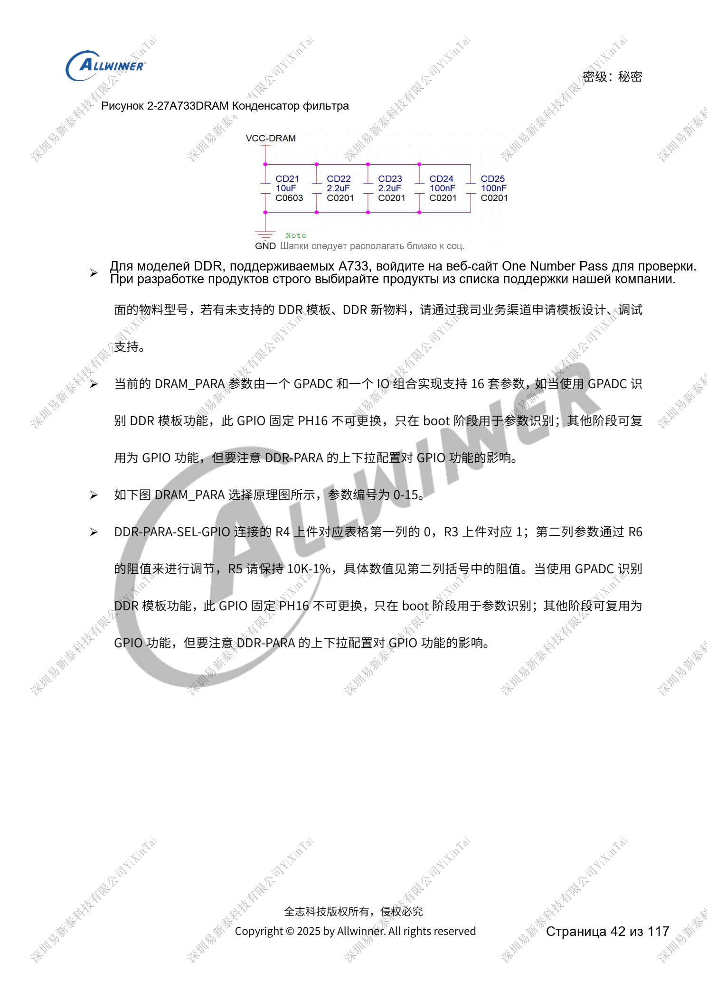
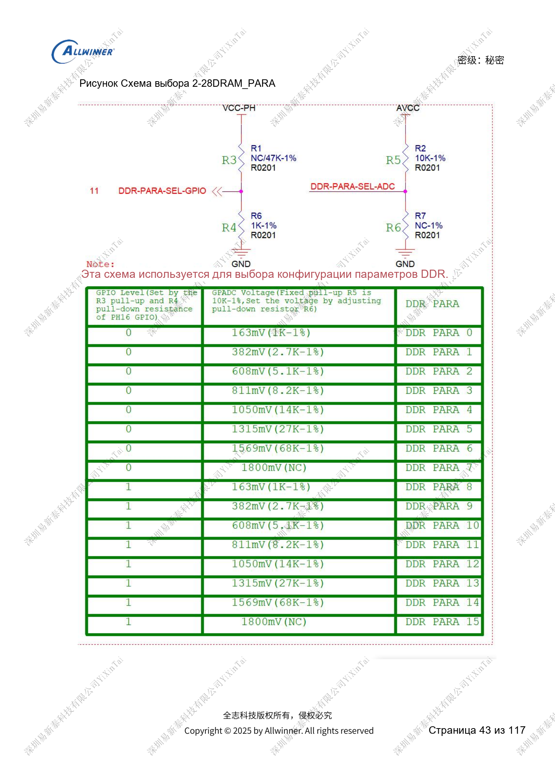
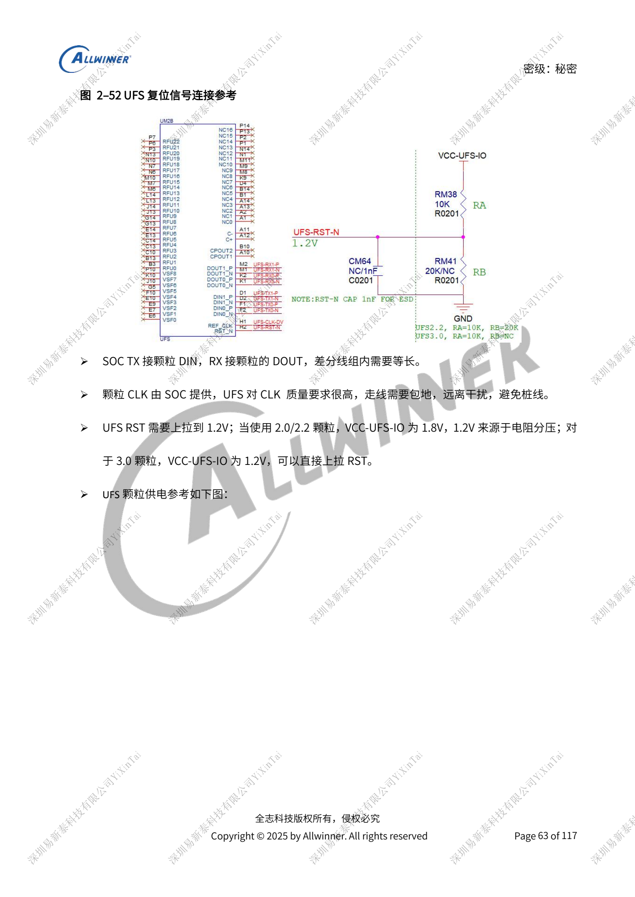

# Память A733: LPDDR4/4X/5, eMMC и UFS

Это тематический материал по исходному руководству, справка по платформе; соответствующая плата ArmSoM не подтверждена. Параметры взяты из источника, не из испытаний ArmSoM. Перед применением проверьте ревизию SoC, PCB, SDK/BSP, ядро, прошивку и периферию.

Источник A733 — черновик V0.9; параметры и поддержка ПО могут меняться. Это не окончательное обязательство для серийного изделия.

**Design draft V0.9 §2.2, §2.4–2.6; PDF 41–44, 55–65**

## Равные напряжения DDR не делают линии взаимозаменяемыми

Сначала выберите тип, chip select и ширину, затем согласованные схемный и PCB-шаблоны с исходными позиционными обозначениями. Дифференциально 85Ω, одиночно 50Ω. SZQ SoC: 120Ω, 1% на землю; типовой вывод памяти: 240Ω, 1% к VCC-VDDQ, с проверкой datasheet. GPADC и фиксированный PH16 выбирают 16 наборов DRAM_PARA 0–15. Повторное использование GPIO учитывает загрузочные подтяжки. Посадочные места конденсаторов сохраняются до валидации.

## Разные ограничения eMMC и SD

HS200/HS400 требуют 1.8V для VCCQ и PC с монотонным включением. Для HS400 200MHz рекомендовано <1000mil; общий раздел отдельно даёт <2000mil и разницу относительно CLK ≤300mil. Общий предел не заменяет высокоскоростной. CLK: 33Ω у SoC, трассы 50Ω, NC/RFU свободны. SD3.0 требует обе линии 3.3V/1.8V для внутреннего переключения. Ёмкость CLK ≤15pF; TVS SD3.0 ≤5pF, SD2.0 <35pF; DET сохраняет 1kΩ. Металлический лоток требует плавного включения; защиту нельзя заменить перемычкой 0Ω.

## Согласуйте поколение UFS

Две линии, в черновике до 11.6Gbps/lane; UFS3.1 ограничен хранением. Для 2.0/2.2 VCCQ2=1.8V, VCC=3.3V; для 3.0/3.1 VCCQ=1.2V, VCC по умолчанию 2.5V, опционально 3.3V. DC8SET настраивается вместе с PMIC. TX к DIN, RX к DOUT. RST — 1.2V: при IO 1.8V нужен делитель. Такт от SoC защищается землёй без ответвлений. Пульсации <5%, ширина питания >30mil, ток минимум 600mA. У неиспользуемого UFS сигналы могут быть свободными, обязательные питания сохраняются.

## Параметры

| Пункт | Данные источника |
| --- | --- |
| Домен питания | LPDDR4 / LPDDR4X / LPDDR5 |
| VCC-DRAM: DCDC7 | 1.1V / 1.1V / 1.05V |
| VCC-DRAML: DCDC6 | 0.8V / 0.6V / 0.5V |
| VCC-VDDQ памяти | DCDC7 1.1V / DCDC6 0.6V / DCDC6 0.5V |
| LPDDR5 VDD2L | ELDO1 0.9V |
| Память / SoC 1.8V | CLDO1 / CLDO3 |

## Исходные иллюстрации

Снимки справочных страниц сохраняют китайские подписи. Соответствующий английский выпуск не найден; четыре языка используют китайские оригиналы. Параметры и шаги в тексте копируются, снимки служат сверке. Номера — физические страницы PDF.

## Выбор платформы ArmSoM

Для проекта ArmSoM выбирайте платформу по официальным продуктам и документации, заново проверяя процессор, интерфейсы и ПО. Схемы A733/H618 нельзя автоматически переносить на другой SoC.

- [ArmSoM](https://www.armsom.org/)
- [ArmSoM Docs](https://docs.armsom.org/)

## Материалы серии

- [Питание A733: AXP318W, последовательности и зарядка](/ru/articles/a733-power-sequence-pmic-design/)
- [A733: такты 26MHz, домены GPIO и восстановление FEL](/ru/articles/a733-clock-gpio-recovery-design/)
- [Дисплеи и камеры A733: мультиплексирование, питание и мосты](/ru/articles/a733-display-camera-interface-design/)
- [Периферия A733: USB, PCIe, Wi-Fi, Ethernet и аудио](/ru/articles/a733-usb-pcie-network-audio-design/)
- [Надёжность A733: ESD, EMI, импульсы и теплоотвод](/ru/articles/a733-esd-emi-thermal-review/)
- [A733 · Обзор серии](/ru/articles/a733-hardware-design-series/)
