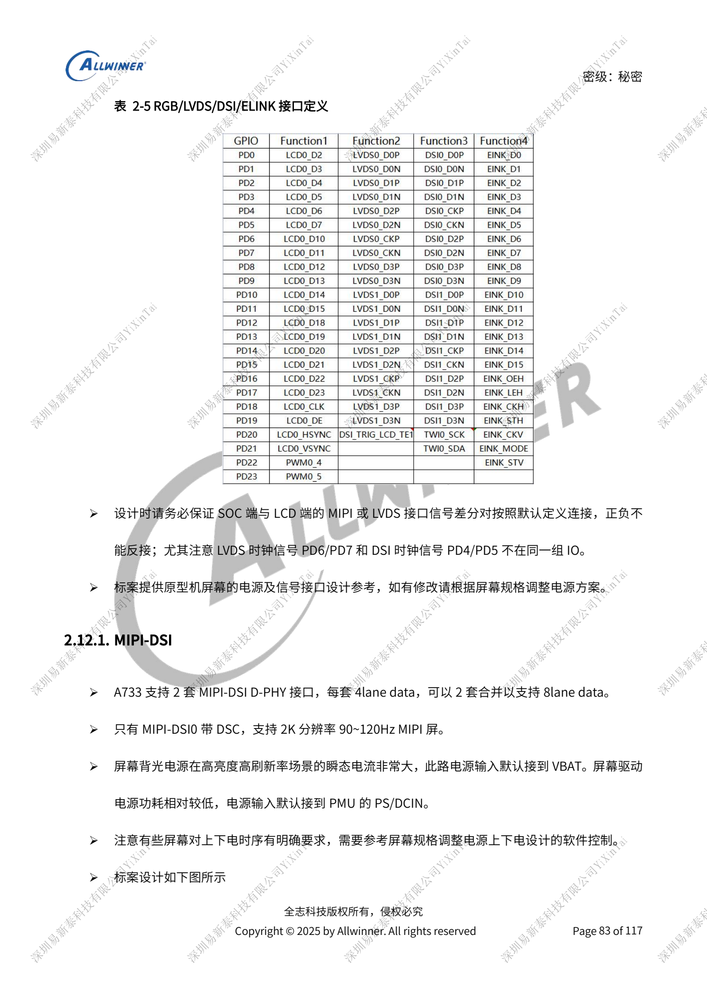
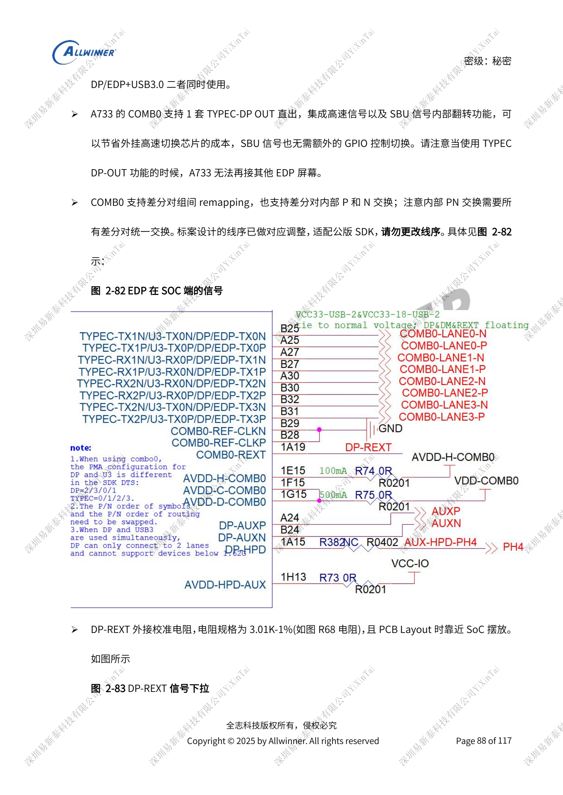
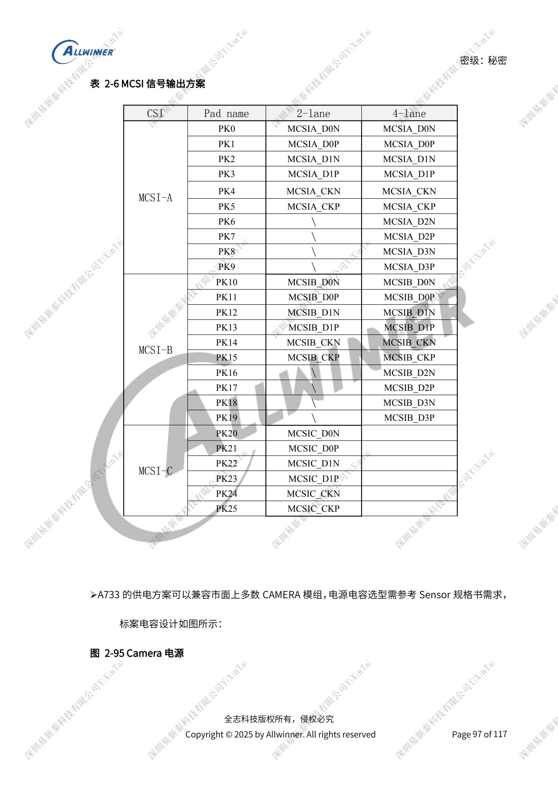

# Дисплеи и камеры A733: мультиплексирование, питание и мосты

Это тематический материал по исходному руководству, справка по платформе; соответствующая плата ArmSoM не подтверждена. Параметры взяты из источника, не из испытаний ArmSoM. Перед применением проверьте ревизию SoC, PCB, SDK/BSP, ядро, прошивку и периферию.

Источник A733 — черновик V0.9; параметры и поддержка ПО могут меняться. Это не окончательное обязательство для серийного изделия.

**Design draft V0.9 §2.12–2.15, §2.18–2.19; PDF 83–100, 102–106**

## Начните с карты ресурсов дисплея

Два MIPI-DSI по четыре линии объединяются в восемь; DSC есть только у DSI0. Четыре LVDS по четыре линии данных: single-link 1366×768@60Hz, dual-link 1920×1080@60Hz. RGB888 распределён между PD/PB, D0/1/8/9/16/17 — 3.3V другого домена. Такт LVDS PD6/PD7 отличается от DSI PD4/PD5; одинаковый разъём не означает совместимость. SPI incell использует SPI1, но распиновка и питание зависят от панели. PWM подсветки выше 20kHz, пример 30–50kHz; переходные токи проверяются вместе с питанием.

## DP и USB делят COMB0

DP/eDP выводится только через COMB0. Четыре линии исключают USB3, две допускают совместную работу. Не обещайте Type-C DP-OUT одновременно с отдельным eDP. Инверсия P/N выполняется согласованно для всех пар; исходный порядок уже связан с SDK. DP-REXT: 3.01kΩ, 1%; eDP: 100Ω и 100nF, совместный Type-C USB3/DP — ориентир 95Ω. Неиспользуемые блоки сохраняют необходимые питания. HDMI OUT 2.0 до 4K60, линии 0.8V/1.8V включены, REXT 1.62kΩ, 1%, пары 100Ω.

## Камеры и внешнее видео

MCSIA/B имеют по четыре линии, MCSIC — две, ориентир до 2Gbps/lane, альтернативно NCSI. Перестановка камер требует изменения ПО. MCLK: 33Ω у SoC и резерв ёмкости у разъёма. AVDD-CSI питается отдельно; объединение цифрового и фокусного питания зависит от последовательности, напряжения и тока. Сохраните TWI-подтяжки, исключите посторонние устройства и одинаковые адреса одновременно работающих датчиков. Нативного HDMI IN нет: используется CSI-мост, пример до HDMI1.4. DP IN также через внешний LT7911D. Текст называет выход MIPI DSI и отсылает к CAMERA: направление протокола нужно уточнить по мосту.

## Исходные иллюстрации

Снимки справочных страниц сохраняют китайские подписи. Соответствующий английский выпуск не найден; четыре языка используют китайские оригиналы. Параметры и шаги в тексте копируются, снимки служат сверке. Номера — физические страницы PDF.

## Выбор платформы ArmSoM

Для проекта ArmSoM выбирайте платформу по официальным продуктам и документации, заново проверяя процессор, интерфейсы и ПО. Схемы A733/H618 нельзя автоматически переносить на другой SoC.

- [ArmSoM](https://www.armsom.org/)
- [ArmSoM Docs](https://docs.armsom.org/)

## Материалы серии

- [Питание A733: AXP318W, последовательности и зарядка](/ru/articles/a733-power-sequence-pmic-design/)
- [Память A733: LPDDR4/4X/5, eMMC и UFS](/ru/articles/a733-ddr-emmc-ufs-design/)
- [A733: такты 26MHz, домены GPIO и восстановление FEL](/ru/articles/a733-clock-gpio-recovery-design/)
- [Периферия A733: USB, PCIe, Wi-Fi, Ethernet и аудио](/ru/articles/a733-usb-pcie-network-audio-design/)
- [Надёжность A733: ESD, EMI, импульсы и теплоотвод](/ru/articles/a733-esd-emi-thermal-review/)
- [A733 · Обзор серии](/ru/articles/a733-hardware-design-series/)

<!-- editable-source-tables -->

## Приложение: полная карта MCSI

V0.9 · Table 2-6 · PDF 98

| CSI | Pad | 2-lane | 4-lane |
| --- | --- | --- | --- |
| MCSI-A | PK0 | MCSIA_D0N | MCSIA_D0N |
| MCSI-A | PK1 | MCSIA_D0P | MCSIA_D0P |
| MCSI-A | PK2 | MCSIA_D1N | MCSIA_D1N |
| MCSI-A | PK3 | MCSIA_D1P | MCSIA_D1P |
| MCSI-A | PK4 | MCSIA_CKN | MCSIA_CKN |
| MCSI-A | PK5 | MCSIA_CKP | MCSIA_CKP |
| MCSI-A | PK6 | \ | MCSIA_D2N |
| MCSI-A | PK7 | \ | MCSIA_D2P |
| MCSI-A | PK8 | \ | MCSIA_D3N |
| MCSI-A | PK9 | \ | MCSIA_D3P |
| MCSI-B | PK10 | MCSIB_D0N | MCSIB_D0N |
| MCSI-B | PK11 | MCSIB_D0P | MCSIB_D0P |
| MCSI-B | PK12 | MCSIB_D1N | MCSIB_D1N |
| MCSI-B | PK13 | MCSIB_D1P | MCSIB_D1P |
| MCSI-B | PK14 | MCSIB_CKN | MCSIB_CKN |
| MCSI-B | PK15 | MCSIB_CKP | MCSIB_CKP |
| MCSI-B | PK16 | \ | MCSIB_D2N |
| MCSI-B | PK17 | \ | MCSIB_D2P |
| MCSI-B | PK18 | \ | MCSIB_D3N |
| MCSI-B | PK19 | \ | MCSIB_D3P |
| MCSI-C | PK20 | MCSIC_D0N | — |
| MCSI-C | PK21 | MCSIC_D0P | — |
| MCSI-C | PK22 | MCSIC_D1N | — |
| MCSI-C | PK23 | MCSIC_D1P | — |
| MCSI-C | PK24 | MCSIC_CKN | — |
| MCSI-C | PK25 | MCSIC_CKP | — |
