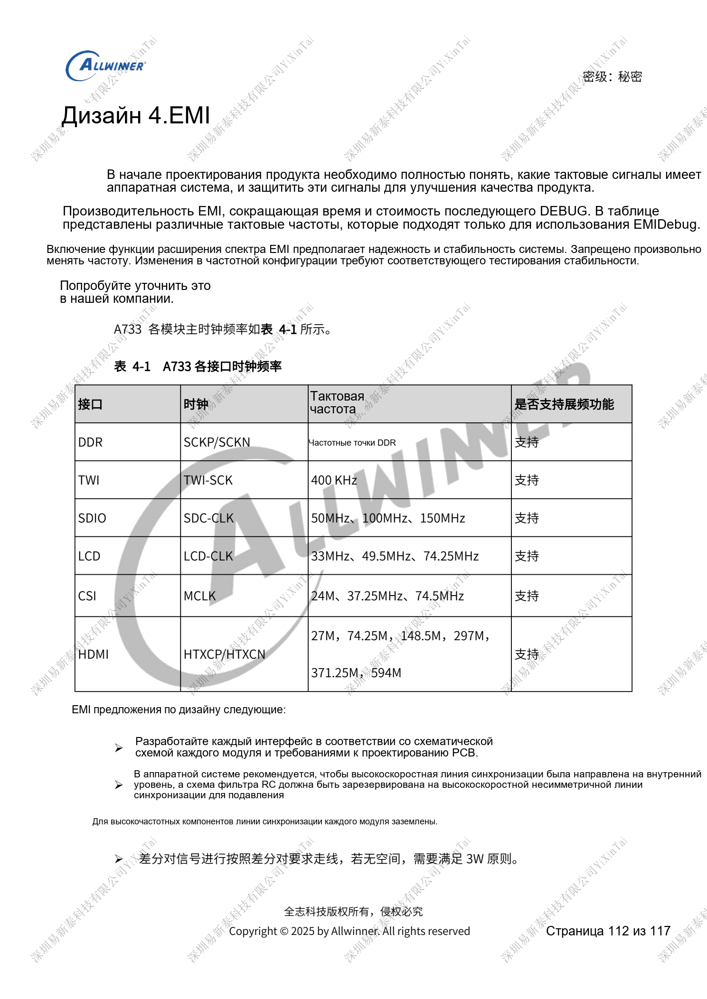
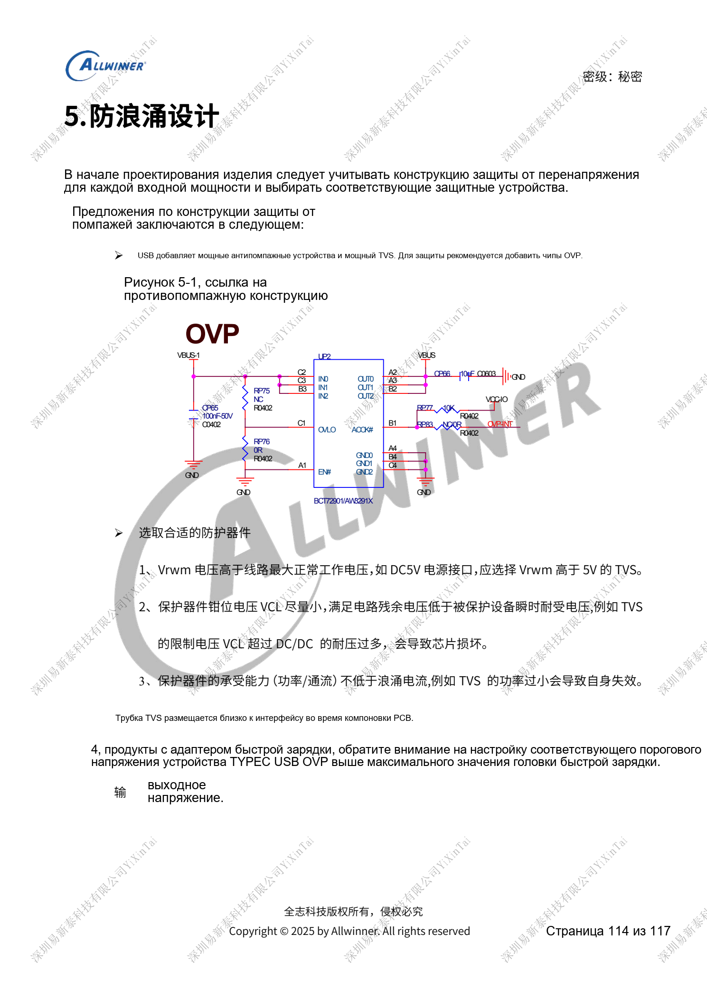

# Надёжность A733: ESD, EMI, импульсы и теплоотвод

Это тематический материал по исходному руководству, справка по платформе; соответствующая плата ArmSoM не подтверждена. Параметры взяты из источника, не из испытаний ArmSoM. Перед применением проверьте ревизию SoC, PCB, SDK/BSP, ядро, прошивку и периферию.

Источник A733 — черновик V0.9; параметры и поддержка ПО могут меняться. Это не окончательное обязательство для серийного изделия.

**Design draft V0.9 §3–6; PDF 110–116**

## ESD — не только TVS у порта

Защитите открытые цепи наушников, USB, TF, MIC и кнопок. На детекторах резервируйте последовательные резисторы; reset SoC сохраняет 1nF. Не выводите длинные трассы от неиспользуемых TEST. Защиту дочерней платы размещайте на ней и отводите разряд через проводящую пену к металлу дисплея, а не через FPC. По периметру обеих сторон PCB предусмотрите несколько площадок земли минимум 25mm² с переходами к сплошной земле. Сброс дисплея, touch, камер и watchdog — восстановление, не доказательство прохождения ESD.

## EMI начинается с перечня тактов

Быстрые такты ведите внутри платы с резервом RC у источника, непрерывной опорой и защитой землёй; при нехватке места проверяйте зазоры пар. Избегайте деталей и трасс под шлейфами, длинные шлейфы экранируйте, дочерние платы заземляйте. Провода динамиков скручивайте. Таблица тактов служит диагностике, не разрешает произвольное изменение DDR/дисплейной частоты или spread spectrum по спектральному пику. Нужна проверка устойчивости. В общей USB/BMU DP/DM резисторы ответвления BMU ставятся у развилки.

## Границы оценки импульсов и нагрева

Vrwm TVS выше максимального рабочего напряжения, остаток после ограничения ниже допустимого импульсного напряжения компонента, мощность и ток соответствуют воздействию. Защита у входа, OVP быстрой зарядки по максимальному выходу адаптера. Одного номинала TVS недостаточно. Измеряйте температуру всего изделия, фиксируйте снижение CPU/DDR, отключение ядер и производительность. DVFS не заменяет теплоотвод. Разделы 3.2 и 6 ссылаются на отдельные PCB/тепловые руководства без полных данных; статья не подтверждает тепловую квалификацию или сертификацию.

## Параметры

| Пункт | Данные источника |
| --- | --- |
| Такты EMI из источника | TWI 400kHz; SDIO 50/100/150MHz; LCD 33/49.5/74.25MHz; CSI MCLK 24/37.25/74.5MHz; HDMI 27/74.25/148.5/297/371.25/594MHz |

## Исходные иллюстрации

Снимки справочных страниц сохраняют китайские подписи. Соответствующий английский выпуск не найден; четыре языка используют китайские оригиналы. Параметры и шаги в тексте копируются, снимки служат сверке. Номера — физические страницы PDF.

## Выбор платформы ArmSoM

Для проекта ArmSoM выбирайте платформу по официальным продуктам и документации, заново проверяя процессор, интерфейсы и ПО. Схемы A733/H618 нельзя автоматически переносить на другой SoC.

- [ArmSoM](https://www.armsom.org/)
- [ArmSoM Docs](https://docs.armsom.org/)

## Материалы серии

- [Питание A733: AXP318W, последовательности и зарядка](/ru/articles/a733-power-sequence-pmic-design/)
- [Память A733: LPDDR4/4X/5, eMMC и UFS](/ru/articles/a733-ddr-emmc-ufs-design/)
- [A733: такты 26MHz, домены GPIO и восстановление FEL](/ru/articles/a733-clock-gpio-recovery-design/)
- [Дисплеи и камеры A733: мультиплексирование, питание и мосты](/ru/articles/a733-display-camera-interface-design/)
- [Периферия A733: USB, PCIe, Wi-Fi, Ethernet и аудио](/ru/articles/a733-usb-pcie-network-audio-design/)
- [A733 · Обзор серии](/ru/articles/a733-hardware-design-series/)
