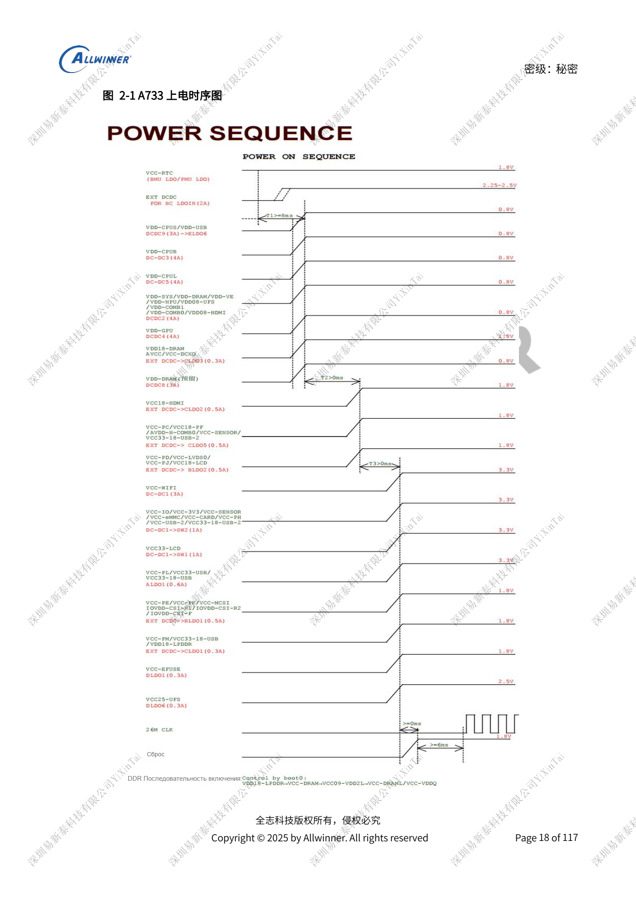
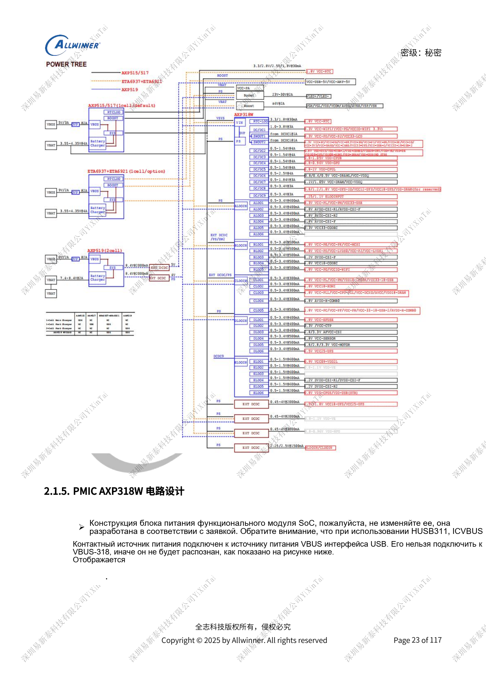
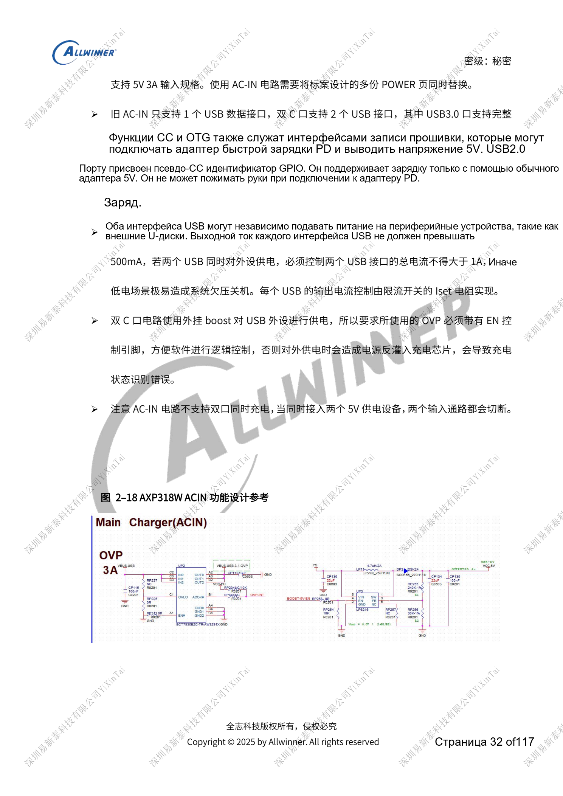

# Питание A733: AXP318W, последовательности и зарядка

Это тематический материал по исходному руководству, справка по платформе; соответствующая плата ArmSoM не подтверждена. Параметры взяты из источника, не из испытаний ArmSoM. Перед применением проверьте ревизию SoC, PCB, SDK/BSP, ядро, прошивку и периферию.

Источник A733 — черновик V0.9; параметры и поддержка ПО могут меняться. Это не окончательное обязательство для серийного изделия.

**Design draft V0.9 §2.1; PDF 17–41**

## Сохраните эталонное дерево питания

AXP318W содержит девять DCDC, два Switch и 29 LDO; DCDC2–9 используют COT. Не переставляйте запрограммированные линии и не переносите DCXO/PLL только из-за одинакового напряжения. VCC-RTC включается первой и остаётся активной. Reset снимается после трёх шагов питания; основной генератор запускается через 6ms после PMU_RESET. BOOT0 включает DDR при VDD18-LPDDR≥VCC-DRAM≥VCC09-VDD2L≥VCC-VDDQ. При программном выключении Reset снижается, затем через STEP отключается питание. Удержание 6s и извлечение батареи не относятся к этой последовательности.

## Обратная связь и устойчивость

DCDC2/3/4/5 получают обратную связь с выводов SYS/CPUB/GPU/CPUL SoC. DCDC7 измеряет напряжение у конденсатора нагрузки SoC/DRAM, а не у PMU. Для COT DCDC2–9 возле PMU ставится один 22µF, остальные большие ёмкости — у нагрузки. Бесконтрольное увеличение ёмкости нарушает устойчивость. Входы неиспользуемых DCDC/LDO остаются запитанными. Путь SW1/SW2 через G15/H15 рассчитан минимум на 2A. ALDO2/3/4 питаются от ALDO1 для PSRR, DLDO — от PS.

## Входы, зарядка и скачки нагрузки

VBUS HUSB311 подключается к VBUS разъёма, не VBUS-318. Перемычка DCIN–PS допустима только в проверенной схеме с предшествующим charger/OVP, не в варианте без зарядного блока. Два Type-C не поддерживают одновременную зарядку; USB2.0 с псевдо-CC не согласует PD. Выход ≤500mA на порт, суммарно ≤1A. AXP515: пример 5V/2A; двухэлементный AXP519: PD 9V/2A с соответствующим OVP. Провалы при старте подсветки/усилителя измеряются по всей цепи батарея–защита–разъём–BMU–PMU. AXP2602 в двухэлементной схеме подключает IRQ к CPUS, не напрямую к системному IRQ.

## Параметры

| Пункт | Данные источника |
| --- | --- |
| Дроссели DCDC1/6/7/8/9 | 1µH; 4A; load ≤80%; DCR <100mΩ |
| Дроссели DCDC2/3/4/5 | 0.33µH; 4A; load ≤80%; DCR <100mΩ |
| Порог отключения без батареи | 2.8V; software configurable |
| Дроссель AXP519 | 2.2µH; ≥3.5A; load ≤80% saturation current; DCR <100mΩ |

## Исходные иллюстрации

Снимки справочных страниц сохраняют китайские подписи. Соответствующий английский выпуск не найден; четыре языка используют китайские оригиналы. Параметры и шаги в тексте копируются, снимки служат сверке. Номера — физические страницы PDF.

## Выбор платформы ArmSoM

Для проекта ArmSoM выбирайте платформу по официальным продуктам и документации, заново проверяя процессор, интерфейсы и ПО. Схемы A733/H618 нельзя автоматически переносить на другой SoC.

- [ArmSoM](https://www.armsom.org/)
- [ArmSoM Docs](https://docs.armsom.org/)

## Материалы серии

- [Память A733: LPDDR4/4X/5, eMMC и UFS](/ru/articles/a733-ddr-emmc-ufs-design/)
- [A733: такты 26MHz, домены GPIO и восстановление FEL](/ru/articles/a733-clock-gpio-recovery-design/)
- [Дисплеи и камеры A733: мультиплексирование, питание и мосты](/ru/articles/a733-display-camera-interface-design/)
- [Периферия A733: USB, PCIe, Wi-Fi, Ethernet и аудио](/ru/articles/a733-usb-pcie-network-audio-design/)
- [Надёжность A733: ESD, EMI, импульсы и теплоотвод](/ru/articles/a733-esd-emi-thermal-review/)
- [A733 · Обзор серии](/ru/articles/a733-hardware-design-series/)

<!-- editable-source-tables -->

## Приложение: развязка у SoC

V0.9 · PDF 53

Источник говорит «не менее», сохранено ≥. Проверяйте снижение ёмкости под DC, корпус и BOM; сумма номиналов не заменяет отдельные компоненты.

| Питание | Конденсаторы | Резерв |
| --- | --- | --- |
| VDD-CPUB | 2 × ≥22µF; 1 × 10µF; 1 × 4.7µF; 3 × 2.2µF; 2 × 1µF | 1–2 × 100nF |
| VDD-CPUL | 2 × ≥22µF; 1 × 10µF; 1 × 4.7µF; 4 × 2.2µF; 4 × 1µF | — |
| VDD-GPU | 1 × ≥10µF; 4 × 2.2µF | 2–3 × 100nF |
| VDD-VE | 1 × ≥10µF; 1 × ≥4.7µF; 1 × 2.2µF; 1 × 1µF | 1–2 × 100nF |
| VDD-SYS | 2 × ≥22µF; 3 × 10µF; 2 × 4.7µF; 1 × 2.2µF; 3 × 1µF | 3–4 × 100nF |
| VCC-DRAM | 1 × ≥22µF; 1 × 10µF; 1 × 2.2µF; 4 × 1µF | 2–3 × 100nF |
