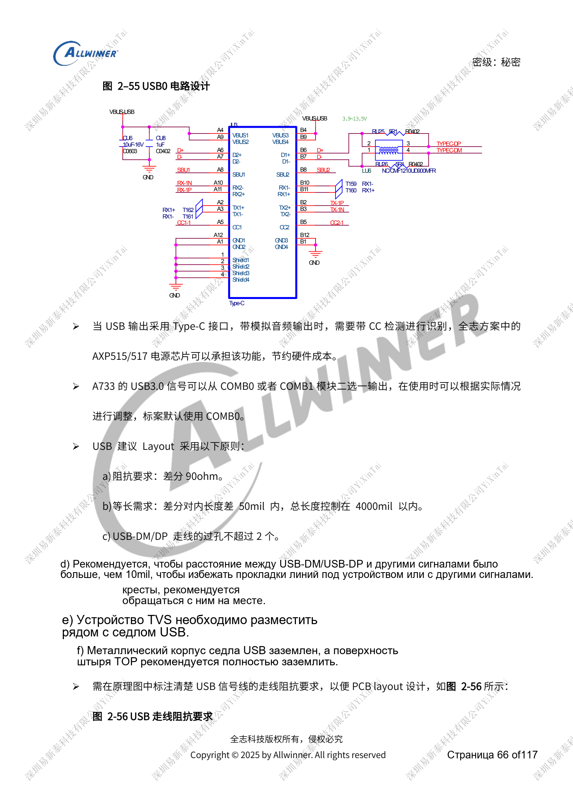
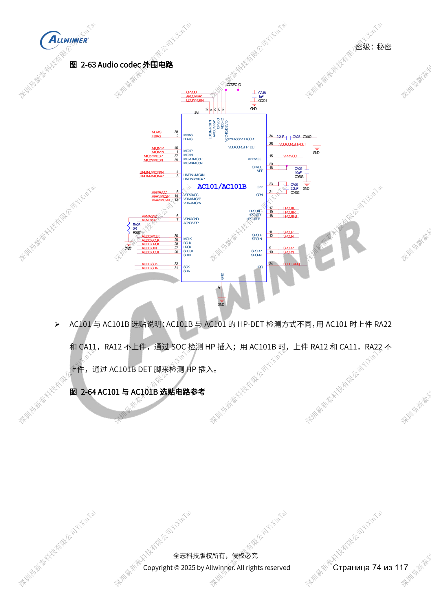
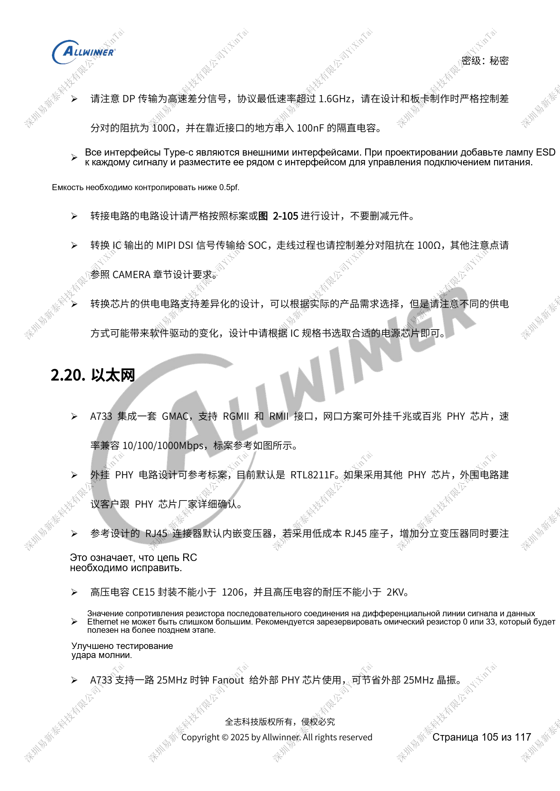
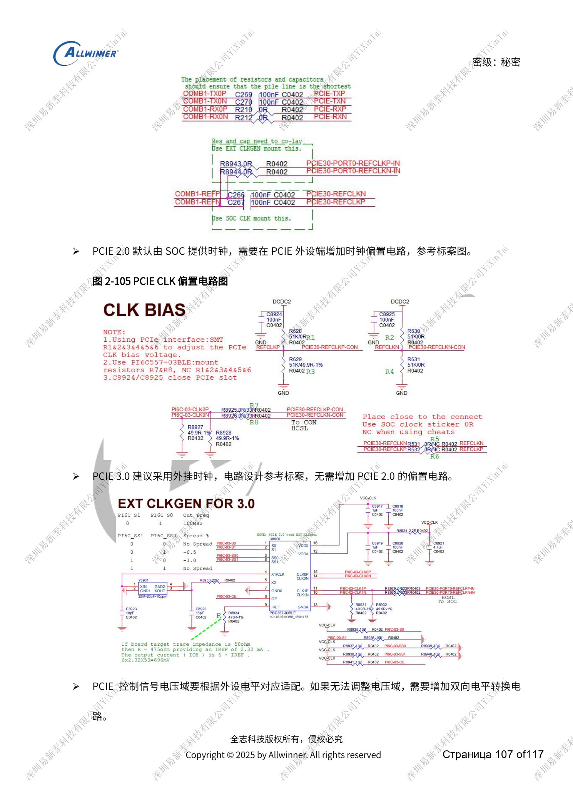

# Периферия A733: USB, PCIe, Wi-Fi, Ethernet и аудио

Это тематический материал по исходному руководству, справка по платформе; соответствующая плата ArmSoM не подтверждена. Параметры взяты из источника, не из испытаний ArmSoM. Перед применением проверьте ревизию SoC, PCB, SDK/BSP, ядро, прошивку и периферию.

Источник A733 — черновик V0.9; параметры и поддержка ПО могут меняться. Это не окончательное обязательство для серийного изделия.

**Design draft V0.9 §2.7–2.9, §2.14, §2.16–2.17, §2.20–2.21; PDF 65–80, 96–97, 101–108**

## Контроллеры USB и такт PCIe

USB0/1 — USB2.0, USB2-U3 — путь USB3.1 до 10Gbps. USB0/2 имеют OTG, USB1 только HOST, прошивка через USB0. Пробуждение поддерживают USB0/1, но не USB2. Type-C объединяет USB0 и USB2-U3; SuperSpeed выбирается COMB0/1, по умолчанию COMB0. Номер контроллера не равен поколению протокола. Защита USB2 DP/DM <5pF, SuperSpeed <1pF; общие 90Ω USB2 не заменяют 95Ω совместных высокоскоростных пар. PCIe: одна линия 2.0/3.0; 2.0 использует такт SoC и смещение у устройства, 3.0 — предпочтительно внешний такт без этой цепи.

## Беспроводная связь, Ethernet и датчики

SDIO Wi-Fi согласуется с PG, пробуждение с PM; подтяжка 32KFOUT 1.8V сохраняется в standby. PCM DOUT/DIN, UART TX/RX и RTS/CTS перекрещиваются, такты и sync соединяются одноимённо. Предусмотрите π-согласование и измерения нового RF-тракта. SDIO CLK: 33Ω, D0–D3 относительно CLK <500mil. GMAC использует внешний PHY, пример RTL8211F, возможен такт 25MHz от SoC; RJ45 без магнитики требует трансформатора. VCC/IOVCC датчиков проверяются отдельно, адреса не конфликтуют; standby-датчики питаются постоянно с прерыванием PL. GPS — внешний модуль с RF 50Ω, проверкой пускового тока и обратного питания reset.

## Аудио: возврат тока и enable

AC101 имеет два ADC/два DAC; AC101B — три ADC/два DAC и другую установку детектора наушников. AEC использует AC107. EN усилителя без TWI подтягивается вниз против POP; мощный усилитель не нагружает PMU PS/DCIN. Питание от батареи берётся после измерения тока. HPOUTFB заземляется у гнезда, в L/R не ставятся ферриты; без гнезда сохраняются обратная связь и RC. Type-C audio switch по умолчанию пропускает USB для прошивки и остаётся запитанным для пробуждения. С DP используется BCT4690, не WAS4766C. Комплектация проверяется вместе с программной полярностью детектора.

## Исходные иллюстрации

Снимки справочных страниц сохраняют китайские подписи. Соответствующий английский выпуск не найден; четыре языка используют китайские оригиналы. Параметры и шаги в тексте копируются, снимки служат сверке. Номера — физические страницы PDF.

## Выбор платформы ArmSoM

Для проекта ArmSoM выбирайте платформу по официальным продуктам и документации, заново проверяя процессор, интерфейсы и ПО. Схемы A733/H618 нельзя автоматически переносить на другой SoC.

- [ArmSoM](https://www.armsom.org/)
- [ArmSoM Docs](https://docs.armsom.org/)

## Материалы серии

- [Питание A733: AXP318W, последовательности и зарядка](/ru/articles/a733-power-sequence-pmic-design/)
- [Память A733: LPDDR4/4X/5, eMMC и UFS](/ru/articles/a733-ddr-emmc-ufs-design/)
- [A733: такты 26MHz, домены GPIO и восстановление FEL](/ru/articles/a733-clock-gpio-recovery-design/)
- [Дисплеи и камеры A733: мультиплексирование, питание и мосты](/ru/articles/a733-display-camera-interface-design/)
- [Надёжность A733: ESD, EMI, импульсы и теплоотвод](/ru/articles/a733-esd-emi-thermal-review/)
- [A733 · Обзор серии](/ru/articles/a733-hardware-design-series/)
