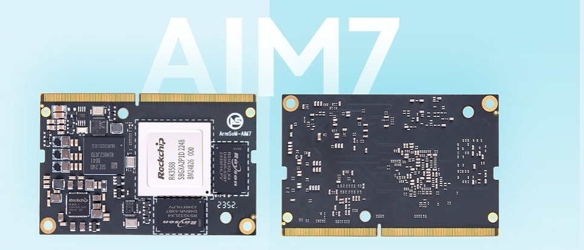

ArmSoM AIM7 — платформа RK3588 для оценки в проектах с Jetson Nano либо конкретным модулем Orin. CPU, GPU и NPU решают разные задачи. Пригодность определяется моделью, периферией, зависимостями ПО и требованиями всей системы.

## Nano и Orin — разные цели совместимости

Документация AIM7 описывает 260-контактный SO-DIMM и путь совместимости с Jetson Nano, одновременно требуя проверки контактов, питания и периферии конкретной несущей платы. **Совпадение разъёма не доказывает универсальную совместимость.**

Семейство Orin включает Orin Nano, Orin NX, AGX Orin и другие варианты. Здесь AIM7 не объявляется универсальной заменой без переделки. Сначала определите модуль и проверьте плату. Для непроверенной комбинации начните программную оценку на подтверждённой плате AIM7.

## Какие проекты оценивать

Подходящие отправные точки — Linux-приложения с основной логикой на CPU, экспортируемой моделью, гибким выбором камер/экрана и проверяемыми требованиями. Возможны классификация, обнаружение объектов, информационные терминалы и анализ видеособытий.

Собственные CUDA-операторы, плагины TensorRT и специфичные NVIDIA-конвейеры увеличивают объём переноса. Сравнивайте затраты разработки, испытаний и сопровождения, а не только цену модуля. Равенство со всеми Orin обещать нельзя.

## Переход с TensorRT на RKNN

| Исходный компонент | Путь для AIM7 |
|---|---|
| Логика Python/C++ | Пересобрать и проверить зависимости целевого Linux |
| Исходная обученная модель | Экспортировать поддерживаемое представление и конвертировать RKNN-Toolkit2 |
| TensorRT engine / CUDA-операторы | Нельзя напрямую использовать как RKNN; адаптировать backend и операторы |
| Камера, экран, видео | Проверить драйверы Rockchip и ускорение |
| Контейнеры | Пересобрать под архитектуру, библиотеки и доступ к устройствам |

Конвертация выполняется на компьютере разработчика, исполнение — через C/C++ или Python на плате. Успешная конвертация не заменяет проверку операторов, точности квантования, предварительной и последующей обработки.

## Решение на одинаковом наборе данных

1. Зафиксируйте исходную модель Jetson, версии ПО и реальные входы.
2. Измерьте точность, задержку P50/P95, пропускную способность, память и мощность всей системы.
3. На AIM7 используйте те же данные и критерии; сравнивайте результаты до скорости.
4. Добавьте камеру, сеть, запись и экран, измерьте полный конвейер.
5. Проверьте длительную нагрузку, восстановление, обновление и откат.

Коэффициент превосходства здесь не выдумывается. Деление TOPS при разных точностях, разреженности и режимах питания не определяет пригодность. Важны приемлемые результаты приложения.

## Следующий шаг

Соберите структуру модели, размеры входов, периферию, точную Jetson SKU и целевые показатели. Затем выбирайте AIM7 и плату. Sige7 подходит для раннего прототипа ПО RK3588, LM7 — для оценки будущего изделия с припаянным модулем.

## Статьи серии и продукты

- [RK3588: восьмиядерный CPU, NPU 6 TOPS и скоростные интерфейсы](/ru/articles/rk3588-chip-guide/)
- [Sige7 и LM7: шесть путей от прототипа RK3588 к изделию](/ru/articles/sige7-lm7-rk3588-applications/)
- [RK3588 Datasheet V1.4: загрузка, блок-схема, корпус и электрические параметры](/ru/articles/rk3588-datasheet-v14/)
- [ArmSoM AIM7](https://docs.armsom.org/armsom-aim7) · [Sige7](https://docs.armsom.org/armsom-sige7) · [LM7](https://docs.armsom.org/armsom-lm7)

## Источники

- [Rockchip RK3588](https://www.rock-chips.com/a/en/products/RK35_Series/2022/0926/1660.html)
- [ArmSoM AIM7](https://docs.armsom.org/armsom-aim7)
- [ArmSoM Sige7](https://docs.armsom.org/armsom-sige7)
- [ArmSoM LM7](https://docs.armsom.org/armsom-lm7)
- [NVIDIA Jetson modules](https://developer.nvidia.com/embedded/jetson-modules)
- [RKNN-Toolkit2](https://github.com/airockchip/rknn-toolkit2)
