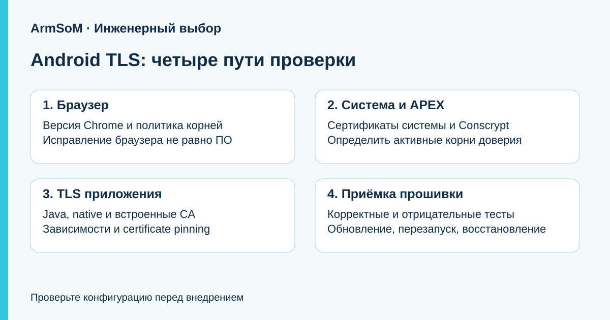

**Сопровождение доверия Android начинается с определения хранилища каждой рабочей TLS-сессии и доставки исправления на устройства, а не с удаления двух файлов.** Chrome, системный TLS и приложение со своим набором CA могут обновляться независимо даже на одной плате ArmSoM.

Руководство предназначено для сопровождающих собственные Android-прошивки. Команды проверяют разрешённые устройства и SDK; они не доказывают завершённую проверку образа ArmSoM. Предоставленная статья задаёт направление расследования, а меры определяются уведомлениями, веткой SDK и зависимостями приложения.



## 1. Устанавливаем факты и границы исправления

Google подтвердил инцидент с промежуточными ключами eMudhra и описал отдельные механизмы блокировки в Chrome и Android. Это не подтверждает обновление всех Android-приложений. Уведомление дополнялось изменениями политики; проверьте его перед выпуском. [Уведомление Google](https://blog.google/security/protecting-chrome-and-android-users-from-compromised-emudhra-intermediate-ca-certificates/)

Различайте корневой, промежуточный и конечный сертификаты и открытый ключ. Перекрёстная подпись позволяет одному ключу присутствовать в разных цепочках. Блокировка SPKI и удаление корня имеют разный охват и последствия.

Скриншот предлагает удалить `b74d2bd5.0` и `75680d2e.0`: в описанной среде это emSign ECC Root CA - G3 и AAA Certificate Services. **Имена файлов не являются универсальным списком удаления.** Корень AAA может обслуживать другие законные цепочки; сопровождающий BSP должен оценить блокировку и совместимость.

## 2. Составляем перечень устройств и соединений

```bash
adb devices
adb shell getprop ro.build.fingerprint
adb shell getprop ro.build.version.release
adb shell getprop ro.build.version.security_patch
adb shell pm list packages com.google.android.gms
adb shell ls -ld /system/etc/security/cacerts
adb shell ls -ld /apex/com.android.conscrypt/cacerts
```

Сохраняйте ошибки: отсутствие доступа или пути само по себе ничего не говорит о защищённости. Версия Android и дата исправлений идентифицируют сборку, но не состояние модулей и обратных переносов. Начиная с Android 14 следует учитывать обновляемое хранилище Conscrypt, а не только `/system`. [AOSP Conscrypt](https://source.android.com/docs/core/ota/modular-system/conscrypt)

| Соединение | Объект проверки | Приёмка |
| --- | --- | --- |
| Страница Chrome | Версия, политика корней, обновления блокировки | Целевой браузер |
| Системный TLS Java/Kotlin | Провайдер, APEX, сетевые настройки приложения | Запрос реального приложения |
| Native или кроссплатформенный компонент | TLS-библиотека, встроенные CA, версия зависимости | Положительные и отрицательные тесты этой библиотеки |
| Частный корпоративный сервис | Частный CA, pinning и смена ключей | Основной и резервный сертификаты |

Наличие `com.google.android.gms` не доказывает доставку обновления или защиту отдельного TLS-стека. Firebase также рекомендует проверять зависимости приложения, а не только обновления ОС. [Рекомендации Firebase](https://firebase.google.com/support/guides/compromised-emudhra-intermediate-ca)

## 3. Идентифицируем сертификат и ключ

Проверяйте на рабочей станции сертификаты из целевого SDK или общедоступных системных каталогов устройства. `candidate.pem` — проверяемый файл, а не указание установить новый корень.

```bash
openssl x509 -in candidate.pem -noout \
  -subject -issuer -serial -dates -fingerprint -sha256
openssl x509 -in candidate.pem -noout -subject_hash_old
openssl x509 -in candidate.pem -pubkey -noout |
  openssl pkey -pubin -outform DER |
  openssl dgst -sha256
```

Первая команда выводит SHA-256 сертификата, третья — SHA-256 структуры SPKI открытого ключа. Это разные величины. Сверяйте их с точным перечнем уведомления или сопровождающего. Имя на основе subject hash не уникально: возможны одинаковые субъекты, коллизии и числовые суффиксы. [OpenSSL x509](https://docs.openssl.org/3.0/man1/openssl-x509/)

Сначала найдите сертификаты SDK, затем разбирайте содержимое. Поиска `emudhra` в именах недостаточно:

```bash
export SDK_ROOT=/path/to/android-sdk
find "$SDK_ROOT/system/ca-certificates" \
  "$SDK_ROOT/external/conscrypt" \
  -type f \( -name '*.0' -o -name '*.pem' -o -name '*.crt' \) -print
```

Исправьте пути под реальную ветку. Проверьте также собранный образ и активный модуль: изменение неиспользуемой копии исходников не меняет доверие устройства.

## 4. Включаем исправление в обновление продукта

1. Зафиксируйте прошивку и затронутые подключения; сохраните отпечатки публичных сертификатов и записи сборки.
2. Используйте соответствующий патч поставщика или обновление компонента. Укажите, меняет ли оно корни, блокирует промежуточные CA или обновляет зависимость.
3. Проверьте system, APEX и отдельные наборы CA вместе с подписью, AVB и OTA.
4. Выполните регрессию на тестовых устройствах, развёртывайте поэтапно и сохраните восстановление и учёт версий.

Отключение проверки сертификата или имени сервера не является исправлением совместимости. Pinning требует ротации, запасных ключей и обработки отказов. [Android Network Security Configuration](https://developer.android.com/privacy-and-security/security-config) задаёт доверие отдельного приложения, но не исправляет остальные процессы.

## 5. После файлов проверяем реальные соединения

Посмотреть цепочку своего сервера можно на рабочей станции:

```bash
openssl s_client -connect your-server.example:443 \
  -servername your-server.example -showcerts \
  -verify_hostname your-server.example -verify_return_error </dev/null
```

Замените пример домена своим сервисом. Серверы часто не передают корень; порядок вывода и последний issuer не доказывают выбранную устройством цепочку. Результат рабочей станции не заменяет тест Android-приложения.

| Проверка | Сохраняемые доказательства |
| --- | --- |
| Законное HTTPS-соединение | Приложение, TLS-библиотека, имя, время, результат |
| Контролируемая неверная цепочка или имя | Отказ в лаборатории; исчезновения файла недостаточно |
| Обновление и перезапуск | Исправление активно, старая политика не восстановилась |
| Восстановление и совместимость | Сброс, резервный сертификат, OTA и синхронизация времени |

Атаковать публичный сервис не требуется. Отсутствие работающего затронутого сайта не ограничивает проверку именами файлов: можно подготовить контролируемые тесты политики и проверить ошибки в настоящем приложении. Для офлайн-продуктов тоже нужен план будущего подключения, обслуживания и обновлений.

Материал переработан из [предоставленной статьи](https://mp.weixin.qq.com/s/URwEId_RlZYRRrHSUy5Jig) с уточнением универсального удаления, охвата GMS и границ проверки по официальным источникам. Сертификаты на устройствах не удалялись; конкретная прошивка не объявляется исправленной.

## Продукты и дальнейшее чтение

Для проекта ArmSoM можно оценить [Sige7](https://www.armsom.org/sige7), [AIM7](https://www.armsom.org/aim7) и [LM7](https://www.armsom.org/lm7) на RK3588 либо [CM5](https://www.armsom.org/cm5) и [Sige5](https://www.armsom.org/sige5) на RK3576. Интерфейсы и доступные образы проверяйте в документации [Sige7](https://docs.armsom.org/armsom-sige7), [CM5](https://docs.armsom.org/armsom-cm5) и [Sige5](https://docs.armsom.org/armsom-sige5). Ссылки помогают выбрать продукт, но не подтверждают проверку всех описанных сочетаний SDK на этих платах.
