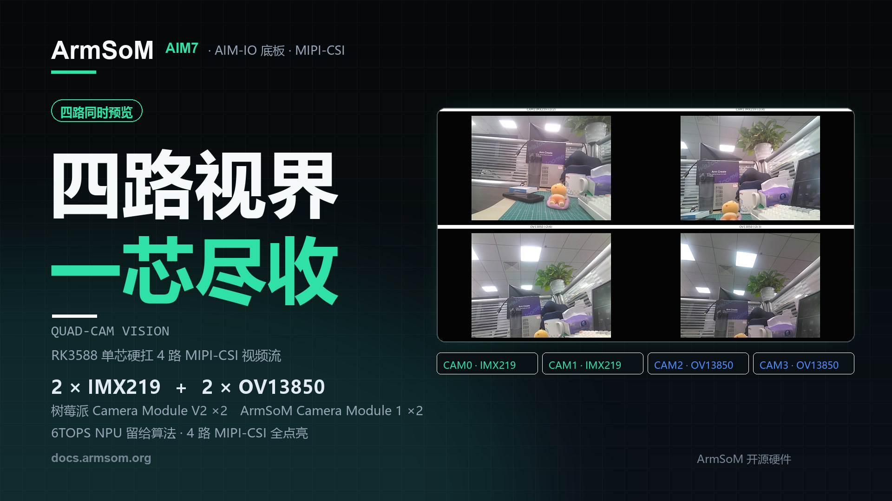
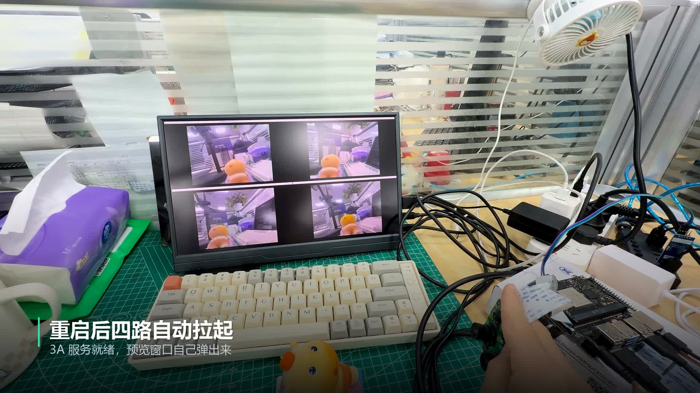

Четыре камеры, четыре ракурса и один экран. В этой демонстрации **ArmSoM AIM7 с платой-носителем AIM-IO** одновременно выводит изображение с двух IMX219 и двух OV13850, подключённых по MIPI-CSI к одной платформе RK3588.

Для робототехники, машинного зрения и прототипов с несколькими точками наблюдения это удобный первый этап: подключить камеры, оценить изображения вместе и настроить систему, прежде чем добавлять сбор данных, анализ и управление.



## Видео: от настройки до четырёх окон

<video controls playsinline preload="metadata" width="1920" height="1080" poster="/assets/armsom-aim7-four-camera-preview/cover.jpg" style="display:block;width:100%;height:auto;aspect-ratio:16/9;margin:1.5rem auto;background:#101820" aria-label="Четыре камеры на ArmSoM AIM7: прототип машинного зрения на RK3588">
  <source src="/assets/armsom-aim7-four-camera-preview/demo.mp4" type="video/mp4">
  <a href="/assets/armsom-aim7-four-camera-preview/demo.mp4">Скачать или открыть оригинальное видео</a>
</video>

*Оригинальное демонстрационное видео ArmSoM длительностью около 34 секунд. Китайские надписи в кадре сохранены. Показаны документация, запуск программы и четыре изображения с камер.*

Два верхних окна относятся к IMX219, два нижних — к OV13850. При перемещении игрушки перед объективами видны различия в положении, масштабе и перекрытии объекта. Так можно оценивать размещение камер и охват сцены, а не только наличие изображения с отдельного сенсора.

## Из чего состоит система?

| Компонент | Конфигурация демонстрации | Назначение |
| --- | --- | --- |
| Вычислительная платформа | ArmSoM AIM7, Rockchip RK3588 | Драйверы камер, обработка изображения и программа просмотра |
| Плата-носитель | AIM-IO | Подключение камер, дисплея и периферии |
| Верхние камеры | 2 × Raspberry Pi Camera Module V2, IMX219 | Два ракурса |
| Нижние камеры | 2 × ArmSoM Camera Module 1, OV13850 | Ещё два ракурса |
| Экран | 1920 × 1080, четыре одинаковых окна | Просмотр с сохранением пропорций изображения |
| Выход для просмотра | Масштабирование выхода ISP каждой камеры до 640 × 480 | Многооконный просмотр в данном примере |

AIM7 объединяет четыре ядра Cortex-A76, четыре Cortex-A55 и NPU с производительностью до 6 TOPS (INT8). Интерфейсы выводятся через плату-носитель. Здесь рассматривается именно **сочетание AIM7 и AIM-IO**; схему подключения и настройки образа нельзя автоматически переносить на любую другую плату. [Характеристики AIM7](https://www.armsom.org/aim7)

[](/assets/armsom-aim7-four-camera-preview/demo-still.png)

*Собранная система и четыре окна просмотра из предоставленных материалов. Исходное подключение и содержимое экрана сохранены.*

## Как понимать параметры предварительного просмотра?

Для этой конфигурации официальная документация указывает примерно **15 FPS для IMX219 и 25 FPS для OV13850**. Цифры относятся к показанным режимам изображения, ПО и способу отображения. Они не гарантируют запись с полным разрешением всех четырёх камер и не являются результатами тестирования нейросетевого вывода. [Официальная инструкция](https://docs.armsom.org/zh/armsom-aim7#aim-io-四路摄像头同时预览)

Одновременный вывод изображений не подтверждает аппаратную синхронизацию кадров между сенсорами. Для стереоизмерений, анализа быстрого движения, сшивки и объединения данных необходимо отдельно оценить временные метки, экспозицию, запуск съёмки, калибровку и сквозную задержку.

Видео демонстрирует получение и просмотр изображений. В нём нет результатов ИИ-распознавания, длительных испытаний стабильности или измерений скорости многопоточной записи. Эти параметры следует проверять при разрешении, частоте кадров, охлаждении и алгоритмической нагрузке вашего проекта.

## Повторение: сначала определить устройства, затем запустить просмотр

1. Подготовьте AIM7, AIM-IO, указанные камеры, подходящие шлейфы, дисплей и источник питания. Перед подключением шлейфов отключите питание.
2. Выберите подходящий образ по документации AIM7. Включите четыре camera overlay в `/boot/uEnv/uEnvarmsom-aim7-io.txt` в соответствии со схемой подключения, перезагрузитесь и проверьте обнаружение камер.
3. Убедитесь, что имя модуля IMX219 соответствует `imx219_rpi-camera-v2_default.json`, а служба 3A работает.
4. Скачайте скрипт четырёхоконного просмотра из официальной документации. Перейдите в его каталог в **терминале графического рабочего стола платы**. Пример GTK требует графического сеанса; текстовая консоль TTY сама по себе не создаёт окон рабочего стола.

В официальной инструкции приведены следующие команды. Для установки зависимостей нужен доступ к подходящим репозиториям пакетов:

```bash
sudo apt-get install -y python3-gi gir1.2-gtk-3.0 gir1.2-gstreamer-1.0 gir1.2-gst-plugins-base-1.0
sudo systemctl restart rkaiq_3A.service
python3 aim7-four-camera-preview.py
```

Для остановки нажмите `Ctrl+C`. В примере используются `/dev/video53`, `/dev/video62`, `/dev/video44` и `/dev/video71`, но номера могут меняться между образами. Проверьте устройства командой `v4l2-ctl --list-devices`, а топологию — `media-ctl -p`, при необходимости выбрав нужное media-устройство. Укажите фактические выходные узлы ISP в скрипте. В документации также отмечено, что этот четырёхкамерный пример ещё не проверен на AIM5.

## Какие проекты можно развивать дальше?

### Роботы и мобильные устройства: сначала проверить обзор

Расположите камеры в разных направлениях и оцените, не закрывает ли корпус часть сцены и не теряется ли объект между зонами обзора. Просмотр помогает выбрать места крепления до реализации распознавания, слежения или объединения данных сенсоров.

### Прототипы машинного зрения: разные поверхности одного объекта

Направьте камеры на фронтальную, боковую или сборочную область детали и оцените свет, фокус и положение. Для обнаружения дефектов дополнительно нужны репрезентативные данные, проверенные алгоритмы и схема запуска съёмки. Точность обнаружения и производственный такт в демонстрации не измерялись.

### Обучение и разработка: изучение тракта изображения

Два типа сенсоров на одной платформе подходят для экспериментов с деревом устройств, узлами V4L2, ISP, 3A и GStreamer. Можно сравнить работу одной и нескольких камер, а затем добавить сохранение снимков, запись видео и другие функции.

### Периферийный ИИ: подключить вывод после проверки захвата

После стабильного получения изображения используйте [руководство ArmSoM по RKNN](https://docs.armsom.org/advanced-manual/rknn-sdk) для развёртывания поддерживаемых моделей. Сначала проверьте корректность и задержку одного потока, затем добавляйте остальные и измеряйте весь тракт. 6 TOPS — характеристика аппаратуры; результат зависит от операторов, квантования, размера входа и распределения ресурсов.

## Начните свой проект машинного зрения

Используйте демонстрацию для проверки размещения камер и программного тракта, затем развивайте сбор и обработку данных под свою задачу.

- [Продукт ArmSoM AIM7](https://www.armsom.org/aim7)
- [AIM7, AIM-IO и инструкция для четырёх камер](https://docs.armsom.org/zh/armsom-aim7#aim-io-四路摄像头同时预览)
- [Развёртывание моделей RKNN](https://docs.armsom.org/advanced-manual/rknn-sdk)
- [Локальная консоль в образах ArmSoM Server](/ru/articles/armsom-server-hdmi-tty-console/)

По вопросам выбора платформы и сотрудничества пишите на [sales@armsom.org](mailto:sales@armsom.org). Укажите количество камер, разрешение, требования к синхронизации и планируемые алгоритмы — это поможет оценить систему целиком.
