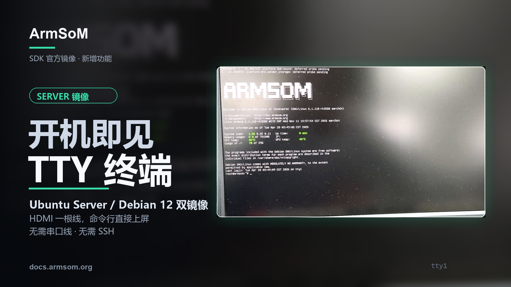
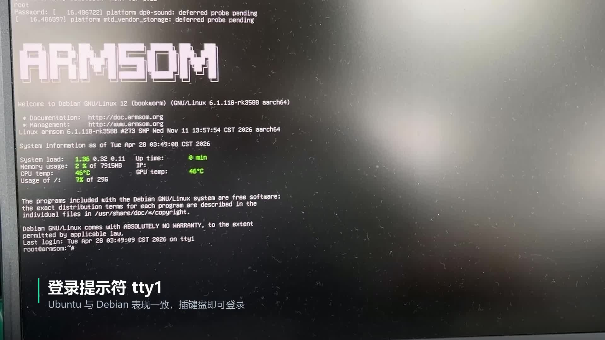

Образ Server уже записан, но сеть ещё не настроена и IP-адрес платы неизвестен. Как войти в систему? Демонстрация ArmSoM показывает прямой способ: **подключить HDMI-дисплей и USB-клавиатуру, войти в локальную TTY и начать работу с Linux.**

Статья основана на предоставленных ArmSoM тексте и видео и знакомит с локальной консолью в образах Ubuntu Server / Debian 12. В кадре явно показан Debian 12; сопроводительные материалы также описывают Ubuntu Server. Поддерживаемые платы, версии образов и учётные записи уточняйте в разделе загрузок соответствующего продукта.



## Что показано в видео от загрузки до командной строки?

<video controls playsinline preload="metadata" width="1920" height="1080" poster="/assets/armsom-server-hdmi-tty-console/cover.jpg" style="display:block;width:100%;height:auto;aspect-ratio:16/9;margin:1.5rem auto;background:#101820" aria-label="Локальная консоль ArmSoM Server: вход в Linux через HDMI и USB-клавиатуру">
  <source src="/assets/armsom-server-hdmi-tty-console/demo.mp4" type="video/mp4">
  <a href="/assets/armsom-server-hdmi-tty-console/demo.mp4">Скачать или открыть оригинальное видео</a>
</video>

*Оригинальная демонстрация длительностью около 20 секунд с сохранёнными китайскими надписями. Показаны загрузочные сообщения через HDMI, запуск служб и приглашение Shell после входа в Debian 12.*

Текст на экране позволяет следить за этапами запуска. После появления приглашения входа введите имя пользователя и пароль с клавиатуры. В записи также видны логотип ArmSoM, версия системы и сведения о её состоянии.

При первом запуске можно проверить систему, узнать сетевой адрес и выполнить настройку ещё до подключения по SSH. Видео смонтировано: его длительность 20 секунд не является измерением времени холодного старта. Нагрузка, температура и время на экране — лишь состояние, отображённое при съёмке.

## Локальная TTY, SSH или рабочий стол?

В этом примере TTY — локальная текстовая консоль для выполнения Linux-команд после входа. `tty1` обозначает виртуальную консоль демонстрации; в другом образе конфигурация может отличаться.

| Способ | Условия | Подходящие задачи |
| --- | --- | --- |
| Локальная TTY через HDMI и USB-клавиатуру | Поддержка вывода на экран и локального входа в образе, подходящие интерфейсы платы | Первый вход, проверка сети и просмотр журналов на месте |
| SSH | Доступная сеть, работающая служба SSH и действующая учётная запись | Удалённое обслуживание, развёртывание и администрирование |
| Графический рабочий стол | Установленная графическая среда и работающие драйверы дисплея | Оконные приложения и графические инструменты |

Для локального выполнения команд рабочий стол не обязателен. Но TTY сама по себе не предоставляет браузер или графические окна. Для оконной программы просмотра камер нужен образ с соответствующей графической средой.

[](/assets/armsom-server-hdmi-tty-console/demo-still.png)

*Локальная консоль Debian 12 в исходной записи. Ядро, учётная запись и показатели относятся к этой демонстрации, а не ко всем платам и образам.*

## Что подготовить для первого входа

- Официальный образ ArmSoM Server для вашей платы с поддержкой локальной HDMI-консоли.
- Загрузочный носитель, подготовленный по инструкции продукта.
- HDMI-дисплей и подходящий кабель, подключённый к видеовыходу.
- Клавиатуру в USB Host и соответствующий источник питания.

До подачи питания проверьте вход монитора и кабель. Используйте учётную запись, указанную для конкретного образа. При вводе пароля символы обычно не отображаются — для терминала Linux это нормально. После первого входа измените стандартные данные доступа согласно требованиям проекта.

Дополнительные сведения: [ресурсы образов ArmSoM](https://docs.armsom.org/getting-start/cloud-disk) и [загрузка и вход](https://docs.armsom.org/getting-start/startup). Слова Ubuntu или Debian в имени файла не означают совместимость со всеми продуктами.

## Начните с проверок без изменения системы

Ниже приведены общие примеры Linux-команд, а не результаты тестов из видео. Выполняйте их на плате по очереди. Доступность зависит от установленных утилит; `systemctl` предназначен для систем с systemd.

```bash
cat /etc/os-release
uname -r
tty
ip -br address
df -h
free -h
systemctl --failed --no-pager
```

| Проверка | Что можно узнать |
| --- | --- |
| Дистрибутив и ядро | Фактические версии для сопоставления с документацией |
| Текущий терминал | Работает ли сеанс через локальную TTY |
| Сетевые адреса | Есть ли адрес для дальнейшего удалённого доступа |
| Диски и память | Базовое состояние ресурсов и свободного места |
| Неудачно запущенные службы | Какие проблемы требуют просмотра журналов |

Узнав фактический адрес, настройте удалённый доступ по официальной инструкции. Так устройство можно сначала подготовить локально, затем обслуживать удалённо, не связывая первый вход с уже работающей сетью.

## Три полезных сценария

**Первый запуск на рабочем столе.** Наблюдайте загрузку, проверяйте версии ПО, накопители и сеть, затем развёртывайте приложение. На занятиях терминал можно вывести на большой экран и объяснять выполняемые команды.

**Первичная настройка на объекте.** Устройство ещё не подключено к целевой сети, но его состояние уже можно проверить локально. При изменении сетевых параметров консоль позволяет продолжить работу, даже если удалённое соединение пропало.

**Диагностика служб на месте.** Если система загружается и консоль доступна, войдите для просмотра служб и журналов. Сбой до инициализации дисплея или до появления рабочего входа по-прежнему может потребовать последовательной отладки. HDMI TTY не заменяет все низкоуровневые средства диагностики.

## Если приглашение входа не появилось

Сначала проверьте питание, выбранный вход монитора и назначение HDMI-порта, затем модель платы, образ и загрузочный носитель. Если сообщения есть, а войти нельзя, проверьте конфигурацию консоли этого образа. Если клавиатура не работает, убедитесь, что используется USB Host.

Образы Server и графического рабочего стола могут вести себя по-разному; само по себе это не означает неисправность платы. Для обращения в поддержку подготовьте модель, имя файла образа, способ подключения дисплея и видимые ошибки.

## Включите локальный доступ в процесс разработки

TTY упрощает первый вход и работу рядом с устройством. При выборе платформы оценивайте дисплей, USB, сеть и прикладные интерфейсы вместе, затем подбирайте образ.

- [Платформы разработки ArmSoM](https://www.armsom.org/)
- [AIM7 и AIM-IO](https://www.armsom.org/aim7) — до покупки или развёртывания уточните поддержку нужного Server-образа и платы-носителя
- [Образы и загрузки](https://docs.armsom.org/getting-start/cloud-disk)
- [Загрузка, вход и удалённый доступ](https://docs.armsom.org/getting-start/startup)
- [От терминала к машинному зрению: четыре камеры на AIM7](/ru/articles/armsom-aim7-four-camera-preview/)

По вопросам выбора образа или платформы пишите на [sales@armsom.org](mailto:sales@armsom.org), указав модель, необходимость графического интерфейса и порядок работы на объекте.
