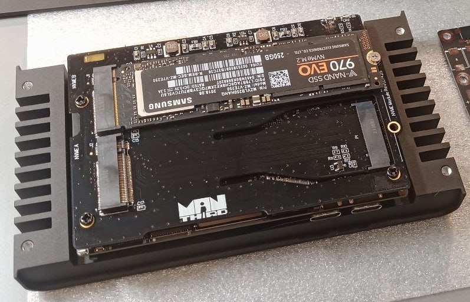
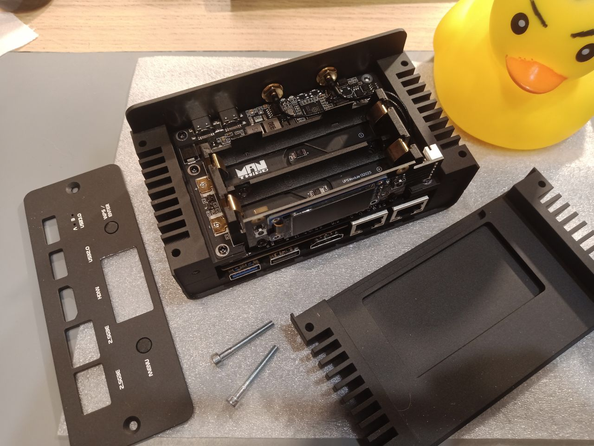
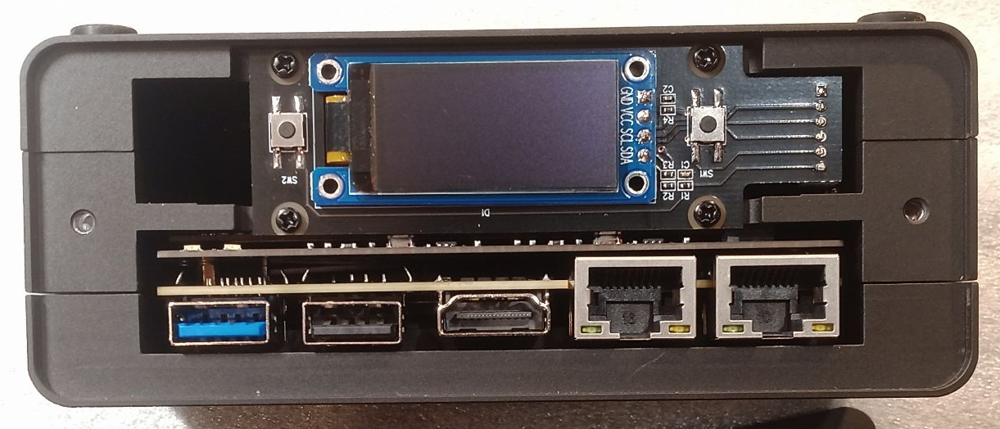
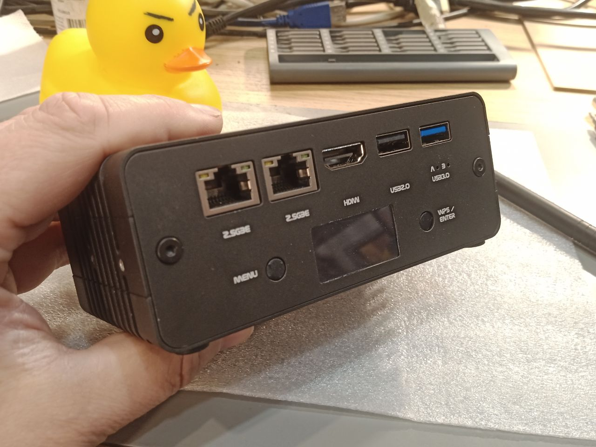
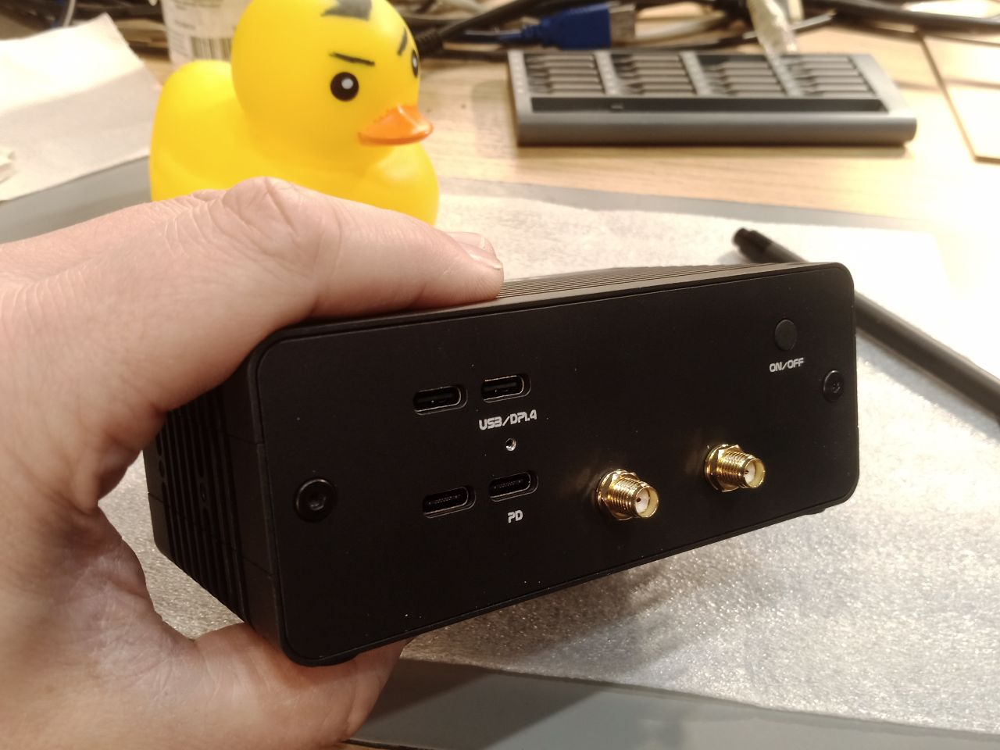
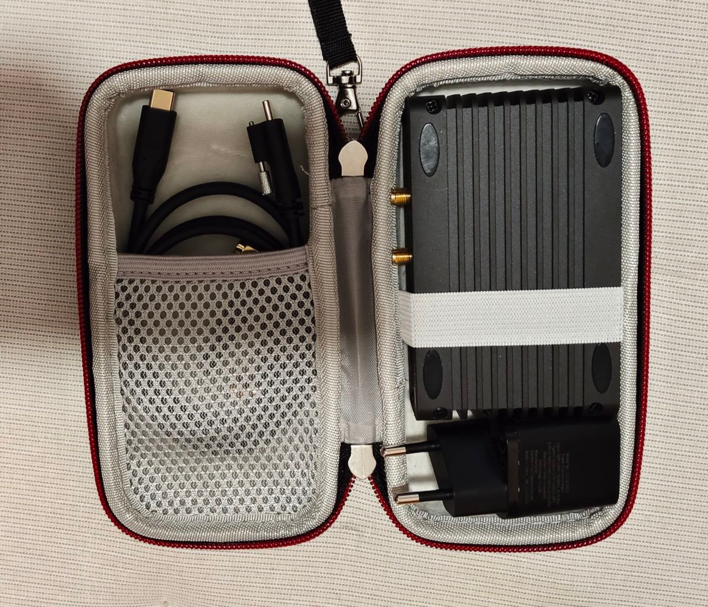
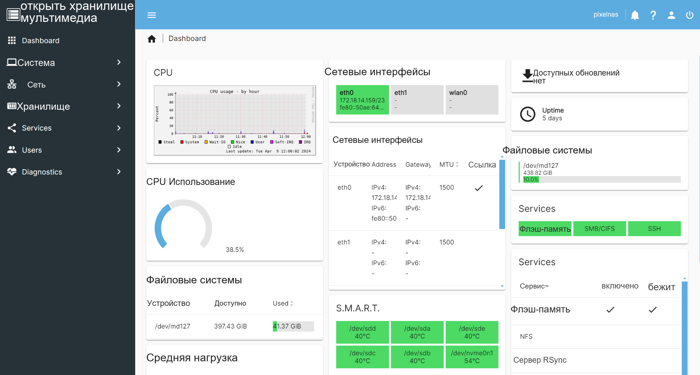

Переносное хранилище может быть не только диском, подключённым к ноутбуку. Разработчики сообщества UberNAS хотели создать небольшой NAS, который можно брать с собой, использовать для сетевого обмена файлами и дополнять аккумуляторами и экраном. Основой стала ArmSoM Sige7, а расширение на два NVMe, ИБП и OLED образовали модульный прототип.

Статья подготовлена по предоставленным материалам и использует название **ArmSoMNAS**. В центре внимания — вариант на Sige7. Модули и фотографии относятся к пользовательскому проекту, а не к стандартному комплекту поставки Sige7.

*Компактный прототип в настольном сценарии; фотография команды проекта.*

## От пяти SATA-накопителей к компактному NVMe

Ранее команда разрабатывала мобильный NAS на RK3568 с пятью местами для M.2 SATA. Следующая конструкция должна была стать меньше и получить NVMe и 2.5GbE. Два порта 2.5GbE и расположенный с обратной стороны Sige7 разъём M.2 PCIe 3.0 x4 стали важными аргументами при выборе платформы.

Готовый SBC позволил сосредоточиться на накопителях, питании и корпусе без разработки процессорной платы с нуля. Основная работа пришлась на двухдисковое расширение, мобильность и сборку модулей.

## Основа для вычислений и подключений

[Официальная документация Sige7](https://docs.armsom.org/armsom-sige7) подтверждает RK3588, два 2.5GbE и M.2 PCIe 3.0 x4. Для этого проекта важно объединение вычислений, сети и подключения накопителей на компактной платформе.

| Компонент | Роль в проекте |
| --- | --- |
| Плата Sige7 | Linux и службы сетевого хранения |
| Два 2.5GbE | Основа проводного обмена и сетевых подключений |
| M.2 PCIe 3.0 x4 | Подключение разработанного командой Twin NVMe |
| Модульный корпус | Варианты с ИБП и экраном или без них |

Параметры интерфейсов не равны результатам копирования файлов. В материале нет тестов длительного чтения/записи, одновременной работы двух SSD или агрегации каналов. Фактическую пропускную способность нужно измерять на собранной системе.

## Twin NVMe: отдельный модуль хранения

Twin NVMe — плата расширения с двумя разъёмами M.2 NVMe, подключаемая к M.2 на обратной стороне Sige7. Такой модульный подход позволяет отдельно дорабатывать выбор SSD, высоту конструкции и охлаждение.

*Прототип Twin NVMe: установлен один SSD, второй разъём виден на плате.*

В исходнике упомянуты RAID 0 и RAID 1, но не опубликованы топология PCIe, ширина линии для каждого SSD и полный перечень совместимости. Два разъёма не означают два независимых подключения x4. Перед повторением проекта нужно проверить версию модуля, драйвер, SSD и системный образ.

RAID 0 использует чередование данных, но не обеспечивает избыточность при отказе диска. RAID 1 зеркалирует данные и повышает доступность при отказе одного накопителя. Ни один вариант не заменяет отдельную восстанавливаемую резервную копию.

## ИБП для работы без стационарного питания

Модуль ИБП использует два элемента LiFePO4 формата 18650 и интеллектуальный контроллер на RP2040 с обменом по USB HID. В исходнике написано «RPi 2040»; здесь использовано общепринятое обозначение, которое следует сверить с документацией модуля.

*Модуль ИБП и держатели аккумуляторов из материалов проекта.*

Автор сообщает о времени работы до 1,5 часа без ограничения активности накопителей и сети. Ёмкость аккумуляторов, модели SSD, профиль нагрузки и условия отключения не указаны. Это описание авторского прототипа, а не универсальная гарантия автономности ArmSoM.

В следующей версии стоит совместно проверить переключение питания, передачу уровня заряда и завершение работы при разряде. Само наличие USB HID ещё не подтверждает реализацию всей цепочки корректного выключения.

## OLED и две кнопки для локального взаимодействия

Модуль объединяет OLED и две кнопки с программно определяемыми функциями. Для NAS без постоянно подключённого монитора это удобная основа отображения состояния и простых действий.

*OLED и две кнопки над сетевыми и USB-разъёмами.*

Адрес сети, заряд и состояние накопителей — возможные направления развития интерфейса. Это предложения для дальнейшей работы: исходник не перечисляет все реализованные страницы экрана и действия кнопок.

## Две конфигурации с общими модулями

Sige7 вместе с Twin NVMe образует более компактный настольный вариант. ИБП, OLED и кнопки превращают его в более оснащённую мобильную систему. Набор можно подобрать под задачу, не устанавливая каждый модуль постоянно.

*Сеть, USB и экран полной конфигурации прототипа.*

*Другая панель разъёмов и корпус полной конфигурации.*

Прототип использует алюминиевый корпус с рёбрами. В кейсе описано пассивное охлаждение и упомянута возможность активного. Необходимость вентилятора зависит от SSD, длительной нагрузки, температуры среды и конструкции корпуса; соответствующих тепловых испытаний в материале нет.

*Прототип и кабели в чехле демонстрируют переносной формат.*

Формат интересен для обмена файлами в поездках, архива съёмок, выездных демонстраций и небольшого homelab. Это идеи применения, а не подтверждённые внедрения.

## Программная основа: Armbian и OpenMediaVault

В проекте используются Armbian и OpenMediaVault. На текущей [странице Armbian для Sige7](https://armbian.com/boards/armsom-sige7) доступны образы, а поддержка обозначена как Community. Версии дистрибутива, ядра и OpenMediaVault прототипа не указаны; при воспроизведении их нужно зафиксировать и следовать соответствующей документации.

[OpenMediaVault](https://www.openmediavault.org/) предоставляет веб-интерфейс управления хранилищем и общими ресурсами. Диски, службы и состояние системы собраны в одном месте, что помогает превратить Linux-плату в управляемый NAS. RAID, взаимодействие с ИБП и дополнительные функции зависят от версии и настроек.

*Справочный экран OpenMediaVault из исходного материала. Несколько дисков, ёмкости, температуры и время работы на нём не являются измерениями этого двухдискового прототипа.*

## Развитие вместе с сообществом

Автор рассказывает, что публикации о переносных NAS привлекли участников в UberNAS News и UberNAS Community. Обсуждения аппаратуры, программного обеспечения и homelab помогают разработчикам получать обратную связь от будущих пользователей.

ArmSoMNAS показывает практический путь: Sige7 обеспечивает вычисления и подключения, пользователь разрабатывает модули хранения, питания и управления, а Linux и опыт сообщества помогают объединить их.

## Как начать свой ArmSoMNAS

Определите количество дисков, необходимость работы без внешнего питания и схему резервного копирования. Затем подберите плату, расширение, питание и корпус. Проверьте обнаружение дисков, длительное копирование, температуру, переключение питания и восстановление. Эта статья — пользовательский кейс, а не полный комплект схем, BOM или установочных скриптов для модулей.

- [Продукт ArmSoM Sige7](https://www.armsom.org/sige7)
- [Документация и интерфейсы Sige7](https://docs.armsom.org/armsom-sige7)
- [Образы Armbian для Sige7](https://armbian.com/boards/armsom-sige7)
- [OpenMediaVault](https://www.openmediavault.org/)
- [UberNAS Community из исходного материала](https://t.me/UberNasCommunity)

Кейс и фотографии предоставлены в материалах сообщества UberNAS. Маркировка исходного корпуса и содержимое панели управления сохранены. Новых аппаратных испытаний ArmSoM не проводилось; прототип не представлен как стандартный комплект, уже доступный в продаже.
