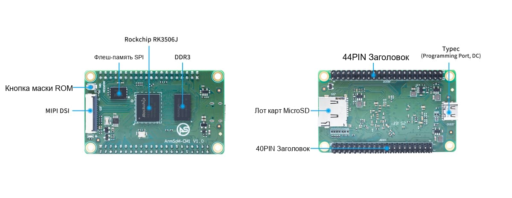

Вычислительный модуль объединяет процессор и базовую память, позволяя сосредоточиться на интерфейсах, корпусе и приложении. ArmSoM CM1 на RK3506J предназначен для промышленных терминалов, управления дисплеем и подключения оборудования. Перед собственной базовой платой удобно испытать CM1-IO.

## Модуль и комплект — разные уровни

| Параметр | CM1 | Комплект с CM1-IO |
|---|---|---|
| Процессор | RK3506J | Использует CM1 |
| Память | Варианты 256/512MB DDR3L и 256/512MB NAND | По установленному модулю |
| Размеры | 70×42mm | Базовая плата 100×70mm |
| Дисплей | MIPI DSI | Проверить панель и драйвер |
| Сеть | Сигналы расширения | Два 10/100 Ethernet, Wi-Fi 5/BT 4.2 |
| USB | Type-C для питания/прошивки | Два USB2.0 Host |

Сетевые разъёмы, беспроводная связь и два USB Host относятся к комплекту с базовой платой, не к самому модулю. Документация указывает −40…85°C; изделие целиком проверяется с его питанием, дисплеем, памятью и корпусом.

## Специализированная панель

Упаковочные машины, экологические приборы и измерительные терминалы часто требуют собственных разъёмов и корпуса. CM1 выполняет GUI, настройки и связь; обработка и защита полевых сигналов размещаются на базовой плате. Размер экрана, питание подсветки и сенсорный интерфейс выбирать уже при разработке схемы.

## Подключение существующего оборудования

Связать контроллер через последовательный порт или CAN; Linux использовать для обработки, буфера и передачи. Определить владельца состояния, поведение при тайм-ауте и срок автономного хранения. Ограничить журналы и не ставить аварийную остановку в зависимость от сетевого сервиса.

## Общая основа семейства изделий

Один модуль может применяться в настенных панелях, настольных приборах и DIN-шлюзах. Прикладное ПО частично переиспользуется, но разъёмы, Device Tree, охлаждение и производственные тесты остаются индивидуальными. Повторное использование не заменяет электрическую проверку.

## От комплекта к прототипу

1. Зафиксировать конфигурацию CM1, ревизию и образ Buildroot.
2. Проверить экран, сенсор, память, сеть и полевые протоколы.
3. Для каждого сигнала указать функции, напряжение, подтяжки, стартовое состояние и защиту.
4. Испытать потерю питания, откат обновления, watchdog и ограничения журналов.
5. Проверить нагрев и стабильность с окончательными питанием, корпусом и кабелями.

Число 40-PIN/44-PIN не доказывает совместимость. Частичная совместимость разъёма базовой платы с Raspberry Pi 40-pin не означает прямую замену другого вычислительного модуля.

## Когда выбрать CM1

CM1 подходит для собственной механики и интерфейсов с использованием документации, схем и ПО ArmSoM. Для быстрого прототипа на готовой плате также стоит рассмотреть Forge1. Эти рекомендации не означают завершённую сертификацию или проверку серийного изделия.

## Статьи серии и официальные материалы

- [RK3506J: процессор для промышленного HMI и подключения оборудования](/ru/articles/rk3506j-chip-guide/)
- [ArmSoM Forge1: разработка шлюзов, HMI и систем сбора данных](/ru/articles/forge1-industrial-hmi-gateway/)
- [RK3506B Datasheet V1.0: архитектура, выводы и электрические характеристики](/ru/articles/rk3506b-datasheet-v10/)
- [Rockchip RK3506](https://www.rock-chips.com/a/cn/product/RK35xilie/2025/1208/2125.html)
- [ArmSoM CM1](https://docs.armsom.org/armsom-cm1)
- [ArmSoM Forge1](https://docs.armsom.org/armsom-forge1)
- [ArmSoM](https://www.armsom.org/)
