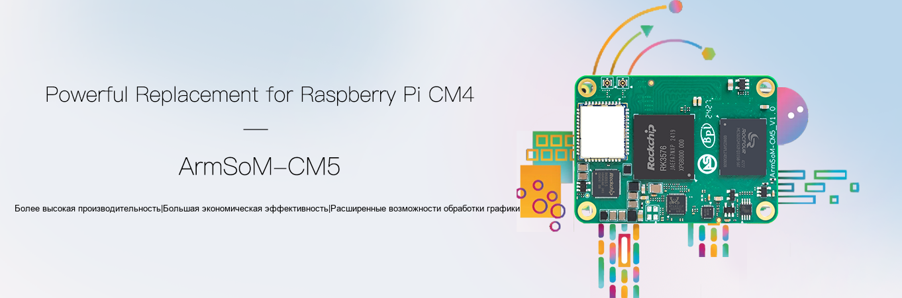

*Официальное изображение ArmSoM; функции чипа не подтверждают полную поддержку ускорения в образе Armbian.*

Вычислительный модуль полезен, когда прототипу нужны определённый корпус, специальные разъёмы или собственная схема питания. ArmSoM CM5 объединяет вычислительную часть на модуле, оставляя несущую плату для требований изделия. Образы и конфигурации Armbian дают начало оценке ПО, но собственную плату необходимо испытывать отдельно.

Статья описывает путь к обслуживаемому Linux-устройству. Это не сертификация серийного изделия и не подтверждение работы всей периферии конкретного образа. Перед модульным проектом прочитайте вводную статью о выборе системы.

## 1. Выбирать модуль, плату и образ вместе

CM5 использует RK3576. Модуль даёт вычислительную основу, несущая плата определяет питание, разъёмы и выведенные сигналы. Одинаковый процессор не гарантирует одинаковый запуск на разных платах. [Информация о CM5](https://www.armsom.org/cm5).

Запишите ревизии модуля и платы, память, накопитель, модели экрана, камеры и внешних устройств. Таблица соединений полезнее простой записи «CM5»: для каждого интерфейса укажите назначение, источник питания, уровни, зависимость от драйвера и процедуру приёмки.

## 2. CM5 IO и CM5 CM4 IO — разные цели

| Запись Armbian | Идентификатор сборки | Принцип выбора |
|---|---|---|
| CM5 IO | `armsom-cm5-io` | Эталонная платформа CM5 IO со страницы |
| CM5 CM4 IO | `armsom-cm5-rpi-cm4-io` | Соответствующая конфигурация несущей платы CM4 IO |

Это не просто разные названия загрузок. Сверьте страницы [CM5 IO](https://armbian.com/boards/armsom-cm5-io) и [CM5 CM4 IO](https://armbian.com/boards/armsom-cm5-rpi-cm4-io) с реальной сборкой. Сейчас обе имеют статус Community. Конфигурация эталонной платы не гарантирует все сторонние платы.

## 3. Начать совместимость с выводов

Совпадение размеров и разъёмов — только начало. Проверьте линии питания, сброса и загрузки, каналы экрана, роли USB, PCIe, сеть и обработку неиспользуемых выводов. Документация CM5 описывает отличия от CM4, в частности число каналов отображения. Возможность применения категории плат не означает полного равенства функций.

Сравните схемы, выводы модуля и проект несущей платы до включения функций. Камеры и экраны дополнительно требуют проверки порядка подключения, питания и драйверов. Используйте [аппаратные материалы CM5](https://docs.armsom.org/armsom-cm5), а не переносите вслепую образ другого модуля.

## 4. Три прототипа изделия

**Терминал состояния:** подключите экран и ввод, затем показывайте состояние оборудования. Начните с чтения и индикатора потери сети, затем добавляйте управление. Проверьте координаты касаний, ориентацию и восстановление после аварийного перезапуска. Обычный интерфейс Linux не является контроллером безопасности реального времени.

**Шлюз сбора:** несущая плата адаптирует полевые интерфейсы, Linux обрабатывает данные, очередь и отправку. Отделите драйверы от прикладных протоколов, ограничьте буфер, добавьте время и обработку дубликатов. Промышленные уровни, изоляция и защита от перенапряжения относятся к аппаратной разработке, а не появляются из образа ОС.

**Узел машинного зрения:** проверяйте захват, вывод модели и сетевой результат отдельно. Сначала сравните фиксированные файлы, затем подключите камеру и оцените охлаждение. NPU и видео требуют согласованного стека. Эталон на CPU помогает отделить ошибку модели от драйвера.


## 5. Запускать собственную плату по этапам

| Этап | Одна новая группа переменных | Пример приёмки |
|---|---|---|
| A | Питание, загрузочный носитель, отладка | Наблюдаемый холодный старт и перезапуск |
| B | Накопитель и проводная сеть | Сохранность данных, постоянные пути |
| C | Экран, USB или один датчик | Правильное обнаружение и ввод/вывод |
| D | Все основные интерфейсы вместе | Нет неразрешённых конфликтов ресурсов |
| E | Корпус и окончательное питание | Температура и восстановление соответствуют цели |

Если B работает, а C нет, исследуйте новый интерфейс вместо одновременной смены ядра, накопителя и приложения. На каждом шаге сохраняйте заведомо загружаемый образ и конфигурацию, чтобы сравнение оставалось осмысленным.

## 6. Сделать ПО воспроизводимым

Фиксируйте источник образа, ревизию Armbian, цель платы, ветку ядра, изменения дерева устройств и зависимости приложения вместе. Одной карты с многочисленными ручными правками недостаточно. Каждое изменение требует причины, привязки к оборудованию и способа возврата.

Команды только читают окружение, не собирают и не заменяют загрузочные файлы:

```sh
cat /etc/armbian-release
uname -a
cat /proc/device-tree/model
lsblk -o NAME,SIZE,TYPE,FSTYPE,MOUNTPOINTS
systemctl --failed
```

Файл модели может выводиться без перевода строки. Если файла нет, сначала проверьте образ и среду. Для собственной сборки используйте актуальное руководство со страницы платы, закрепите версию кода и испытайте результат. Не смешивайте команды разных дистрибутивов, веток и несущих плат.

## 7. Установка и обновления требуют восстановления

Перед переносом на внутренний накопитель подтвердите поддерживаемую схему загрузки и целевой носитель. Сохраните данные и доступ к отладке или восстановлению. Нельзя считать все комбинации eMMC, NVMe и SPI одинаковыми.

При обновлении проверяйте загрузку, сеть, данные приложения, периферию и права служб, а не только номер версии. Восстановление должно входить в приёмку: возврат предыдущего приложения при неудаче и пересоздание носителя по документации при его отказе. Продолжайте оценивать исправления безопасности; зафиксированная база не означает вечной остановки обслуживания.

## 8. От одной платы к нескольким устройствам

Отделяйте шаблоны настроек от индивидуальности устройств. При подготовке генерируйте или назначайте отдельные учётные данные; не клонируйте общий закрытый ключ и фиксированную сетевую идентичность на весь парк. Доступная информация о версии помогает поддержке определить сочетание оборудования и ПО.

Сохраняйте ревизии модуля и платы, хеш образа, источник сборки, версию приложения, периферию, результаты испытаний и откат. Community-образы — вход в оценку, а не договор серийного сопровождения. Для длительных поставок необходимы ответственный за обслуживание и ресурсы проверки обновлений.

## 9. Начать с эталонной платформы

Изучите [комплектации CM5](https://www.armsom.org/cm5) и [документацию CM5-IO](https://docs.armsom.org/armsom-cm5-io). Запустите основное приложение на известной комбинации, затем меняйте плату и периферию по одному элементу. Это сохраняет возможность локализовать проблемы адаптации.

Модуль позволяет сосредоточиться на отличительных интерфейсах и поведении продукта, а Armbian даёт начало оценке Linux. Польза состоит в понятной исходной конфигурации, упрощающей каждую проверку, а не в отказе от испытаний.

## Другие статьи серии

- [ArmSoM × Armbian: от выбора образа до первого проекта на Linux](/ru/articles/armsom-armbian-getting-started/)
- [Sige5 / Sige7 с Armbian: шесть практических проектов на Linux](/ru/articles/sige5-sige7-armbian-projects/)
