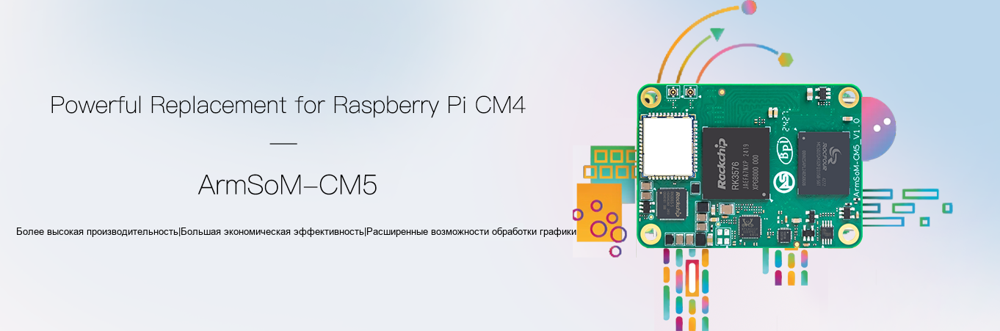

Для проектов на Raspberry Pi CM4 или CM5 модуль ArmSoM CM5 предлагает другой путь на RK3576: восемь ядер CPU и NPU в компактном модуле с периферией через несущую плату. Его стоит оценить для локального инференса или изменения архитектуры, но перенос необходимо рассматривать применительно к конкретному изделию.

## Два значения слова «замена»

**Альтернативная платформа** означает новый выбор процессора, ПО и периферии. **Совместимая замена модуля** дополнительно требует соответствия электрических условий, выводов, интерфейсов и ПО. ArmSoM описывает работу с базовой платой Raspberry Pi CM4 и различия в количестве HDMI/DSI. Это не гарантирует любую стороннюю плату CM4 и не подтверждает совместимость с Raspberry Pi CM5 IO Board.

| Исходный проект | Рекомендуемый подход |
|---|---|
| Raspberry Pi CM4 IO Board | Проверить периферию с соответствующим образом и документацией ArmSoM |
| Сторонняя несущая плата CM4 | Поэлементно проверить схему, выводы, питание и интерфейсы |
| Raspberry Pi CM5 со своей платой | Рассматривать как перенос платформы, не замену по названию |
| Новое устройство с ИИ | Сначала прототип CM5 с подходящей платой, затем собственная аппаратная часть |

## Зачем рассматривать ArmSoM CM5

NPU RK3576 даёт отдельный путь выполнения конвертированных моделей классификации и обнаружения, пока CPU обслуживает протоколы и логику. Необходимы RKNN-конвертация и проверка точности. 6 TOPS INT8 рассчитаны с разреженностью и не означают одинаковую скорость любых моделей.

Модуль позволяет проектировать несущую плату под питание, разъёмы и механику изделия. Часть существующей конструкции иногда можно сохранить, но это следует проверить, а не предполагать отсутствие изменений аппаратуры и ПО.

## Сравнивайте задачи, а не число ядер

Raspberry Pi указывает четыре Cortex-A76 для CM5; ArmSoM CM5 использует четыре A72 и четыре A53. Восемь против четырёх ядер разных микроархитектур не определяют победителя. Измеряйте задержку, пропускную способность, память и энергопотребление приложения с учётом драйверов, сопровождения и стоимости переноса.

Образ Raspberry Pi OS не является образом RK3576. Бизнес-логика на Python или в контейнерах может переноситься сравнительно легко, но номера GPIO, стек камер, ускорение видео, Device Tree и загрузка требуют отдельной адаптации. Общая система команд Arm не делает драйверы взаимозаменяемыми.

## Перенос в пять шагов

1. **Зависимости:** камеры, экраны, USB, PCIe, беспроводная связь и GPIO.
2. **Аппаратура:** ревизия, разъёмы, выводы и последовательность питания. ArmSoM сообщает об исправлении проблемы Pin 21 ранней CM5 v1.2 в v1.3; проверьте реальную ревизию.
3. **База ПО:** образ для конкретного модуля и платы, зафиксированные ядро и драйверы.
4. **Приложение:** сначала базовая работа, затем ускорение и доступ к периферии.
5. **Изделие:** холодный старт, потеря питания, обрыв сети, температура и длительная нагрузка.

## Когда начать с Sige5

Если несущая плата ещё не определена, Sige5 позволяет непосредственно проверить функции. При известных размерах, расположении портов и производственных требованиях имеет смысл интеграция CM5. Это инженерная методика выбора, не обещание непроверенного выигрыша в цене или производительности.

## Статьи серии и продукты

- [RK3576: от восьмиядерного CPU до устройств ArmSoM для периферийного ИИ](/ru/articles/rk3576-chip-guide/)
- [Возможности Sige5: шесть применений RK3576 на периферии](/ru/articles/sige5-rk3576-applications/)
- [RK3576 Datasheet V1.0: загрузка, корпус, питание и охлаждение](/ru/articles/rk3576-datasheet-v10/)
- [ArmSoM CM5](https://www.armsom.org/cm5) · [ArmSoM Sige5](https://docs.armsom.org/armsom-sige5)

## Источники

- [Rockchip RK3576](https://www.rock-chips.com/a/en/products/RK35_Series/2024/1212/2033.html)
- [RK3576 Brief V1.2 (2025-08-28)](https://www.rock-chips.com/uploads/pdf/2024.3.18/191/RK3576%20Brief%20Datasheet%20V1.2-20250828.pdf)
- [ArmSoM CM5](https://docs.armsom.org/armsom-cm5)
- [ArmSoM Sige5](https://docs.armsom.org/armsom-sige5)
- [Raspberry Pi CM5](https://www.raspberrypi.com/products/compute-module-5/)
