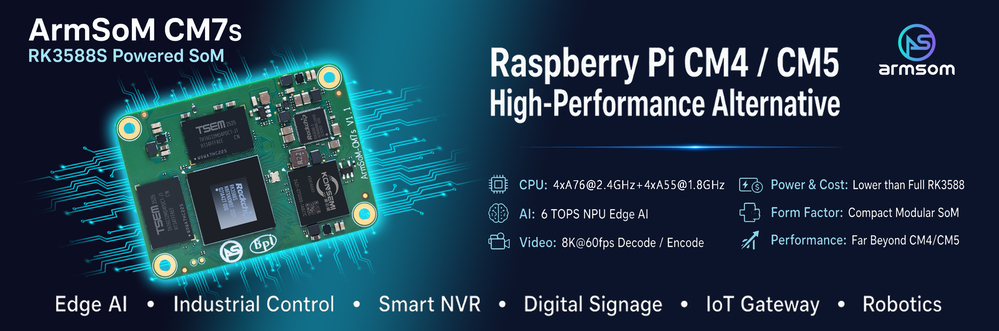
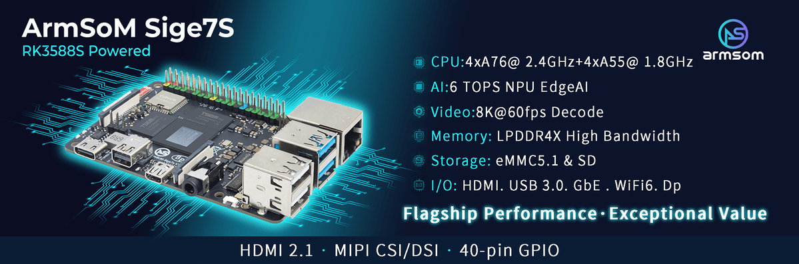

Выбор RK3588S начинается с формата: готовая плата с разъёмами или модуль внутри вашего устройства? **Sige7S удобен для быстрого старта приложения, CM7S — для собственной платы-носителя.** Это не сравнение вычислительной мощности.

## Выберите маршрут разработки

| Требование | Стартовая платформа | Необходимая работа |
|---|---|---|
| Linux-приложение или демонстратор | Sige7S | Образ, охлаждение, периферия, приложение |
| Свой корпус и разъёмы | CM7S + собственная плата | Питание, целостность сигналов, device tree, испытания |
| Раннее ПО для модульного устройства | CM7S + CM7S-IO | Проверка на отладочной плате, затем перенос |

В документации CM7S указаны 55 × 40 × 1.6 mm и три межплатных разъёма по 100 контактов. Модуль объединяет сложную вычислительную часть, а носитель адаптируется под задачу. Сходство размеров не означает совместимость с носителями Raspberry Pi CM4/CM5: необходимо проверить разъёмы, распиновку и питание.

## Sige7S: сначала приложение

Документация перечисляет Gigabit Ethernet, Wi-Fi 6, HDMI, USB и колодку расширения. Это отправная точка для терминала ИИ, управления дисплеем или Linux-прототипа. Камеру и экран выбирают по разъёмам и драйверам платы, а не по максимумам SoC.

Например, документированный DP на Sige7S использует две линии и поддерживает до 4K60. Это другая конфигурация, чем четырёхлинейный максимум кристалла. Для CSI и DSI также проверяют линии, шлейф и драйвер.

## CM7S: носитель под ваше устройство

ПО можно проверить на CM7S-IO, затем перенести на собственную плату. Сохраняйте проверенные версии ПО, но повторно проверяйте device tree, последовательность питания и периферию.

Различайте питание модуля и носителя: для CM7S указано 5V, для CM7S-IO — 12V DC. Нельзя подавать входное напряжение носителя непосредственно на питание модуля. Документация также предупреждает об ограничении контактов 2 и 4 разъёма CN2 у CM7S v1.1. Уточните ревизию и исправления до проектирования.

## Пять проверок перед заказом

1. Подтвердить RAM и eMMC поставляемого SKU.
2. Проверить реально выведенные интерфейсы камеры, дисплея и расширения.
3. Согласовать образ, ядро, NPU runtime и драйверы.
4. Испытать пиковую нагрузку, охлаждение, корпус и условия среды.
5. Зафиксировать производственный образ, восстановление и ревизию платы.

На странице Sige7S есть разные размеры. Для корпуса используйте механические файлы нужной ревизии. Это руководство по выбору, не измеренный сравнительный тест.

## Материалы и продукты

- [RK3588S: восемь ядер CPU, NPU 6 TOPS и платформы ArmSoM](/ru/articles/rk3588s-chip-guide/)
- [Периферийный ИИ и мультимедиа на RK3588S: проектирование с CM7S и Sige7S](/ru/articles/rk3588s-edge-ai-multimedia/)
- [RK3588S Datasheet V1.3: загрузка, блок-схема и руководство по параметрам](/ru/articles/rk3588s-datasheet-v13/)

### Продукты и разработка

- [CM7S](https://www.armsom.org/cm7s) · [CM7S Docs](https://docs.armsom.org/armsom-cm7s)
- [Sige7S](https://www.armsom.org/sige7s) · [Sige7S Docs](https://docs.armsom.org/armsom-sige7s)
- [Rockchip RKNN-Toolkit2](https://github.com/airockchip/rknn-toolkit2) · [RKNN-LLM](https://github.com/airockchip/rknn-llm)
