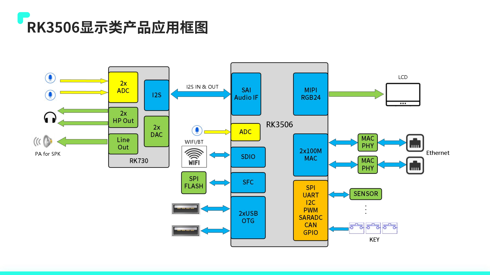
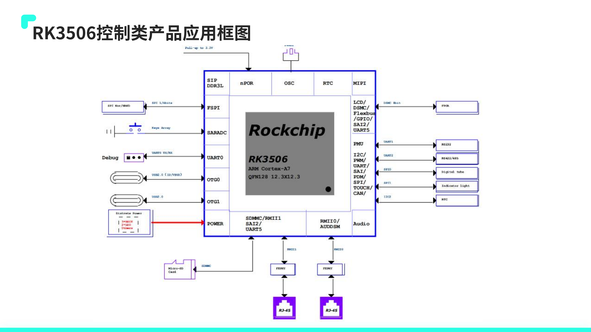
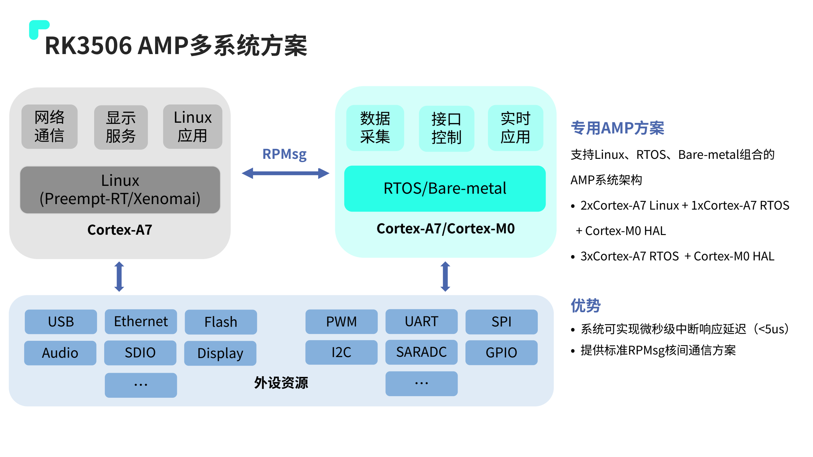
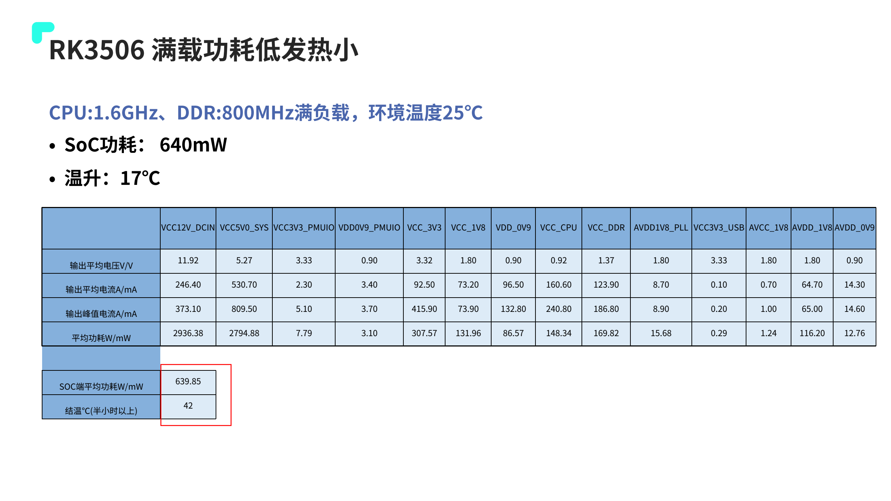

Промышленный проект начинается с надёжной совместной работы дисплея, связи и приложения. ArmSoM Forge1 объединяет RK3506J с распространёнными интерфейсами для HMI, шлюзов и сбора данных. Позднее собственное исполнение можно разработать на CM1.

## Аппаратные и программные ресурсы

Спецификация Forge1 перечисляет 512MB DDR3L, 512MB NAND, два Fast Ethernet, MIPI DSI, USB2.0 Host и RS485/CAN при размере 92×62mm. Питание — DC 12V/1A либо Type-C 5V/2A, согласно руководству платы.

В описании ПО указаны Buildroot, Linux 6.1, RT-Thread 4.1, AMP, Preempt-RT/Xenomai и LVGL. Это список ресурсов, а не подтверждение включения всех возможностей в каждом образе. Проверить образ, конфигурацию ядра и примеры.

## HMI для оборудования

Создать страницы состояния, настроек, аварий и обслуживания. Использовать реальные данные и измерять отклик при интенсивном обмене. Отделить сбор от отрисовки, ограничить размер обновления и влияние декодирования больших изображений или частых записей.

Нужны согласованные тайминги панели, драйвер и сенсор. 2D-движок не ускоряет автоматически любую UI-библиотеку: проверить графический backend и драйверный путь.

## Шлюз между полем и сетью

RS485 или CAN подключают оборудование, Ethernet — полевую и верхнюю сеть. Modbus и MQTT являются вариантами программной реализации, а не обещанием их наличия в заводском образе.

Задать период опроса, тайм-ауты, повторы, пределы буферов и удаление дубликатов. Проверить согласование линии, землю, изоляцию, защиту от импульсов и кабели. Названия интерфейсов не заменяют испытания ЭМС всего изделия.

## Прослеживаемый сбор данных

Добавлять метки времени к состояниям, счётчикам и авариям, ограниченно хранить данные без сети и периодически отправлять их. Определить поведение без сетевого времени, сохранять версии настроек и проверять внезапное отключение питания. Аналоговые, термопарные и высоковольтные входы требуют внешних измерительных и изолирующих схем.

## Проверка реального времени

Linux, RT-патчи и AMP предлагают разные подходы, но не гарантируют максимальную задержку. Одновременно нагружать сеть, экран и накопитель, записывать распределение и максимум задержки. Необходимость отдельного контроллера для критического контура определяется временными требованиями и отказами системы.

## Границы применения

Forge1 удобен для ранней проверки интерфейсов и приложения, CM1 — для собственной базовой платы. Диапазон −40…85°C платы нельзя автоматически переносить на изделие с экраном. Официальная страница содержит NAND в спецификации и eMMC в инструкции загрузки. Здесь используется спецификация NAND; фактический носитель проверяется по поставленной ревизии.

Официальная иллюстрация указывает 92×60mm, а таблица — 92×62mm. Различие сохранено: для корпуса и крепления использовать механический чертёж поставленной ревизии, а не размеры рекламной картинки.

## Дополнить проект материалами RK3506

Дополнение основано на 34-страничном `RK3506 产品应用方案介绍_V1.2.2_20240903(1).pdf`. На обложке дата 2024.08.29, отличающаяся от имени файла; обе относятся к одному предоставленному документу. Ниже — редакционное руководство, а не повторные измерения ArmSoM.

Стр. 12 различает RK3506G2, RK3506B и RK3506J. У G2 встроено 128MB DDR3L, B/J используют внешнюю DDR, J ориентирован на промышленную температуру. Официальные сведения Forge1 и CM1 указывают RK3506J; память G2 и соединения EVB нельзя переносить напрямую.

*Применение RK3506 с дисплеем — Оригинал на китайском; соответствующей английской иллюстрации в этой подборке нет. `RK3506 产品应用方案介绍_V1.2.2_20240903(1).pdf`, PDF p. 5.*

## Шесть сценариев как инженерные задачи

| Сценарий источника | Первый измеримый результат | Что ещё требуется |
| --- | --- | --- |
| Управление бытовым оборудованием | Настройки, тревоги и восстановление конфигурации | Драйвер экрана, сертификация, сон и пробуждение |
| Портативный POS | Сканирование одновременно с интерфейсом | Камера/сканер, батарея и безопасность |
| Домофон | Аудиовидеосвязь, путь эха и переподключение | Аудиоалгоритмы, камера, сеть и динамик |
| PLC | Воспроизводимые измерения периода и джиттера | Драйвер реального времени, изоляция задач, отказы и шина |
| Промышленный HMI | Сенсорный ввод, перерисовка и сбор данных вместе | Тайминги, подсветка, помехоустойчивость и ресурсы UI |
| Промышленный шлюз | Буферизация, пересылка и удалённое обслуживание | Протоколы, изоляция, журналы и откат обновления |

Это направления разработки, а не готовые приложения стандартного образа Forge1. Forge1 подходит для проверки платы; особые разъёмы, размеры и отраслевые интерфейсы можно затем реализовать на носителе CM1.

*Применение RK3506 для управления — Оригинал на китайском; соответствующей английской иллюстрации в этой подборке нет. `RK3506 产品应用方案介绍_V1.2.2_20240903(1).pdf`, PDF p. 6.*

## Программное видео и UI делят ресурсы CPU

Стр. 19 описывает программное декодирование H.264/MJPEG: 720P 30FPS либо 480P 60FPS, с загрузкой двух Cortex-A7 на 90%. Это не утверждение о малозатратном аппаратном декодере. Нагружайте декодирование, масштабирование, UI, связь и аудио совместно, измеряя кадры и задержку касания.

Презентация перечисляет Linux Kernel 6.1, RT-Thread 4.1, LVGL, ускорение RGA, дифференциальное OTA, разделы A/B и быстрый старт. Доступность зависит от SDK, образа и настроек. Демонстрация запуска за 3 секунды не гарантирует такой старт пользовательского приложения.

## Сравнивать задержки при одинаковых условиях

*Распределение задач AMP RK3506 — Оригинал на китайском; соответствующей английской иллюстрации в этой подборке нет. `RK3506 产品应用方案介绍_V1.2.2_20240903(1).pdf`, PDF p. 22.*

Стр. 22 показывает AMP, включая `2× Cortex-A7 Linux + 1× Cortex-A7 RTOS + Cortex-M0 HAL`, и RPMsg. Это позволяет отделить сеть/UI от задач быстрого ответа, но общую память, владение периферией и восстановление после отказа ещё нужно спроектировать.

Около 62µs задержки Preempt-RT на стр. 23 получены с cyclictest на изолированном ядре, stress-ng, CPU 1300MHz и DDR3 800MHz. Стр. 24 отдельно даёт EtherCAT: 90µs джиттера при периоде 1ms. Отклик прерывания `<5us` на стр. 22 — другая метрика; объединять их в гарантию реального времени нельзя.

## Различать потребление SoC, платы и периферии

*Условия и границы измерения мощности производителя — Оригинал на китайском; соответствующей английской иллюстрации в этой подборке нет. `RK3506 产品应用方案介绍_V1.2.2_20240903(1).pdf`, PDF p. 29.*

При CPU 1.6GHz, DDR 800MHz и окружающей температуре 25℃ стр. 29 указывает примерно 640mW для SoC и нагрев на 17℃. В той же таблице для входа 12V приведено около 2936.38mW. Границы измерения различаются: 640mW не является потреблением всей Forge1.

Числа стр. 28 — IDLE 109mW, статический рабочий стол 200mW, сон 30mW/8mW — также зависят от экрана, Wi-Fi и отключения Logic. Питание, охлаждение и батарею выбирайте по пиковому и среднему потреблению всей системы с экраном, сетью, USB и переходниками.

## От демонстрации к изделию

Для каждого проекта фиксируйте плату/образ, время запуска, пик памяти, потери пакетов, отклик UI, температуру, восстановление после отключения и откат обновления. Сначала проверьте ПО и интерфейсы на Forge1, затем выбирайте собственную плату CM1. Непроверенные функции явно оставляйте в этом статусе.

## Продукты и документация

- **Forge1** — [Продукт](https://www.armsom.org/forge1) · [Документация](https://docs.armsom.org/armsom-forge1)
- **CM1** — [Продукт](https://www.armsom.org/cm1) · [Документация](https://docs.armsom.org/armsom-cm1)

## Читайте также

- [Интерфейсы и отладка RK3506G EVB](/ru/articles/rk3506g-evb-interface-debugging/)
- [Аудиосхемы RK730](/ru/articles/rk730-audio-codec-design/)

## Статьи серии и официальные материалы

- [RK3506J: процессор для промышленного HMI и подключения оборудования](/ru/articles/rk3506j-chip-guide/)
- [ArmSoM CM1: модуль RK3506J для промышленного терминала](/ru/articles/cm1-rk3506j-industrial-module/)
- [RK3506B Datasheet V1.0: архитектура, выводы и электрические характеристики](/ru/articles/rk3506b-datasheet-v10/)
- [Rockchip RK3506](https://www.rock-chips.com/a/cn/product/RK35xilie/2025/1208/2125.html)
- [ArmSoM CM1](https://docs.armsom.org/armsom-cm1)
- [ArmSoM Forge1](https://docs.armsom.org/armsom-forge1)
- [ArmSoM](https://www.armsom.org/)
