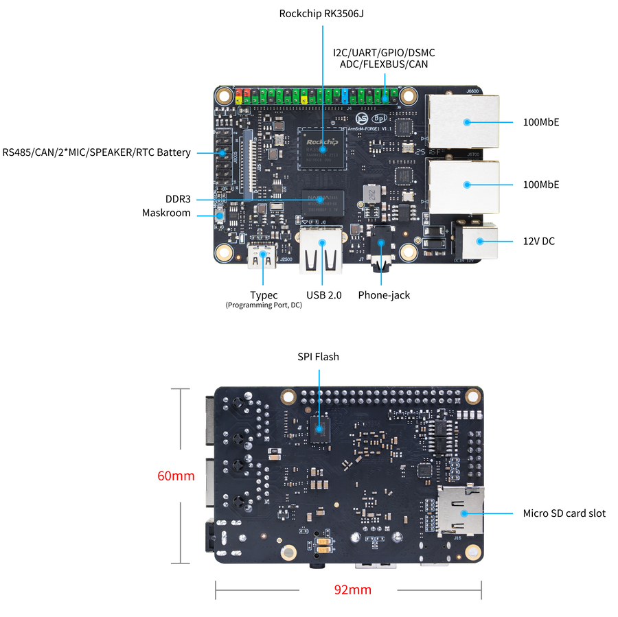

Промышленный проект начинается с надёжной совместной работы дисплея, связи и приложения. ArmSoM Forge1 объединяет RK3506J с распространёнными интерфейсами для HMI, шлюзов и сбора данных. Позднее собственное исполнение можно разработать на CM1.

## Аппаратные и программные ресурсы

Спецификация Forge1 перечисляет 512MB DDR3L, 512MB NAND, два Fast Ethernet, MIPI DSI, USB2.0 Host и RS485/CAN при размере 92×62mm. Питание — DC 12V/1A либо Type-C 5V/2A, согласно руководству платы.

В описании ПО указаны Buildroot, Linux 6.1, RT-Thread 4.1, AMP, Preempt-RT/Xenomai и LVGL. Это список ресурсов, а не подтверждение включения всех возможностей в каждом образе. Проверить образ, конфигурацию ядра и примеры.

## HMI для оборудования

Создать страницы состояния, настроек, аварий и обслуживания. Использовать реальные данные и измерять отклик при интенсивном обмене. Отделить сбор от отрисовки, ограничить размер обновления и влияние декодирования больших изображений или частых записей.

Нужны согласованные тайминги панели, драйвер и сенсор. 2D-движок не ускоряет автоматически любую UI-библиотеку: проверить графический backend и драйверный путь.

## Шлюз между полем и сетью

RS485 или CAN подключают оборудование, Ethernet — полевую и верхнюю сеть. Modbus и MQTT являются вариантами программной реализации, а не обещанием их наличия в заводском образе.

Задать период опроса, тайм-ауты, повторы, пределы буферов и удаление дубликатов. Проверить согласование линии, землю, изоляцию, защиту от импульсов и кабели. Названия интерфейсов не заменяют испытания ЭМС всего изделия.

## Прослеживаемый сбор данных

Добавлять метки времени к состояниям, счётчикам и авариям, ограниченно хранить данные без сети и периодически отправлять их. Определить поведение без сетевого времени, сохранять версии настроек и проверять внезапное отключение питания. Аналоговые, термопарные и высоковольтные входы требуют внешних измерительных и изолирующих схем.

## Проверка реального времени

Linux, RT-патчи и AMP предлагают разные подходы, но не гарантируют максимальную задержку. Одновременно нагружать сеть, экран и накопитель, записывать распределение и максимум задержки. Необходимость отдельного контроллера для критического контура определяется временными требованиями и отказами системы.

## Границы применения

Forge1 удобен для ранней проверки интерфейсов и приложения, CM1 — для собственной базовой платы. Диапазон −40…85°C платы нельзя автоматически переносить на изделие с экраном. Официальная страница содержит NAND в спецификации и eMMC в инструкции загрузки. Здесь используется спецификация NAND; фактический носитель проверяется по поставленной ревизии.

Официальная иллюстрация указывает 92×60mm, а таблица — 92×62mm. Различие сохранено: для корпуса и крепления использовать механический чертёж поставленной ревизии, а не размеры рекламной картинки.

## Статьи серии и официальные материалы

- [RK3506J: процессор для промышленного HMI и подключения оборудования](/ru/articles/rk3506j-chip-guide/)
- [ArmSoM CM1: модуль RK3506J для промышленного терминала](/ru/articles/cm1-rk3506j-industrial-module/)
- [RK3506B Datasheet V1.0: архитектура, выводы и электрические характеристики](/ru/articles/rk3506b-datasheet-v10/)
- [Rockchip RK3506](https://www.rock-chips.com/a/cn/product/RK35xilie/2025/1208/2125.html)
- [ArmSoM CM1](https://docs.armsom.org/armsom-cm1)
- [ArmSoM Forge1](https://docs.armsom.org/armsom-forge1)
- [ArmSoM](https://www.armsom.org/)
