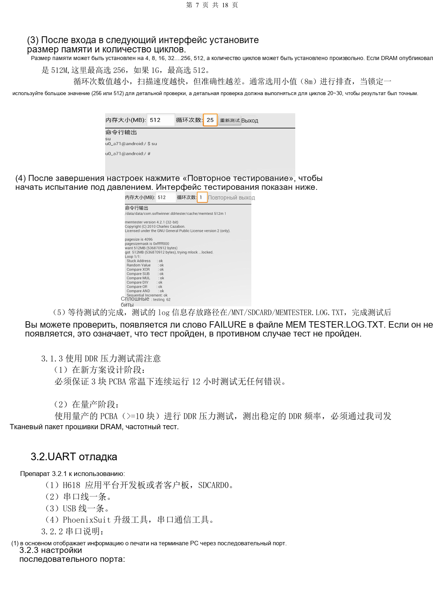
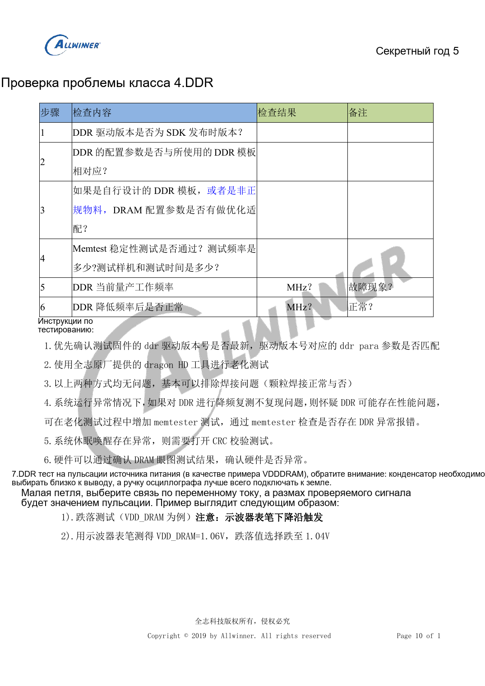

# H618: первый запуск, прошивка, DDR и диагностика

Это тематический материал по исходному руководству, справка по платформе; соответствующая плата ArmSoM не подтверждена. Параметры взяты из источника, не из испытаний ArmSoM. Перед применением проверьте ревизию SoC, PCB, SDK/BSP, ядро, прошивку и периферию.

**Debug V1.1 PDF 4–17; stability checklist F01 PDF 5–12**

## Определите этап отказа

Без питания проверьте DCIN, CPU, GPU, SYS, DRAM и PLL на короткое замыкание и осмотрите пайку. Пример первого включения: 5V с ограничением 500mA, не номинал для полной нагрузки. При отсутствии питания различайте замыкание регулятора и нагрузки измерениями с обеих сторон дросселя при отключённом питании. Затем проверяйте снятие сброса, 24MHz и обнаружение USB0. Правильное напряжение подтверждает только отдельную проверку, а не исправность всей системы.

## Прошивка и UART

Используется PhoenixSuit, не одновременно с PhoenixUSB Pro. Без прошивки — USB0; с прошивкой отключите питание и удерживайте UBOOT при подключении USB. Источник также описывает сервисный вход FEL замыканием Flash CLK на землю; сначала определяются контрольная точка и состояние питания. При повторной автопрошивке проверяйте BOOT_Select и `need secure img`. Для UART через SDCARD0 D3 — TX платы, CLK — RX платы. Согласуйте уровни IO; VCC адаптера не является универсальным источником питания.

## DDR и динамическая нагрузка

В примере DDRTest1_2.apk для 512M выбирается максимум 256, для 1G — 512. После малого объёма выполняются 20–30 подробных циклов на 256/512. Путь источника `/MNT/SDCARD/MEMTESTER.LOG.TXT`, поиск `FAILURE`; регистр пути проверяется на устройстве. Требования: три платы 12h при комнатной температуре на этапе разработки, минимум десять серийных плат для оценки частоты. Это не результаты ArmSoM. Для сбоев пробуждения добавьте CRC. Улучшение при снижении частоты указывает на недостаточный запас, не подтверждает качество компонента.

## Измерения и ошибки источника

Измеряйте на конденсаторе у выводов нагрузки с короткой землёй щупа: AC-связь для пульсаций, запуск по спаду для провалов. Таблица печатает `1.05/1.1` для 1200000/1320000 под заголовком mV, а следующая страница — 1.05V/1.1V. Нельзя использовать ошибочную таблицу как значения программирования. Формулировка Wi-Fi «отражение больше -20dB/-10dB» также требует уточнения. Для HDMI, USB, аудио, SD и Ethernet проверяйте питание, enable, соединения, сигнал и пайку; фиксируйте число образцов и длительность испытаний.


## Команды источника

Только для исходного SDK с соответствующими узлами cpufreq/debugfs. Запишите governor и частоту, после теста восстановите. Команды при подготовке статьи не выполнялись.

```sh
echo userspace > /sys/devices/system/cpu/cpu0/cpufreq/scaling_governor
echo 1008000> /sys/devices/system/cpu/cpu0/cpufreq/scaling_setspeed
cat /sys/devices/system/cpu/cpu0/cpufreq/cpuinfo_cur_freq
cat /sys/kernel/debug/cpufreq_table
```

## Исходные иллюстрации

Снимки справочных страниц сохраняют китайские подписи. Соответствующий английский выпуск не найден; четыре языка используют китайские оригиналы. Параметры и шаги в тексте копируются, снимки служат сверке. Номера — физические страницы PDF.

[](/assets/localized/figures/ru/61f64d99e36d50511c40.png)

[](/assets/localized/figures/ru/7c47a206885029fb7a4d.png)

## Выбор платформы ArmSoM

Для проекта ArmSoM выбирайте платформу по официальным продуктам и документации, заново проверяя процессор, интерфейсы и ПО. Схемы A733/H618 нельзя автоматически переносить на другой SoC.

- [ArmSoM](https://www.armsom.org/)
- [ArmSoM Docs](https://docs.armsom.org/)

## Материалы серии

- [Минимальная система H618: AXP313A, тактирование 24MHz и загрузка](/ru/articles/h618-power-clock-boot-design/)
- [H618 DDR и eMMC: шаблоны, импеданс и проверка PCB](/ru/articles/h618-dram-emmc-pcb-design/)
- [Интерфейсы H618: USB, HDMI, Ethernet и ESD](/ru/articles/h618-interfaces-esd-layout/)
- [H618 · Обзор серии](/ru/articles/h618-hardware-design-series/)

<!-- editable-source-tables -->

## Приложение: частоты и напряжения теста

Stability checklist F01 · PDF 9

Это значения тестовой прошивки источника, не универсальные OPP H618. Сверяйте собственную таблицу; не копируйте напряжения вручную. Конфликт единиц предыдущей страницы отмечен выше.

| Частота kHz | Напряжение V |
| --- | --- |
| 480000 | 0.9 |
| 720000 | 0.9 |
| 936000 | 0.9 |
| 1008000 | 0.95 |
| 1104000 | 1.0 |
| 1200000 | 1.05 |
| 1320000 | 1.1 |
| 1416000 | 1.15 |
