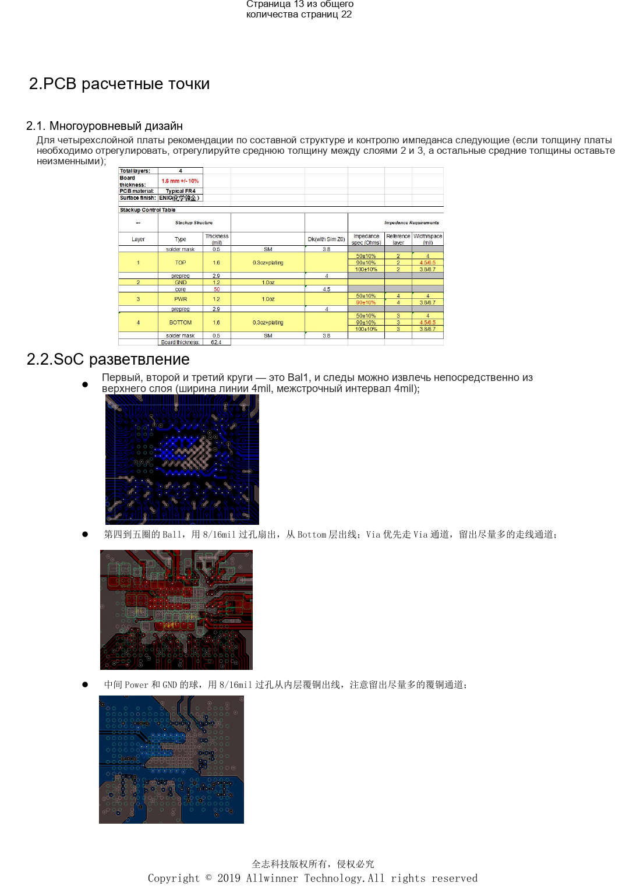
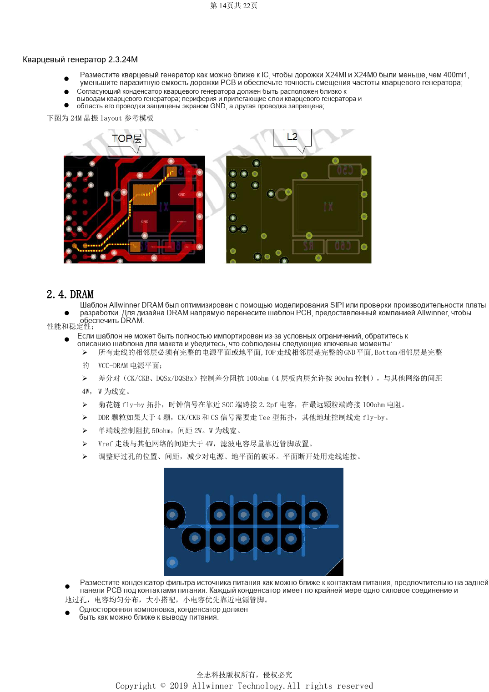

# H618 DDR и eMMC: шаблоны, импеданс и проверка PCB

Это тематический материал по исходному руководству, справка по платформе; соответствующая плата ArmSoM не подтверждена. Параметры взяты из источника, не из испытаний ArmSoM. Перед применением проверьте ревизию SoC, PCB, SDK/BSP, ядро, прошивку и периферию.

**Design V1.0 §1.5–1.6, §2.1–2.5; PDF 9–10, 14–16; PCB checklist V1.0**

## Сначала выберите память

Перечислены DDR4, DDR3/3L, LPDDR3 и LPDDR4, один канал 32-bit, два сигнала выбора и объём до 4GB. Шаблон должен соответствовать микросхеме и прошивке. На ZQ SoC и DRAM источник задаёт подтяжку к земле 240Ω, 1%. При перестановке групп данных по 8 бит переносите соответствующие DQM и пары DQS. Четырёхслойный эталон использует 4/4mil и переходы 8/16mil; изменение толщины платы не должно произвольно менять геометрию опорных слоёв.

## Трассировка DDR

Верхний слой опирается на сплошную GND, нижний — на VCC-DRAM. CK/DQS: 100Ω дифференциально, для внутренних трасс четырёхслойного эталона допускаются 90Ω; checklist отдельно задаёт 100Ω±10%, поэтому сверяйте шаблон. Зазор до других сетей 4W для пар, одиночные линии 50Ω и 2W, Vref более 4W. В примере fly-by стоят 2.2pF между тактовыми линиями у SoC и 100Ω у последней микросхемы. При числе микросхем больше четырёх CK/CS имеют Tee, остальные адресные линии — fly-by. Каждый конденсатор получает переход питания и земли; малые ёмкости ближе к выводам.

## eMMC: не только равная длина

CLK использует 33Ω, CMD — 10kΩ к VCC-PC. Домен GPIO SoC и eMMC VCCQ питаются одной линией. NC/RFU нельзя соединять ради удобства трассировки. Для заземляемых выводов eMMC5.0 текст не даёт полного списка: нужен datasheet выбранного компонента. Длина ≤2000mil, разница D0–D7/DS относительно CLK ≤300mil, импеданс 50Ω, зазор ≥2W; CLK/DS защищаются землёй либо зазором ≥3W. VCC/VCCQ ≥12mil и минимум два перехода. На высокой скорости предпочтительно соединение точка-точка; в совместной разводке eMMC заканчивает цепочку.

## Исходные иллюстрации

Снимки справочных страниц сохраняют китайские подписи. Соответствующий английский выпуск не найден; четыре языка используют китайские оригиналы. Параметры и шаги в тексте копируются, снимки служат сверке. Номера — физические страницы PDF.

## Выбор платформы ArmSoM

Для проекта ArmSoM выбирайте платформу по официальным продуктам и документации, заново проверяя процессор, интерфейсы и ПО. Схемы A733/H618 нельзя автоматически переносить на другой SoC.

- [ArmSoM](https://www.armsom.org/)
- [ArmSoM Docs](https://docs.armsom.org/)

## Материалы серии

- [Минимальная система H618: AXP313A, тактирование 24MHz и загрузка](/ru/articles/h618-power-clock-boot-design/)
- [Интерфейсы H618: USB, HDMI, Ethernet и ESD](/ru/articles/h618-interfaces-esd-layout/)
- [H618: первый запуск, прошивка, DDR и диагностика](/ru/articles/h618-bringup-stability-validation/)
- [H618 · Обзор серии](/ru/articles/h618-hardware-design-series/)
