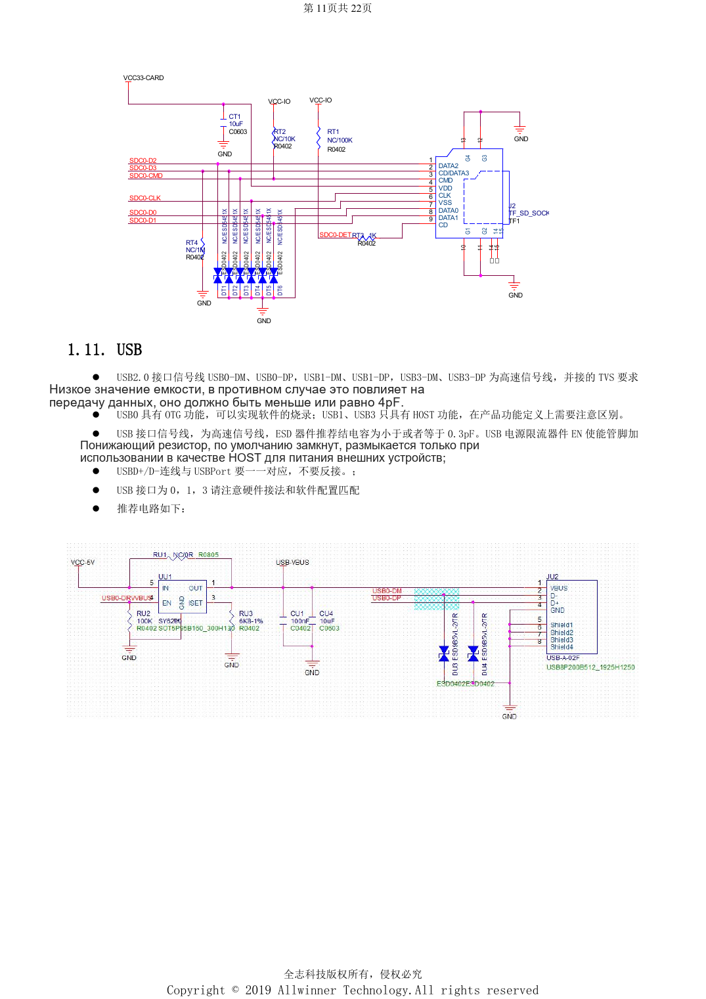
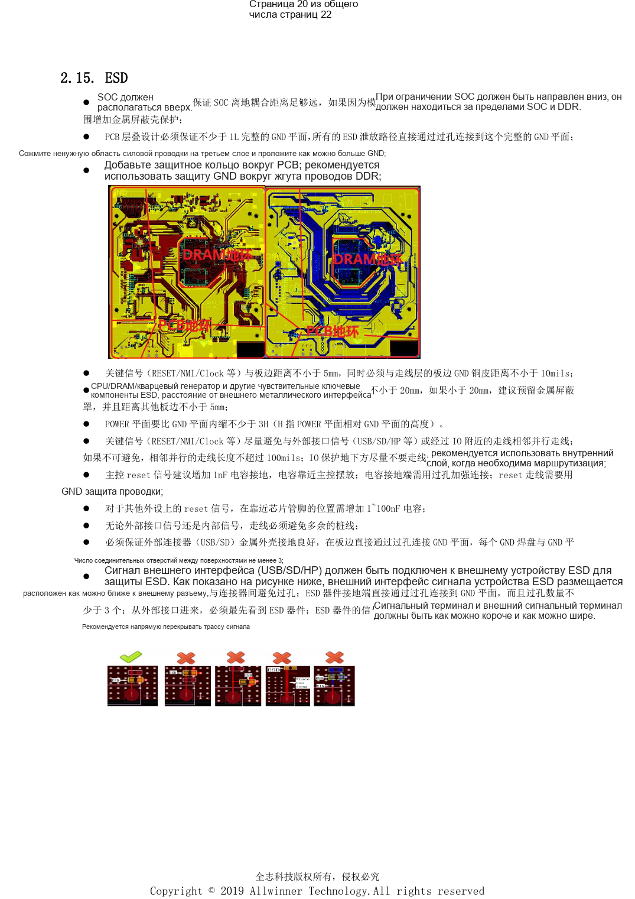

# Интерфейсы H618: USB, HDMI, Ethernet и ESD

Это тематический материал по исходному руководству, справка по платформе; соответствующая плата ArmSoM не подтверждена. Параметры взяты из источника, не из испытаний ArmSoM. Перед применением проверьте ревизию SoC, PCB, SDK/BSP, ядро, прошивку и периферию.

**Design V1.0 §1.7–1.13, §2.6–2.15; PDF 10–13, 17–21; PCB checklist V1.0**

## USB и дисплей

USB0 поддерживает OTG/прошивку, USB1 и USB3 — HOST. Номер 3 не означает USB3.0. EN ограничителя тока по умолчанию низкий, включается для питания в режиме HOST. На одной странице указаны TVS ≤4pF и ≤0.3pF: назначение необходимо уточнить, а не выбирать произвольный общий предел. HDMI содержит преобразование IIC/CEC; 5V защищается диодом Шоттки с малым падением против обратного питания и снижения ниже 4.75V. Токовый CVBS использует шунт 75Ω корпуса 0805 и защиту трассы землёй.

## Сеть, Wi-Fi и звук

Высоковольтные конденсаторы Ethernet: минимум 1206 и 2kV, резисторы 75Ω — 0805; под трансформатором запрещены трассы и медь. Руководство требует >50mil до низковольтной части, checklist — минимум 2mm: сохраняйте более строгую проверку. IO Wi-Fi согласуется с PG; пример SDIO CLK — 33Ω и 5.6pF. Пробуждение Bluetooth требует подходящего постоянно включённого питания. RF: 50Ω, желательно <6cm, >3mm от края, без ответвлений и смены слоя; земляные переходы через 0.5–1mm. AVCC аудио ≥25mil, VRA1/2 ≥10mil и ≤300mil; LINEOUT вдали от DDR.

## ESD и теплоотвод

Сохраните минимум одну сплошную GND. Защита располагается у разъёма до внутренних цепей, с минимум тремя земляными переходами. RESET/NMI/Clock: ≥5mm от края и ≥10mil от краевой меди; CPU/DDR/кварцы: ≥20mm от открытых металлических портов, иначе рассматривается экран. Для сброса SoC указан 1nF, периферии — 1–100nF; правила не взаимозаменяемы. Плоскость питания отступает от земли минимум на 3H. Тепловые переходы: отверстия 10–12mil, шаг 30–40mil; источники тепла распределяются, ориентир PMU–SoC >2cm. Нужны испытания всего изделия по нагреву и EMC.

## Параметры

| Пункт | Данные источника |
| --- | --- |
| Трассировка USB | 90Ω; length <4000mil; vias ≤2; clearance >10mil |
| Трассировка HDMI | 90–100Ω; intra-pair <10mil; inter-pair <100mil; length <3000mil |
| Трассировка SD | 50Ω; data-to-CLK <500mil; CLK resistor within 300mil of SoC |

## Исходные иллюстрации

Снимки справочных страниц сохраняют китайские подписи. Соответствующий английский выпуск не найден; четыре языка используют китайские оригиналы. Параметры и шаги в тексте копируются, снимки служат сверке. Номера — физические страницы PDF.

## Выбор платформы ArmSoM

Для проекта ArmSoM выбирайте платформу по официальным продуктам и документации, заново проверяя процессор, интерфейсы и ПО. Схемы A733/H618 нельзя автоматически переносить на другой SoC.

- [ArmSoM](https://www.armsom.org/)
- [ArmSoM Docs](https://docs.armsom.org/)

## Материалы серии

- [Минимальная система H618: AXP313A, тактирование 24MHz и загрузка](/ru/articles/h618-power-clock-boot-design/)
- [H618 DDR и eMMC: шаблоны, импеданс и проверка PCB](/ru/articles/h618-dram-emmc-pcb-design/)
- [H618: первый запуск, прошивка, DDR и диагностика](/ru/articles/h618-bringup-stability-validation/)
- [H618 · Обзор серии](/ru/articles/h618-hardware-design-series/)
