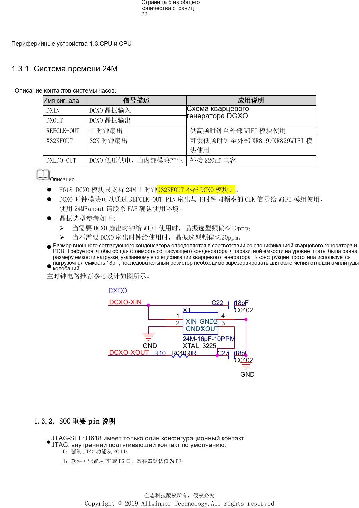
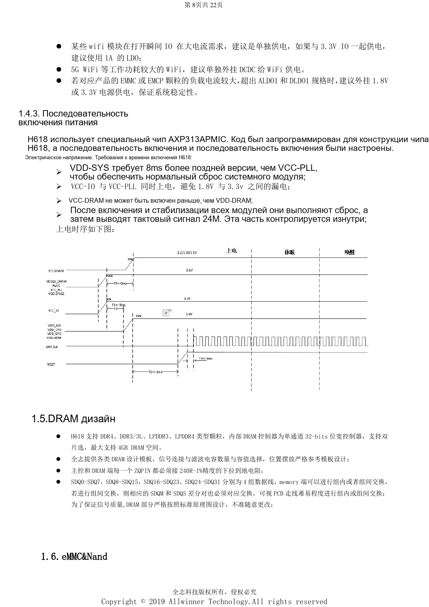

# Минимальная система H618: AXP313A, тактирование 24MHz и загрузка

Это тематический материал по исходному руководству, справка по платформе; соответствующая плата ArmSoM не подтверждена. Параметры взяты из источника, не из испытаний ArmSoM. Перед применением проверьте ревизию SoC, PCB, SDK/BSP, ядро, прошивку и периферию.

**Design V1.0 §1.1–1.4, §2.1–2.3, §2.11; PDF 5–9, 14–15, 19**

## От BROM до ОС

После сброса BROM инициализирует питание, такты, шины, сброс и накопитель. Настройки UART и DRAM загружаются в SRAM; затем выполняются Boot0, U-Boot и ОС с периферией. Доступ к UART, загрузочные перемычки и восстановление входят в минимальную систему. Внутренняя подтяжка JTAG-SEL задаёт высокий уровень: низкий принудительно выбирает PG, высокий позволяет программно выбрать PF/PG, по умолчанию PF. AP-RESET подтягивается к VCC-PLL; RC и ESD-защита сохраняются.

## Питание и последовательность

Эталон использует предварительно настроенный AXP313A. VDD-SYS включается через 8ms после VCC-PLL; VCC-IO одновременно с VCC-PLL, а VCC-DRAM не раньше VDD-DRAM. Затем выполняются внутренний сброс и запуск 24MHz. Питание CPU выделено для DVFS; общую линию GPU/SYS нельзя независимо регулировать для GPU. Предусмотрены 22µF у регулятора и CPU, два 22µF около SYS/GPU и минимум 10µF около VCC-DRAM. Для мощного Wi-Fi или eMMC с током выше возможностей LDO требуется отдельная оценка питания.

## Тактирование и противоречия

DCXO поддерживает только 24MHz; допуск кварца ≤10ppm при выдаче такта Wi-Fi и ≤20ppm иначе. DXLDO-OUT требует 220nF. Конденсаторы 18pF — пример прототипа, не универсальное значение. DXIN/DXOUT короче 400mil с защитой землёй. В таблице ток SYS+GPU равен 1.6A при возможности PMU 1.5A: запас не подтверждён, требуется уточнение. Оглавление указывает V2.1, обложка и история — V1.0; здесь используется обозначение V1.0.

## Параметры

| Пункт | Данные источника |
| --- | --- |
| Загрузка; PC3/4/5/6 | MLC NAND / SLC NAND: 1/1/1/1; eMMC USER: 0/1/1/1; eMMC BOOT: 1/0/1/1; SPI_NOR: 1/1/0/1; SPI_NAND: 1/1/1/0 |
| Минимум питания модуля | >=1.78V; nominal 1.8V ±1% |

## Исходные иллюстрации

Снимки справочных страниц сохраняют китайские подписи. Соответствующий английский выпуск не найден; четыре языка используют китайские оригиналы. Параметры и шаги в тексте копируются, снимки служат сверке. Номера — физические страницы PDF.

## Выбор платформы ArmSoM

Для проекта ArmSoM выбирайте платформу по официальным продуктам и документации, заново проверяя процессор, интерфейсы и ПО. Схемы A733/H618 нельзя автоматически переносить на другой SoC.

- [ArmSoM](https://www.armsom.org/)
- [ArmSoM Docs](https://docs.armsom.org/)

## Материалы серии

- [H618 DDR и eMMC: шаблоны, импеданс и проверка PCB](/ru/articles/h618-dram-emmc-pcb-design/)
- [Интерфейсы H618: USB, HDMI, Ethernet и ESD](/ru/articles/h618-interfaces-esd-layout/)
- [H618: первый запуск, прошивка, DDR и диагностика](/ru/articles/h618-bringup-stability-validation/)
- [H618 · Обзор серии](/ru/articles/h618-hardware-design-series/)

<!-- editable-source-tables -->

## Приложение: таблица AXP313A

Design V1.0 · PDF 8

CPU/SYS в источнике имеют «+5%», не «±5%»; знак не исправлен молча. Противоречие тока SYS+GPU описано выше. DRAM здесь — пример DDR3.

| Питание | Напряжение | Точность источника | Пульсации | Пик сценария | Возможность PMU |
| --- | --- | --- | --- | --- | --- |
| CPU | 0.9V | 0.9V+5% | <90mV | 1.8A | 3A |
| SYS+GPU | 0.94V | 0.94V+5% | <90mV | 1.6A | 1.5A |
| DRAM | 1.5V | 1.5V±10% | <125mV | 1A | 2A |
| Module | 1.8V | 1.8V±1% | <30mV | 100mA | 300mA |
| IO normal | 3.3V | 3.3V±10% | <125mV | 200mA | 500mA |
