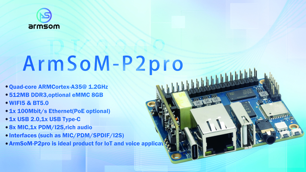

Компактность, Linux и проводная/беспроводная связь делают P2 Pro основой лёгких прототипов сбора и передачи данных. Задача — связать оборудование с приложением, а не заменить высокопроизводительную сетевую систему. Сначала определить частоты опроса, очередь и протоколы.

## Выбор комплектации

| Пункт | Опубликовано | Что уточнить |
|---|---|---|
| CPU | RK3308B-S, четыре Cortex-A35 | Частота и архитектура образа |
| RAM | Обычно 512MB DDR3; документация также 256/512MB | Поставленная версия |
| Накопитель | MicroSD, опционально 8GB eMMC | eMMC не считать обязательным |
| Сеть | Один Fast Ethernet, AP6256 | Драйвер, антенна, диапазоны и покрытие |
| Питание | Type-C 5V/2A; PoE опционально | Наличие модуля |
| Размер/температура | 65×52.5mm; указано 0–70°C | Испытать корпус и целое изделие |

Официальные страницы также расходятся между Bluetooth4.2 и 5.0. Здесь подтверждается модуль и возможность связи; версию и функции проверять по модулю, прошивке и образу.

## Датчики и состояние

Через подходящие I2C-, SPI- или последовательные компоненты читать параметры среды и оборудования, проверять диапазоны, добавлять время и передавать. Сначала проверить напряжения, преобразователи уровней, изоляцию и питание. GPIO UART не является RS232/RS485; полевые шины требуют трансиверов.

## Шлюз сообщений

Оценить, например, MQTT, разделив сбор, очередь и отправку. Установить интервалы повторов, предел очереди и срок действия записей. После восстановления связи не отправлять бесконечно устаревшие сообщения. Предусмотреть TLS, аутентификацию, обновления и журналы даже во внутренней сети.

## Сетевые аудиособытия

Получать события приложения и проигрывать сигналы или речь. Измерить ресурсы при одновременных сети и аудио. При внешнем речевом сервисе определить работу без подключения.

## Сетевые границы и сопровождение

Один Fast Ethernet не равен двухпортовому маршрутизатору. Можно оценивать обмен между проводной и беспроводной сетью, но мост, маршрутизация и VPN требуют отдельных измерений пропускной способности.

Debian11, Buildroot и сторонние OpenWrt/istoreos — варианты из документации, не утверждение об актуальности всех выпусков или одинаковой поддержке периферии. Проверять источник, плату, драйверы и сопровождение образа.

## Последовательность испытаний

1. Проверить комплектацию, питание, загрузку, накопитель и сеть.
2. Подключить реальный датчик; записывать время, неверные значения и ошибки связи.
3. Добавить ограниченную очередь; проверить обрыв, перезапуск и потерю питания.
4. Измерить CPU, RAM, запись и длительный нагрев; убрать лишние службы.
5. Проверить обновление и откат, зафиксировать версии образа и приложения.

Это пути разработки, не сертификация и не результаты теста стабильности. P2 Pro помогает создать прототип, но конечное изделие требует собственной проверки.

## Статьи серии и официальные материалы

- [RK3308B-S: процессор для речи, аудио и подключённых устройств](/ru/articles/rk3308bs-chip-guide/)
- [ArmSoM P2 Pro: микрофоны, голосовой интерфейс и сетевое аудио](/ru/articles/p2pro-voice-audio-applications/)
- [RK3308B-S Datasheet V1.0: загрузка, аудиоархитектура и электрические параметры](/ru/articles/rk3308bs-datasheet-v10/)
- [Rockchip Audio](/ru/articles/023-rockchip-audio/)
- [Rockchip RK3308](https://www.rock-chips.com/a/cn/product/RK33xilie/2018/0614/908.html)
- [P2 Pro — Docs](https://docs.armsom.org/armsom-p2pro)
- [P2 Pro — ArmSoM](https://www.armsom.org/product-page/p2pro)
- [P2 Pro — BSP](https://github.com/ArmSoM/armsom-p2pro-bsp)
