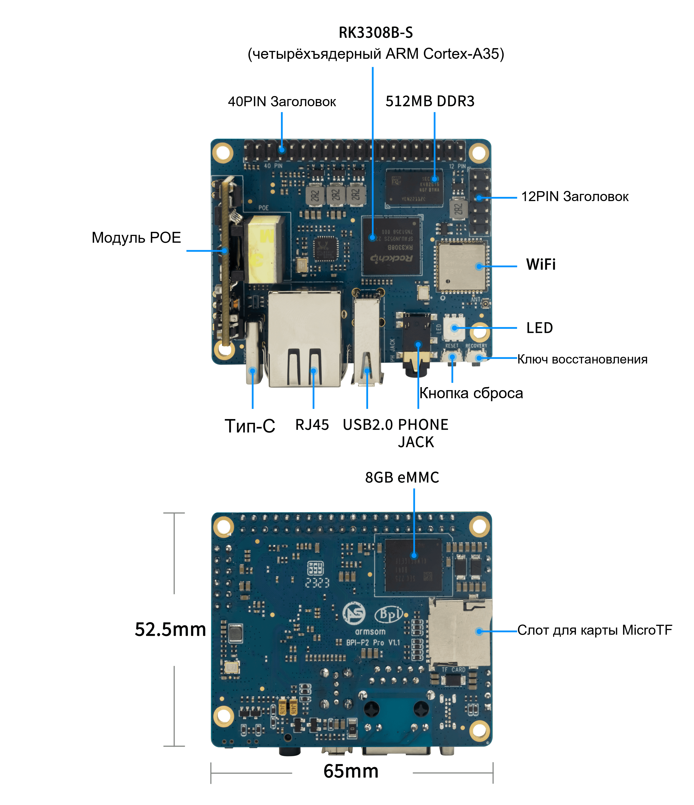

Голосовая плата полезна, когда можно объединить микрофоны, выход, сеть и Linux. ArmSoM P2 Pro на RK3308B-S подходит для голосовых прототипов, сетевого аудио и многоканальной записи. Сначала стабилизировать сигнальный тракт, затем добавлять сложные алгоритмы.

## Понимание интерфейсов

Документация перечисляет восемь MIC, PDM/I2S, два линейных выхода и SPDIF на 40-pin, а также аудиоразъём. Это не готовый установленный микрофонный массив. Микрофоны, геометрию, кабели и конфигурацию захвата выбирать отдельно.

Аудиоразъём 40-pin нельзя считать совместимым с Raspberry Pi только по числу контактов. Проверить схему, напряжение, MICBIAS и дифференциальные входы. Линейный выход не является силовым выходом динамика.

## Голосовые команды

Разделить захват, предобработку, обнаружение события, распознавание, действие и ответ. VAD сообщает об активности; ключевое слово и распознавание выбираются отдельно. Можно оценить локальную систему с ограниченным словарём или явно выбранный удалённый сервис. Локально измерять CPU, память и точность; удалённо учитывать связь, задержки и обработку данных.

Проверять тишину, музыку, нескольких говорящих, собственное воспроизведение и отсутствие сети. Записывать ложные срабатывания, пропуски и сквозную задержку. Одна успешная демонстрация не подтверждает дальность и наличие лицензии алгоритма.

## Сетевое воспроизведение и уведомления

Разделить приём, буферизацию, декодирование и воспроизведение. Проверить опустошение буфера, восстановление потока и смену громкости. Для усилителя сверить уровни и землю; параметры наушников/LineOut не равны мощности готовой колонки.

Возможны терминалы оповещения, настольные проигрыватели и голосовая обратная связь оборудования. Синхронное воспроизведение несколькими узлами требует синхронизации времени, компенсации дрейфа и буферов; Wi-Fi этого сам не гарантирует.

## Многоканальный захват

С одним микрофоном проверить полярность, усиление и формат; затем порядок каналов и совместный захват. Руководство различает внешние IO и внутренние связи кодека. Число контроллеров не равно числу внешних портов. Допустимые сочетания каналов и частот проверять по интерфейсу.

Эти команды перечисляют устройства ALSA и не записывают звук. Номера устройств брать из вывода, а не задавать заранее:

```sh
cat /proc/asound/cards
arecord -l
aplay -l
```

## Стабильная работа

Зафиксировать ревизию, образ, ядро, звуковую конфигурацию, микрофоны и питание. Проверить прерывания захвата, потерянные отсчёты, дрейф, попадание воспроизведения во вход и температуру. Длительная запись требует расчёта ёмкости и ресурса flash. Разные опубликованные частоты не подтверждают быстродействие алгоритма. BSP и аудиоруководство дают дальнейшие материалы; команды документации не являются проведёнными здесь аппаратными испытаниями.

## Статьи серии и официальные материалы

- [RK3308B-S: процессор для речи, аудио и подключённых устройств](/ru/articles/rk3308bs-chip-guide/)
- [ArmSoM P2 Pro: сбор данных IoT и разработка компактного шлюза](/ru/articles/p2pro-iot-lightweight-gateway/)
- [RK3308B-S Datasheet V1.0: загрузка, аудиоархитектура и электрические параметры](/ru/articles/rk3308bs-datasheet-v10/)
- [Rockchip Audio](/ru/articles/023-rockchip-audio/)
- [Rockchip RK3308](https://www.rock-chips.com/a/cn/product/RK33xilie/2018/0614/908.html)
- [P2 Pro — Docs](https://docs.armsom.org/armsom-p2pro)
- [P2 Pro — ArmSoM](https://www.armsom.org/product-page/p2pro)
- [P2 Pro — BSP](https://github.com/ArmSoM/armsom-p2pro-bsp)
