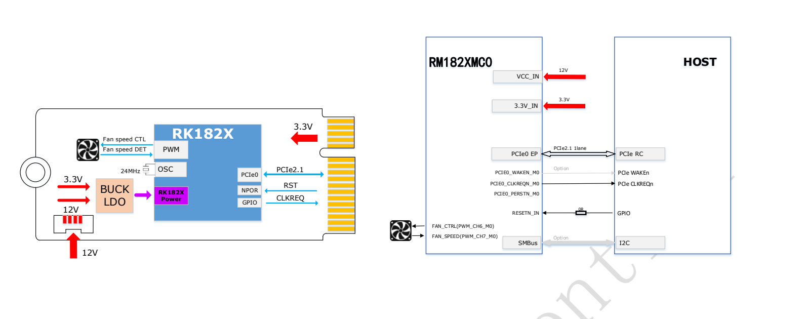
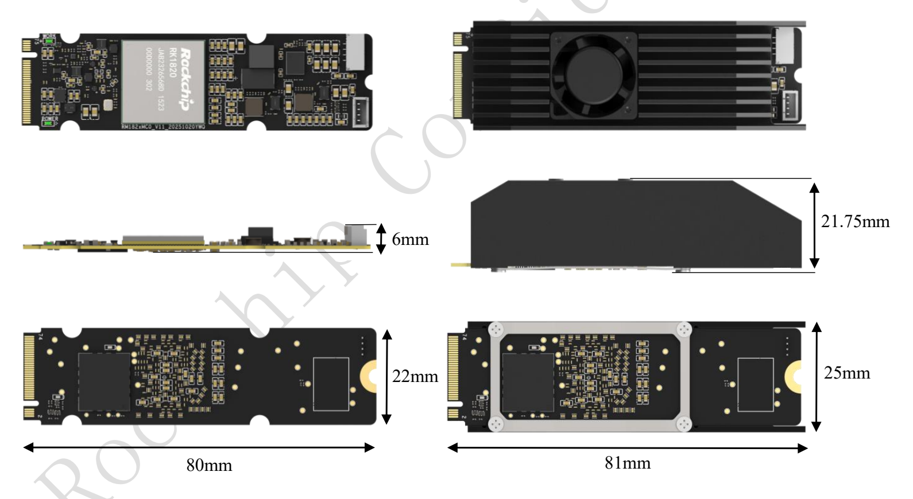

RM182XMC0 — семейство ИИ-сопроцессоров RK182X в M.2 Key M: RM1820MC0 и RM1828MC0. Статья систематизирует спецификацию, таблицу производительности, питание, рисунки и заказы из предоставленного двухстраничного Rev1.0 для оценки с ArmSoM. Исходные измерения не являются тестами ArmSoM.

[Скачать исходный Brief, 2 страницы](/assets/rk182x/RK182X-M2-Brief-V1.0.pdf)

## 1. Модели и вычисления

| Модель заказа | Чип | Встроенная DRAM | Позиционирование | Интерфейс |
|---|---|---|---|---|
| RM1820MC0 | RK1820 | 2.5GB | 3B | M.2 Key M, PCIe2.1 |
| RM1828MC0 | RK1828 | 5GB | 7B | M.2 Key M, PCIe2.1 |

20TOPS@INT8, поддержка INT4/INT8/INT16/FP8/FP16/BF16. Китайский Brief описывает пропускную способность DRAM как «сотни GB», не указывая явно единицу в секунду, точное число или условия. Здесь значение GB/s не выдумывается. Размер модели не определяет квантование, контекст или память исполнения.

## 2. Модели и программные компоненты

Перечислены Qwen2.5 0.5B/1.5B/3B, Qwen3 0.6B/1.7B, FastVLM, MobilnetV1, MobilnetV2, Resnet50V2, yolov5s, yolov6s, yolov8s. `Mobilnet` — исходное написание. Qwen2.5 7B отдельно присутствует в таблице результатов, хотя отсутствует в списке; сохранены оба раздела.

ПО: RKNN3 Toolkit на компьютере разработчика, RKNN3 Runtime на плате, RKNN3 Model Zoo с примерами конвертации/развёртывания. Версии, команды установки, матрица ОС и квантование не указаны. Нужны согласованные пакеты и инструкции.

## 3. Производительность и мощность источника

Оба режима указывают **Input tokens: 128**. TTFT — время до первого токена, TPS — скорость генерации. Числа перенесены из оригинала.

| Модель | Режим | TTFT (ms) | TPS (tokens/s) | Средняя мощность (W) | Пиковая мощность (W) |
|---|---|---|---|---|---|
| Qwen2.5 3B | Экономичный | 144.455 | 54.537 | 5.35 | 15.14 |
| Qwen2.5 3B | Стандартный | 96.05 | 77.945 | 7.2 | 24.86 |
| Qwen2.5 7B | Экономичный | 288.255 | 35.044 | 7.02 | 16.11 |
| Qwen2.5 7B | Стандартный | 186.435 | 51.476 | 10.4 | 27.28 |

Хост, firmware, квантование, длина ответа, семплирование, охлаждение и границы измерения мощности не раскрыты полностью. Нельзя обещать такую скорость любой 3B/7B-модели; средняя мощность не заменяет пиковую потребность питания.

## 4. Питание и соединение с HOST

**Кроме 3.3V слота M.2 требуется дополнительное 12V.** PCIe0 EP соединяется с RC хоста по PCIe2.1 x1; указаны CLKREQ, опциональный WAKE, RESETN_IN/0Ω, опциональный SMBus/I2C, PWM/тахометр вентилятора. Key M не делает модуль NVMe SSD и не гарантирует питание или ПО любого слота.

## 5. Габариты

Без радиатора 22×80mm, сбоку отмечено 6mm. С охлаждением: длина 81mm, ширина 25mm, высота 21.75mm. Помимо контура 2280 нужны место для питания, крепления и воздуха. Рисунок не является полным производственным чертежом допусков.

## 6. Отличия SO-DIMM

M.2: RM1820MC0/RM1828MC0; SO-DIMM: RM1820SA0/RM1828SA0. Общий чип не означает одинаковые интерфейсы, питание, механику или firmware. Нельзя без проверки переносить 8–14.4V, 260 контактов и тепловые пределы SO-DIMM на M.2.

## 7. Порядок оценки с ArmSoM

Проверить RC/разводку слота →3.3V, дополнительное 12V и пиковый запас →габариты охлаждения →драйвер, firmware, RKNN3 →точность, TTFT/TPS, стабильность. Эти PDF не подтверждают прямую поддержку определённой платы ArmSoM; нужна проверка конкретной ревизии.

## Связанная документация

- [Модуль RK182X SO-DIMM: архитектура, 260 контактов, питание и интеграция](/ru/articles/rk182x-sodimm-module-datasheet/)
- [ArmSoM Docs](https://docs.armsom.org/)
