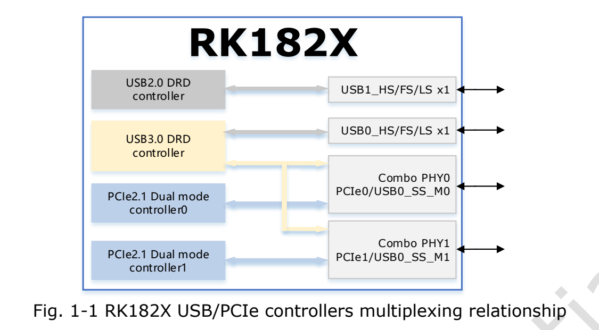
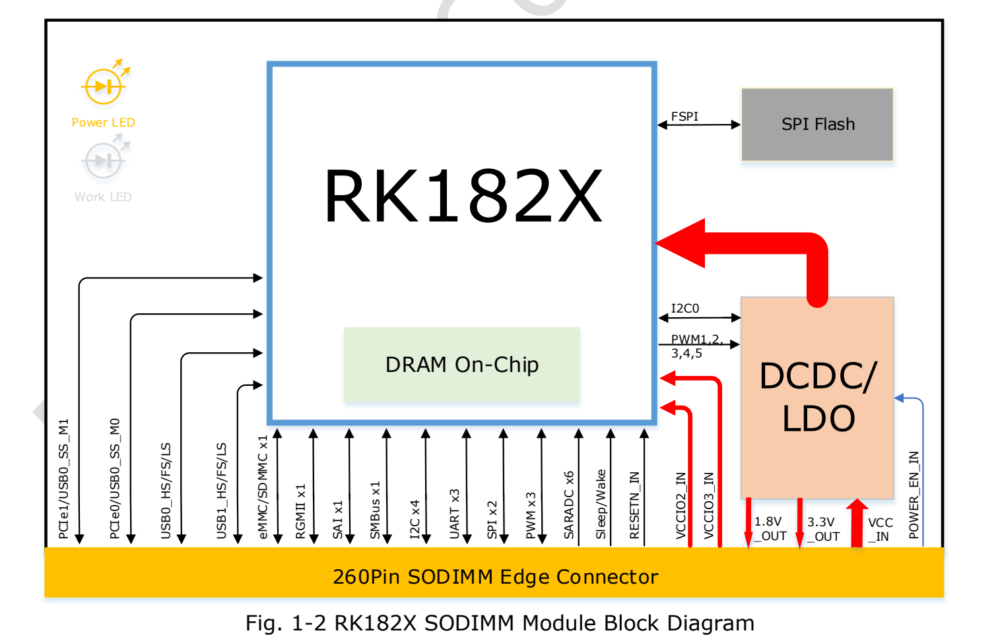
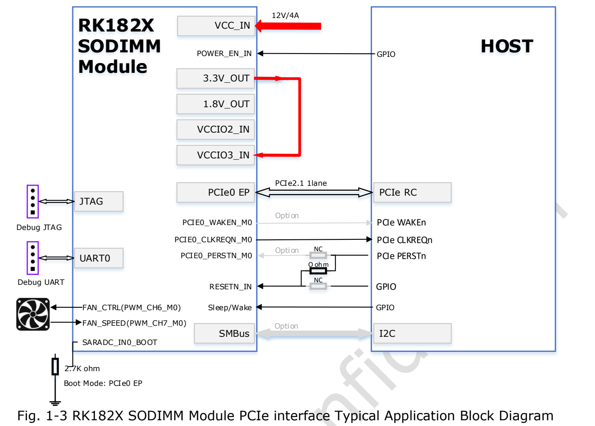
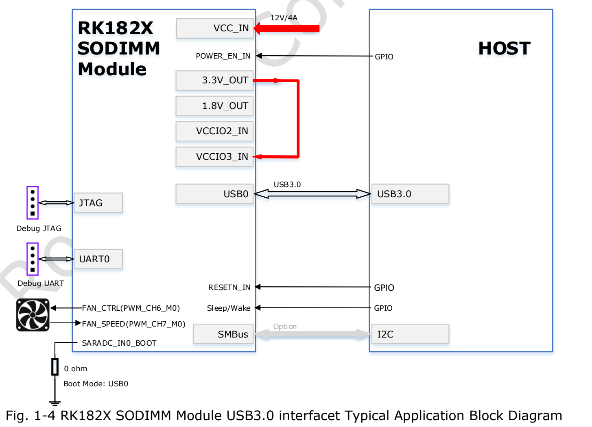
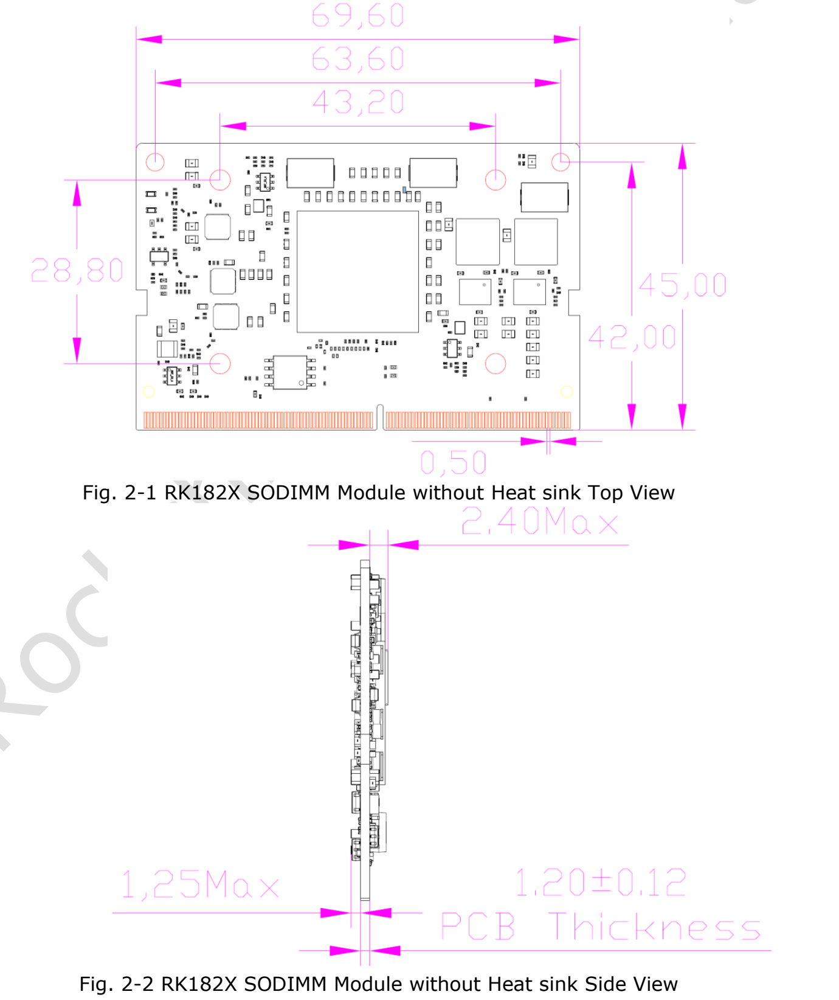
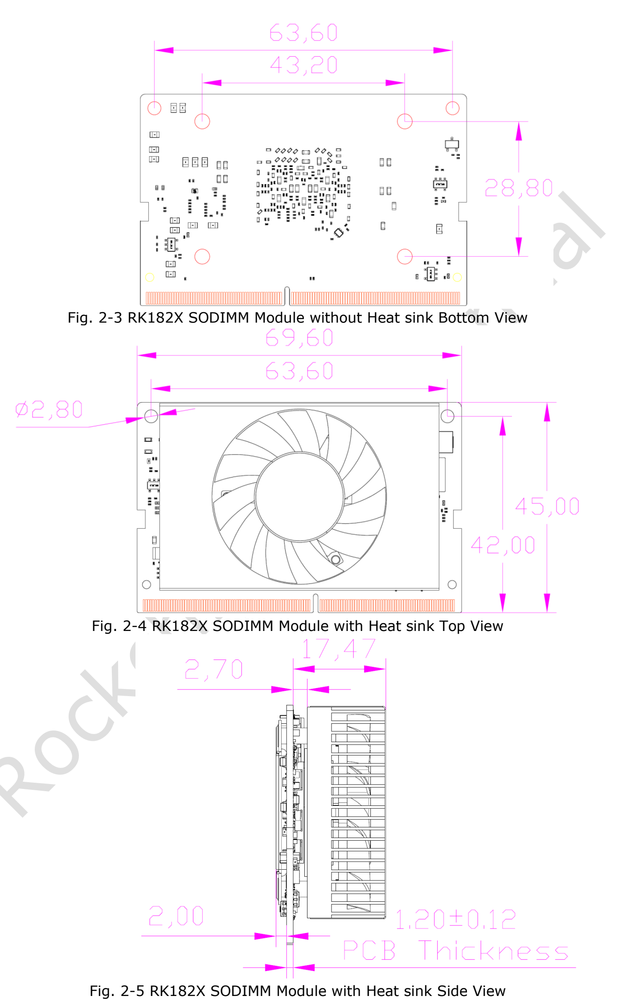
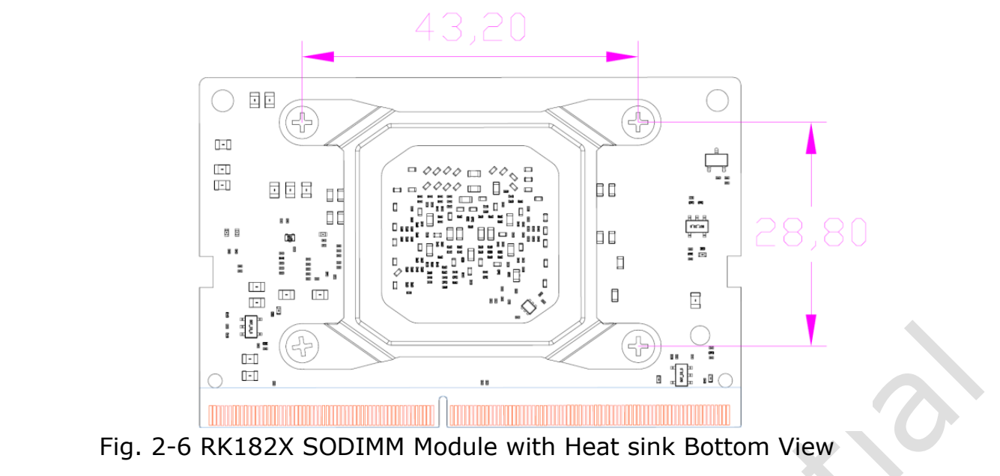

RK182X — **ИИ-сопроцессор** для инференса и машинного зрения. Основа — предоставленный RK182X SODIMM Module Datasheet Rev1.1; статья предназначена для оценки с хостом ArmSoM или собственной платой. Это не самостоятельная универсальная хост-плата. Формат 260-pin SO-DIMM не означает взаимозаменяемость с AIM7, Jetson или слотами памяти.

[Полный исходный PDF, 24 страницы](/assets/rk182x/RK182X-SODIMM-Datasheet-V1.1.pdf)

Руководство включает все 260 контактов и основные электрические пределы. Полный перечень функций и условия интерфейсных измерений находятся в оригинале. Аппаратная совместимость ArmSoM и производительность моделей здесь не измерялись.

## 1. Модели, ядра и память

| Модуль | Чип | Встроенная DRAM | Позиционирование источника |
|---|---|---|---|
| RM1820SA0 | RK1820 | 2.5GB | 3B |
| RM1828SA0 | RK1828 | 5GB | 7B |

Три независимых 64-bit RISC-V ядра — SRV, VRV0, VRV1. SRV использует RV64GCB, векторные ядра — RV64GCBV. У каждого FPU H/F/D, 32KB кэша инструкций, 32KB данных и 128KB L2. VRV0/VRV1 имеют 128-bit векторные блоки. В одной строке оригинала написано VR0; по контексту используется VRV0, расхождение сохранено в записи проверки.

NPU: до **20 TOPS INT8**, INT4/INT8/INT16/FP8/FP16/BF16. Источник перечисляет TensorFlow, MXNet, PyTorch, Caffe, Tflite, Onnx NN, Android NN. Это не гарантирует любую версию, оператор или модель.

BootROM поддерживает загрузку с FSPI/eMMC/SD/MMC и скачивание через USB0/UART0/PCIe0. Есть 512KB системной SRAM и SPI Flash модуля. Режимы общего SDMMC взаимоисключающие: eMMC4.51 с HS200, 1/4/8-bit, без CMD Queue; SD3.0/MMC4.51 с 1/4-bit.

## 2. Система и обработка изображений

Четыре PLL, вход 24MHz, раздельное тактирование и общие/локальные программные сбросы. Домены PMU: VDD_TOP, VDD_LOGIC, VDD_PMU. Шесть 64-bit таймеров, три 32-bit watchdog и 12 межъядерных почтовых ящиков. DMA: два физических, 24 логических канала, 22 группы запросов периферии, передачи память/периферия, списки и многоблочные операции.

Источников прерываний 160 для SRV, 64 для VRV; программные прерывания M/S, активный высокий уровень, программируемые приоритеты. Криптоблок перечисляет AES-128/192/256, SM4, SHA-1, SHA-256/224, MD5, SM3, соответствующие HMAC, RSA до 4096-bit, ECC до 256-bit, SM2, многоступенчатый Key-ladder. Перечень не рекомендует все устаревшие алгоритмы для новых систем.

JPEG-кодирование: Baseline/JFIF1.02, 16×16–65520×65520; декодирование начинается с 48×48. Написание декодерного формата `RG888` сохранено, не исправлено молча на `RGB888`.

RGA: BT.601/709, дизеринг, источник 8192×8192/результат 4096×4096, масштаб 1/16–16, повороты 0/90/180/270°, зеркалоXY, BitBLT, Alpha, YUV2YUV CSC, инверсия OSD. При увеличении бикубическая фильтрация по оригиналу сменяется билинейной при source>1992; порог сохранён до проверки SDK. Некоторые 10-bit входы обрезаются до 8-bit, поэтому сквозной 10-bit выход не обещается.

## 3. Интерфейсы и мультиплексирование

Два Combo PHY обслуживают два PCIe2.1 и один USB3.0 DRD; SuperSpeed USB выбирает один PHY. Каждый PCIe — x1, RC/EP, 2.5/5.0Gbps в каждом направлении. Все функции нельзя считать одновременно независимыми портами.

| Интерфейс | Возможности источника |
|---|---|
| Ethernet | Один MAC, RGMII, 10/100/1000Mbps, полный/полудуплекс, TSO/USO, IEEE1588-2002/2008 |
| USB2.0 DRD | 480/12/1.5Mbps, EHCI1.0, OHCI1.0a |
| USB3.0 DRD | Статический Device или xHCI Host |
| SPI | Два контроллера, два CS, настраиваемый master/slave |
| I2C | Четыре master, адрес 7/10-bit, 100k/400k/1M bit/s |
| SMBus | Один slave, байт/слово/32-bit/блок, PEC, Alert, UDID, растяжение такта |
| UART | Три, TX/RX FIFO по 64 байта, 5/6/7/8-bit, до 4Mbps; UART2 поток/RS485 |
| PWM | Три, захват, непрерывный/однократный, двухступенчатый делитель, кнопка питания, частотомер, счётчик |
| SAI | Один, 4 TX+4 RX, I2S/PCM/TDM, до 128 слотов, длина/данные 8–32bit |
| GPIO | Уровень/нарастающий/спадающий/оба фронта, полярность, слабые подтяжки, сила драйвера |
| OTP | 8K bits, 6.5K для безопасности; Program/Read/Idle |

## 4. Подключение хоста

Пример PCIe: хост RC, модуль PCIe0 EP, 12V/4A, резистор выбора загрузки 2.7kΩ. USB-пример выбирает USB0 с 0Ω. Сверьте reset, CLKREQ, опциональные WAKE/PERST, SMBus, UART/JTAG отладки, PWM/тахометр вентилятора с рисунками и окончательным референсным проектом. Не включайте непроверенную плату только по этому тексту.

## 5. Механика и 260 контактов

69.6×45mm, 260-pin SO-DIMM, шаг 0.5mm. На рисунках указаны толщина PCB1.20±0.12mm и максимумы компонентов 2.40mm/1.25mm по сторонам. Учтите радиатор и разъём; размеры в mm.

Все 260 контактов; сохранены мультиплексирование, RSVD, NC и двойной слеш контакта 195.

| Контакт | Исходное имя сигнала |
|---|---|
| 1 | `GND` |
| 2 | `GND` |
| 3 | `RSVD` |
| 4 | `RSVD` |
| 5 | `RSVD` |
| 6 | `RSVD` |
| 7 | `GND` |
| 8 | `GND` |
| 9 | `RSVD` |
| 10 | `RSVD` |
| 11 | `RSVD` |
| 12 | `RSVD` |
| 13 | `GND` |
| 14 | `GND` |
| 15 | `RSVD` |
| 16 | `RSVD` |
| 17 | `RSVD` |
| 18 | `RSVD` |
| 19 | `GND` |
| 20 | `GND` |
| 21 | `3.3V OUT` |
| 22 | `RSVD` |
| 23 | `3.3V OUT` |
| 24 | `RSVD` |
| 25 | `GND` |
| 26 | `GND` |
| 27 | `1.8V OUT` |
| 28 | `RSVD` |
| 29 | `1.8V OUT` |
| 30 | `RSVD` |
| 31 | `GND` |
| 32 | `GND` |
| 33 | `VCCIO2_IN` |
| 34 | `RSVD` |
| 35 | `VCCIO3_IN` |
| 36 | `RSVD` |
| 37 | `GND` |
| 38 | `GND` |
| 39 | `RSVD` |
| 40 | `RSVD` |
| 41 | `RSVD` |
| 42 | `RSVD` |
| 43 | `GND` |
| 44 | `GND` |
| 45 | `RSVD` |
| 46 | `RSVD` |
| 47 | `RSVD` |
| 48 | `RSVD` |
| 49 | `GND` |
| 50 | `GND` |
| 51 | `RSVD` |
| 52 | `RSVD` |
| 53 | `RSVD` |
| 54 | `RSVD` |
| 55 | `GND` |
| 56 | `GND` |
| 57 | `RSVD` |
| 58 | `RSVD` |
| 59 | `RSVD` |
| 60 | `RSVD` |
| 61 | `GND` |
| 62 | `GND` |
| 63 | `RSVD` |
| 64 | `RSVD` |
| 65 | `RSVD` |
| 66 | `RSVD` |
| 67 | `GND` |
| 68 | `GND` |
| 69 | `RSVD` |
| 70 | `RSVD` |
| 71 | `RSVD` |
| 72 | `RSVD` |
| 73 | `GND` |
| 74 | `GND` |
| 75 | `RSVD` |
| 76 | `RSVD` |
| 77 | `RSVD` |
| 78 | `RSVD` |
| 79 | `GND` |
| 80 | `GND` |
| 81 | `RSVD` |
| 82 | `RSVD` |
| 83 | `RSVD` |
| 84 | `RSVD` |
| 85 | `GND` |
| 86 | `GND` |
| 87 | `USB0_DRD_VBUSDET` |
| 88 | `RSVD` |
| 89 | `ETH_TXD0/PCIE1_WAKEN_M2/PWM_CH0_M1/SPI0_MOSI_M2/GPIO1_A6_d` |
| 90 | `RSVD` |
| 91 | `ETH_TXCTL/PCIE1_CLKREQN_M2/SPI0_CLK_M2/GPIO1_B2_d` |
| 92 | `RSVD` |
| 93 | `ETH_TXD1/PCIE1_PERSTN_M2/SPI0_MISO_M2/GPIO1_A7_d` |
| 94 | `RSVD` |
| 95 | `ETH_RXD0/SPI0_CS0N_M2/GPIO1_B4_d` |
| 96 | `RSVD` |
| 97 | `ETH_RXD1/SPI0_CS1N_M2/GPIO1_B5_d` |
| 98 | `RSVD` |
| 99 | `SARADC_IN6/PCIE0_PERSTN_M1/I2C4_SCL_M0/SAI_SDI2_M2/UART2_TX_M0/PWM_CH6_M2/GPIO1_D6_d` |
| 100 | `RSVD` |
| 101 | `SARADC_IN7/PCIE0_WAKEN_M1/I2C4_SDA_M0/SAI_SDI3_M2/UART2_RX_M0/PWM_CH7_M2/GPIO1_D7_d` |
| 102 | `GND` |
| 103 | `RSVD` |
| 104 | `ETH_TXD2/SPI1_MOSI_M2/GPIO1_B0_d` |
| 105 | `RSVD` |
| 106 | `ETH_TXCLK/I2C1_SCL_M1/SPI1_CLK_M2/GPIO1_B3_d` |
| 107 | `GND` |
| 108 | `ETH_TXD3/SPI1_MISO_M2/GPIO1_B1_d` |
| 109 | `USB0_DRD_DM` |
| 110 | `ETH_RXD2/I2C1_SDA_M1/SPI1_CS0N_M2/GPIO1_B6_d` |
| 111 | `USB0_DRD_DP` |
| 112 | `ETH_RXD3/I2C4_SCL_M1/SPI1_CS1N_M2/GPIO1_B7_d` |
| 113 | `GND` |
| 114 | `RSVD` |
| 115 | `USB1_DRD_DM` |
| 116 | `RSVD` |
| 117 | `USB1_DRD_DP` |
| 118 | `SARADC_IN5/PCIE0_CLKREQN_M1/SAI_SDI1_M2/SPI0_CS1N_M1/GPIO1_D5_d` |
| 119 | `GND` |
| 120 | `RSVD` |
| 121 | `RSVD` |
| 122 | `RSVD` |
| 123 | `RSVD` |
| 124 | `ETH_RXCTL/PCIE0_WAKEN_M2/GPIO1_C0_d` |
| 125 | `GND` |
| 126 | `ETH_RXCLK/I2C4_SDA_M1/GPIO1_C1_d` |
| 127 | `USB0_DRD_ID` |
| 128 | `ETH_MDC/PCIE0_PERSTN_M2/GPIO1_C2_d` |
| 129 | `GND` |
| 130 | `ETH_MDIO/PCIE0_CLKREQN_M2/GPIO1_C3_d` |
| 131 | `PCIE0_RXN/USB0_DRD_SSRXN_M0` |
| 132 | `GND` |
| 133 | `PCIE0_RXP/USB0_DRD_SSRXP_M0` |
| 134 | `PCIE0_TXN/USB0_DRD_SSTXN_M0` |
| 135 | `GND` |
| 136 | `PCIE0_TXP/USB0_DRD_SSTXP_M0` |
| 137 | `RSVD` |
| 138 | `GND` |
| 139 | `RSVD` |
| 140 | `RSVD` |
| 141 | `GND` |
| 142 | `RSVD` |
| 143 | `RSVD` |
| 144 | `GND` |
| 145 | `RSVD` |
| 146 | `GND` |
| 147 | `GND` |
| 148 | `RSVD` |
| 149 | `RSVD` |
| 150 | `RSVD` |
| 151 | `RSVD` |
| 152 | `GND` |
| 153 | `GND` |
| 154 | `RSVD` |
| 155 | `RSVD` |
| 156 | `RSVD` |
| 157 | `RSVD` |
| 158 | `GND` |
| 159 | `GND` |
| 160 | `PCIE0_REFCLKN` |
| 161 | `PCIE1_RXN/USB0_DRD_SSRXN_M1` |
| 162 | `PCIE0_REFCLKP` |
| 163 | `PCIE1_RXP/USB0_DRD_SSRXP_M1` |
| 164 | `GND` |
| 165 | `GND` |
| 166 | `PCIE1_TXN/USB0_DRD_SSTXN_M1` |
| 167 | `RSVD` |
| 168 | `PCIE1_TXP/USB0_DRD_SSTXP_M1` |
| 169 | `RSVD` |
| 170 | `GND` |
| 171 | `GND` |
| 172 | `RSVD` |
| 173 | `PCIE1_REFCLKN` |
| 174 | `RSVD` |
| 175 | `PCIE1_REFCLKP` |
| 176 | `GND` |
| 177 | `GND` |
| 178 | `RSVD` |
| 179 | `I2C2_SCL_M0/UART1_CTSN_M0/PCIE0_WAKEN_M0/SMBUS_ALERT_M0/SAI_SDI0_M0/SAI_SDO3_M0/GPIO0_B5_d` |
| 180 | `PCIE0_CLKREQN_M0/SAI_LRCK_M0/GPIO0_B7_d` |
| 181 | `I2C2_SDA_M0/UART1_RTSN_M0/PCIE0_PERSTN_M0/SAI_SCLK_M0/GPIO0_B6_d` |
| 182 | `RSVD` |
| 183 | `RSVD` |
| 184 | `RSVD` |
| 185 | `ETH_CLK_25M_OUT/I2C2_SCL_M1/SAI_SDO2_M2/UART2_CTSN_M0/SPI1_CS1N_M1/GPIO1_C4_d` |
| 186 | `RSVD` |
| 187 | `ETH_MCLK/I2C2_SDA_M1/SAI_SDO1_M2/UART2_RTSN_M0/PWM_CH0_M2/SPI1_MOSI_M1/GPIO1_C5_d` |
| 188 | `RSVD` |
| 189 | `SARADC_IN2/SMBUS_SCL_M1/I2C3_SCL_M1/SAI_SDO3_M2/UART1_TX_M1/PWM_CH6_M1/SPI0_MOSI_M1/GPIO1_D2_d` |
| 190 | `RSVD` |
| 191 | `SARADC_IN3/SMBUS_SDA_M1/I2C3_SDA_M1/UART1_RX_M1/PWM_CH7_M1/SPI0_MISO_M1/GPIO1_D3_d` |
| 192 | `RSVD` |
| 193 | `SARADC_IN4/SMBUS_ALERT_M1/SAI_SDO0_M2/UART1_CTSN_M1/SPI0_CS0N_M1/GPIO1_D4_d` |
| 194 | `RSVD` |
| 195 | `PCIE1_CLKREQN_M0/SAI_SDI0_M2/UART1_RTSN_M1//SPI0_CLK_M1/GPIO1_D1_d` |
| 196 | `RSVD` |
| 197 | `ETH_PPSTRIG/PCIE1_PERSTN_M0/SAI_LRCK_M2/SPI1_CLK_M1/GPIO1_D0_d` |
| 198 | `RSVD` |
| 199 | `ETH_PPSCLK/PCIE1_WAKEN_M0/SAI_SCLK_M2/SPI1_CS0N_M1/GPIO1_C7_d` |
| 200 | `GND` |
| 201 | `GND` |
| 202 | `RSVD` |
| 203 | `JTAG_TCK_M0/UART1_TX_M0_d` |
| 204 | `RSVD` |
| 205 | `JTAG_TMS_M0/UART1_RX_M0_d` |
| 206 | `I2C3_SCL_M0/PWM_CH6_M0/SPI1_CLK_M0/SMBUS_SCL_M0/SAI_SDI2_M0/SAI_SDO1_M0/GPIO0_B3_d` |
| 207 | `RSVD` |
| 208 | `I2C3_SDA_M0/PWM_CH7_M0/SPI1_MOSI_M0/SMBUS_SDA_M0/SAI_SDI1_M0/SAI_SDO2_M0/GPIO0_B4_d` |
| 209 | `RSVD` |
| 210 | `RSVD` |
| 211 | `ETH_PTP_REFCLK/SAI_MCLK_M2/SPI1_MISO_M1/GPIO1_C6_d` |
| 212 | `RSVD` |
| 213 | `RSVD` |
| 214 | `SARADC_IN0_BOOT` |
| 215 | `RSVD` |
| 216 | `RSVD` |
| 217 | `NC(MODULE_ID)` |
| 218 | `PWR_CTRL1/PWM_CH0_M0/SPI1_CS1N_M0/GPIO0_A3_d` |
| 219 | `SDMMC_D0/SAI_SDO2_M1/UART1_CTSN_M2/GPIO0_D2_u` |
| 220 | `SDMMC_D7/I2C2_SDA_M2/SAI_SDO0_M1/UART2_RTSN_M2/PCIE1_WAKEN_M1/GPIO1_A1_u` |
| 221 | `SDMMC_D1/SAI_SDO3_M1/UART1_RTSN_M2/GPIO0_D3_u` |
| 222 | `SDMMC_D6/I2C2_SCL_M2/SAI_SDI0_M1/UART2_CTSN_M2/SMBUS_ALERT_M2/GPIO1_A0_u` |
| 223 | `SDMMC_D2/SAI_SDI2_M1/UART1_TX_M2/GPIO0_D4_u` |
| 224 | `SDMMC_D5/I2C4_SDA_M2/SAI_LRCK_M1/UART2_RX_M2/SMBUS_SDA_M2/GPIO0_D7_u` |
| 225 | `SDMMC_D3/SAI_SDI3_M1/UART1_RX_M2/GPIO0_D5_u` |
| 226 | `SDMMC_D4/I2C4_SCL_M2/SAI_SCLK_M1/UART2_TX_M2/SMBUS_SCL_M2/GPIO0_D6_u` |
| 227 | `SDMMC_CMD/GPIO1_A2_u` |
| 228 | `RSVD` |
| 229 | `SDMMC_CLK_OUT/SAI_SDO1_M1/GPIO1_A3_d` |
| 230 | `RSVD` |
| 231 | `GND` |
| 232 | `SDMMC_RSTN/I2C3_SCL_M2/SAI_SDI1_M1/PCIE1_PERSTN_M1/GPIO1_A4_u` |
| 233 | `RSVD` |
| 234 | `SDMMC_DETN/I2C3_SDA_M2/SAI_MCLK_M1/PCIE1_CLKREQN_M1/GPIO1_A5_u` |
| 235 | `RSVD` |
| 236 | `JTAG_TCK_M1/UART0_TX_u` |
| 237 | `POWER_EN_IN` |
| 238 | `JTAG_TMS_M1/UART0_RX_u` |
| 239 | `RESETN_IN_u` |
| 240 | `Sleep/Wake(GPIO0_A0)_d` |
| 241 | `GND` |
| 242 | `GND` |
| 243 | `GND` |
| 244 | `GND` |
| 245 | `GND` |
| 246 | `GND` |
| 247 | `GND` |
| 248 | `GND` |
| 249 | `GND` |
| 250 | `GND` |
| 251 | `VCC_IN` |
| 252 | `VCC_IN` |
| 253 | `VCC_IN` |
| 254 | `VCC_IN` |
| 255 | `VCC_IN` |
| 256 | `VCC_IN` |
| 257 | `VCC_IN` |
| 258 | `VCC_IN` |
| 259 | `VCC_IN` |
| 260 | `VCC_IN` |

## 6. Питание, управление и условия

VCC_IN: 251–260. POWER_EN_IN237: высокий включает, низкий выключает, 100kΩ вниз, тип входа 1.5V–VCC_IN. RESETN_IN239: активный низкий, 1kΩ вверх к 3.3V. Sleep/Wake240: опциональный GPIO домена 3.3V. SARADC_IN0_BOOT214: 10kΩ вверх к 1.8V. MODULE_ID217 зарезервирован, не используется.

21/23 выдают 3.3V, 27/29 —1.8V, прежде всего для VCCIO2/VCCIO3 и связанной периферии; 33/35 — входы этих доменов. Внешняя нагрузка увеличивает потребность VCC_IN. Соответствующие GPIO0 имеют фиксированные 3.3V; SDMMC-группа GPIO0_D2–GPIO1_A5 относится к VCCIO2, GPIO1_A6–GPIO1_D7 — к VCCIO3. Полную принадлежность сверять с таблицей 2-4.

| Параметр/условие | Мин. | Тип. | Макс. | Единица |
|---|---|---|---|---|
| Рабочее входное напряжение | 8.0 | 12.0 | 14.4 | V |
| Ток питания | 4.0 | - | 5.0 | A |
| Пиковый выход 3.3V | - | - | 0.8 | A |
| Пиковый выход 1.8V | - | - | 0.3 | A |
| Домен VCCIO1.8V | 1.62 | 1.8 | 1.98 | V |
| Домен VCCIO3.3V | 2.97 | 3.3 | 3.63 | V |
| Температура хранения | -20 | - | 70 | °C |
| Влажность хранения, без конденсации | 30 | - | 70 | % |
| Рабочая окружающая температура | TBD | 25 | TBD | °C |
| Рекомендуемая температура перехода | - | - | 95 | °C |
| Абсолютный VCC_IN | -0.3 | - | 18 | V |
| Абсолютный VCCIO | -0.3 | - | 3.8 | V |
| Абсолютная температура перехода | NA | - | 105 | °C |
| Точность выходного напряжения | -3 | - | 3 | % |

Строка 4–5A не означает постоянный расход во всех режимах. Источник рекомендует 12V с учётом обычного предела 0.5A на контакт разъёма; даже при источнике свыше 40W на контакт не должно приходиться больше 0.5A. Средней мощности инференса недостаточно для выбора питания.

## 7. Неясности, SARADC и охлаждение

- Дата имени 20251016, обложка Rev1.1/August2025, история только 2025-08-20 Rev1.0. Официальная дата публикации и полный ход редакций не выводятся.
- Функции SARADC: семь каналов включая загрузку, 13-bit, до 2MS/s; схема×6; таблица 3-6: восемь, типично 1MS/s, ENOB11.2 тип./13 макс. Формулировки сохранены отдельно до уточнения.
- Диапазон 0–1.8V и отдельно максимум 3.3V: это не гарантированный диапазон измерения. DNL±1/±3LSB, INL±2/±6LSB тип./макс.; SINAD69.2dB, THD77.3dB. Условия: fS=1MS/s, fclk=24MHz; для SINAD также fOUT=1.17KHz.
- Таблица 3-7 сочетает `Tx de-emphasis level ratio` с 80–120ohm: название/единицу проверить. AC-ёмкость 75–200nF и UI399.88–400.12ps относятся к режиму, не ко всем скоростям сразу.
- Рекомендуемый предел перехода 95°C, абсолютный 105°C; окружающие рабочие пределы TBD. Хранение не равно работе.
- Глава 4 только отсылает к отдельному Thermal Design Guide, который не предоставлен. Полные режимы мощности и подбор радиатора восстановить нельзя.

## 8. Перед интеграцией ArmSoM

Проверьте RC/USB Host, разъём, уровни, затем драйвер, firmware, RKNN3, конвертацию и охлаждение. Путь RKNN-Toolkit2 для встроенного NPU RK3588 не равен RK182X. AIM7/Sige7/LM7 — направления оценки, не утверждения проверенной совместимости.

## Связанная документация

- [Модуль RK182X M.2: 20 TOPS, модели 3B/7B и два входа питания](/ru/articles/rk182x-m2-module-guide/)
- [ArmSoM Docs](https://docs.armsom.org/)
