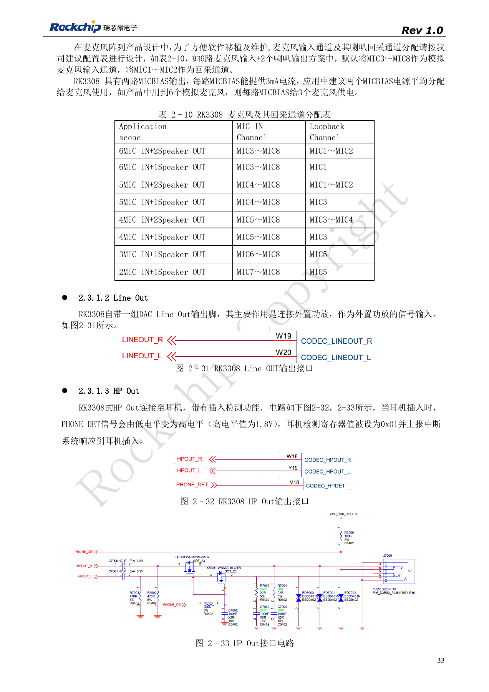
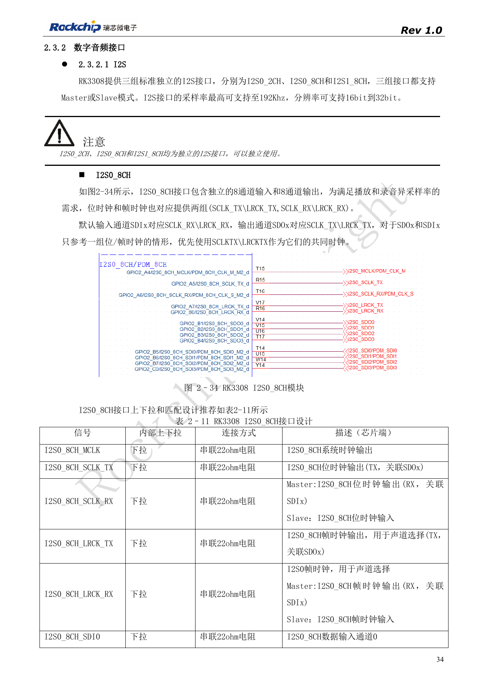
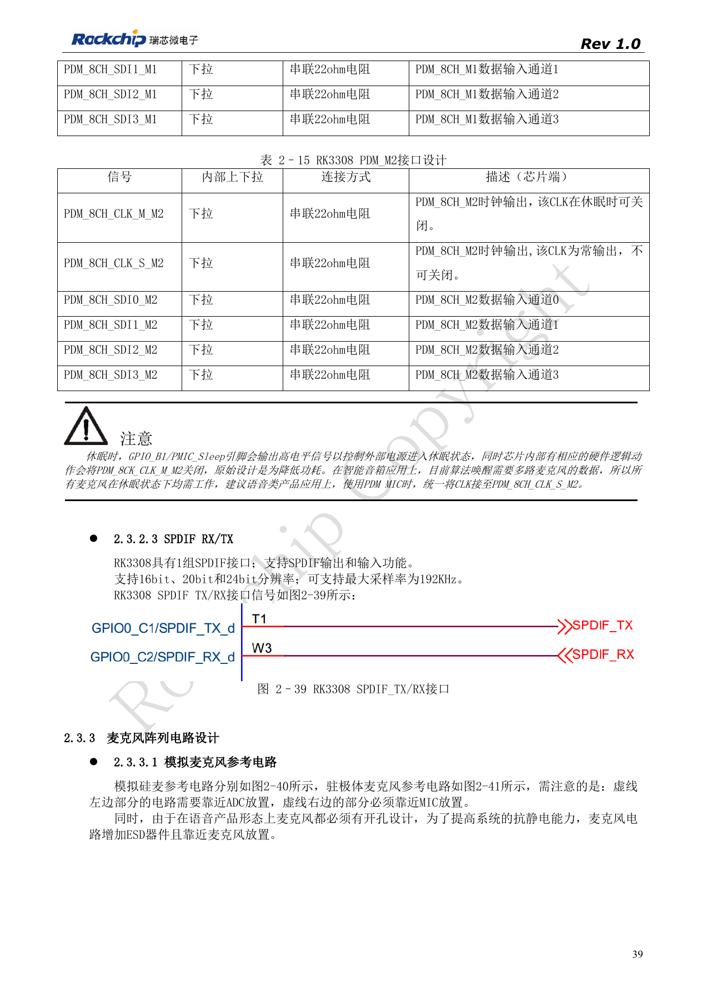
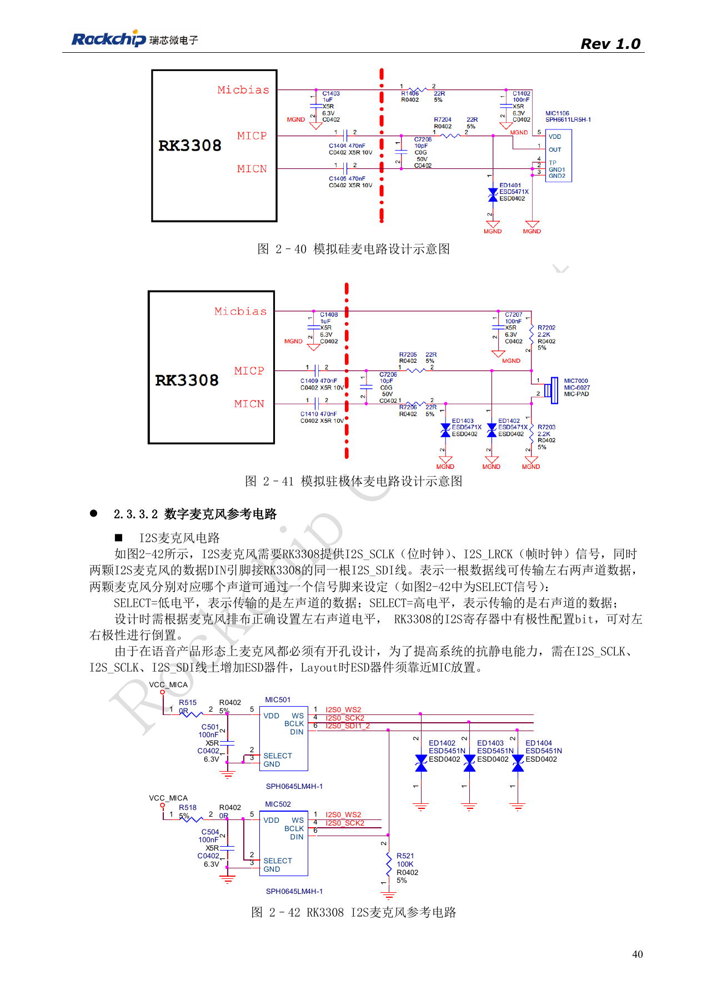
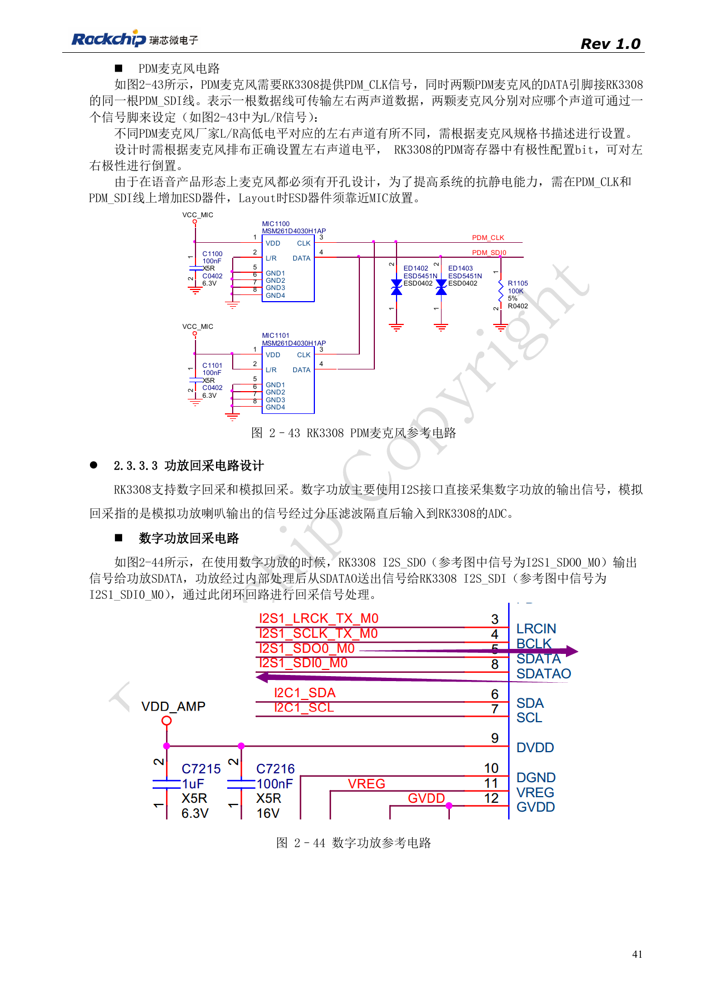
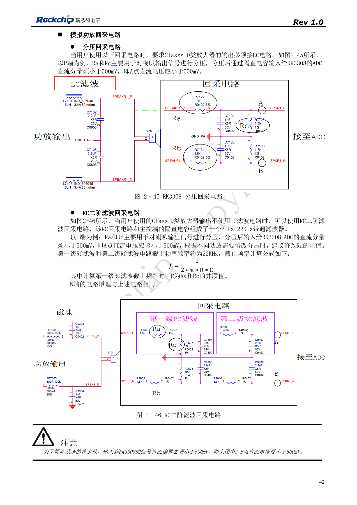

# Микрофонные массивы RK3308: аналог, I2S, PDM и обратный захват

По RK3308 Hardware Design Guide V1.0 (2018-09-14) с учётом отличий из документа совместимости V1.1 2023 года. P2 Pro использует RK3308B-S; старый эталон не заменяет её схему. Это тематическая статья, не полный постраничный перевод. Значения не являются испытаниями ArmSoM. Проверяйте интерфейсы, SDK/BSP, ядро и прошивку конкретной платы.

**RK3308硬件设计指南_V1.0_20180914.pdf** · §2.3

## Согласуйте каналы с алгоритмом

Исходный RK3308 имеет восемь ADC и два DAC. В примере шесть микрофонов/два динамика MIC3–MIC8 служат записи, MIC1–MIC2 — обратному захвату. Каждый из двух MICBIAS выдаёт 3mA; шесть микрофонов распределяют по три, проверяя их реальный ток. Line Out подключается ко входу внешнего усилителя, не напрямую к динамику. Высокий PHONE_DET для HP Out — 1.8V. Реально выведенные каналы P2 Pro проверяют по схеме платы.

## Не удваивайте ресурсы I2S и PDM

I2S0_2CH, I2S0_8CH и I2S1_8CH независимы, поддерживают master/slave, до 192kHz и 16–32bit по источнику. M0/M1 I2S1_8CH — варианты выводов одного интерфейса. Контроллер PDM один, выбирается только M0, M1 или M2. Одна SDI передаёт два микрофона; полярность L/R проверяют по их спецификации. Для непрерывного прослушивания во сне рекомендован PDM_8CH_CLK_S_M2, а не останавливаемый CLK_M_M2. Постоянный такт не подтверждает наличие готового алгоритма пробуждения в SDK.

## Схема обратного захвата зависит от усилителя

Цифровой усилитель может образовать I2S-петлю выдачи и возврата. Аналоговый путь требует делителя, фильтра и отсечения DC. При LC-фильтре Class D используют эталонный делитель, без LC — двухступенчатый RC. Источник требует DC в точках A/B ниже 500mV: силовой выход динамика нельзя непосредственно подавать на ADC. RC и разделительный конденсатор образуют примерно 22Hz–22kHz полосу; номиналы проверяют для конкретного усилителя. ESD размещают у отверстий микрофонов. Сначала проверяют каналы, полярность и уровень, затем совместное воспроизведение, эхокомпенсацию и сон/пробуждение.

## Распределение микрофонов и обратного захвата

| Применение | Вход микрофона | Обратный захват |
| --- | --- | --- |
| 6 MIC + 2 Speaker | MIC3–MIC8 | MIC1–MIC2 |
| 6 MIC + 1 Speaker | MIC3–MIC8 | MIC1 |
| 5 MIC + 2 Speaker | MIC4–MIC8 | MIC1–MIC2 |
| 5 MIC + 1 Speaker | MIC4–MIC8 | MIC3 |
| 4 MIC + 2 Speaker | MIC5–MIC8 | MIC3–MIC4 |
| 4 MIC + 1 Speaker | MIC5–MIC8 | MIC3 |
| 3 MIC + 1 Speaker | MIC6–MIC8 | MIC5 |
| 2 MIC + 1 Speaker | MIC7–MIC8 | MIC5 |

Источник: таблица 2-10, PDF33. Разные назначения обратного захвата сохранены, не заменены везде на MIC1/2. Это эталон кристалла, не подтверждение всех комбинаций P2 Pro.

## Исходные рисунки и страницы проверки

В этой подборке доступны только китайские оригиналы. Все четыре языка используют одинаковые исходные изображения с контекстом; надписи внутри не переведены. Текст редактируемый. Указаны физические страницы PDF.

PDF 33

PDF 34

PDF 39

PDF 40

PDF 41

PDF 42

## Продукты и документация ArmSoM

- [ArmSoM P2 Pro](https://www.armsom.org/product-page/p2pro) · [P2 Pro Docs](https://docs.armsom.org/armsom-p2pro)

## Читайте далее

- [Оглавление серии](/ru/articles/rk3308-hardware-design-series/)
- [Загрузка и память RK3308: такт, FLASH_SEL и восстановление](/ru/articles/rk3308-clock-boot-storage-design/)
- [RK3308: питание, DDR, ожидание и варианты S](/ru/articles/rk3308-power-ddr-hardware-design/)
- [Периферия RK3308: USB, RMII, дисплей и отладка](/ru/articles/rk3308-usb-network-peripheral-design/)
- [RK3308: тепло, ESD и подготовка производства](/ru/articles/rk3308-thermal-esd-production-design/)
