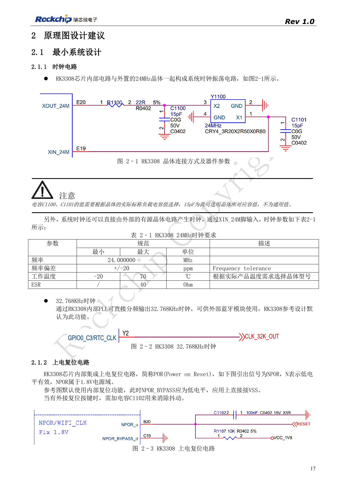
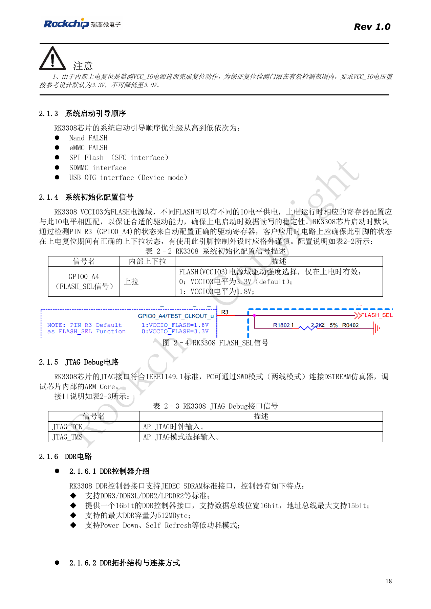
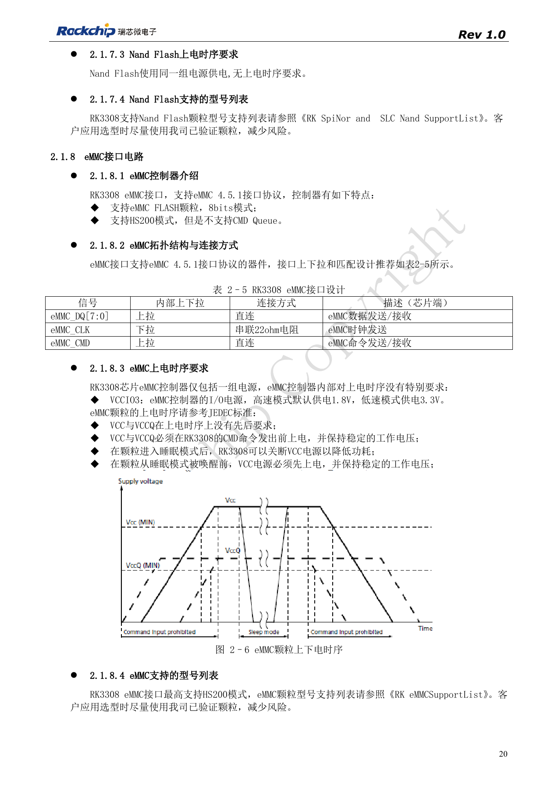
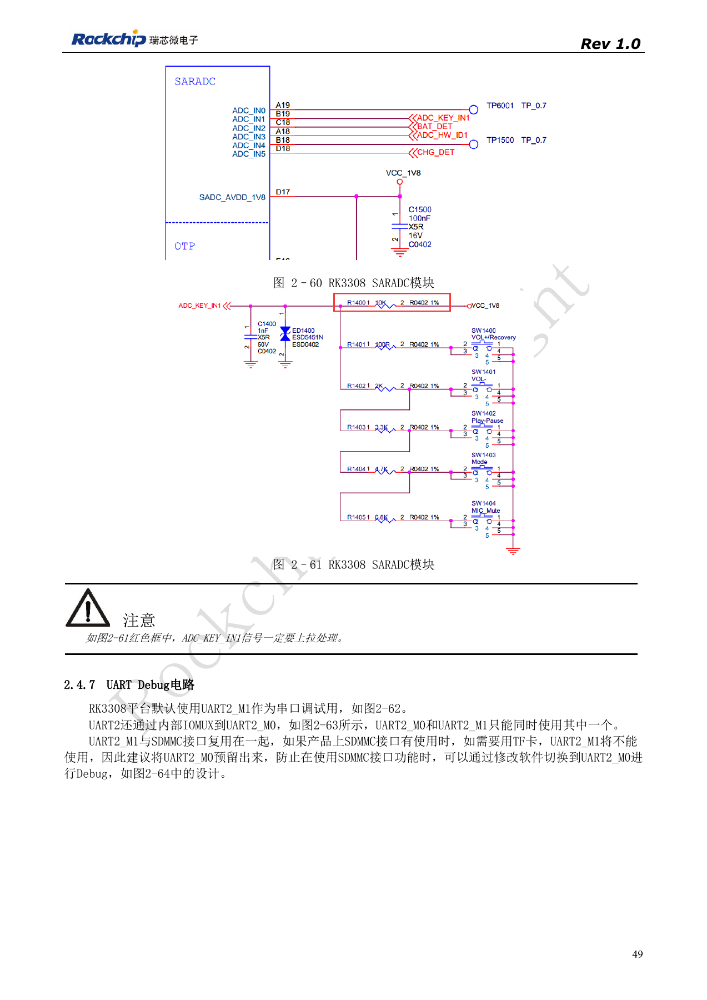
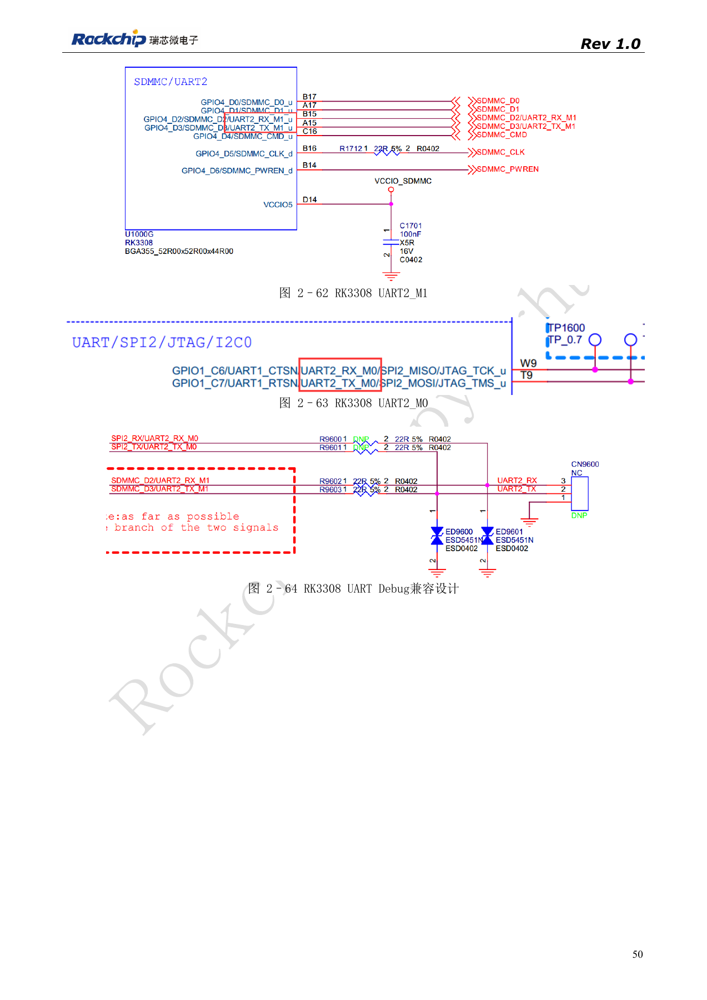

# Загрузка и память RK3308: такт, FLASH_SEL и восстановление

По RK3308 Hardware Design Guide V1.0 (2018-09-14) с учётом отличий из документа совместимости V1.1 2023 года. P2 Pro использует RK3308B-S; старый эталон не заменяет её схему. Это тематическая статья, не полный постраничный перевод. Значения не являются испытаниями ArmSoM. Проверяйте интерфейсы, SDK/BSP, ядро и прошивку конкретной платы.

**RK3308硬件设计指南_V1.0_20180914.pdf** · §2.1; §2.4.1; §2.4.6–2.4.7

## Сохраняйте границы старой версии

V1.0 2018 года описывает RK3308/RK3308G, а не все требования RK3308B-S в P2 Pro. Тактовый эталон: 24MHz, ±20ppm, ESR≤40Ω; 15pF — пример для конкретного кварца. NPOR активен низким уровнем в домене 1.8V; NPOR_BYPASS заземлён для внутреннего сброса. Контролируемое сбросом VCC_IO должно оставаться 3.3V, не 3.0V. Для вариантов S дополнительно проверяют новую документацию совместимости.

## Загрузочный носитель и уровни проверяют вместе

Порядок загрузки: NAND, eMMC, SPI Flash/SFC, SDMMC, USB OTG Device. FLASH_SEL — GPIO0_A4 (R3), считываемый при включении: 0 означает VCCIO3=3.3V, 1 — 1.8V. Периферия не должна менять уровень при сбросе. eMMC: 8bit, 4.5.1, HS200 без CMD Queue; CLK через 22Ω, CMD/данные напрямую. SFC поддерживает загрузку NOR/NAND и 22Ω на CLK. Микросхему выбирают с учётом bootloader, DDR-инициализации и списка поддержки, не только названия интерфейса.

## SD-карта и UART

UART2_M1 по умолчанию делит выводы с SDMMC. При использовании TF-карты предусмотрите UART2_M0 и программное переключение. SARADC_IN1 также служит Recovery: при записанной прошивке удерживайте 0V, не более 100mV, во время старта; после обнаружения Rockusb компьютером отпустите до 1.8V. Подтяжка обязательна, интервал кодов кнопок рекомендуется больше 35. При запуске определяйте этап отказа: ROM, DDR, накопитель или ядро.

## Исходные рисунки и страницы проверки

В этой подборке доступны только китайские оригиналы. Все четыре языка используют одинаковые исходные изображения с контекстом; надписи внутри не переведены. Текст редактируемый. Указаны физические страницы PDF.

PDF 17

PDF 18

PDF 20

PDF 49

PDF 50

## Продукты и документация ArmSoM

- [ArmSoM P2 Pro](https://www.armsom.org/product-page/p2pro) · [P2 Pro Docs](https://docs.armsom.org/armsom-p2pro)

## Читайте далее

- [Оглавление серии](/ru/articles/rk3308-hardware-design-series/)
- [RK3308: питание, DDR, ожидание и варианты S](/ru/articles/rk3308-power-ddr-hardware-design/)
- [Микрофонные массивы RK3308: аналог, I2S, PDM и обратный захват](/ru/articles/rk3308-audio-array-hardware-design/)
- [Периферия RK3308: USB, RMII, дисплей и отладка](/ru/articles/rk3308-usb-network-peripheral-design/)
- [RK3308: тепло, ESD и подготовка производства](/ru/articles/rk3308-thermal-esd-production-design/)
