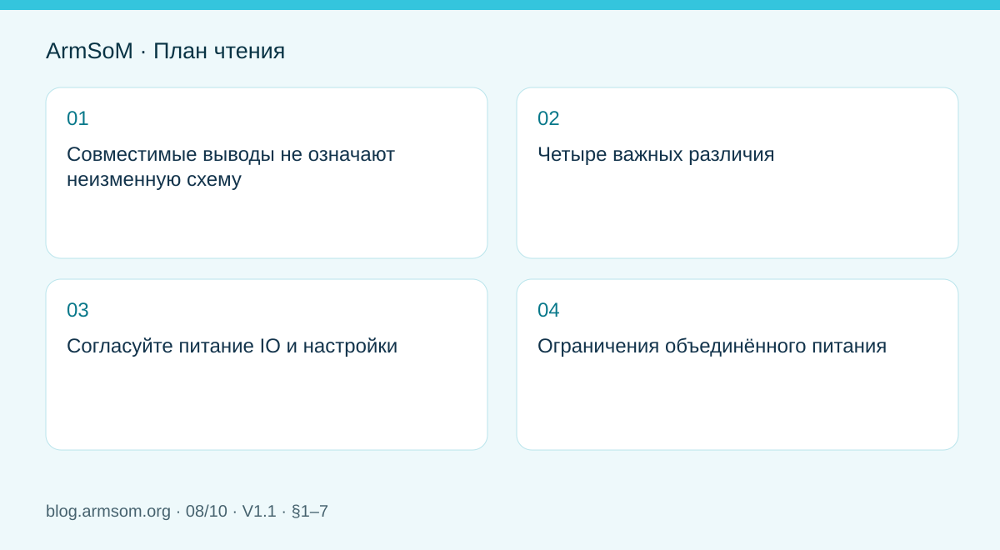
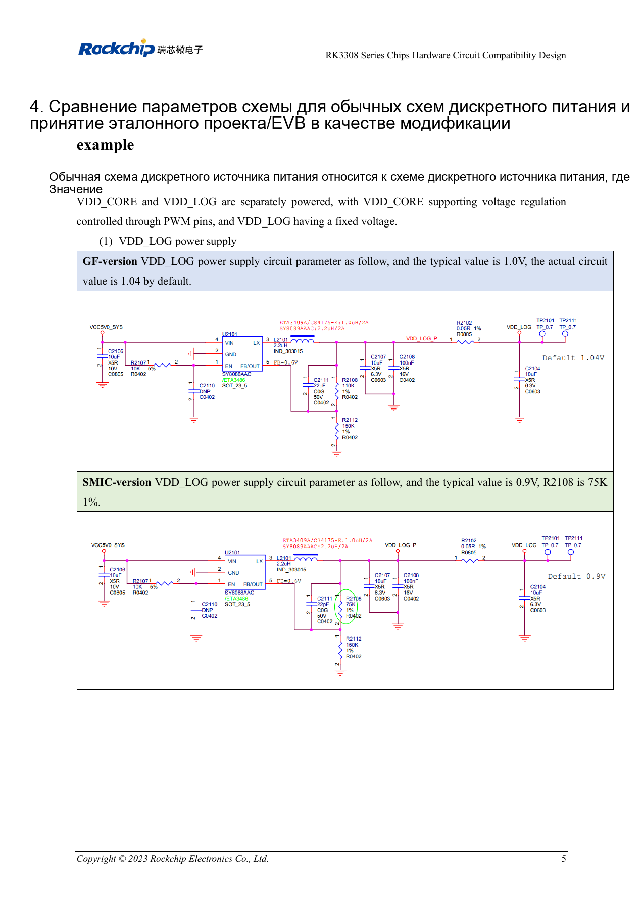

# Варианты RK3308: аппаратная совместимость для аудиопроектов P2 Pro

## Область применения и источники

Это тематическое инженерное руководство, а не постраничный перевод всего PDF. Примеры источника не являются измерениями ArmSoM. Напряжения, выводы, SDK/BSP и ядро сверяйте с фактической ревизией платы.

**Rockchip:** `RK3308系列芯片硬件电路兼容设计与差异化说明_V1.1_20230728_CN.pdf` · V1.1 · §1–7

## Совместимые выводы не означают неизменную схему

В документе RK3308B/H отнесены к GF, RK3308B-S/H-S — к SMIC. При совпадении шариков нужны изменения связанных цепей и ПО. P2 Pro использует RK3308B-S; статья объясняет различия, а не предписывает переделку готовой платы.

## Четыре важных различия

| Узел | Исходные сведения | Действие |
| --- | --- | --- |
| Типовые напряжения | §1: 1.0V и 0.9V для ряда шин, включая VDD_LOG/VDD_CORE | Согласовать топологию, BOM и таблицы частота–напряжение |
| Драйверы IO | GF: 4 уровня; SMIC: 7 | Одинаковые обозначения mA не означают одинаковую способность; измерять под нагрузкой |
| PMIC | RK816B-3 для GF; RK816B-6 для эталонных S-схем | Проверить суффикс, напряжения и последовательность |
| USB_EXTR | GF C15: 133R 1%; SMIC C15: NC | Эталонный R1400 не устанавливают; обозначение не универсально |

Типовые напряжения не являются полным рабочим диапазоном. В §4 отдельно указаны значения и изменения эталонных цепей. Сверяйте схему, фактически установленный BOM и ПО.

## Согласуйте питание IO и настройки

Сначала определите реальное подключение питания, затем программный домен. Наличие резервных резисторов на схеме не означает монтаж всех ветвей. Недостаточная сила драйвера даёт медленные фронты и ошибки уровня, избыточная — выбросы и звон. После изменения нагрузки, трасс или версии чипа повторите измерения.

## Ограничения объединённого питания

Для конкретной раздельно-компонентной схемы с объединёнными VDD_CORE/VDD_LOG §6 задаёт GF до 1.1V и 912MHz, SMIC до 1.0V и 816MHz. Это ограничения данной топологии, а не всех RK3308 или P2 Pro. Их нельзя смешивать с независимыми шинами или заявленной частотой платы.

## Проверка аудиоустройства

На P2 Pro сначала подтвердите захват, воспроизведение, сеть и хранение. После изменения аппаратуры проверьте шум, параллельные передачи, USB, холодный старт и выход из ожидания. Сохраняйте маркировку чипа, BOM, прошивку и осциллограммы.

## Иллюстрация из источника

Оригинал английского документа, общий для EN/RU/DE. Эталонный проект, а не схема платы ArmSoM.

`RK3308 Series Chips Hardware Circuit Compatibility Design and Differentiation Explanation_V1.1_20230728_EN.pdf` · PDF p. 11.

## Продукты и документация

- **P2 Pro** — [Страница продукта](https://www.armsom.org/product-page/p2pro) · [Документация](https://docs.armsom.org/armsom-p2pro)

## Другие статьи серии

- [Запуск платы RK3576: минимальная система и проверка первого включения](/ru/articles/rk3576-hardware-bringup/)
- [Плата-носитель ArmSoM CM5: питание, загрузка и планирование интерфейсов](/ru/articles/019-cm5-carrier-production/)
- [Скоростные интерфейсы RK3576: совместная проверка схемы и PCB](/ru/articles/rk3576-high-speed-interface-design/)
- [Аппаратное проектирование RK3588S: от эталонной схемы к носителю CM7s](/ru/articles/rk3588s-cm7s-carrier-design/)
- [RK3588 для периферийного ИИ: питание, охлаждение и расширение](/ru/articles/rk3588-edge-ai-hardware-design/)
- [Проверка скоростной PCB RK3588: слои, импеданс и трассировка](/ru/articles/rk3588-high-speed-pcb-review/)
- [Аппаратная часть HMI на RK3506: выбор пути с CM1 или Forge1](/ru/articles/rk3506-industrial-hmi-hardware/)
- [RK3588S и RK3588S2: что проверить перед изменением платы](/ru/articles/rk3588s-rk3588s2-hardware-differences/)
- [От прототипа Rockchip к серии: технологические требования и испытания](/ru/articles/rockchip-hardware-production-checklist/)

## Читайте далее

- [RK3308: аппаратное проектирование](/ru/articles/rk3308-hardware-design-series/)
