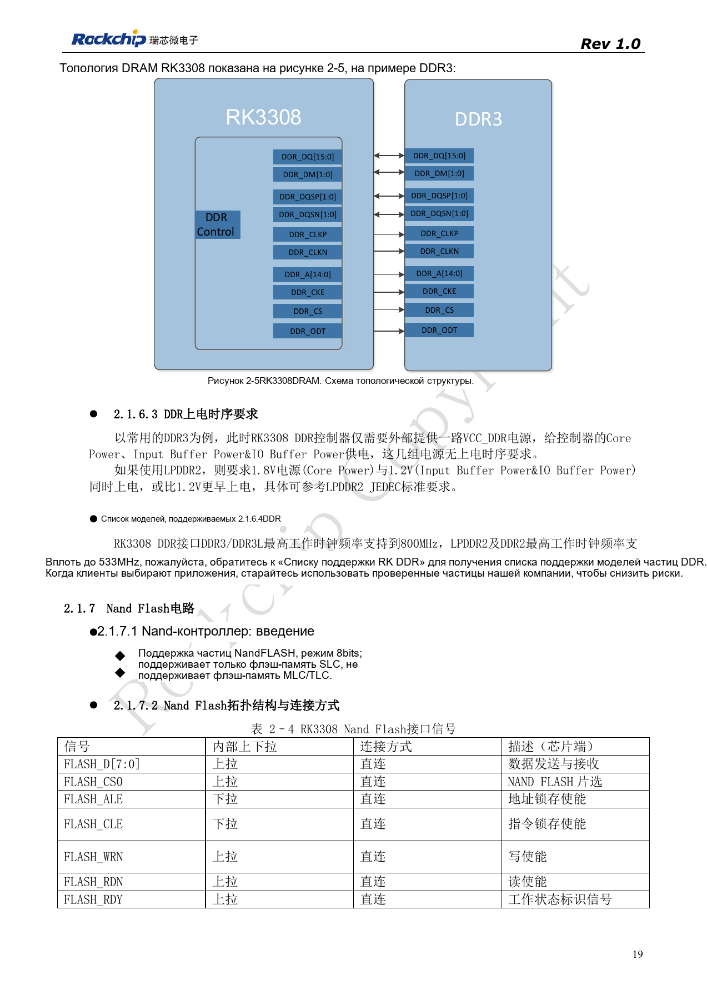
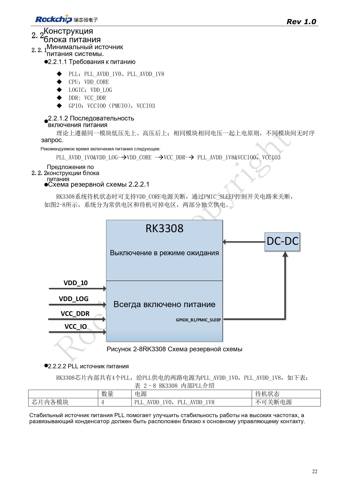
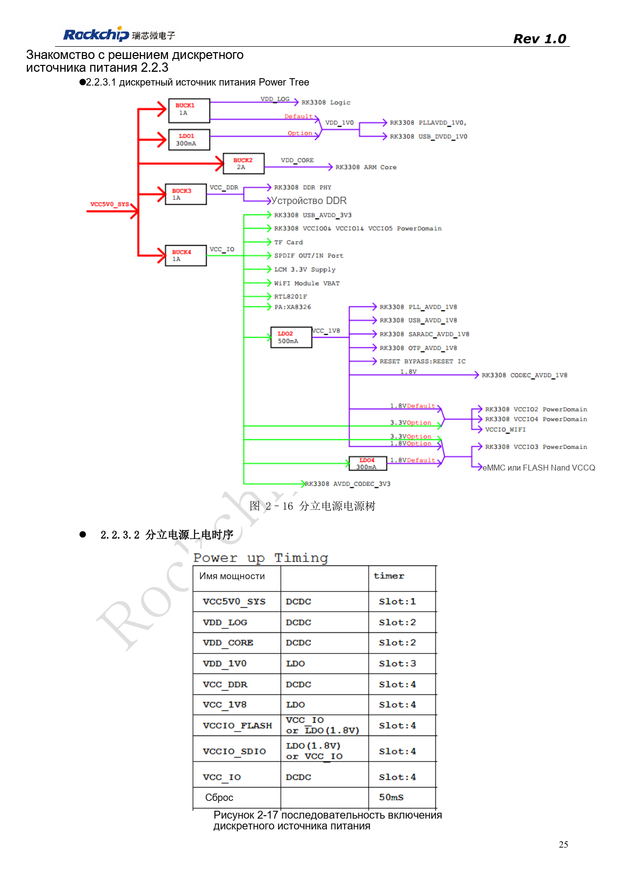
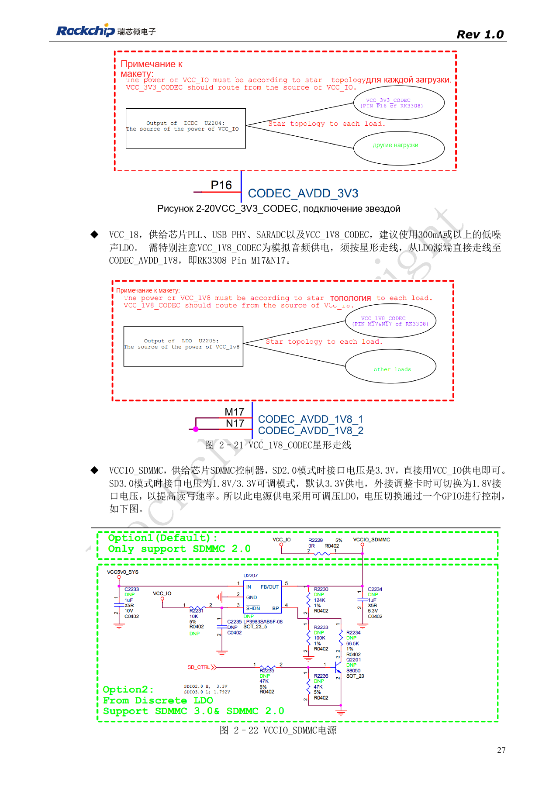
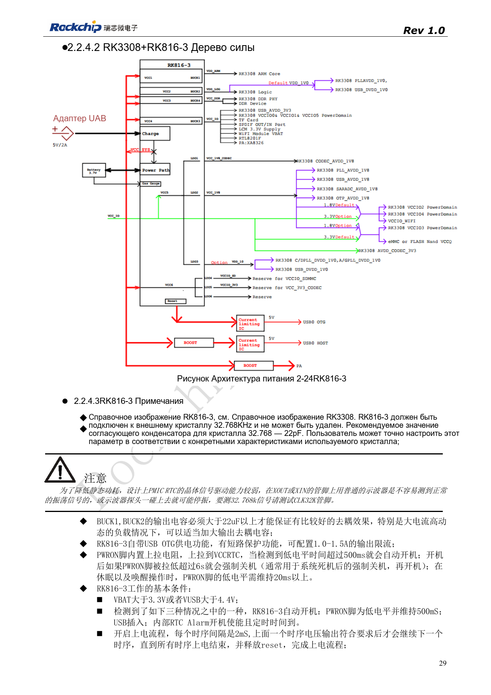

# RK3308: питание, DDR, ожидание и варианты S

По RK3308 Hardware Design Guide V1.0 (2018-09-14) с учётом отличий из документа совместимости V1.1 2023 года. P2 Pro использует RK3308B-S; старый эталон не заменяет её схему. Это тематическая статья, не полный постраничный перевод. Значения не являются испытаниями ArmSoM. Проверяйте интерфейсы, SDK/BSP, ядро и прошивку конкретной платы.

**RK3308硬件设计指南_V1.0_20180914.pdf** · §2.1.6; §2.2; compatibility V1.1

## DDR и питание зависят от варианта

Исходный RK3308 поддерживает DDR3/DDR3L/DDR2/LPDDR2, 16bit и до 512MB; RK3308G содержит 64MB DDR2. Для LPDDR2 питание 1.8V включают до или одновременно с 1.2V. Руководство указывает до 800MHz для DDR3/3L и 533MHz для DDR2/LPDDR2. Это параметры старой платформы, не фактическая память и частота P2 Pro.

## Разделяйте CPU и аналоговые цепи

Старый дискретный эталон использует четыре BUCK и один LDO. VDD_CORE поддерживает DVFS; при замене BUCK рекомендуются 1.5–2A и опорная обратная связь 0.6V без произвольного изменения PWM-цепи. VDD_LOG и VDD_1V0 связаны ферритом, но это не разрешает подключать туда CPU. Аналоговые 3.3V от источника BUCK и 1.8V от малошумящего LDO разводят отдельными звёздными ветвями к Codec, исключая ток Wi-Fi. PMIC_SLEEP разделяет постоянные и отключаемые домены; PLL не выключают вместе с CPU.

## Сопоставьте старую схему с новыми отличиями

Схема RK816-3 2018 года требует внешний кварц 32.768kHz. Измеряйте CLK32K: обычный щуп на кварце может остановить генератор. Документ 2023 года различает RK816B-3 для GF и RK816B-6 для SMIC S, уровни питания и настройки драйвера; выбирайте полный суффикс. Токи старой EVB получены при CPU 1.3GHz, DDR 589MHz, полосе осциллографа 20MHz и заданной аудио/Wi-Fi нагрузке, не на P2 Pro. Проверяйте запуск, переходы напряжения, аудиошум и выход из сна, сохраняя условия измерения.

## Пиковый ток RK3308 EVB и условия

| Сеть | Напряжение / V | Пиковый ток / mA |
| --- | --- | --- |
| VDD_CORE | 0.95–1.34 | 1055 |
| VDD_LOG | 1.04 | 204 |
| VDD_1V0 | 1.04 | 9.8 |
| VCC_DDR | 1.5 | 289 |
| VCC_1V8 | 1.8 | 83.8 |
| VCC_IO (включая WiFi) | 3.3 | 709 |

Источник: таблица 2–9, PDF31. RK3308 EVB производителя: CPU до 1.3GHz, DDR 589MHz, ограничение полосы осциллографа 20MHz. Испытания: stresstest памяти, алгоритм прослушивания шести микрофонов и одновременное онлайн-воспроизведение через WiFi. Данные справочные. Токи, напряжение DDR и максимальную частоту старой EVB нельзя напрямую переносить на RK3308B-S P2 Pro: проверяйте компонент, питание, ПО и нагрузку.

## Исходные рисунки и страницы проверки

В этой подборке доступны только китайские оригиналы. Все четыре языка используют одинаковые исходные изображения с контекстом; надписи внутри не переведены. Текст редактируемый. Указаны физические страницы PDF.

PDF 19

PDF 22

PDF 25

PDF 27

PDF 29

## Продукты и документация ArmSoM

- [ArmSoM P2 Pro](https://www.armsom.org/product-page/p2pro) · [P2 Pro Docs](https://docs.armsom.org/armsom-p2pro)

## Читайте далее

- [Оглавление серии](/ru/articles/rk3308-hardware-design-series/)
- [Загрузка и память RK3308: такт, FLASH_SEL и восстановление](/ru/articles/rk3308-clock-boot-storage-design/)
- [Микрофонные массивы RK3308: аналог, I2S, PDM и обратный захват](/ru/articles/rk3308-audio-array-hardware-design/)
- [Периферия RK3308: USB, RMII, дисплей и отладка](/ru/articles/rk3308-usb-network-peripheral-design/)
- [RK3308: тепло, ESD и подготовка производства](/ru/articles/rk3308-thermal-esd-production-design/)
