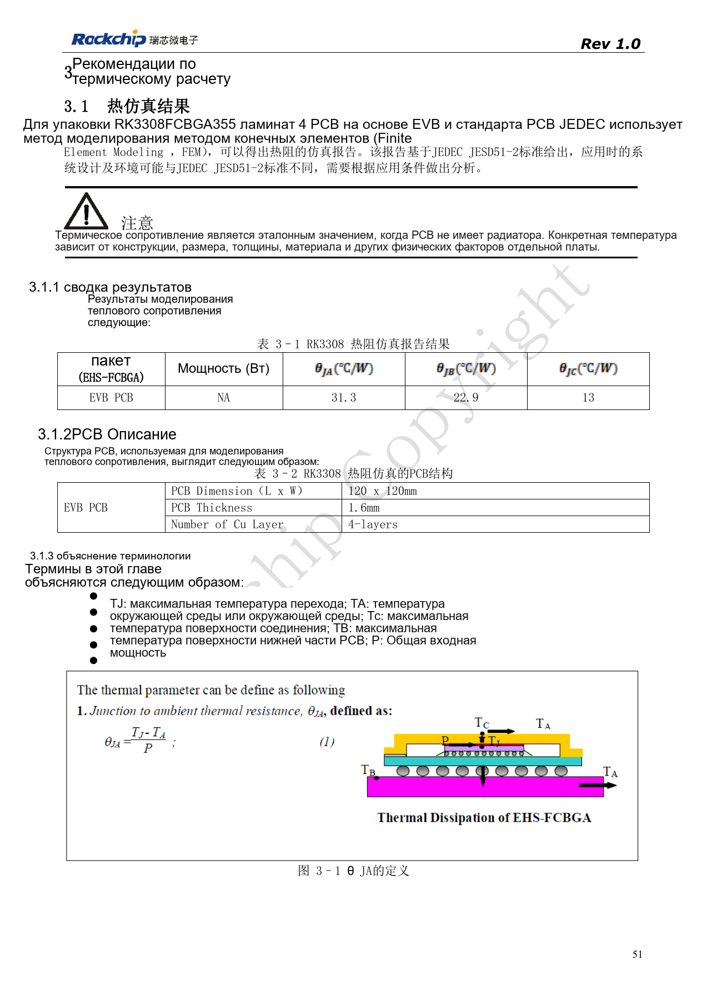
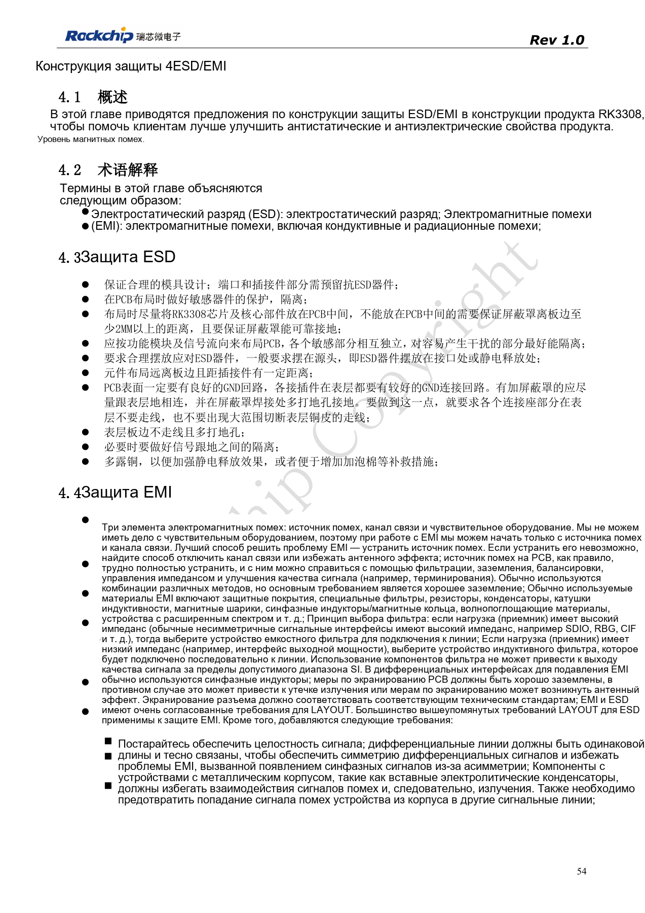
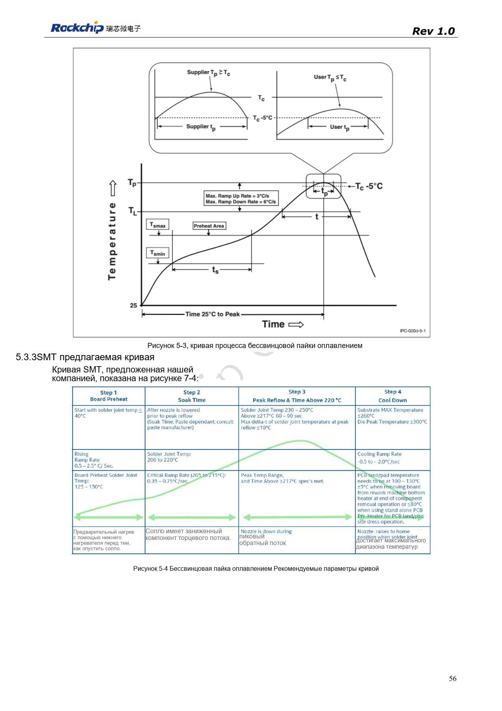
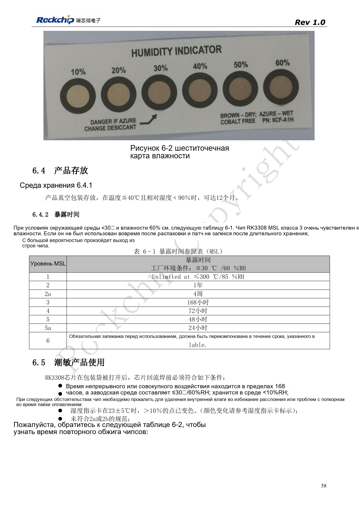
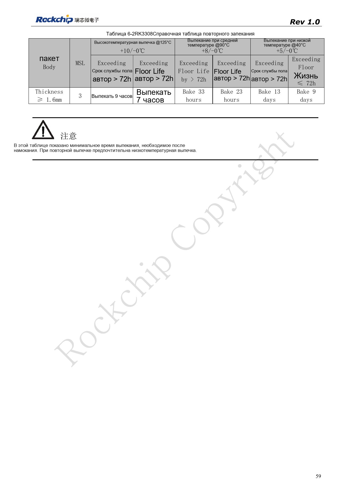

# RK3308: тепло, ESD и подготовка производства

По RK3308 Hardware Design Guide V1.0 (2018-09-14) с учётом отличий из документа совместимости V1.1 2023 года. P2 Pro использует RK3308B-S; старый эталон не заменяет её схему. Это тематическая статья, не полный постраничный перевод. Значения не являются испытаниями ArmSoM. Проверяйте интерфейсы, SDK/BSP, ядро и прошивку конкретной платы.

**RK3308硬件设计指南_V1.0_20180914.pdf** · §3–6

## Тепловые данные ограничены условиями платы

Тепловое сопротивление источника — расчёт для заданного корпуса, PCB и среды, не измерение ArmSoM. Площадь платы, медь, воздух, соседние силовые элементы и радиатор меняют температуру; одного θJA недостаточно. Зафиксируйте среду, корпус, нагрузку, частоты и политику охлаждения, затем измерьте кристалл и поверхности компонентов. Программное снижение частоты, аварийное отключение и нормальный теплоотвод — разные меры.

## ESD требует пути отвода

Защиту располагают у разъёмов и точек входа разряда с коротким непрерывным возвратом на землю. Экраны надёжно заземляют, такты, сброс и аудио удаляют от помех и края. Увеличение фильтрующей ёмкости ради EMI не должно ухудшать высокоскоростной канал. После изменения TVS, синфазного дросселя или разъёма проверяют сигнал. Приёмка включает горячее подключение, восстановление после ESD и длительную нагрузку с учётом сбросов, шума и ошибок.

## Считайте суммарное воздействие влаги

Указан MSL3 и 168 часов суммарного времени после вскрытия при ≤30°C/60%RH. При возврате партии на линию счёт не начинается заново. Для герметичного хранения указаны ≤40°C, <90%RH и 12 месяцев. При превышении или изменении индикатора выбирайте сушку по толщине корпуса, времени превышения и температуре. В обеих таблицах есть подозрительное “≤300°C” для MSL1 — его нельзя использовать как режим хранения. Профиль пайки подтверждают для пасты, теплоёмкости платы и корпуса, сохраняя измерения и партии.

## Исходная таблица повторной сушки

| Температура | Превышение floor life >72h | Превышение floor life ≤72h |
| --- | --- | --- |
| 125°C +10/-0°C | 9h | 7h |
| 90°C +8/-0°C | 33h | 23h |
| 40°C +5/-0°C | 13d | 9d |

Только при условиях источника: MSL3, толщина корпуса ≥1.6mm. Указаны минимальные времена, предпочтительна низкая температура. Проверяйте допустимость температуры лотка и компонентов. Таблица не задаёт сушку другого корпуса или собранной платы.

## Исходные рисунки и страницы проверки

В этой подборке доступны только китайские оригиналы. Все четыре языка используют одинаковые исходные изображения с контекстом; надписи внутри не переведены. Текст редактируемый. Указаны физические страницы PDF.

PDF 51

PDF 54

PDF 56

PDF 58

PDF 59

## Продукты и документация ArmSoM

- [ArmSoM P2 Pro](https://www.armsom.org/product-page/p2pro) · [P2 Pro Docs](https://docs.armsom.org/armsom-p2pro)

## Читайте далее

- [Оглавление серии](/ru/articles/rk3308-hardware-design-series/)
- [Загрузка и память RK3308: такт, FLASH_SEL и восстановление](/ru/articles/rk3308-clock-boot-storage-design/)
- [RK3308: питание, DDR, ожидание и варианты S](/ru/articles/rk3308-power-ddr-hardware-design/)
- [Микрофонные массивы RK3308: аналог, I2S, PDM и обратный захват](/ru/articles/rk3308-audio-array-hardware-design/)
- [Периферия RK3308: USB, RMII, дисплей и отладка](/ru/articles/rk3308-usb-network-peripheral-design/)
