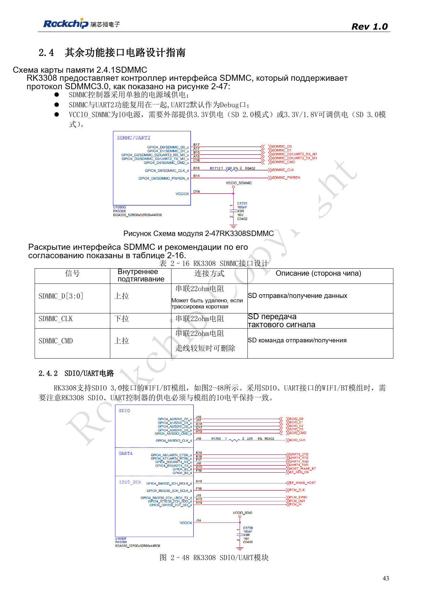
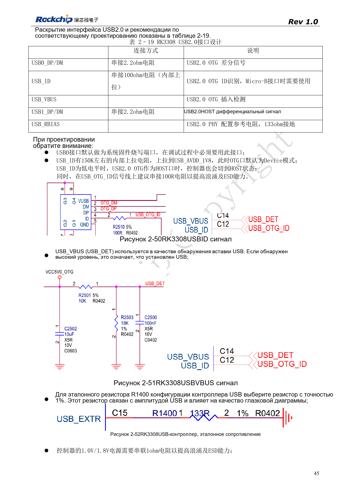
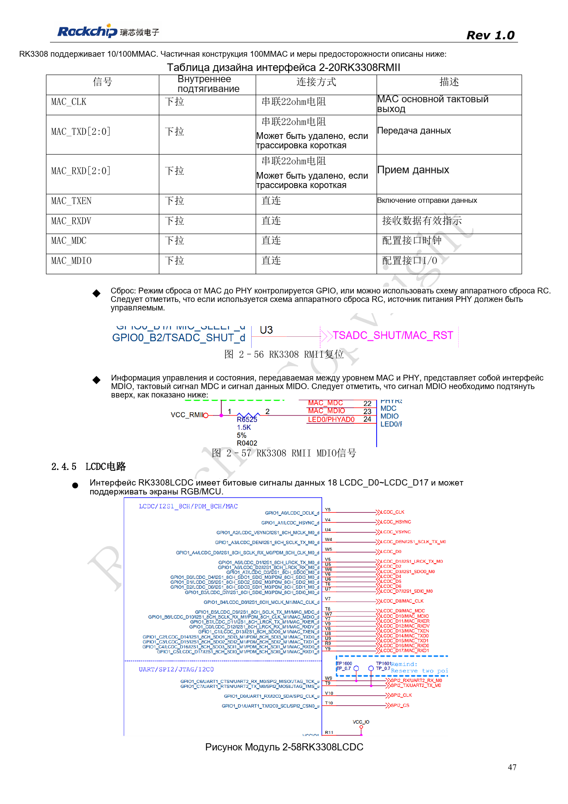
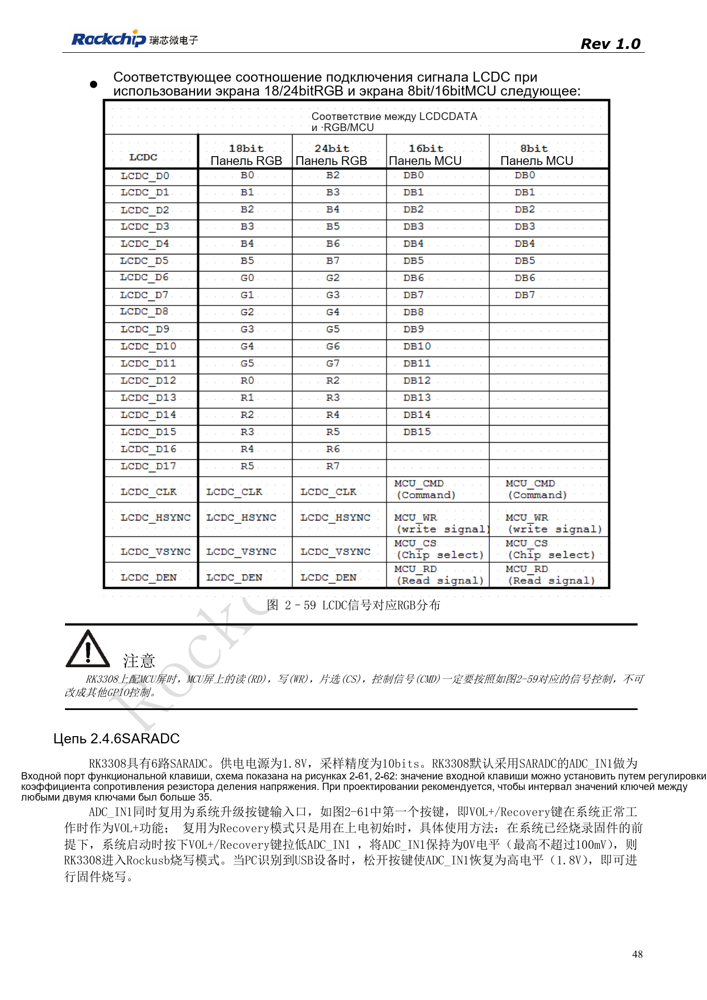

# Периферия RK3308: USB, RMII, дисплей и отладка

По RK3308 Hardware Design Guide V1.0 (2018-09-14) с учётом отличий из документа совместимости V1.1 2023 года. P2 Pro использует RK3308B-S; старый эталон не заменяет её схему. Это тематическая статья, не полный постраничный перевод. Значения не являются испытаниями ArmSoM. Проверяйте интерфейсы, SDK/BSP, ядро и прошивку конкретной платы.

**RK3308硬件设计指南_V1.0_20180914.pdf** · §2.4; compatibility V1.1 §7

## Перед USB проверьте суффикс

У исходного RK3308 USB0 — OTG/прошивка, USB1 — HOST. Эталон содержит 2.2Ω в DP/DM и 100Ω в ID. Требование USB_RBIAS 133Ω 1% из 2018 года относится к старому кристаллу: документ 2023 года обозначает C15 как NC у SMIC S, поэтому внешняя цепь GF меняется. P2 Pro использует B-S; проверяйте фактическую схему и монтаж, не добавляйте резистор по старому рисунку.

## Проверяйте сеть как систему

Для RMII 100Mbps нужен внешний PHY. Такт получают от кварца или MAC_CLK, направление задают выбранной схемой. При RC-сбросе PHY руководство требует управляемое питание PHY. MDIO нужна подтяжка. Модуль SDIO 3.0 Wi-Fi/BT должен соответствовать уровням SDIO/UART SoC, направлениям CTS/RTS и пути PCM. В таблице 2-20 данные RMII названы MAC_TXD[2:0]/RXD[2:0]; это требует уточнения по PinOut/TRM, а не добавления третьей линии данных.

## Сохраните обслуживание и корректный вывод

LCDC имеет 18 линий данных; RGB/MCU выбирают по исходному рисунку. RD, WR, CS и CMD MCU-панели требуют заданных функций, не произвольных GPIO. При конфликте SDMMC с UART2_M1 предусмотрите UART2_M0. Внешним разъёмам нужны последовательная защита, ESD-путь и проверка без питания. Проверяйте длительную сеть, горячее подключение USB, обновление дисплея и аудио одновременно.

## Исходные рисунки и страницы проверки

В этой подборке доступны только китайские оригиналы. Все четыре языка используют одинаковые исходные изображения с контекстом; надписи внутри не переведены. Текст редактируемый. Указаны физические страницы PDF.

PDF 43

PDF 45

PDF 47

PDF 48

## Продукты и документация ArmSoM

- [ArmSoM P2 Pro](https://www.armsom.org/product-page/p2pro) · [P2 Pro Docs](https://docs.armsom.org/armsom-p2pro)

## Читайте далее

- [Оглавление серии](/ru/articles/rk3308-hardware-design-series/)
- [Загрузка и память RK3308: такт, FLASH_SEL и восстановление](/ru/articles/rk3308-clock-boot-storage-design/)
- [RK3308: питание, DDR, ожидание и варианты S](/ru/articles/rk3308-power-ddr-hardware-design/)
- [Микрофонные массивы RK3308: аналог, I2S, PDM и обратный захват](/ru/articles/rk3308-audio-array-hardware-design/)
- [RK3308: тепло, ESD и подготовка производства](/ru/articles/rk3308-thermal-esd-production-design/)
