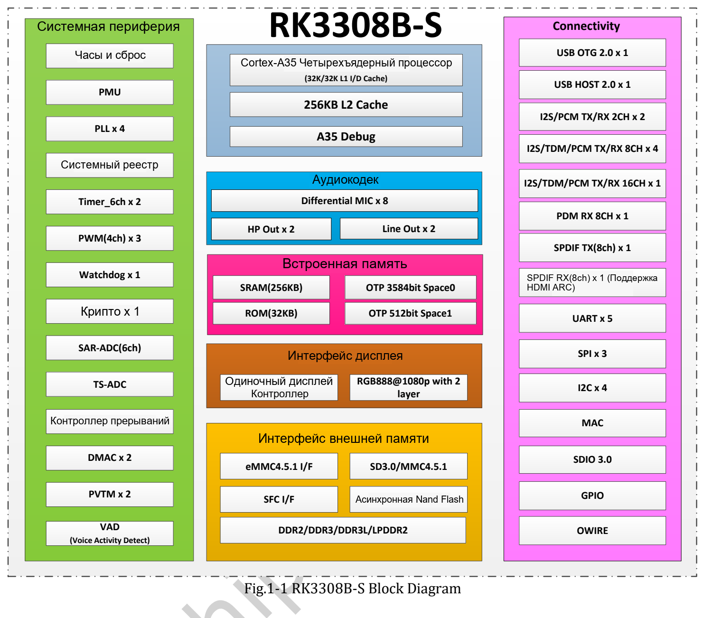

RK3308B-S ориентирован на захват, воспроизведение аудио и связь во встраиваемых устройствах. Четыре Cortex-A35, аудиокодек и цифровые аудиоинтерфейсы подходят для голосовых терминалов, сетевого аудио и шлюзов оборудования. ArmSoM P2 Pro предоставляет интерфейсы платы и Linux-ресурсы для создания прототипа.

## Архитектура и назначение

| Блок | Возможности RK3308B-S V1.0 | Назначение |
|---|---|---|
| CPU | Четыре Cortex-A35, Armv8-A, NEON | Приложения, протоколы, обработка аудио |
| Кэш | 32KB L1 инструкций, 32KB L1 данных, 256KB L2 | Результат зависит и от нагрузки |
| Память | 16-bit DDR2/DDR3/DDR3L/LPDDR2, адресация до 512MB | ПО с контролируемым потреблением памяти |
| Кодек | До восьми микрофонных ADC-каналов, стерео-DAC | Захват, наушники и линейный выход |
| Цифровое аудио | I2S/PCM/TDM, PDM, SPDIF, включая внутренние связи | Проверять реальные внешние выводы |
| VAD | Обнаружение голосовой активности и хранение данных | Событие для последующей обработки |
| Сеть/USB | 10/100M MAC, USB2.0 | Дополняются PHY, радиомодулем и драйверами |

Не переносить сюда CPU, NPU, видео и расширения RK3506J или RK3588. 64-битный CPU не означает 64-битное пользовательское окружение каждого образа. Беспроводная связь P2 Pro реализована отдельным модулем, а не радиочастью внутри SoC.

## Сначала аудиотракт, затем частота

Для нескольких микрофонов важны синхронизация, порядок каналов, такты, усиление и шум. Аналоговые входы и PDM нельзя автоматически суммировать как готовые независимые ресурсы. Компоненты, мультиплексирование, драйверы и полоса памяти определяют рабочую конфигурацию.

VAD обнаруживает активность, а не смысл команды. Ключевое слово, распознавание речи, эхоподавление, формирование луча и синтез требуют алгоритмов и интеграции. Без испытаний нельзя обещать дальность, точность или потребление всей платы в ожидании.

## Три направления разработки

**Голосовой терминал:** захват → предобработка → активность/пробуждение → команда → звуковой ответ. Начать с одного канала, затем расширить массив и испытать реальный корпус и шум.

**Сетевой аудиоузел:** приём → буфер/декодирование → выход. Возможны терминалы уведомлений, настольные проигрыватели и прототипы оповещения. Кодеки, джиттер, громкость и усилитель проверять отдельно.

**Компактный IoT-шлюз:** датчик/последовательный интерфейс → проверка и очередь → передача. Ограничивать службы и журналы. Fast Ethernet не превращает устройство в гигабитный маршрутизатор или скоростное хранилище.

## Различия частот и дисплейных данных

Электрическая таблица B-S V1.0 на странице 67 указывает максимум A35 **1.1GHz**. Документация P2 Pro содержит **1.2GHz и 1.3GHz**. Нельзя молча выбрать максимум: уточнять ревизию чипа, BSP и условия работы.

Общая страница RK3308 указывает RGB/MCU до 720P, а B-S — 1080p. Различие источников сохранено. Контроллер дисплея в чипе не означает HDMI-видеовыход на P2 Pro; проверить выведенные сигналы.

## Начать с P2 Pro

Подходящим для ревизии образом проверить аудио, сеть и накопитель, затем зафиксировать ПО. Опциональные eMMC и PoE сверять с покупкой. Остальные статьи раскрывают аудио, шлюз и руководство. Сценарии являются предложениями разработки, не внедрениями клиентов или результатами измерений.

## Статьи серии и официальные материалы

- [ArmSoM P2 Pro: микрофоны, голосовой интерфейс и сетевое аудио](/ru/articles/p2pro-voice-audio-applications/)
- [ArmSoM P2 Pro: сбор данных IoT и разработка компактного шлюза](/ru/articles/p2pro-iot-lightweight-gateway/)
- [RK3308B-S Datasheet V1.0: загрузка, аудиоархитектура и электрические параметры](/ru/articles/rk3308bs-datasheet-v10/)
- [Rockchip Audio](/ru/articles/023-rockchip-audio/)
- [Rockchip RK3308](https://www.rock-chips.com/a/cn/product/RK33xilie/2018/0614/908.html)
- [P2 Pro — Docs](https://docs.armsom.org/armsom-p2pro)
- [P2 Pro — ArmSoM](https://www.armsom.org/product-page/p2pro)
- [P2 Pro — BSP](https://github.com/ArmSoM/armsom-p2pro-bsp)
