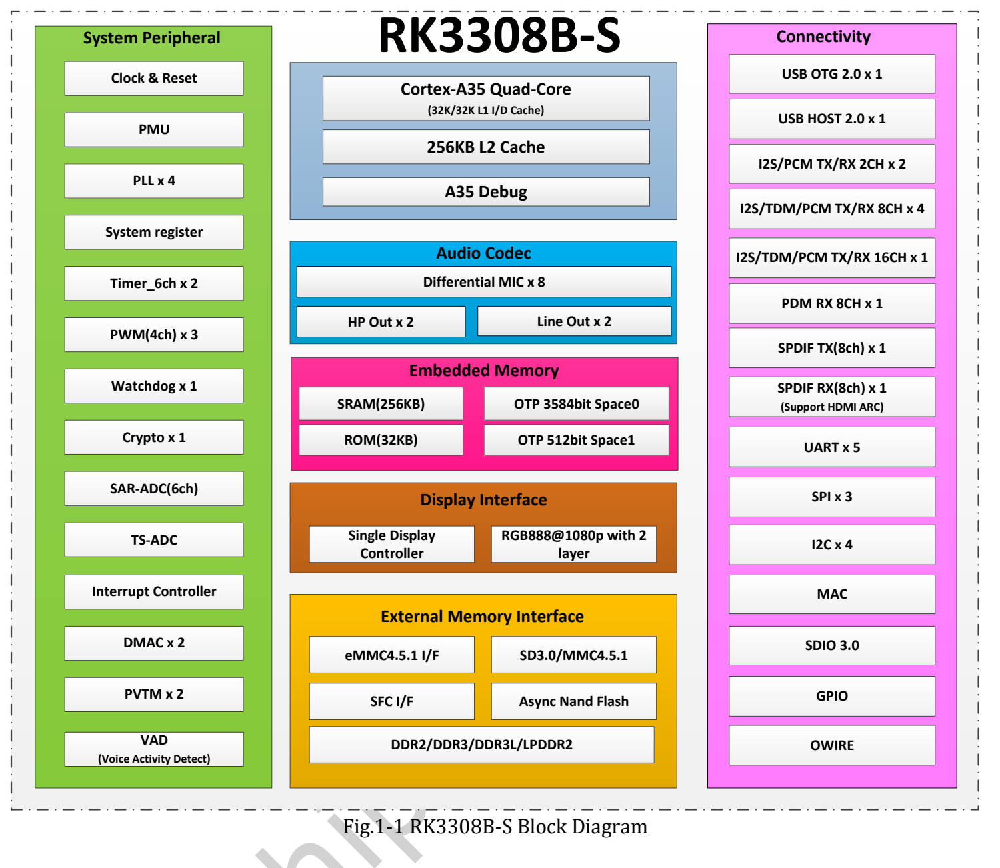
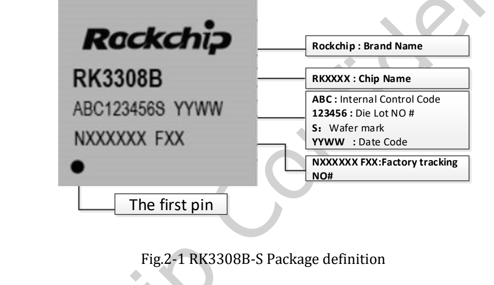
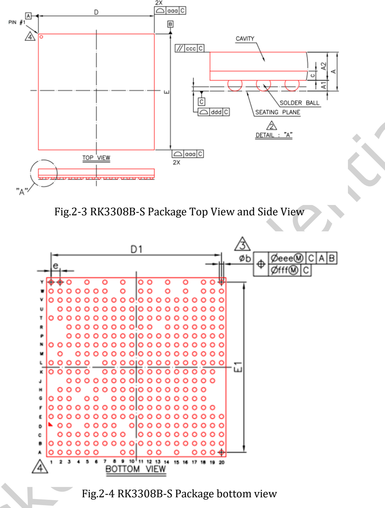

Предоставлен оригинальный **RK3308B-S Datasheet V1.0 от 2021-10-10, 72 страницы** и инженерный путеводитель по архитектуре, аудио, корпусу, электрическим и тепловым данным. Это не построчный перевод; полные карты шариков, мультиплексирование и электрические таблицы остаются в PDF.

## Загрузка и варианты

[Скачать оригинальный RK3308B-S Datasheet V1.0](/assets/rk3308bs/Rockchip-RK3308B-S-Datasheet-V1.0-20211010.pdf)

Документ описывает **RK3308B-S и RK3308H-S**. Встроенные 64MB DDR2 варианта H-S не относятся к B-S. Проверять заголовки корпуса, карт и тепловых таблиц. P2 Pro использует B-S; установленная DDR и накопители зависят от комплектации.

| Страницы | Содержание |
|---|---|
| 7–14 | CPU, память, дисплей, аудио, связь |
| 15 / 16 | Блок-схемы B-S / H-S |
| 17–20 | Маркировки, корпуса, размеры |
| 21–28 | Карты шариков по вариантам |
| 29–33 | Номера выводов B-S |
| 34–65 | Питание, функциональные IO, мультиплексирование, типы IO |
| 66–71 | Пределы, режимы, интерфейсы и аудиоэлектрика |
| 72 | Тепловые данные обоих вариантов |

## CPU и память

Четыре Cortex-A35 Armv8-A поддерживают NEON. Указаны 32KB L1 инструкций,32KB L1 данных,256KB L2 и 256KB SRAM. Внешняя 16-bit DDR2/DDR3/DDR3L/LPDDR2 адресует до 512MB.

eMMC поддерживает 4.41/4.51/5.0/5.1,1/4/8-bit и доHS200, явно без CMD Queue. Также есть асинхронная NAND, SPI NOR/NAND и SD; это не означает установку всех носителей на каждой плате.

## Читать аудио по тракту

| Функция | V1.0 и ограничения |
|---|---|
| Кодек | 24-bit ADC до восьми микрофонов,24-bit стерео-DAC |
| PDM | До восьми моно или четырёх стереомикрофонов |
| I2S_8CH | Четыре компонента:0/1 внешние,2/3 внутренний кодек |
| TDM | Общие контроллеры I2S;192kHz@2CH,48kHz@8CH |
| VAD | Одноканальная активность и варианты многоканального хранения до/после события |
| SPDIF | TX/RX и HDMI ARC, не HDMI-видеопорт платы |

Контроллеры, внутренние связи и разъёмы — разные уровни. Не перемножать максимальные частоты и каналы и не складывать все интерфейсы. VAD не выполняет распознавание ключевого слова или всей речи.

## Исходные иллюстрации

Указан TFBGA355. Посадочное место строить по официальным размерам и допускам, не измерять веб-картинку. Соседние чертежи H-S не подставлять вместо B-S.

## Электрические и тепловые условия

| Параметр | B-S V1.0 |
|---|---|
| Максимум A35, страница 67 | 1.1GHz |
| Рекомендуемое питание CPU | Min TBD, typ 0.90V, max TBD |
| Окружающая Ta | 0 / 25 / 85°C, min/typ/max |
| Максимальная температура кристалла | 125°C; тепловой раздел требует оставаться ниже |
| θJA / θJB / θJC | 45 / 35 / 15°C/W, справочные данные производителя |

Условия: четырёхслойная тестовая плата 101.6×114.3mm, толщина 1.6mm, среда 25°C. Это не измерения P2 Pro и не прямой прогноз температуры в корпусе. Токи кодека относятся к указанному домену и режиму, не ко всей плате.

## Различия веб-источников

Страницы P2 Pro указывают 1.2GHz/1.3GHz, таблица —1.1GHz. Общая страница RK3308:720P; B-S:1080p. Источники сохранены раздельно, применимость к поставке не предполагается. Диапазон платы P2 Pro 0–70°C нельзя заменять диапазоном чипа 0–85°C.

Файл и водяные знаки не изменены. До реализации проверить ревизию чипа, документацию, BSP, питание, схему и измерения. Аппаратные испытания для серии не выполнялись.

## Статьи серии и официальные материалы

- [RK3308B-S: процессор для речи, аудио и подключённых устройств](/ru/articles/rk3308bs-chip-guide/)
- [ArmSoM P2 Pro: микрофоны, голосовой интерфейс и сетевое аудио](/ru/articles/p2pro-voice-audio-applications/)
- [ArmSoM P2 Pro: сбор данных IoT и разработка компактного шлюза](/ru/articles/p2pro-iot-lightweight-gateway/)
- [Rockchip Audio](/ru/articles/023-rockchip-audio/)
- [Rockchip RK3308](https://www.rock-chips.com/a/cn/product/RK33xilie/2018/0614/908.html)
- [P2 Pro — Docs](https://docs.armsom.org/armsom-p2pro)
- [P2 Pro — ArmSoM](https://www.armsom.org/product-page/p2pro)
- [P2 Pro — BSP](https://github.com/ArmSoM/armsom-p2pro-bsp)
