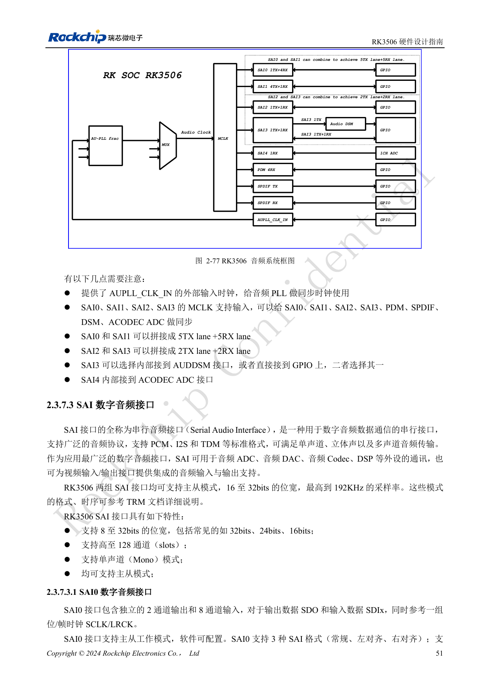
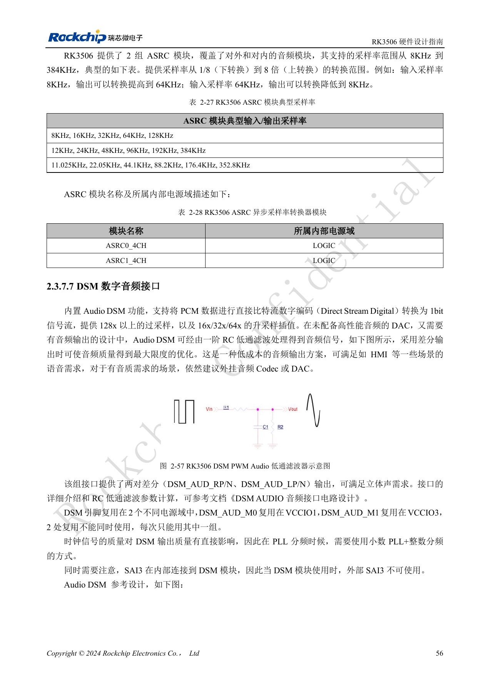
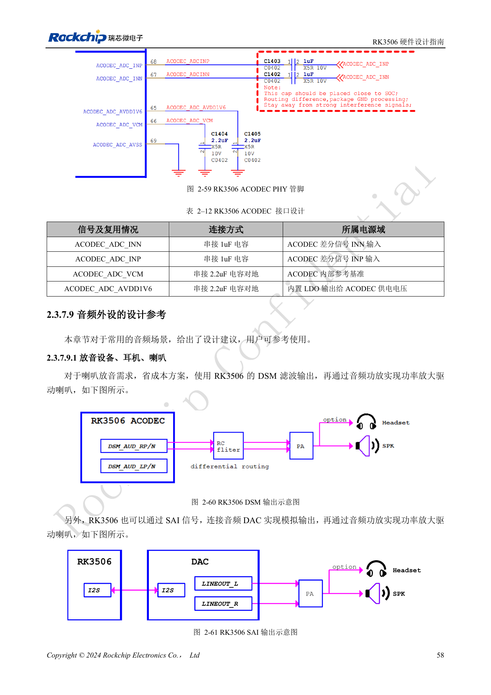
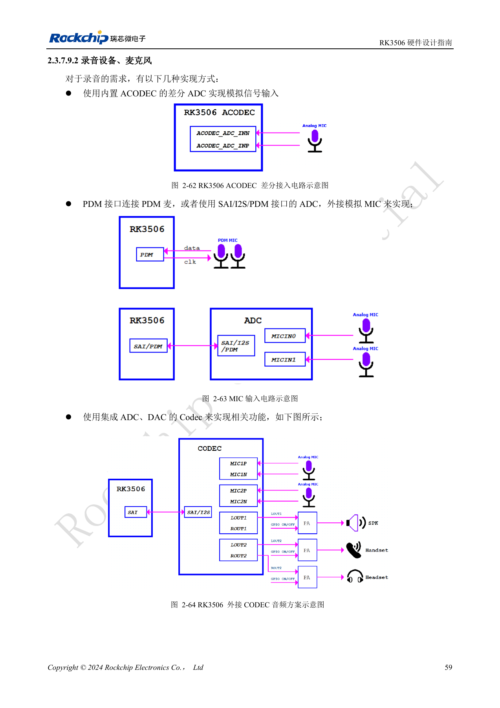

# Аудиотракт RK3506: SAI, PDM, ASRC и DSM

По RK3506 Hardware Design Guide V1.0 (2024-09), охватывающему G2 и B/J. Корпус, память, питание и выводы проверяют по варианту, интерфейсы CM1/Forge1 — по документации платы. Это тематическая инженерная статья, не полный постраничный перевод. Значения взяты из источника, не из испытаний ArmSoM. Проверяйте реальные SDK/BSP, ядро и прошивку.

**RK3506 Hardware Design Guide_V1.0_20240904_CN.pdf** · §2.3.7; §3.3.13

## Сначала схема тактов и данных

Наружу выведены только SAI0–3; SAI4 подключён к ACODEC ADC внутри. SAI0/1 объединяются в 5TX+5RX линий, SAI2/3 — в 2TX+2RX, но это не дополнительные контроллеры. M0/M1 SAI2 — альтернативы одного интерфейса. SAI3 выбирает внутренний DSM либо внешние IO; DSM исключает внешний SAI3. Источник сначала указывает 16–32bit, затем 8–32bit для SAI; уточняйте режим по TRM и SDK.

## Цифровые микрофоны и асинхронность

PDM работает ведущим приёмником: четыре линии по два канала, до восьми микрофонов либо шесть микрофонов и два канала обратного захвата. Для PDM_CLK рекомендованы 33Ω, для SAI MCLK/SCLK/LRCK обычно 22Ω. Не объединяйте разные правила. Два ASRC поддерживают 8–384kHz и отношение 1/8–8 для разных частот или одинаковых номинальных частот от несинхронных генераторов. ASRC — внутренний ресурс обработки, не внешний порт.

## Аналоговый путь выбирают по качеству

Недорогие HMI-сигналы можно получить через DSM, RC-фильтр и усилитель; для высокого качества нужен внешний Codec/DAC. ACODEC имеет один дифференциальный микрофонный вход. Сохраните 2.2µF на VCM и AVDD1V6; во входной цепи эталона стоят 1µF. Такты нескольких устройств SAI/PDM разводите цепочкой, отдельно экранируйте землёй с переходами не реже 300mil, удаляйте аудио от LCD, DDR, преобразователей и RF. Проверяйте шум, порядок каналов, одновременную запись/воспроизведение, длительную синхронизацию и пробуждение.

## Исходные рисунки и страницы проверки

В этой подборке доступны только китайские оригиналы. Все четыре языка используют одинаковые исходные изображения с контекстом; надписи внутри не переведены. Текст редактируемый. Указаны физические страницы PDF.

PDF 66

PDF 71

PDF 73

PDF 74

## Продукты и документация ArmSoM

- [ArmSoM CM1](https://www.armsom.org/product-page/cm1) · [CM1 Docs](https://docs.armsom.org/armsom-cm1)
- [ArmSoM Forge1](https://www.armsom.org/armsom-forge1) · [Forge1 Docs](https://docs.armsom.org/armsom-forge1)

## Читайте далее

- [Оглавление серии](/ru/articles/rk3506-hardware-design-series/)
- [Минимальная система RK3506: тактирование, сброс и восстановление](/ru/articles/rk3506-clock-boot-reset-design/)
- [Домены питания RK3506: G2, B/J и плата-носитель](/ru/articles/rk3506-power-domains-design/)
- [RK3506 DDR, eMMC и FSPI: схемы и трассировка](/ru/articles/rk3506-ddr-storage-hardware-design/)
- [RK3506: распределение дисплея, USB и RM_IO](/ru/articles/rk3506-display-usb-io-design/)
- [Промышленные интерфейсы RK3506: RMII, FlexBus, DSMC](/ru/articles/rk3506-industrial-bus-hardware-design/)
- [RK3506: тепло, ESD и подготовка производства](/ru/articles/rk3506-thermal-esd-production-design/)
