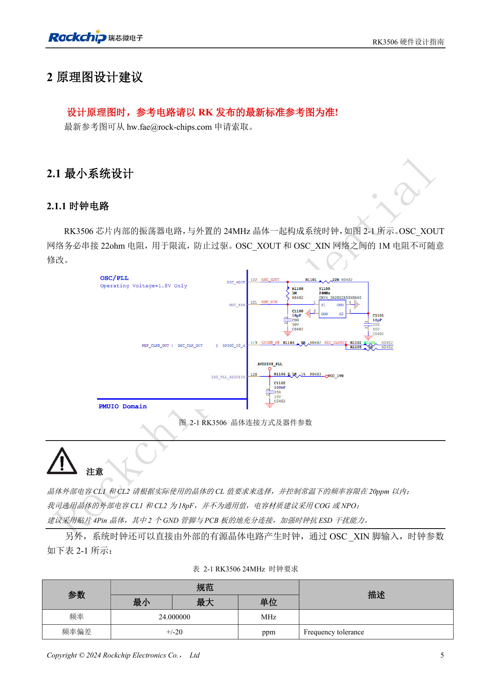
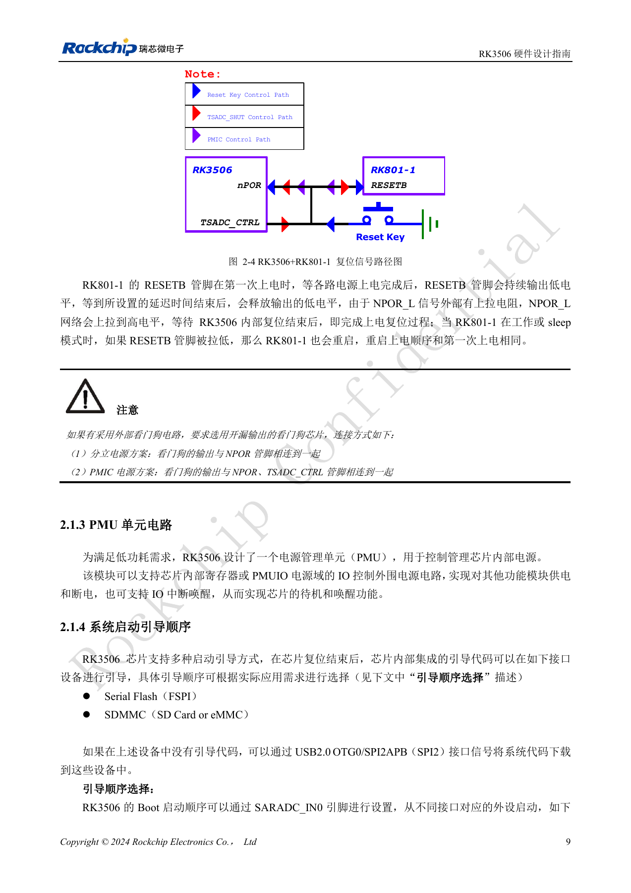
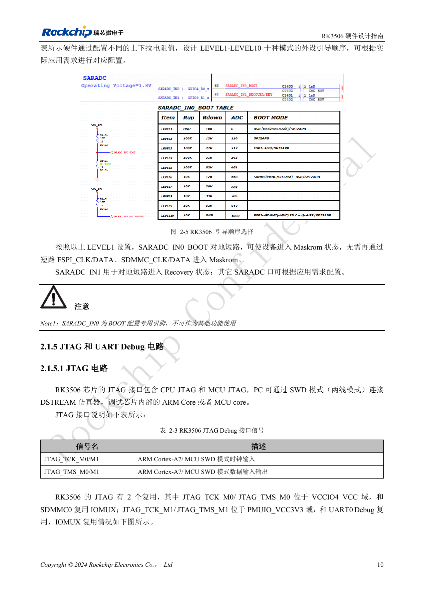
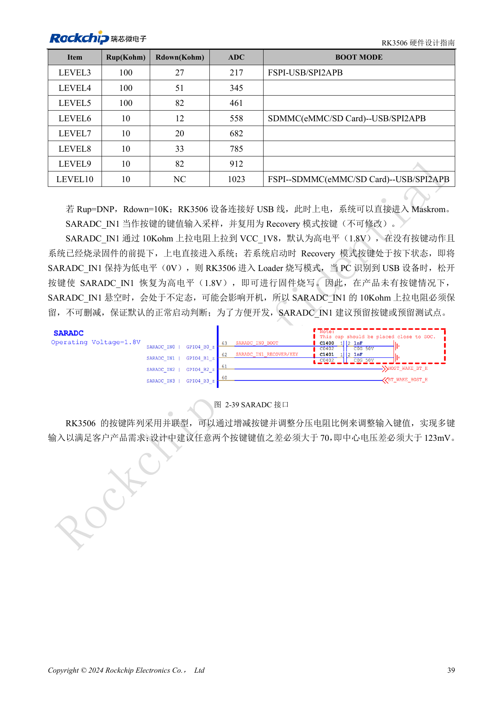
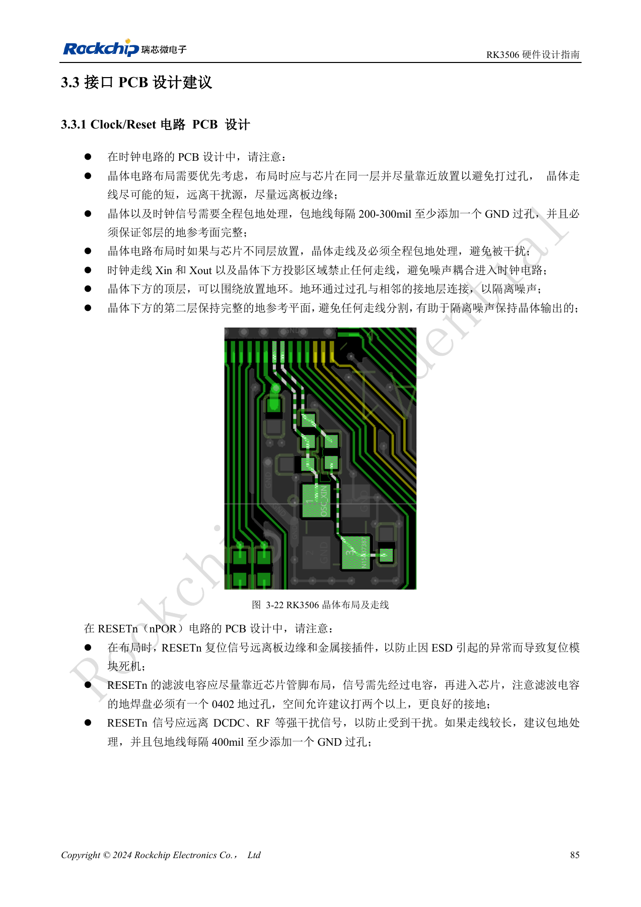

# Минимальная система RK3506: тактирование, сброс и восстановление

По RK3506 Hardware Design Guide V1.0 (2024-09), охватывающему G2 и B/J. Корпус, память, питание и выводы проверяют по варианту, интерфейсы CM1/Forge1 — по документации платы. Это тематическая инженерная статья, не полный постраничный перевод. Значения взяты из источника, не из испытаний ArmSoM. Проверяйте реальные SDK/BSP, ядро и прошивку.

**RK3506 Hardware Design Guide_V1.0_20240904_CN.pdf** · §2.1.1–2.1.5; §2.3.2; §3.3.1

## 24MHz и тактирование сна

Сохраните 22Ω в OSC_XOUT и не изменяйте произвольно 1MΩ между XOUT и XIN. Конденсаторы 18pF относятся к эталонному кварцу: рассчитывайте нагрузку по CL и паразитным ёмкостям. Допуск при комнатной температуре — ±20ppm; рекомендуются C0G/NP0 и четырёхвыводной кварц. Разместите кварц рядом с SoC на той же стороне, исключите посторонние трассы под ним и XIN/XOUT, сохраните соседнюю землю и переходы экрана через 200–300mil.

## Сброс зависит от питания

NPOR активен низким уровнем. Фильтр 10nF размещают у вывода, а не только у удалённой кнопки. В дискретной схеме внешний watchdog с открытым стоком подключают к NPOR; схема RK801-1 также включает TSADC_CTRL. Этот сигнал закреплён за RM_IO21 и не переносится. Согласуйте тактовые уровни с доменом IO. Перед отключением 24MHz проверьте источник пробуждения. Для внешних 32.768kHz указаны ±30ppm, заполнение 45–55% и амплитуда 0.7×VDD…VDD.

## Сохраните доступ к восстановлению

SARADC_IN0 выделен для выбора загрузки; заземление по LEVEL1 переводит SoC в Maskrom. SARADC_IN1 служит Recovery: сохраните подтяжку 10kΩ к 1.8V и кнопку или тестовую точку. Для используемых ADC нужны 1nF у SoC; у кнопки сигнал проходит ESD, затем 100Ω. Реализованный порт прошивки в этой версии — USB OTG0. SPI2APB указан в таблице, но его ПО на момент документа ещё не разработано, поэтому заменять им USB нельзя. При первом включении фиксируйте питания, 24MHz, NPOR, UART и обнаружение USB компьютером.

## Исходные рисунки и страницы проверки

В этой подборке доступны только китайские оригиналы. Все четыре языка используют одинаковые исходные изображения с контекстом; надписи внутри не переведены. Текст редактируемый. Указаны физические страницы PDF.

PDF 20

PDF 24

PDF 25

PDF 54

PDF 100

## Продукты и документация ArmSoM

- [ArmSoM CM1](https://www.armsom.org/product-page/cm1) · [CM1 Docs](https://docs.armsom.org/armsom-cm1)
- [ArmSoM Forge1](https://www.armsom.org/armsom-forge1) · [Forge1 Docs](https://docs.armsom.org/armsom-forge1)

## Читайте далее

- [Оглавление серии](/ru/articles/rk3506-hardware-design-series/)
- [Домены питания RK3506: G2, B/J и плата-носитель](/ru/articles/rk3506-power-domains-design/)
- [RK3506 DDR, eMMC и FSPI: схемы и трассировка](/ru/articles/rk3506-ddr-storage-hardware-design/)
- [RK3506: распределение дисплея, USB и RM_IO](/ru/articles/rk3506-display-usb-io-design/)
- [Аудиотракт RK3506: SAI, PDM, ASRC и DSM](/ru/articles/rk3506-audio-hardware-design/)
- [Промышленные интерфейсы RK3506: RMII, FlexBus, DSMC](/ru/articles/rk3506-industrial-bus-hardware-design/)
- [RK3506: тепло, ESD и подготовка производства](/ru/articles/rk3506-thermal-esd-production-design/)
