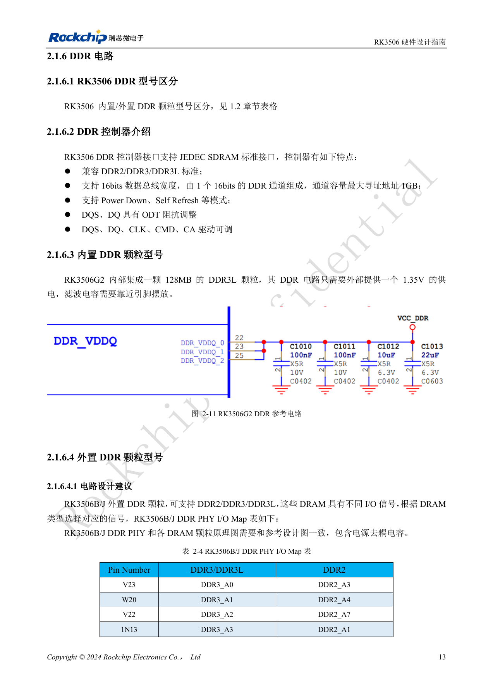
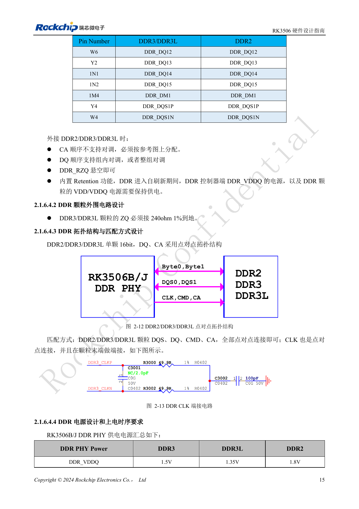
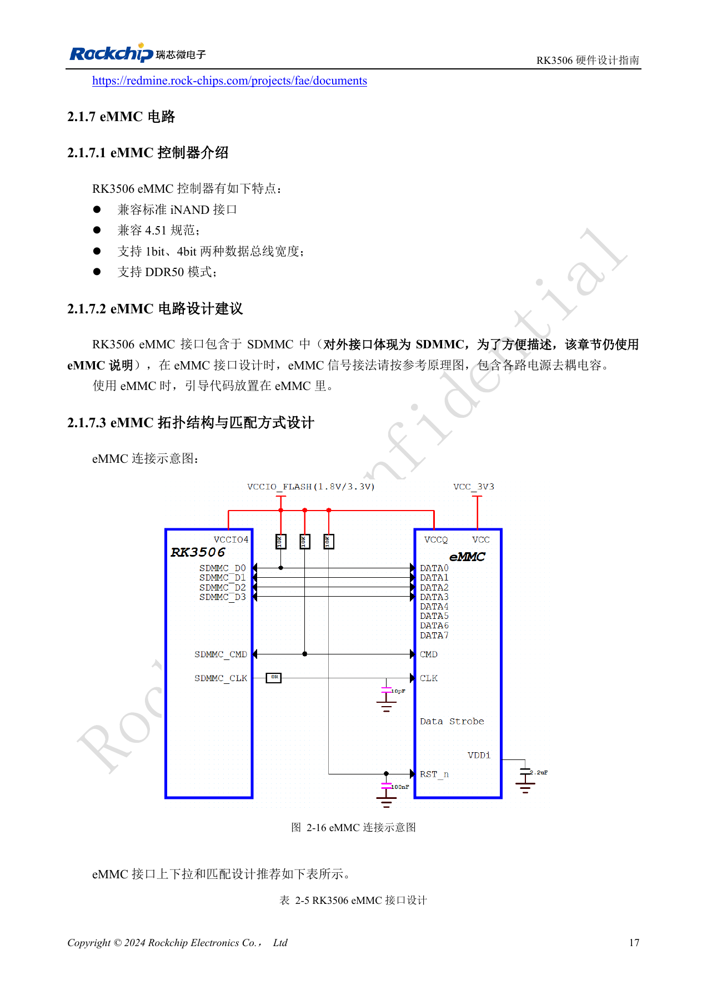
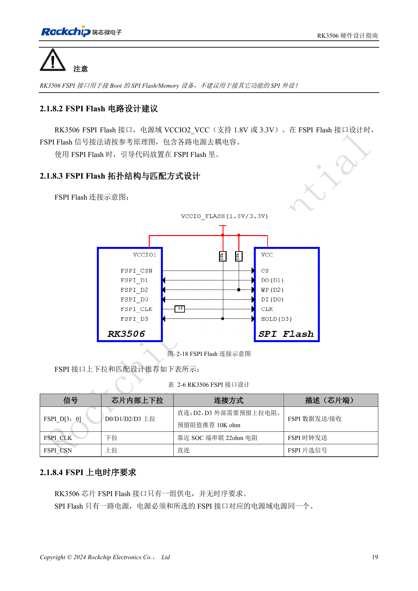
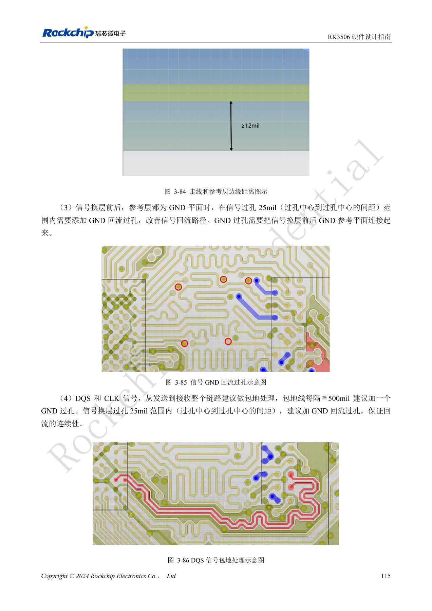

# RK3506 DDR, eMMC и FSPI: схемы и трассировка

По RK3506 Hardware Design Guide V1.0 (2024-09), охватывающему G2 и B/J. Корпус, память, питание и выводы проверяют по варианту, интерфейсы CM1/Forge1 — по документации платы. Это тематическая инженерная статья, не полный постраничный перевод. Значения взяты из источника, не из испытаний ArmSoM. Проверяйте реальные SDK/BSP, ядро и прошивку.

**RK3506 Hardware Design Guide_V1.0_20240904_CN.pdf** · §2.1.6–2.1.8; §3.3.9–3.3.12

## Встроенная и внешняя DDR

G2 содержит DDR3L 128MB с внешним питанием 1.35V и локальной развязкой. B/J использует DDR2/DDR3/DDR3L на одном 16bit канале; предел адресации 1GB не означает такой объём на CM1 или Forge1. Типовые DDR_VDDQ: DDR3 1.5V, DDR3L 1.35V, DDR2 1.8V. CA переставлять нельзя; DQ допускает перестановку внутри группы или целых групп. Вывод DDR_RZQ контроллера оставляют свободным, а ZQ микросхемы DDR3/3L подключают через 240Ω 1% к земле. При self-refresh сохраняют DDR_VDDQ контроллера и VDD/VDDQ памяти.

## Перенесите ограничения в правила PCB

Таблицы DDR2/3/3L задают 50Ω±10% для одиночных и 100Ω±10% для дифференциальных линий. Разность DQ/DM–DQS внутри byte ≤50mil, адрес/управление–CLK ≤100mil, внутри пар DQS и CLK ≤12mil, DQS–CLK ≤450mil. При смене слоя поставьте возвратный переход земли в пределах 25mil между центрами переходов и сохраните опорную плоскость. Интервал меандра ≥3W. Шаблон должен соответствовать памяти и DDR-прошивке; его проверка не заменяет испытание новой платы.

## Не путайте eMMC с восьмибитным HS400

Здесь eMMC работает через SDMMC: спецификация 4.51, ширина 1/4bit, DDR50. Для D0 и CMD рекомендованы внешние 10kΩ, на CLK у SoC — 22Ω; остальные данные используют внутренние подтяжки. Загрузочный FSPI поддерживает NOR/NAND, SDR и 1/2/4 линии в VCCIO2. Предусмотрите 10kΩ на D2/D3, 22Ω на CLK у SoC и общее питание flash с доменом. PCB: eMMC <3in, FSPI <4in; 50Ω±10% и разность такт/данные <100mil. Проверяйте холодный старт, восстановление, длительную запись/чтение и потерю питания с поддерживаемыми данным SDK микросхемами.

## Параметры трассировки DDR2 / DDR3 / DDR3L

| Проверка | Требование источника |
| --- | --- |
| Одиночный импеданс | 50Ω ±10% |
| Дифференциальный импеданс | 100Ω ±10% |
| Внутри byte: DQ / DM относительно DQS | ≤50mil |
| CS / ODT / CKE относительно CLK | ≤100mil |
| Другие адрес/управление относительно CLK | ≤100mil |
| Разность внутри DQS_P / DQS_N; CLK_P / CLK_N | ≤12mil |
| Разность DQS / CLK | ≤450mil |
| Между byte; DQ–DQ внутри byte | ≥2W |
| DQ–DQS, CLK–другие сигналы | Рекомендуется ≥3W; минимум 2W |

Источник: таблицы 3-17 и 3-18, PDF132–133. W — ширина трассы. Некоторые заголовки называют разницу задержкой, но единица mil обозначает длину, а не время.

## Полная карта сигналов DDR PHY RK3506B/J

| Вывод корпуса | DDR3 / DDR3L | DDR2 |
| --- | --- | --- |
| V23 | DDR3_A0 | DDR2_A3 |
| W20 | DDR3_A1 | DDR2_A4 |
| V22 | DDR3_A2 | DDR2_A7 |
| 1N13 | DDR3_A3 | DDR2_A1 |
| W18 | DDR3_A4 | DDR2_A2 |
| 1N14 | DDR3_A5 | DDR2_A5 |
| Y20 | DDR3_A6 | DDR2_A6 |
| T22 | DDR3_A7 | DDR2_A9 |
| Y21 | DDR3_A8 | DDR2_A8 |
| U22 | DDR3_A9 | DDR2_A12 |
| W17 | DDR3_A10 | DDR2_RASN |
| W22 | DDR3_A11 | DDR2_A11 |
| W23 | DDR3_A12 | DDR2_A0 |
| T23 | DDR3_A13 | DDR2_A13 |
| Y22 | DDR3_A14 | DDR2_A14 |
| Y17 | DDR3_A15 | DDR2_A15 |
| 1M9 | DDR3_WEN | DDR2_BA1 |
| 1N8 | DDR3_CASN | DDR2_BA0 |
| 1M8 | DDR3_RASN | DDR2_WEN |
| 1N12 | DDR3_BA0 | DDR2_A10 |
| Y18 | DDR3_BA1 | DDR2_CASN |
| 1N9 | DDR3_BA2 | DDR2_BA2 |
| W15 | DDR_CKE | DDR_CKE |
| 1M11 | DDR_CSN | DDR_CSN |
| 1N10 | DDR_ODT | DDR_ODT |
| 1M13 | DDR3_RESET | -- |
| Y14 | DDR_CLKP | DDR_CLKP |
| W14 | DDR_CLKN | DDR_CLKN |
| Y13 | DDR_DQ0 | DDR_DQ0 |
| Y12 | DDR_DQ1 | DDR_DQ1 |
| Y11 | DDR_DQ2 | DDR_DQ2 |
| 1M6 | DDR_DQ3 | DDR_DQ3 |
| 1M5 | DDR_DQ4 | DDR_DQ4 |
| 1N6 | DDR_DQ5 | DDR_DQ5 |
| W9 | DDR_DQ6 | DDR_DQ6 |
| 1N5 | DDR_DQ7 | DDR_DQ7 |
| 1N4 | DDR_DM0 | DDR_DM0 |
| Y10 | DDR_DQS0P | DDR_DQS0P |
| W10 | DDR_DQS0N | DDR_DQS0N |
| Y7 | DDR_DQ8 | DDR_DQ8 |
| W7 | DDR_DQ9 | DDR_DQ9 |
| Y6 | DDR_DQ10 | DDR_DQ10 |
| Y3 | DDR_DQ11 | DDR_DQ11 |
| W6 | DDR_DQ12 | DDR_DQ12 |
| Y2 | DDR_DQ13 | DDR_DQ13 |
| 1N1 | DDR_DQ14 | DDR_DQ14 |
| 1N2 | DDR_DQ15 | DDR_DQ15 |
| 1M4 | DDR_DM1 | DDR_DM1 |
| Y4 | DDR_DQS1P | DDR_DQS1P |
| W4 | DDR_DQS1N | DDR_DQS1N |

Источник: таблица 2-4, PDF28–30. Обозначения `1N13`, `1M9` сохранены буквально; перед изготовлением платы сверьте их с официальным PinOut корпуса B/J, не удаляя первый символ самостоятельно. Перестановка CA запрещена. DQ допускает перестановку внутри группы или целыми группами при согласовании с эталонной схемой и инициализацией. `DDR_RZQ` оставляют неподключённым; ZQ микросхемы DDR3/DDR3L соединяют с землёй через 240Ω, 1%. Для сохранения данных в self-refresh должны питаться и `DDR_VDDQ` контроллера, и `VDD/VDDQ` памяти. Таблица не описывает внешние выводы встроенной DDR G2 и не подтверждает вывод всех сигналов на CM1/Forge1.

## Исходные рисунки и страницы проверки

В этой подборке доступны только китайские оригиналы. Все четыре языка используют одинаковые исходные изображения с контекстом; надписи внутри не переведены. Текст редактируемый. Указаны физические страницы PDF.

PDF 28

PDF 30

PDF 32

PDF 34

PDF 130

## Продукты и документация ArmSoM

- [ArmSoM CM1](https://www.armsom.org/product-page/cm1) · [CM1 Docs](https://docs.armsom.org/armsom-cm1)
- [ArmSoM Forge1](https://www.armsom.org/armsom-forge1) · [Forge1 Docs](https://docs.armsom.org/armsom-forge1)

## Читайте далее

- [Оглавление серии](/ru/articles/rk3506-hardware-design-series/)
- [Минимальная система RK3506: тактирование, сброс и восстановление](/ru/articles/rk3506-clock-boot-reset-design/)
- [Домены питания RK3506: G2, B/J и плата-носитель](/ru/articles/rk3506-power-domains-design/)
- [RK3506: распределение дисплея, USB и RM_IO](/ru/articles/rk3506-display-usb-io-design/)
- [Аудиотракт RK3506: SAI, PDM, ASRC и DSM](/ru/articles/rk3506-audio-hardware-design/)
- [Промышленные интерфейсы RK3506: RMII, FlexBus, DSMC](/ru/articles/rk3506-industrial-bus-hardware-design/)
- [RK3506: тепло, ESD и подготовка производства](/ru/articles/rk3506-thermal-esd-production-design/)
