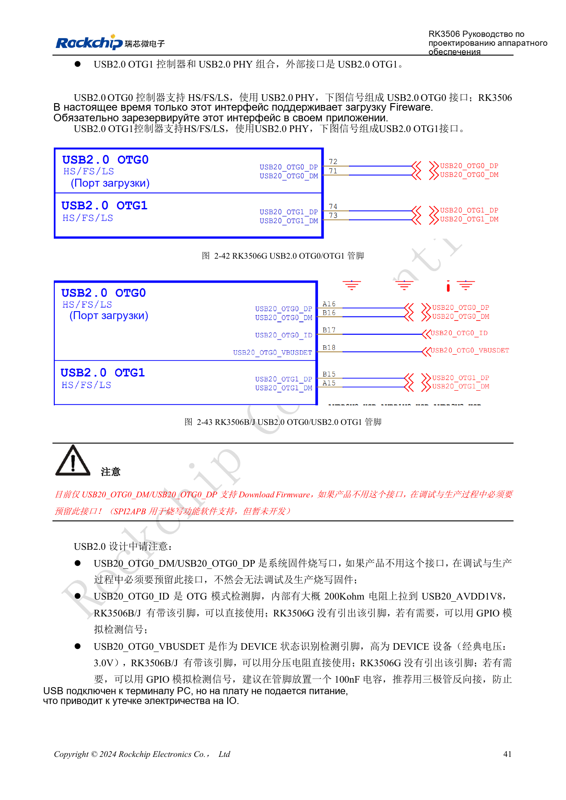
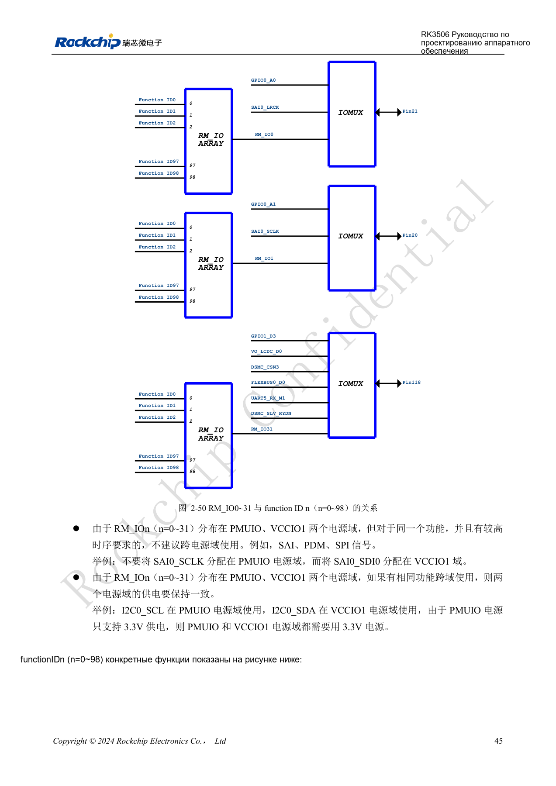
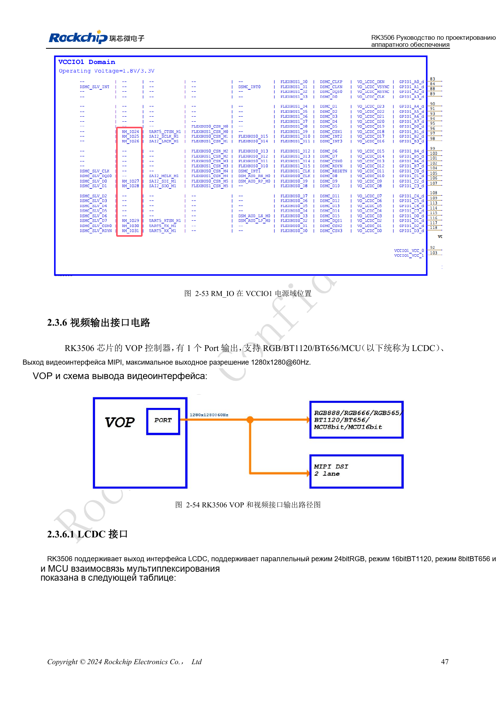
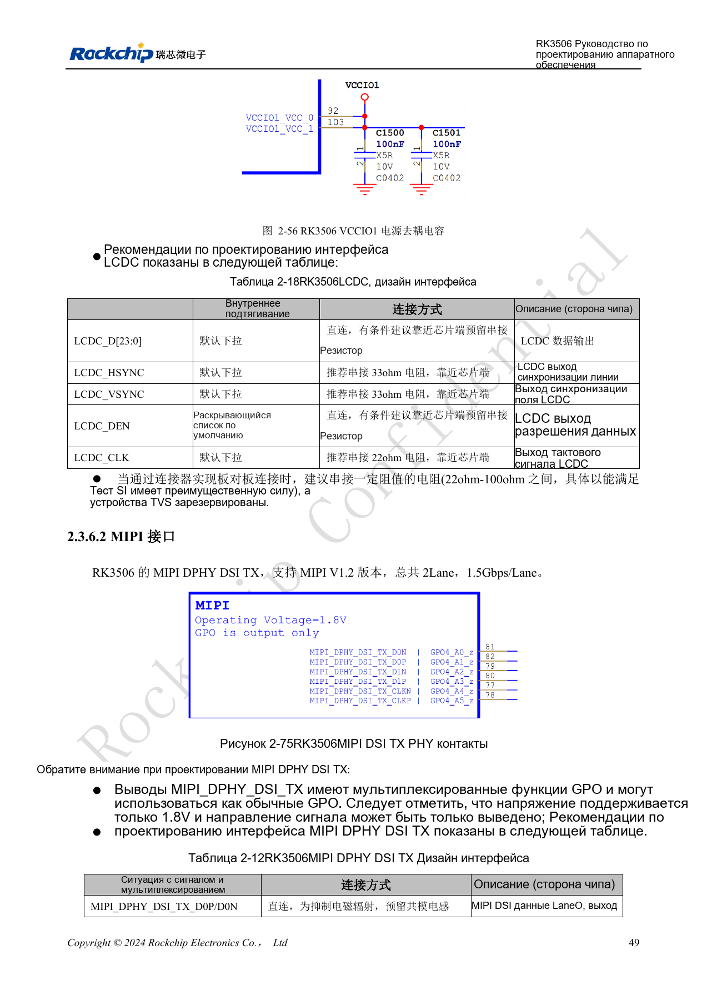
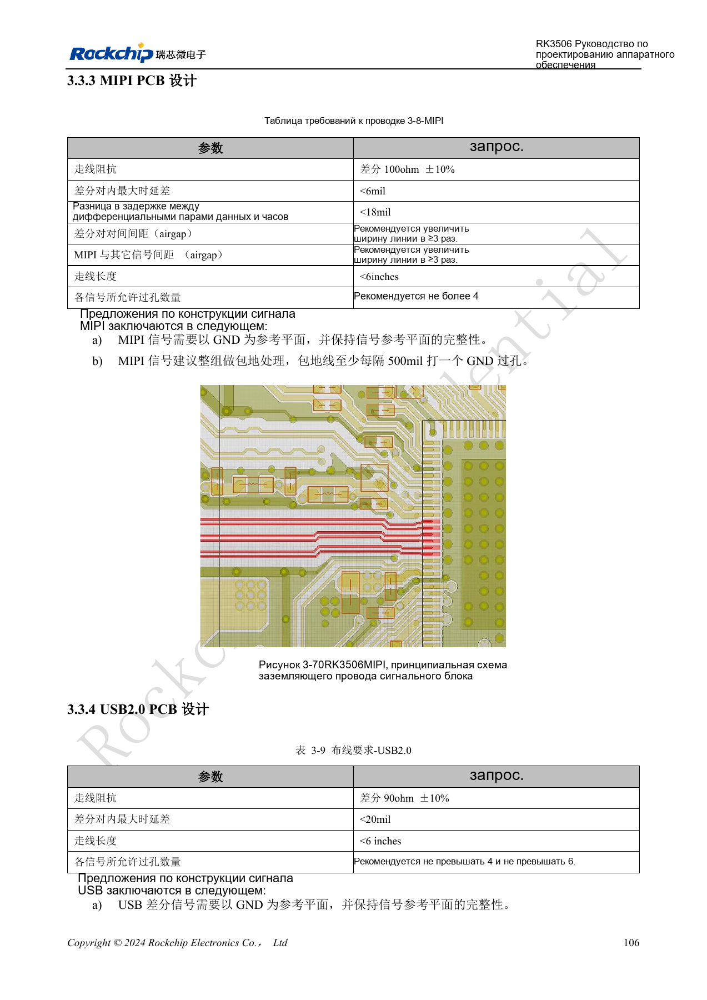
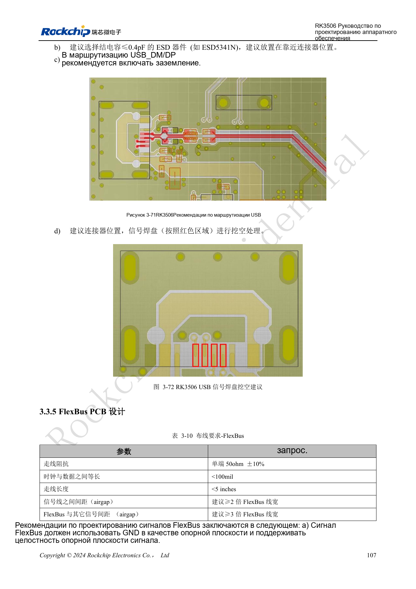

# RK3506: распределение дисплея, USB и RM_IO

По RK3506 Hardware Design Guide V1.0 (2024-09), охватывающему G2 и B/J. Корпус, память, питание и выводы проверяют по варианту, интерфейсы CM1/Forge1 — по документации платы. Это тематическая инженерная статья, не полный постраничный перевод. Значения взяты из источника, не из испытаний ArmSoM. Проверяйте реальные SDK/BSP, ядро и прошивку.

**RK3506 Hardware Design Guide_V1.0_20240904_CN.pdf** · §2.3.4–2.3.6; §3.3.3–3.3.4; §3.3.11

## Сначала выберите путь вывода

VOP имеет один порт: RGB/BT1120/BT656/MCU или MIPI, максимум по документу 1280×1280@60Hz. Перечень интерфейсов не означает одновременный вывод на несколько экранов. LCDC принадлежит VCCIO1 и должен соответствовать напряжению панели; рекомендуются 33Ω на HSYNC/VSYNC и 22Ω на CLK у источника. MIPI DSI TX имеет две линии данных по 1.5Gbps/Lane. Режим GPO на этих выводах — только выход 1.8V, не двунаправленный GPIO.

## USB и защита

Из двух USB2.0 OTG сохраните OTG0 для прошивки. У G2 ID/VBUSDET OTG0 не выведены, у B/J выведены; GPIO-детектор не должен питать выключенную плату от PC. Сохраните 2.2Ω на DP/DM и 100Ω на ID; для HOST 5V используйте ключ с ограничением тока. Схемная глава допускает ESD до 3pF, глава PCB рекомендует ≤0.4pF. Сохраните оба условия и проверяйте более строгий бюджет глазковой диаграммой. Трассы USB: 90Ω±10%, внутри пары <20mil, длина <6in, желательно до четырёх переходов, максимум шесть.

## Гибкость RM_IO имеет ограничения

RM_IO0–31 выбирают function ID0–98, но одну функцию можно назначить только одному выводу. Матрица распределена между PMUIO и VCCIO1; не разделяйте чувствительные к времени SAI/PDM/SPI между доменами. Для I2C между доменами нужны одинаковые уровни, а PMUIO фиксирован на 3.3V. MIPI PCB: 100Ω±10%, внутри пары <6mil, между парой данных и такта <18mil, длина <6in, желательно ≤4 переходов. До назначения разъёма составьте таблицу сигнал/функция/питание, затем проверяйте весь канал.

## Исходные рисунки и страницы проверки

В этой подборке доступны только китайские оригиналы. Все четыре языка используют одинаковые исходные изображения с контекстом; надписи внутри не переведены. Текст редактируемый. Указаны физические страницы PDF.

PDF 56

PDF 60

PDF 62

PDF 64

PDF 121

PDF 122

## Продукты и документация ArmSoM

- [ArmSoM CM1](https://www.armsom.org/product-page/cm1) · [CM1 Docs](https://docs.armsom.org/armsom-cm1)
- [ArmSoM Forge1](https://www.armsom.org/armsom-forge1) · [Forge1 Docs](https://docs.armsom.org/armsom-forge1)

## Читайте далее

- [Оглавление серии](/ru/articles/rk3506-hardware-design-series/)
- [Минимальная система RK3506: тактирование, сброс и восстановление](/ru/articles/rk3506-clock-boot-reset-design/)
- [Домены питания RK3506: G2, B/J и плата-носитель](/ru/articles/rk3506-power-domains-design/)
- [RK3506 DDR, eMMC и FSPI: схемы и трассировка](/ru/articles/rk3506-ddr-storage-hardware-design/)
- [Аудиотракт RK3506: SAI, PDM, ASRC и DSM](/ru/articles/rk3506-audio-hardware-design/)
- [Промышленные интерфейсы RK3506: RMII, FlexBus, DSMC](/ru/articles/rk3506-industrial-bus-hardware-design/)
- [RK3506: тепло, ESD и подготовка производства](/ru/articles/rk3506-thermal-esd-production-design/)
