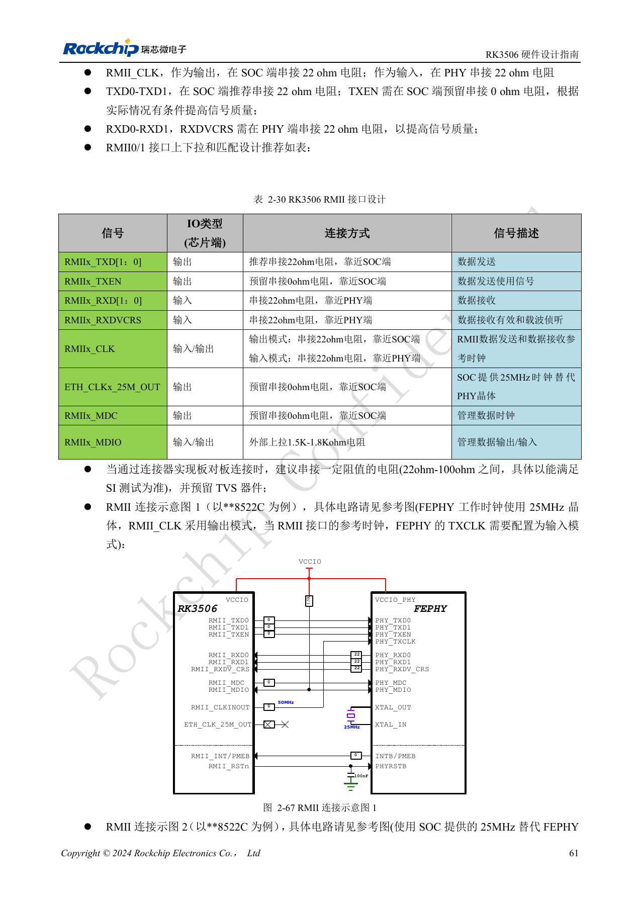
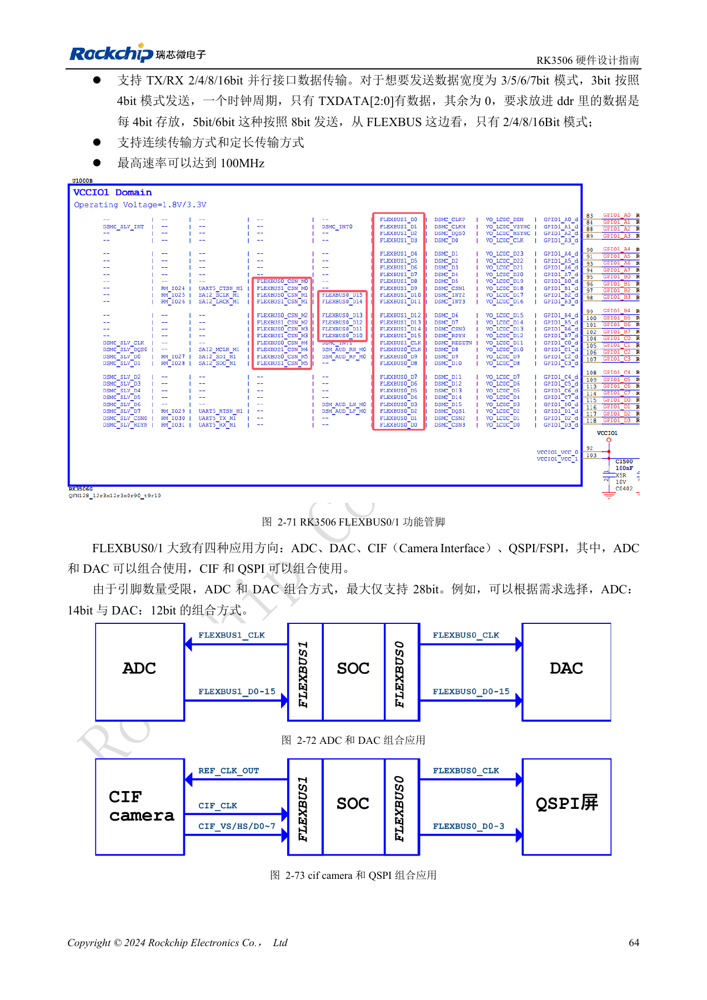
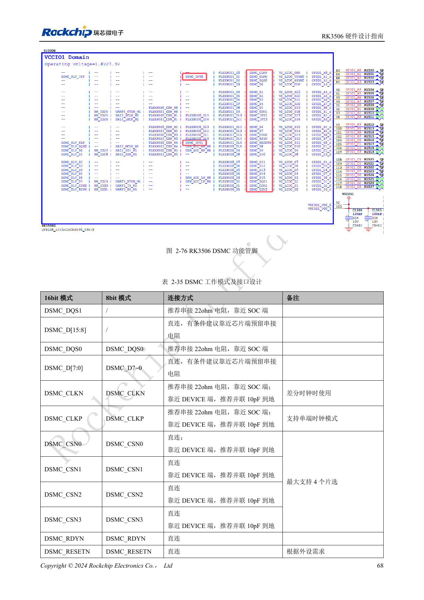
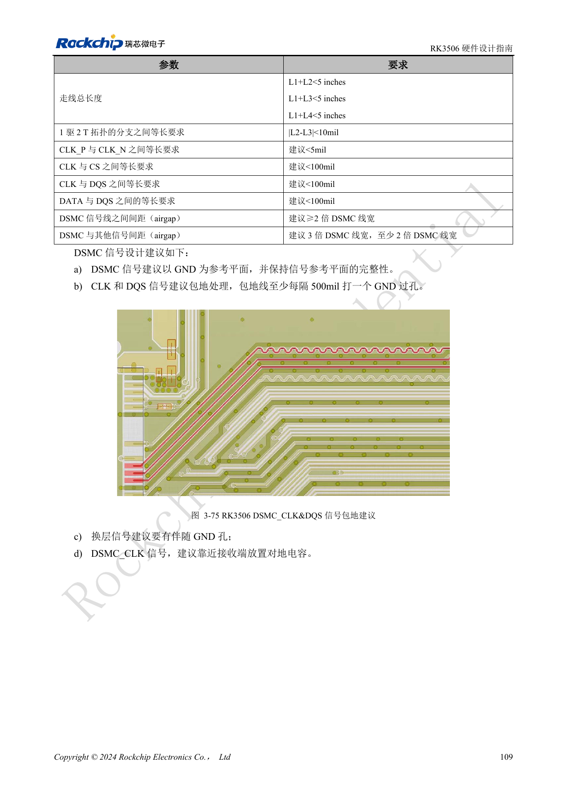
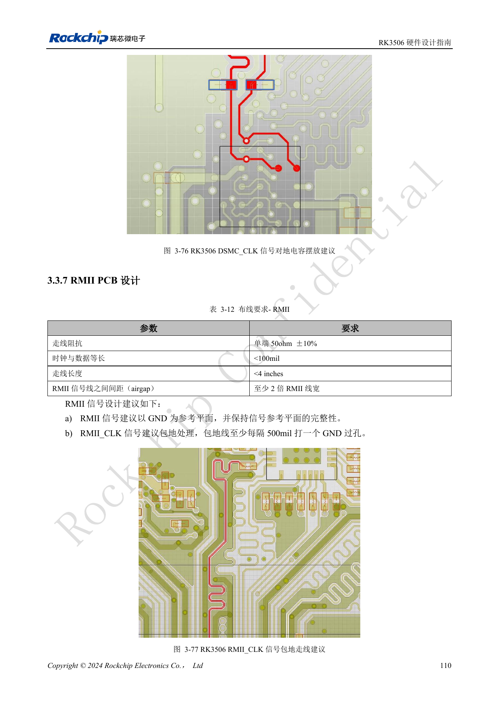

# Промышленные интерфейсы RK3506: RMII, FlexBus, DSMC

По RK3506 Hardware Design Guide V1.0 (2024-09), охватывающему G2 и B/J. Корпус, память, питание и выводы проверяют по варианту, интерфейсы CM1/Forge1 — по документации платы. Это тематическая инженерная статья, не полный постраничный перевод. Значения взяты из источника, не из испытаний ArmSoM. Проверяйте реальные SDK/BSP, ядро и прошивку.

**RK3506 Hardware Design Guide_V1.0_20240904_CN.pdf** · §2.3.8–2.3.17; §3.3.5–3.3.7

## Два MAC — не два готовых сетевых порта

RK3506 содержит два EMAC 10/100Mbps: RMII0 в VCCIO3 и RMII1 в VCCIO4. PHY, трансформаторы, RJ45, сброс и защита определяются платой. Для 50MHz выберите один источник: 22Ω у SoC, если он выдаёт такт, либо у PHY при обратном направлении. MDIO подтягивается через 1.5–1.8kΩ к питанию IO. Кварц PHY 25MHz и RMII 50MHz — разные сигналы. При смене PHY проверяют средние точки трансформатора, конфигурационные выводы и порядок контактов Tab-up/Tab-down.

## Направление и упаковка параллельной шины

Данные FlexBus0 двунаправленные, CLK только выход; данные FlexBus1 только вход, CLK вход/выход. Передача использует 2/4/8/16bit: 3bit упаковывают в 4bit, 5/6/7bit — в 8bit. Меньшее число подключённых выводов не создаёт произвольную разрядность. Максимум по источнику 100MHz; совместные ADC/DAC ограничены суммарно 28bit. DSMC проверяют по топологии: разность ветвей T 1:2 <10mil, CLK P/N желательно <5mil, CLK–CS/DQS и DATA–DQS <100mil, полный путь <5in.

## Проверяйте и плату-носитель

Для RMII указаны 50Ω±10%, разность такт/данные <100mil и длина <4in; для FlexBus — 50Ω±10%, <100mil, <5in. Для UART, SPI, I2C, PWM, touch и CAN отдельно проверьте мультиплексирование, уровни и внешние компоненты. Сигналы CAN-контроллера нельзя непосредственно соединять с полевой шиной. Носитель CM1 проектируют по реально выведенным функциям; Forge1 оценивают по её интерфейсам. После раздельных тестов проверяйте одновременное обновление дисплея, сеть и полевые данные, фиксируя ошибки и восстановление.

## Подключение ведущего интерфейса DSMC

| Сигнал | Подключение и назначение |
| --- | --- |
| DSMC_DQS1 | Только 16bit; рекомендуется 22Ω у SoC |
| DSMC_D[15:8] | Только 16bit; напрямую, предусмотреть последовательный резистор |
| DSMC_DQS0 | 8/16bit; рекомендуется 22Ω у SoC |
| DSMC_D[7:0] | Напрямую, предусмотреть последовательный резистор |
| DSMC_CLKN | Только дифференциальный режим; 22Ω у SoC, 10pF к земле у устройства |
| DSMC_CLKP | Поддерживает одиночный режим; 22Ω у SoC, 10pF к земле у устройства |
| DSMC_CSN0–3 | До четырёх CS; напрямую, предусмотреть 10pF к земле у устройства |
| DSMC_RDYN / DSMC_RESETN | Напрямую, по требованиям устройства |
| DSMC_INT0/1 | Аппаратное прерывание; напрямую |
| DSMC_INT2/3 | Программное прерывание, медленнее; напрямую |

Источник: §2.3.8, таблица 2-35, PDF82–84. Ведущий интерфейс: x8/x16 DDR, тактовая частота до 150MHz, Xccela/Hyperbus PSRAM или FPGA. Подчинённый: x8 DDR до 100MHz; DQS0, D[7:0], CLKP, CSN0, RDYN и INT подключают по требованиям HOST. Номиналы — рекомендации эталонной схемы, требующие проверки с устройством и временными параметрами. Максимальная частота не гарантируется для любой платы.

## Низкоскоростные шины и ограничения мультиплексирования

| Интерфейс | Ограничения источника |
| --- | --- |
| UART0–5 | UART0: PMUIO, отладка; UART1–4: RM_IO; UART5: M0/VCCIO4 либо M1/VCCIO1. UART3/4/5 имеют соответствующие линии управления потоком. FIFO TX/RX 64-byte, данные 5–8bit. |
| SPI0/1 | Ведущий/подчинённый, полный/полудуплекс, 4/8/16bit, RM_IO PMUIO/VCCIO1; 22Ω у источника такта, данные/CS напрямую. |
| SPI2APB | Только подчинённый, полудуплекс, 8/16bit, VCCIO3, собственный протокол; не универсальный SPI-master. |
| I2C0–2 | Ведущий, адрес 7/10bit, до 1Mbit/s; RM_IO, рекомендованы подтяжки 2.2kΩ с проверкой нагрузки. В таблице 2-42 отсутствует n=2, текст и 2-43 указывают 0/1/2. |
| CAN0/1 | CAN 2.0B, стандартные/расширенные кадры, RM_IO; CANn_TX требует внешнюю подтяжку 4.7kΩ, RX напрямую к трансиверу. |

Источник: PDF85–90. Проверяйте одновременно PinMux, напряжение домена и DTS: один вывод не выполняет все альтернативные функции сразу. Перечислены скорости UART 115.2kbps, 460.8kbps, 921.6kbps, 1.5Mbps, 3Mbps, 4Mbps; выбор зависит от тактирования и второго устройства. Функции аналоговых PHY без питания отключают в DTS, чтобы ПО не включало обесточенный блок.

## Исходные рисунки и страницы проверки

В этой подборке доступны только китайские оригиналы. Все четыре языка используют одинаковые исходные изображения с контекстом; надписи внутри не переведены. Текст редактируемый. Указаны физические страницы PDF.

PDF 76

PDF 79

PDF 83

PDF 124

PDF 125

## Продукты и документация ArmSoM

- [ArmSoM CM1](https://www.armsom.org/product-page/cm1) · [CM1 Docs](https://docs.armsom.org/armsom-cm1)
- [ArmSoM Forge1](https://www.armsom.org/armsom-forge1) · [Forge1 Docs](https://docs.armsom.org/armsom-forge1)

## Читайте далее

- [Оглавление серии](/ru/articles/rk3506-hardware-design-series/)
- [Минимальная система RK3506: тактирование, сброс и восстановление](/ru/articles/rk3506-clock-boot-reset-design/)
- [Домены питания RK3506: G2, B/J и плата-носитель](/ru/articles/rk3506-power-domains-design/)
- [RK3506 DDR, eMMC и FSPI: схемы и трассировка](/ru/articles/rk3506-ddr-storage-hardware-design/)
- [RK3506: распределение дисплея, USB и RM_IO](/ru/articles/rk3506-display-usb-io-design/)
- [Аудиотракт RK3506: SAI, PDM, ASRC и DSM](/ru/articles/rk3506-audio-hardware-design/)
- [RK3506: тепло, ESD и подготовка производства](/ru/articles/rk3506-thermal-esd-production-design/)
