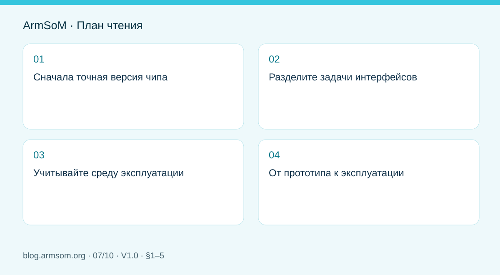
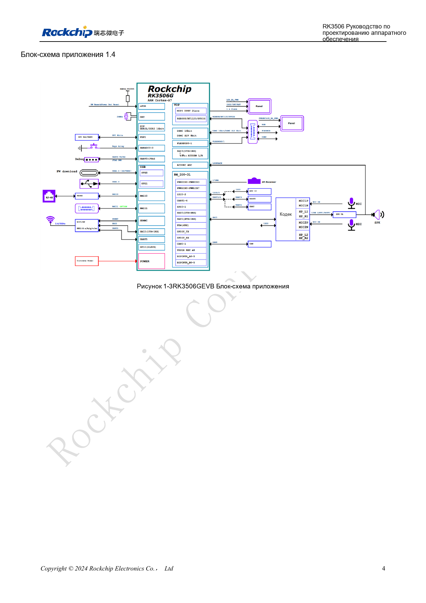

# Аппаратная часть HMI на RK3506: выбор пути с CM1 или Forge1

## Область применения и источники

Это тематическое инженерное руководство, а не постраничный перевод всего PDF. Примеры источника не являются измерениями ArmSoM. Напряжения, выводы, SDK/BSP и ядро сверяйте с фактической ревизией платы.

**Rockchip:** `RK3506 Hardware Design Guide_V1.0_20240904_CN.pdf` · V1.0 · §1–5

## Сначала точная версия чипа

Страница 3 PDF V1.0 прямо перечисляет RK3506G2 и RK3506B/J, включая J. Расположение файла в каталоге B/G не ограничивает применимость всего руководства. Выводы, питание, DDR и соединения платы проверяются по варианту.

CM1 подходит для собственных интерфейсов и механики на базе модуля; Forge1 — платформа разработки промышленного приложения. Сначала определите экран, сенсор, сеть, полевые коммуникации, звук и корпус.

## Разделите задачи интерфейсов

| Функция | Что проверять вместе |
| --- | --- |
| Экран и сенсор | Интерфейс, тайминги, подсветку, контроллер, драйвер |
| Ethernet | Такты MAC/PHY, питание, сброс, разъём, изоляцию |
| Полевые связи | Трансивер, изоляцию, терминаторы и землю |
| Звук | Уровни, петли земли, связь аналоговых и цифровых помех |
| Обслуживание | UART, прошивку, идентификацию версии, доступ в корпусе |

Глава 3 отдельно описывает PCB для MIPI, USB2.0, FlexBus, DSMC, RMII, памяти и аудио. Это не означает, что каждая плата выводит все функции.

## Учитывайте среду эксплуатации

Рассматривайте внешние разъёмы, защиту и чувствительные цепи целиком. ESD требует подходящего пути возврата; шлейфы дисплея, импульсное питание и аудио — продуманного размещения. Главы 4–5 помогают составить проверки тепла и ESD/EMI, но не заменяют испытания изделия и сертификацию.

## От прототипа к эксплуатации

Сначала проверьте интерфейсы отдельно, затем совместите обновление экрана, сеть и сбор данных. Записывайте время старта, отклик, ошибки связи и нагрев. Проверяйте старт и восстановление в допустимом диапазоне питания. Надпись «промышленный» не заменяет доказательств.

Для CM1 сначала подтвердите ПО и периферию на IO-плате; для Forge1 уточните реализованные интерфейсы. Собственный носитель требует проверки собственного питания, защиты и разъёмов.

## Иллюстрация из источника

Китайский оригинал; соответствующая английская иллюстрация в материалах не найдена. RK3506G EVB ≠ RK3506J / CM1 / Forge1. Эталонный проект, а не схема платы ArmSoM.

`RK3506 Hardware Design Guide_V1.0_20240904_CN.pdf` · PDF p. 19.

## Продукты и документация

- **CM1** — [Страница продукта](https://www.armsom.org/product-page/cm1) · [Документация](https://docs.armsom.org/armsom-cm1)
- **Forge1** — [Страница продукта](https://www.armsom.org/armsom-forge1) · [Документация](https://docs.armsom.org/armsom-forge1)

## Другие статьи серии

- [Запуск платы RK3576: минимальная система и проверка первого включения](/ru/articles/rk3576-hardware-bringup/)
- [Плата-носитель ArmSoM CM5: питание, загрузка и планирование интерфейсов](/ru/articles/019-cm5-carrier-production/)
- [Скоростные интерфейсы RK3576: совместная проверка схемы и PCB](/ru/articles/rk3576-high-speed-interface-design/)
- [Аппаратное проектирование RK3588S: от эталонной схемы к носителю CM7s](/ru/articles/rk3588s-cm7s-carrier-design/)
- [RK3588 для периферийного ИИ: питание, охлаждение и расширение](/ru/articles/rk3588-edge-ai-hardware-design/)
- [Проверка скоростной PCB RK3588: слои, импеданс и трассировка](/ru/articles/rk3588-high-speed-pcb-review/)
- [Варианты RK3308: аппаратная совместимость для аудиопроектов P2 Pro](/ru/articles/rk3308-hardware-variant-compatibility/)
- [RK3588S и RK3588S2: что проверить перед изменением платы](/ru/articles/rk3588s-rk3588s2-hardware-differences/)
- [От прототипа Rockchip к серии: технологические требования и испытания](/ru/articles/rockchip-hardware-production-checklist/)

## Читайте далее

- [RK3506: аппаратное проектирование](/ru/articles/rk3506-hardware-design-series/)
