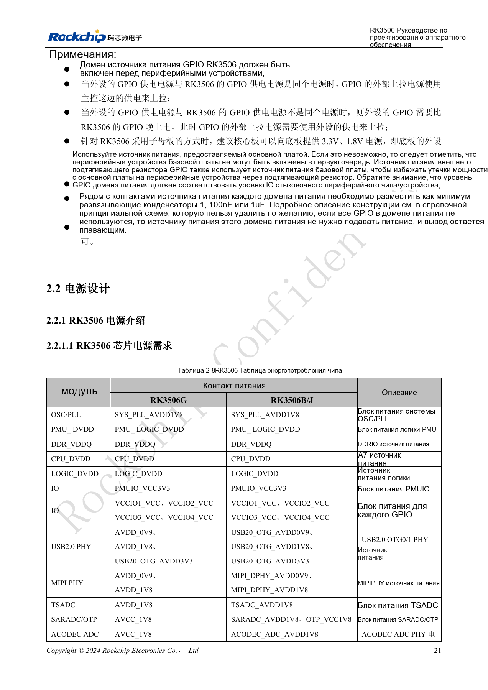
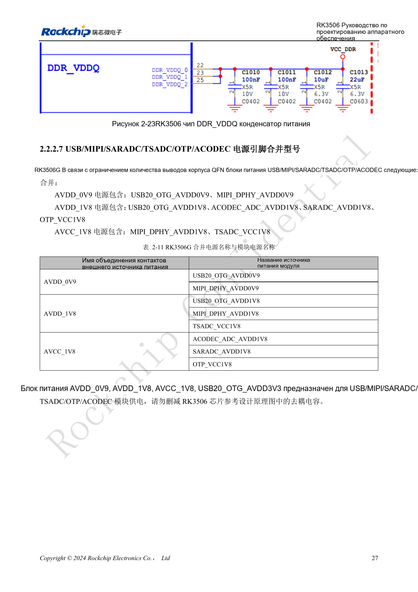
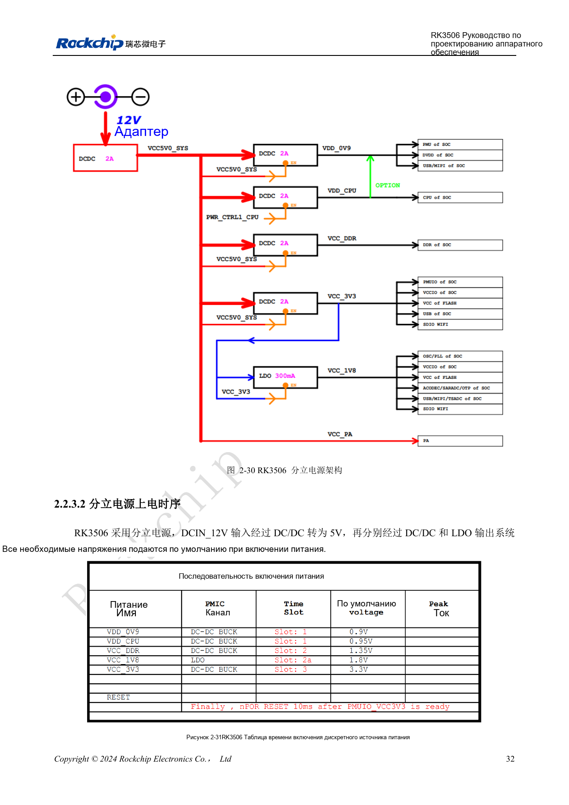
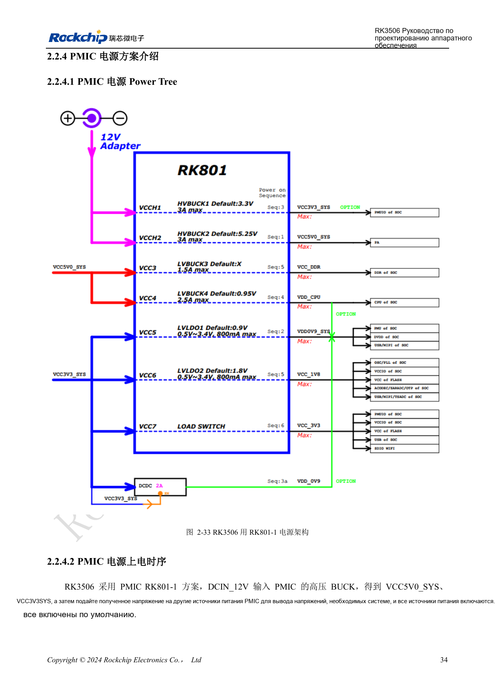

# Домены питания RK3506: G2, B/J и плата-носитель

По RK3506 Hardware Design Guide V1.0 (2024-09), охватывающему G2 и B/J. Корпус, память, питание и выводы проверяют по варианту, интерфейсы CM1/Forge1 — по документации платы. Это тематическая инженерная статья, не полный постраничный перевод. Значения взяты из источника, не из испытаний ArmSoM. Проверяйте реальные SDK/BSP, ядро и прошивку.

**RK3506 Hardware Design Guide_V1.0_20240904_CN.pdf** · §1.2; §2.1.9; §2.2; §3.3.2

## Сначала определите корпус

Руководство прямо включает RK3506G2 и RK3506B/J. G2 — QFN128L со встроенной DDR3L 128MB; B/J — FBGA333L с внешней DDR. В G2 часть аналоговых питаний объединена, тогда как у B/J USB, MIPI, SARADC, OTP и ACODEC имеют отдельные выводы. Одинаковые названия блоков не позволяют копировать цепи другого корпуса. Для CM1 и Forge1 на варианте J руководство применимо вместе с реальной схемой изделия и распиновкой разъёмов.

## Очередность и паразитное питание

Внутри одного блока низкое напряжение подают раньше высокого, одинаковые напряжения — совместно. Это не разрешает включать периферию раньше GPIO SoC. При раздельном питании подтяжки подключают к питанию периферии, исключая ток в выключенное устройство. PMUIO фиксирован на 3.3V; VCCIO1–4 допускают 1.8V/3.3V с аппаратным определением по руководству. Всё равно проверяйте уровни, очередность и состояние без питания. Сохраните возле каждого питающего вывода домена минимум один конденсатор 100nF или 1µF.

## Проверяйте динамику питания

Дискретная схема и RK801-1 имеют собственные последовательности и сброс; используйте соответствующий эталон целиком. Для LOGIC_DVDD и DDR_VDDQ требуется суммарно более 30µF на каждую цепь. Пример DDR BUCK: минимум 1000mA, точность ±1.5%, пульсации ±5% при скачке 10%→80% максимальной нагрузки со скоростью 1A/µs. Для USB B/J указаны AC-пределы: 0.9V <25mV, 1.8V <50mV, 3.3V <200mV. Это требования источника, не измерения платы. Текст страницы 27 о совмещённых питаниях G2 противоречит таблице 2-11; соответствие нужно уточнять по PinOut и схеме, не исправлять догадкой.

## Семь групп целевого импеданса PDN

| Таблица / объект | 100kHz–1MHz / Ω | 1–30MHz / Ω | 30–100MHz / Ω |
| --- | --- | --- | --- |
| 3-1 RK3506B VDD_CPU | ≤0.045 | ≤0.08 | ≤0.25 |
| 3-2 RK3506G VDD_CPU | ≤0.045 | ≤0.08 | ≤0.25 |
| 3-3 RK3506B VDD_0V9 | ≤0.05 | ≤0.06 | ≤0.15 |
| 3-4 RK3506G VDD_0V9 | ≤0.05 | ≤0.1 | ≤0.35 |
| 3-5 RK3562B VCC_DDR * | ≤0.045 | ≤0.1 | ≤0.3 |
| 3-6 RK3562G VCC_DDR * | ≤0.06 | ≤0.09 | ≤0.25 |
| 3-7 VCC_DDR микросхемы DDR | ≤0.04 | ≤0.04 | ≤0.08 |

Источник: PDF107–108, 113, 118–119. * Заголовки и вводный текст таблиц 3-5/3-6 указывают RK3562B/G, соседние графики 3-65/3-66 — RK3506B/G. Это противоречие моделей в источнике: значения и названия сохранены; две строки нельзя считать подтверждёнными пределами приёмки DDR RK3506. В остальных таблицах исходное RK3506G не заменено молча на G2. Целевой импеданс — рекомендация для сети питания, проверяемая с учётом стека, корпуса, развязки и спектра нагрузки, а не потребление платы или быстродействие CPU.

## Ширина питания и расстояния развязки

| Питание | Ширина DCDC–SoC | Полезная ширина под SoC | DCR |
| --- | --- | --- | --- |
| VDD_CPU | ≥160mil | ≥55mil | ≤30mΩ |
| VDD_0V9 | ≥100mil | ≥30mil | ≤30mΩ |
| VCC_DDR | ≥80mil | ≥30mil | ≤30mΩ |

Источник: §3.3.2. На выходе DCDC нужно минимум четыре переходных отверстия 0503, рекомендуется ≥6. Каждому выводу питания требуется переход питания. Расстояние от края площадки развязки 100nF до центра перехода питания ≤12mil, для 1µF — ≤50mil. Каждой земляной площадке нужен земляной переход. Ключевые конденсаторы варианта B размещают с обратной стороны соответствующих выводов; не удаляйте развязку эталона без проверки. Текст требует GND-переходы в пределах 40mil, но подписи 3-44 и 3-58 говорят 50mil; зафиксируйте расхождение и используйте подтверждённый шаблон.

## Пиковые токи платы разработчика

| Сеть | Напряжение / V | Пиковый ток / A | Мощность источника / W | Частота |
| --- | --- | --- | --- | --- |
| VDD_CPU | 0.95 | 0.7 | 0.76 | 1.5GHz |
| VDD_0V9 | 0.9 | 0.5 | 0.54 | — |
| VCC_DDR | 1.35 | 0.6 | 0.945 | 800MHz |

Источник: таблица 2-12, PDF51. RK3506G2, температура перехода 100°C, плата без радиатора; запись через 15 минут стабильной работы. Каждый блок испытывался в собственной предельной нагрузке: сумма строк не является одновременным потреблением платы. `VCC_DDR` включает `DDR_VDDQ` и встроенную DDR. Мощность не равна указанным напряжению × току; метод расчёта не объяснён. Значения сохранены как требующие проверки, без самостоятельного «исправления». Это не измерения ArmSoM и не окончательные гарантированные пределы чипа.

## Исходные рисунки и страницы проверки

В этой подборке доступны только китайские оригиналы. Все четыре языка используют одинаковые исходные изображения с контекстом; надписи внутри не переведены. Текст редактируемый. Указаны физические страницы PDF.

PDF 36

PDF 42

PDF 47

PDF 49

## Продукты и документация ArmSoM

- [ArmSoM CM1](https://www.armsom.org/product-page/cm1) · [CM1 Docs](https://docs.armsom.org/armsom-cm1)
- [ArmSoM Forge1](https://www.armsom.org/armsom-forge1) · [Forge1 Docs](https://docs.armsom.org/armsom-forge1)

## Читайте далее

- [Оглавление серии](/ru/articles/rk3506-hardware-design-series/)
- [Минимальная система RK3506: тактирование, сброс и восстановление](/ru/articles/rk3506-clock-boot-reset-design/)
- [RK3506 DDR, eMMC и FSPI: схемы и трассировка](/ru/articles/rk3506-ddr-storage-hardware-design/)
- [RK3506: распределение дисплея, USB и RM_IO](/ru/articles/rk3506-display-usb-io-design/)
- [Аудиотракт RK3506: SAI, PDM, ASRC и DSM](/ru/articles/rk3506-audio-hardware-design/)
- [Промышленные интерфейсы RK3506: RMII, FlexBus, DSMC](/ru/articles/rk3506-industrial-bus-hardware-design/)
- [RK3506: тепло, ESD и подготовка производства](/ru/articles/rk3506-thermal-esd-production-design/)
