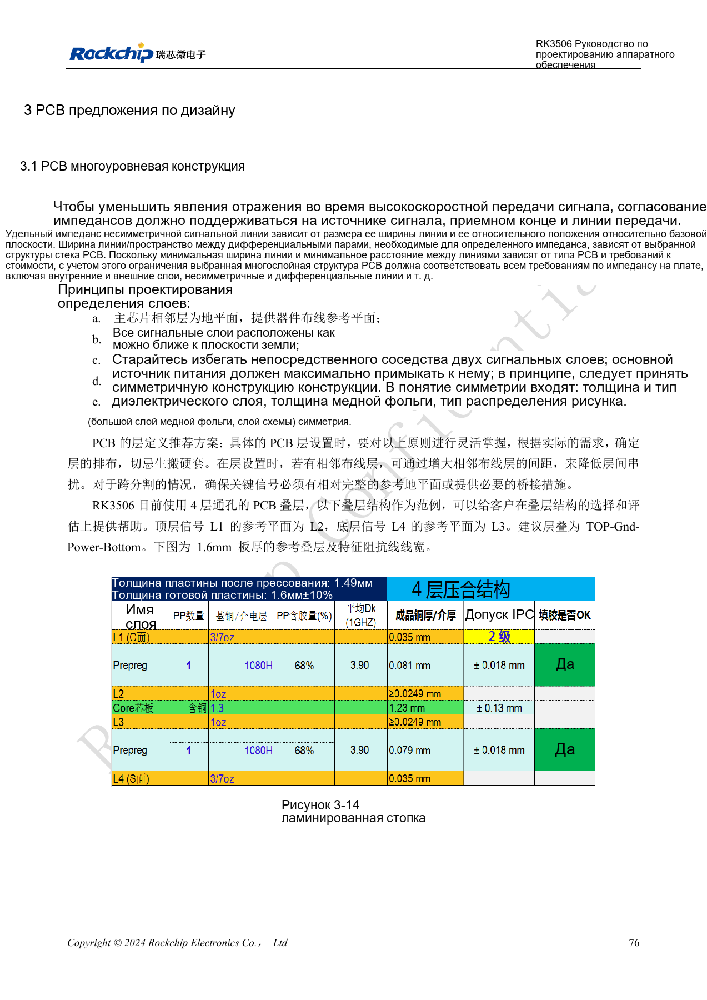
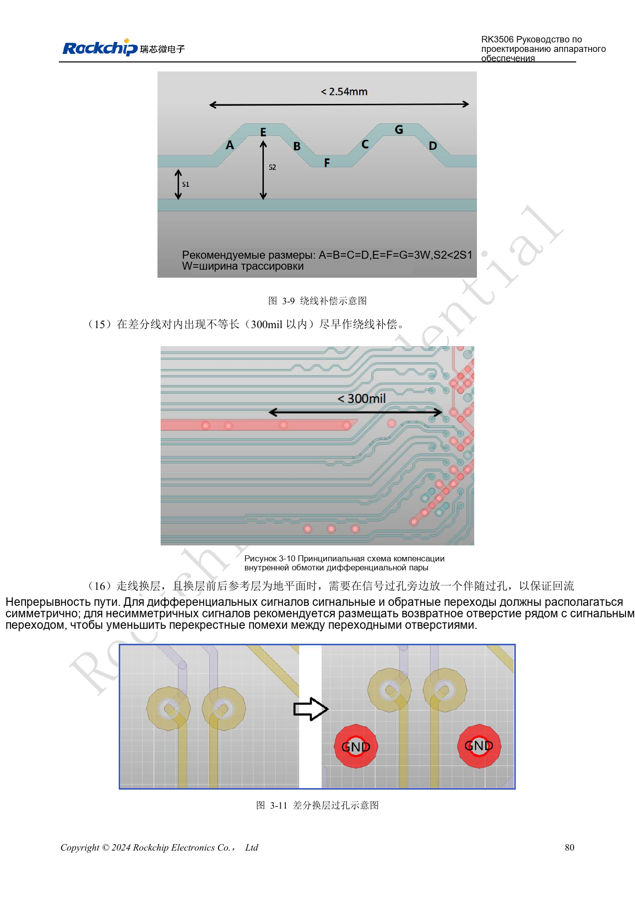
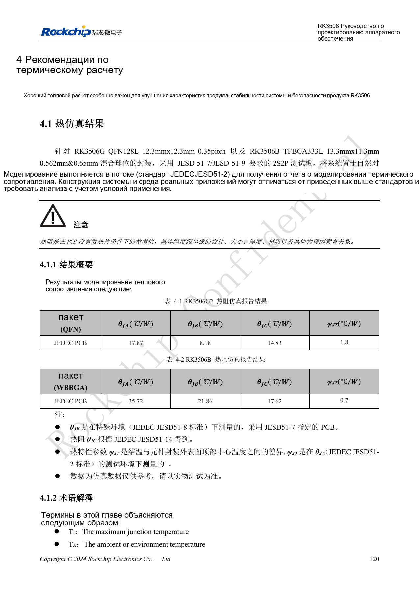
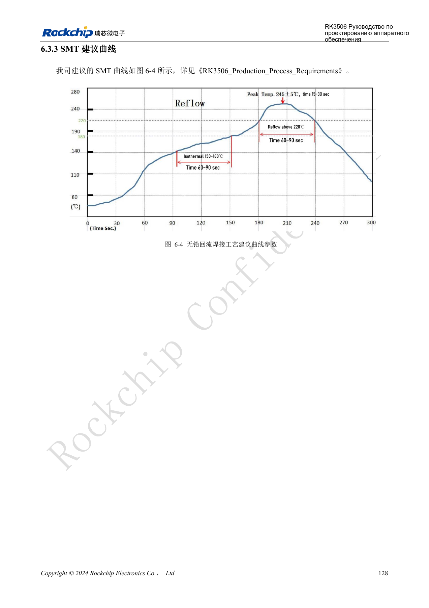
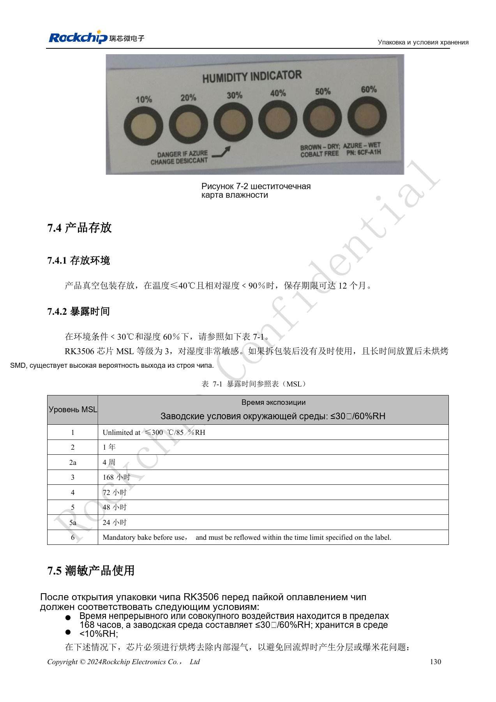
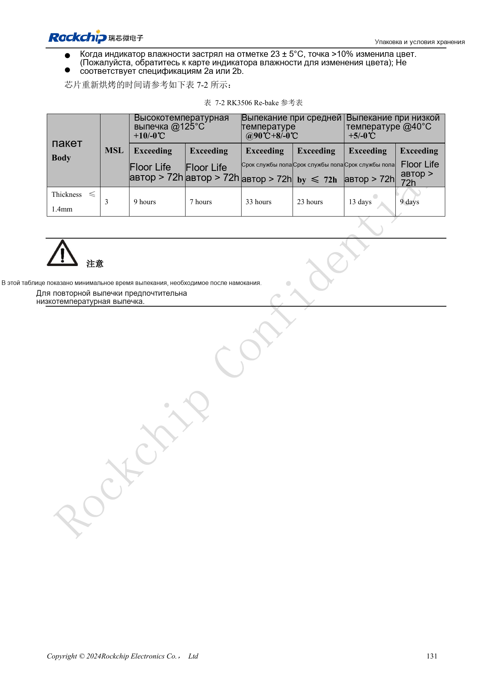

# RK3506: тепло, ESD и подготовка производства

По RK3506 Hardware Design Guide V1.0 (2024-09), охватывающему G2 и B/J. Корпус, память, питание и выводы проверяют по варианту, интерфейсы CM1/Forge1 — по документации платы. Это тематическая инженерная статья, не полный постраничный перевод. Значения взяты из источника, не из испытаний ArmSoM. Проверяйте реальные SDK/BSP, ядро и прошивку.

**RK3506 Hardware Design Guide_V1.0_20240904_CN.pdf** · §3.1–3.2; §4–7

## Тепловые данные ограничены условиями платы

Тепловое сопротивление источника — расчёт для заданного корпуса, PCB и среды, не измерение ArmSoM. Площадь платы, медь, воздух, соседние силовые элементы и радиатор меняют температуру; одного θJA недостаточно. Зафиксируйте среду, корпус, нагрузку, частоты и политику охлаждения, затем измерьте кристалл и поверхности компонентов. Программное снижение частоты, аварийное отключение и нормальный теплоотвод — разные меры.

## ESD требует пути отвода

Защиту располагают у разъёмов и точек входа разряда с коротким непрерывным возвратом на землю. Экраны надёжно заземляют, такты, сброс и аудио удаляют от помех и края. Увеличение фильтрующей ёмкости ради EMI не должно ухудшать высокоскоростной канал. После изменения TVS, синфазного дросселя или разъёма проверяют сигнал. Приёмка включает горячее подключение, восстановление после ESD и длительную нагрузку с учётом сбросов, шума и ошибок.

## Считайте суммарное воздействие влаги

Указан MSL3 и 168 часов суммарного времени после вскрытия при ≤30°C/60%RH. При возврате партии на линию счёт не начинается заново. Для герметичного хранения указаны ≤40°C, <90%RH и 12 месяцев. При превышении или изменении индикатора выбирайте сушку по толщине корпуса, времени превышения и температуре. В обеих таблицах есть подозрительное “≤300°C” для MSL1 — его нельзя использовать как режим хранения. Профиль пайки подтверждают для пасты, теплоёмкости платы и корпуса, сохраняя измерения и партии.

## Исходная таблица повторной сушки

| Температура | Превышение floor life >72h | Превышение floor life ≤72h |
| --- | --- | --- |
| 125°C +10/-0°C | 9h | 7h |
| 90°C +8/-0°C | 33h | 23h |
| 40°C +5/-0°C | 13d | 9d |

Только при условиях источника: MSL3, толщина корпуса ≤1.4mm. Указаны минимальные времена, предпочтительна низкая температура. Проверяйте допустимость температуры лотка и компонентов. Таблица не задаёт сушку другого корпуса или собранной платы.

## Исходные рисунки и страницы проверки

В этой подборке доступны только китайские оригиналы. Все четыре языка используют одинаковые исходные изображения с контекстом; надписи внутри не переведены. Текст редактируемый. Указаны физические страницы PDF.

PDF 91

PDF 95

PDF 135

PDF 143

PDF 145

PDF 146

## Продукты и документация ArmSoM

- [ArmSoM CM1](https://www.armsom.org/product-page/cm1) · [CM1 Docs](https://docs.armsom.org/armsom-cm1)
- [ArmSoM Forge1](https://www.armsom.org/armsom-forge1) · [Forge1 Docs](https://docs.armsom.org/armsom-forge1)

## Читайте далее

- [Оглавление серии](/ru/articles/rk3506-hardware-design-series/)
- [Минимальная система RK3506: тактирование, сброс и восстановление](/ru/articles/rk3506-clock-boot-reset-design/)
- [Домены питания RK3506: G2, B/J и плата-носитель](/ru/articles/rk3506-power-domains-design/)
- [RK3506 DDR, eMMC и FSPI: схемы и трассировка](/ru/articles/rk3506-ddr-storage-hardware-design/)
- [RK3506: распределение дисплея, USB и RM_IO](/ru/articles/rk3506-display-usb-io-design/)
- [Аудиотракт RK3506: SAI, PDM, ASRC и DSM](/ru/articles/rk3506-audio-hardware-design/)
- [Промышленные интерфейсы RK3506: RMII, FlexBus, DSMC](/ru/articles/rk3506-industrial-bus-hardware-design/)
