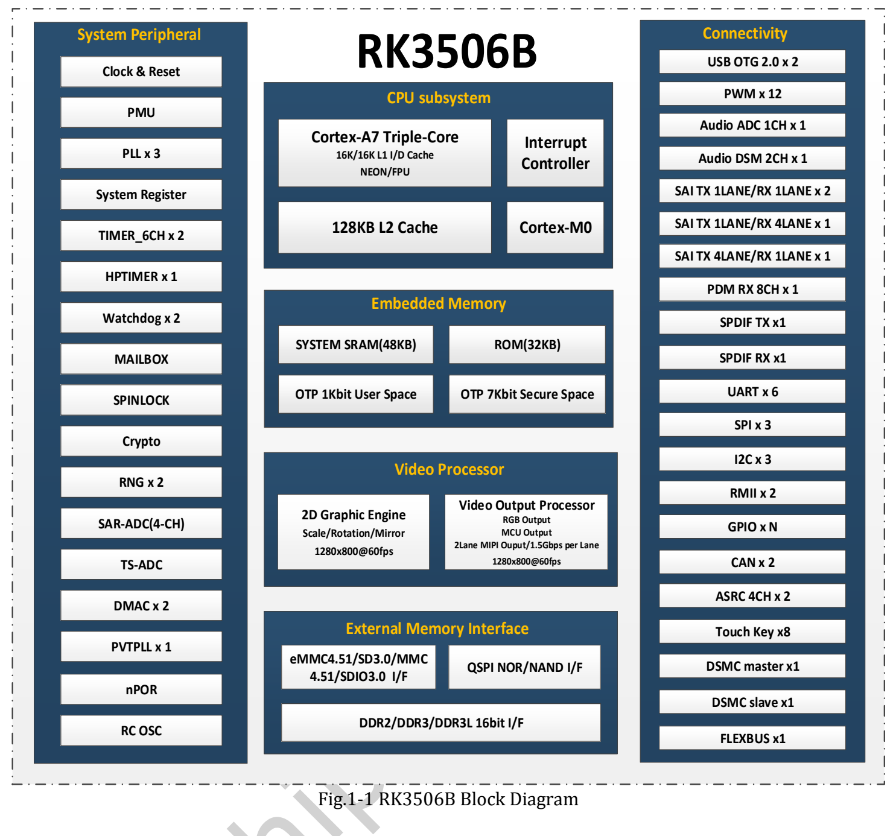
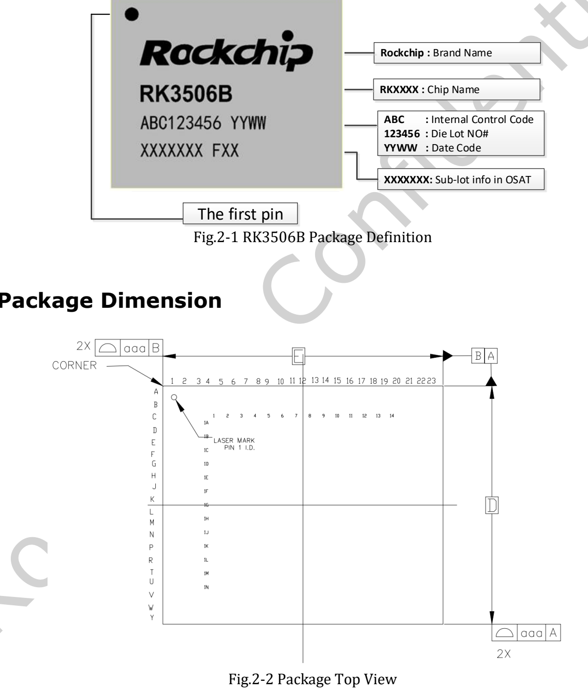
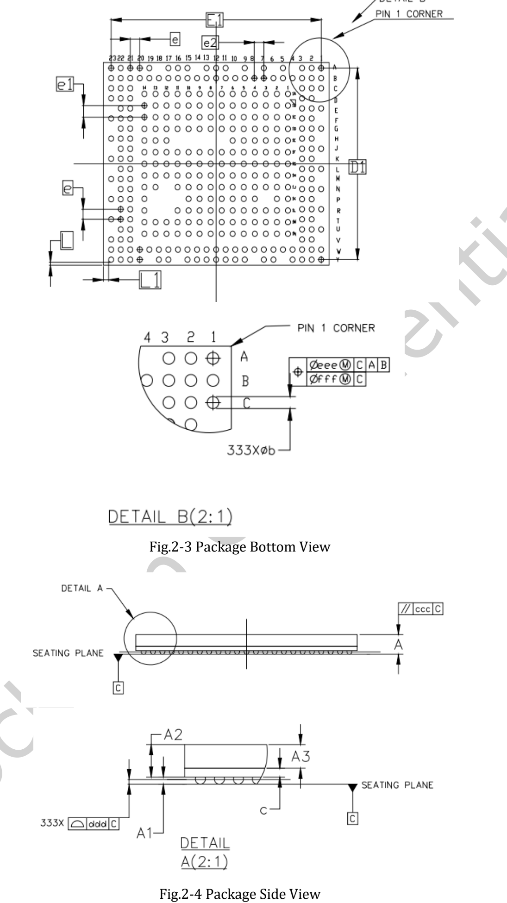

Статья предоставляет исходный **RK3506B Datasheet V1.0 от 2024-08-16, 50 страниц** и инженерный путеводитель по архитектуре, корпусу, выводам, электрическим и тепловым параметрам. Это не построчный перевод: полные таблицы выводов и электрических характеристик находятся в PDF.

**CM1 и Forge1 используют RK3506J. Документ RK3506B не подтверждает напряжения, температуру, частоту или совместимость выводов варианта J.**

## Файл и навигация

[Скачать оригинальный PDF RK3506B Datasheet V1.0](/assets/rk3506/Rockchip-RK3506B-Datasheet-V1.0-20240816.pdf)

| Страницы | Раздел | Что проверить |
|---|---|---|
| 7–14 | Архитектура и функции | CPU, память, дисплей, аудио, периферия |
| 15–17 | Корпус и маркировка | FBGA333L, ориентация, размеры, допуски |
| 17–26 | Список выводов | Шарики и мультиплексированные функции |
| 26–41 | Питание и функциональные IO | Домены, подтяжки, мультиплексирование |
| 41–44 | Matrix IO и FLEXBUS | Примеры ADC/DAC/DVP/QSPI LCD |
| 45–49 | Электрические параметры | Пределы, рекомендуемые условия, уровни |
| 50 | Тепловые параметры | Температура кристалла, неопределённые значения |

## Архитектура RK3506B

Три Cortex-A7 Armv7-A поддерживают NEON и VFPv4-D32. Указаны 16KB L1 инструкций, 16KB L1 данных и 128KB L2, а также Cortex-M0, Mailbox, Spinlock и DMA. Распределение задач определяется соответствующим SDK.

16-bit DDR2/DDR3/DDR3L адресует до 1024MB. Накопители: SPI NOR/NAND и SD/MMC; перечислены eMMC 4.51, SD3.0, SDIO3.0 и 4-bit шина. Конкретная плата не обязана иметь все носители.

Для вывода указаны до 1280×1280@60fps, две линии MIPI по 1.5Gbps, RGB/MCU и BT.656/BT.1120. 2D-движок выполняет масштабирование, поворот, отражение и alpha blending. Совместную работу и разделяемые выводы проверять отдельно.

## Корпус и печатная плата

Корпус FBGA333L, уровень влагочувствительности 3, материал шариков SnAgCu. Рисунки помогают понять ориентацию; посадочное место строить по таблице размеров и актуальным файлам корпуса, не по измерению веб-картинки.

## Рекомендации и предельные значения

| Параметр | RK3506B V1.0 |
|---|---|
| Рекомендуемая окружающая Ta | −20 / 25 / 80°C, min/typ/max |
| Хранение | −40…125°C |
| Максимум температуры кристалла | 125°C; тепловой раздел требует оставаться ниже |
| Питание CPU | min 0.81V, typ 0.9V, max TBD |
| θJA, θJB, θJC, ψJT | Все TBD |

TBD нельзя заменять предположениями. Температура кристалла не равна окружающей, а хранение не означает работу под питанием. Неуказанный максимум питания CPU нельзя заимствовать у другого варианта.

## Неясности исходного документа

На странице 49 строка CODEC ADC Resolution содержит 24 с единицей °C, тогда как функциональный раздел описывает 24-bit ADC. Это неясность единицы исходника, не температурная характеристика. Пять SAI-компонентов включают внутренние связи и не означают пять независимых внешних аудиопортов.

Перед реализацией проверить точный чип, актуальную документацию, BSP, последовательность питания, мультиплексирование, схему и измерения. Электрические и тепловые испытания оборудования ArmSoM для статьи не выполнялись.

## Статьи серии и официальные материалы

- [RK3506J: процессор для промышленного HMI и подключения оборудования](/ru/articles/rk3506j-chip-guide/)
- [ArmSoM CM1: модуль RK3506J для промышленного терминала](/ru/articles/cm1-rk3506j-industrial-module/)
- [ArmSoM Forge1: разработка шлюзов, HMI и систем сбора данных](/ru/articles/forge1-industrial-hmi-gateway/)
- [Rockchip RK3506](https://www.rock-chips.com/a/cn/product/RK35xilie/2025/1208/2125.html)
- [ArmSoM CM1](https://docs.armsom.org/armsom-cm1)
- [ArmSoM Forge1](https://docs.armsom.org/armsom-forge1)
- [ArmSoM](https://www.armsom.org/)
