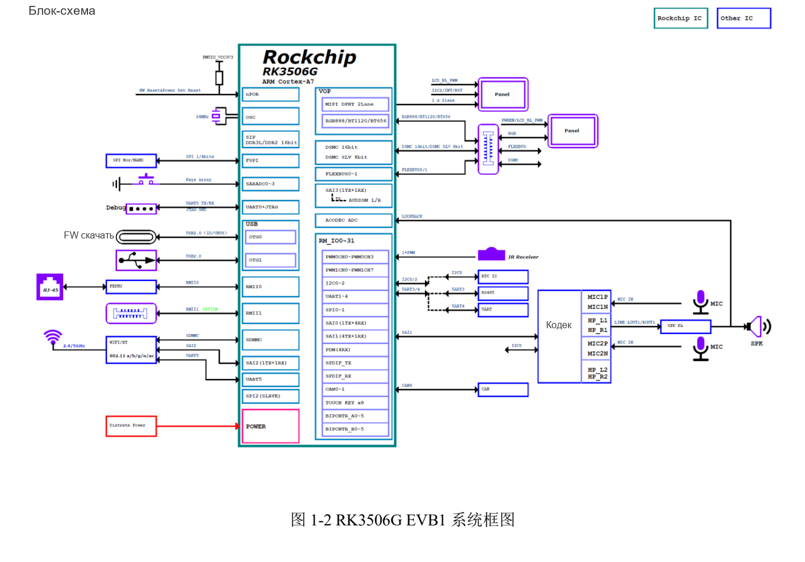
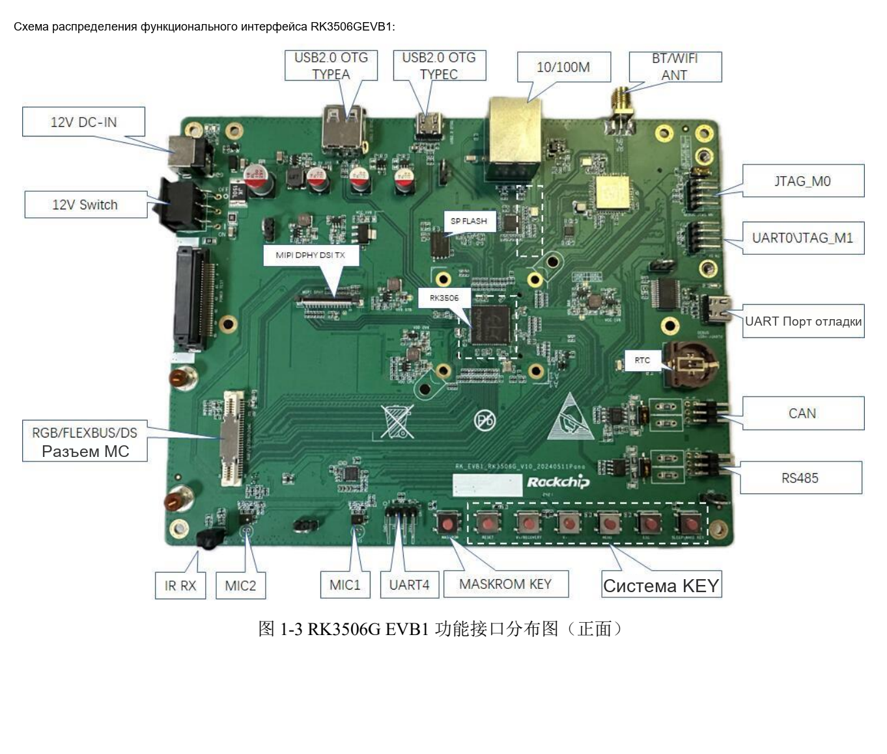

Это тематическое руководство по исходному документу: ключевые параметры, ограничения и оригинальные иллюстрации. Оно не заменяет полный перевод, таблицу выводов или регистров. Примеры производителя не являются измерениями ArmSoM. Перед применением проверьте ревизию платы, схему, SDK/BSP, ядро и драйверы; новых аппаратных испытаний для статьи не проводилось.

**Основной источник：** `Rockchip_RK3506G_EVB1_User_Guide_V1.0_20240719_CN.pdf` · PDF 40 стр..

## Отделить эталон G от продуктов J

Руководство относится к `RK_EVB1_RK3506G_V10_20240511Pana.brd`. Таблица указывает 128MB DDR3L и опциональную eMMC; комплект содержит 12V/3A и MIPI-панель 1280×720. CM1 и Forge1 документированы как RK3506J. Нельзя напрямую переносить память, температурный класс, питание и выводы G EVB.


[](/assets/localized/figures/ru/95e4112a34243ececb6a.png)

*Система RK3506G EVB1 — Оригинал на китайском; соответствующей английской иллюстрации в этой подборке нет. `Rockchip_RK3506G_EVB1_User_Guide_V1.0_20240719_CN.pdf`, PDF p. 12.*


## Направления разработки на эталоне

| Направление | Реализация | Проверка |
| --- | --- | --- |
| HMI | 2-lane MIPI DSI и расширение RGB | Тайминги, подсветка, touch и шлейф |
| Сеть оборудования | 1 Fast Ethernet RJ45; второй FEPHY через 60pin | PHY, питание, общие сигналы и драйвер |
| Расширение управления | Общие RGB/FLEXBUS/DSMC через 60pin | Резисторы и pinmux выбранной функции |
| Полевая связь | CAN и RS485 | Трансивер, согласование, провода и земля |
| Аудио | 1 динамик, 2 аналоговых MIC и кодек | Маршруты, такты и mixer |
| USB | OTG0 Type-C для прошивки; OTG1 Type-A | Роль, питание и драйвер, не форма разъёма |


[](/assets/localized/figures/ru/403248eb99b7bf940fbb.png)

*Разъёмы RK3506G EVB1 — Оригинал на китайском; соответствующей английской иллюстрации в этой подборке нет. `Rockchip_RK3506G_EVB1_User_Guide_V1.0_20240719_CN.pdf`, PDF p. 14.*


## Сначала загрузка и последовательный доступ

Источник использует инструмент v3.28 или новее. MASKROM или V+(RECOVERY) выбирает режим; после обнаружения нужны соответствующие Loader, Parameter, Uboot и другие файлы. Для Loader требуется низкий `SARADC_IN1`. Питание и кнопки сверяйте с конкретной платой, до записи сохраняйте данные.

Debug Type-C — USB-UART со скоростью `1500000` (1.5M), это не OTG0 загрузки. Сохраняйте журнал от питания до userspace. До поиска ошибки ядра проверьте питание, кабели и порты. При поддержке ADB:

```sh
adb devices
adb shell
```

## eMMC — вариант комплектации

Стр. 27 даёт таблицу только для указанного эталона:

| Сигнал | Направление перемычки источника |
| --- | --- |
| eMMC_CLKOUT | `R1614→R1644` |
| eMMC_CMD | `R1615→R1639` |
| eMMC_D0 | `R1616→R1640` |
| eMMC_D1 | `R1617→R1641` |
| eMMC_D2 | `R1645→R1642` |
| eMMC_D3 | `R1146→R1143` |

Номера последней строки отличаются, но сохранены без исправления на R16xx. До изменения проверьте схему, BOM, монтаж и Loader/разделы. Это не инструкция менять CM1/Forge1 по этим позициям.

## Условия I2C, согласования и JTAG

I2C0 содержит HYM8563TS `0x51` и ES8388 `0x11`, оба 3.3V. Touch — I2C2, `0x28/0x29`, 3.3V. Аудиораздел этой EVB нельзя автоматически использовать как подключение RK730.

У RS485 есть переключаемые 120Ω. Включение определяется топологией всей шины, а не каждым узлом безусловно. Соединения CAN/RS485 и питание проверяйте по схеме при выключенной плате.

JTAG_M0 делит ресурсы с Wi-Fi SDIO и требует настройки переключателя. Два JTAG-разъёма меняют местами TMS/TCK: M0 — GND, TMS, TCK, VCC; M1 — GND, TCK, TMS, VCC. Одинаковой формы недостаточно.

## Неточности источника и перенос

В таблице Wi-Fi напечатано `1T21`, в обзоре — 1T1R. Последняя страница сохранила заголовок RK3576, подпись UART названа JTAG. Эти несоответствия отмечены, а не превращены в новые возможности.

Forge1 можно оценивать для HMI, шлюза и интерфейсов, CM1 — для собственного носителя. Заново заполните память, загрузочный носитель, питание, экран, шины и версии ПО. После отдельных интерфейсов и восстановления объедините UI, сеть, накопитель и полевую шину, затем проверяйте температуру и длительную стабильность.


## Продукты и документация

- **CM1** — [Продукт](https://www.armsom.org/cm1) · [Документация](https://docs.armsom.org/armsom-cm1)
- **Forge1** — [Продукт](https://www.armsom.org/forge1) · [Документация](https://docs.armsom.org/armsom-forge1)


## Читайте также

- [Проекты на Forge1](/ru/articles/forge1-industrial-hmi-gateway/)
- [Аудиокодек RK730](/ru/articles/rk730-audio-codec-design/)
