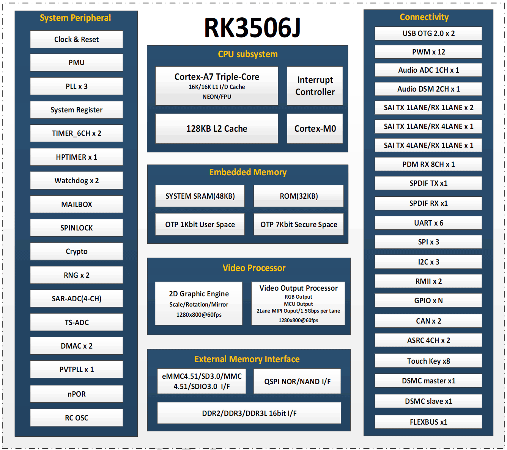

RK3506J объединяет отображение, связь с оборудованием и управляющее ПО в компактном терминале. ArmSoM CM1 предлагает модуль для собственного изделия, а Forge1 — готовую плату для проверки дисплеев, протоколов и приложений. Начинать стоит с потоков данных и интерфейсов, а не только с частоты CPU.

## Распределение задач

| Блок | Опубликованные сведения | Назначение |
|---|---|---|
| CPU | Три Cortex-A7; на схеме ArmSoM также Cortex-M0 | Linux-приложения; использование M0 зависит от BSP |
| Графика | 2D-движок и процессор вывода | Композиция, масштабирование, поворот |
| Память | RK3506B/J: 16-bit DDR2/DDR3/DDR3L | Объём определяется платой |
| Сеть | Два RMII | Нужны внешние PHY и разъёмы |
| Связь | USB2.0 OTG, UART, SPI, I2C, CAN, PWM | Дисплеи, датчики, оборудование |
| Расширение | DSMC, FLEXBUS, Matrix IO | Проверить мультиплексирование, временные параметры и драйверы |

Три Cortex-A7 и Cortex-M0 — не четыре одинаковых Linux-ядра. 2D-движок не является универсальным 3D-GPU. Официальная страница не указывает производительность NPU, поэтому платформа не позиционируется здесь для инференса больших языковых моделей.

## Пять направлений применения

### Сенсорный промышленный HMI

Объединить состояние, настройки, графики и аварийные сообщения. Сначала проверить отклик лёгкого интерфейса, например LVGL, затем подключить реальный протокол оборудования. Разрешение, обновление, шрифты и изображения влияют на память и задержки. Анимацию проверять под рабочей нагрузкой.

### Шлюз протоколов

Собирать последовательные или CAN-данные и отправлять записи по Ethernet. Разделить сбор, проверку, буферизацию и передачу; предусмотреть восстановление связи и дубликаты. Два Fast Ethernet не гарантируют предельную скорость маршрутизации, сертификацию протокола или жёсткое реальное время.

### Управление бытовой техникой и зданием

Контролировать температуру, освещение, вентиляторы и локальный интерфейс. Сохранять основные функции без сети, учитывать ресурс NAND и восстановление питания. Реле, аналоговые входы и полевые напряжения требуют внешних схем, а не прямого подключения к GPIO.

### Терминал производственных данных

Собирать счётчики, состояния и аварии, показывать их локально и периодически передавать. До выбора базы данных определить частоту, метки времени, срок автономного хранения и объём памяти. Это проектный сценарий, а не подтверждённое внедрение у клиента ArmSoM.

### Голосовой и звуковой интерфейс

Rockchip перечисляет Audio ADC, DSM, SAI и PDM. Микрофонные массивы, эхоподавление, речевые алгоритмы и аудиокомпоненты требуют интеграции. Наличие интерфейсов не означает готовое автономное распознавание речи.

## От Forge1 к CM1

На Forge1 проверить интерфейсы, GUI и обмен данными. При необходимости собственной формы, разъёмов и питания выбрать CM1 с заказной базовой платой. Общий RK3506J не делает образы взаимозаменяемыми: проверить Device Tree, разметку памяти, дисплей и питание.

## Частоты и варианты

Указанные в интернете частоты плат различаются. Здесь не обещается фиксированная максимальная частота CM1 или Forge1: использовать таблицу частот поставляемого образа, режим и температурные условия. Приложенный PDF — **RK3506B V1.0**, а не электрическая спецификация RK3506J.

## Статьи серии и официальные материалы

- [ArmSoM CM1: модуль RK3506J для промышленного терминала](/ru/articles/cm1-rk3506j-industrial-module/)
- [ArmSoM Forge1: разработка шлюзов, HMI и систем сбора данных](/ru/articles/forge1-industrial-hmi-gateway/)
- [RK3506B Datasheet V1.0: архитектура, выводы и электрические характеристики](/ru/articles/rk3506b-datasheet-v10/)
- [Rockchip RK3506](https://www.rock-chips.com/a/cn/product/RK35xilie/2025/1208/2125.html)
- [ArmSoM CM1](https://docs.armsom.org/armsom-cm1)
- [ArmSoM Forge1](https://docs.armsom.org/armsom-forge1)
- [ArmSoM](https://www.armsom.org/)
