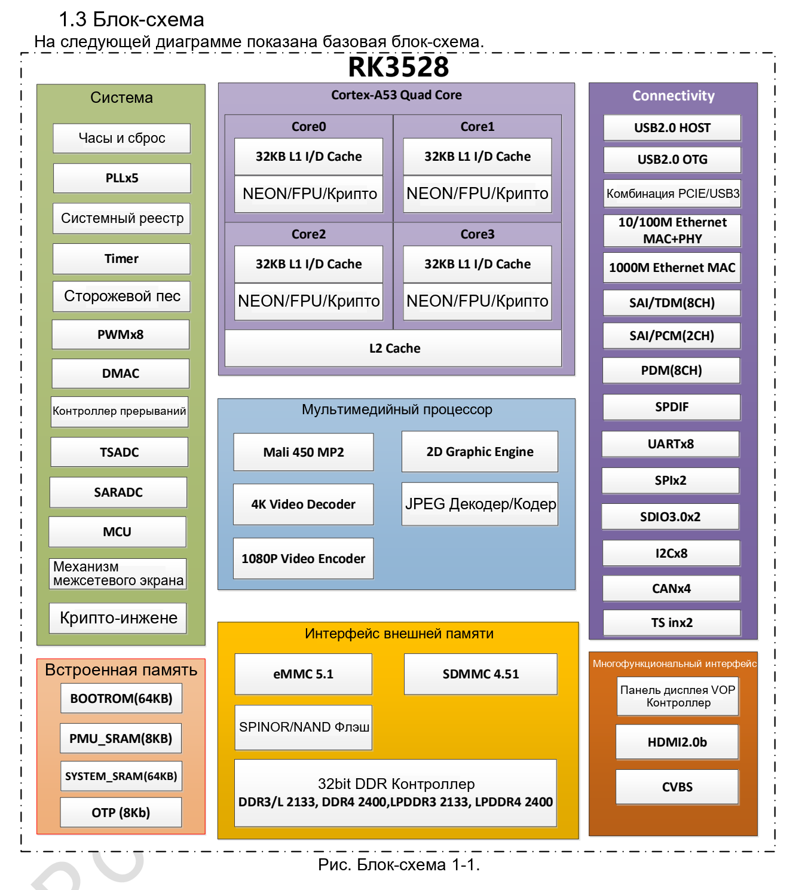

Статья основана на указанной редакции datasheet. Значения являются спецификациями производителя, а не измерениями ArmSoM; новых аппаратных испытаний не проводилось. Проверьте ревизию кристалла, схему платы, SDK/BSP, ядро и драйверы. Пояснения и редактируемые таблицы помогают чтению; полная спецификация и не рассмотренные подробно битовые поля находятся в исходном PDF.

**RK3528 · Rockchip RK3528 Datasheet V1.0-20230522.pdf · PDF 6–14.**

*Английский оригинал, PDF, стр. 14.*

## Вычисления и загрузка

RK3528 ориентирован на мультимедиа и периферию. В этой редакции отдельный NPU не указан; характеристики AI другого чипа переносить нельзя.

| Параметр | Спецификация / примечание |
|---|---|
| CPU | 4 × Cortex-A53 · Armv8-A · NEON/FPU · TrustZone |
| GPU | Mali-450 · OpenGL ES 1.1/2.0 · OpenVG 1.1 |
| SRAM | 64 KB + PMU 8 KB |
| MCU | Cortex-M0 · 8 KB TCM |
| Загрузка | SPI / eMMC / SDMMC; USB download |
| Такты | 24 MHz reference · 5 PLL |
| Домены напряжения | ARM / GPU / LOGIC / PMU |
| DMA | 3 DMAC; 8 channels / 32 requests / 2 interrupt outputs each |
| Защита | SHA-1/224/256, MD5, SM3, HMAC, AES-128/192/256, DES/TDES, SM4; PKA ≤4096 bit; 16 DDR regions |

## Память и хранение

Шина 32 bit и предел 4 GB относятся к контроллеру, а не к комплектации каждой Sige1. Типы DDR — альтернативы. Загрузку, напряжение шины и прошивку согласуют с платой.

| Параметр | Спецификация / примечание |
|---|---|
| DDR | 32 bit · ≤4 GB · DDR3/DDR3L/LPDDR3/DDR4/LPDDR4/LPDDR4X |
| eMMC | 5.1 · HS400 · command queue · 1/4/8 bit |
| SDMMC | SD 3.0 / MMC 4.51 · 4 bit |
| FSPI | 1/2/4 bit |

## Видео, графика и дисплей

Пределы декодирования, кодирования и вывода различны. Проверяйте кодек, разрядность, частоту кадров, полосу памяти и выход совместно; 4K не доказывает любую одновременную комбинацию.

| Параметр | Спецификация / примечание |
|---|---|
| Декодирование 4K | H.264 BP/MP/HP L5.1 + MVC; H.265 Main/Main10 L5.1 High Tier; AVS2 · 4K×2K @60 |
| Другие декодеры | MPEG-1/2/4, AVS/AVS+, VC-1 · 1080p60; H.263 · 576p60 |
| Кодирование | H.264 HP L4.2 / H.265 Main L4.1 High Tier · 1080p60 |
| JPEG | 48×48–8176×8176 · 76 Mpixel/s · ROI · 400/420/422/440/411/444 |
| 2D | Input ≤8192×8192; output ≤4096×4096; rotation 0/90/180/270°, mirror, alpha |
| VDPP | YUV420/422 input; YUV444 output also listed; deinterlace width ≤1920; DMSR / ZME |
| HDMI | 2.0b · 4K 10-bit @60 · HDR10 / HLG / HDR Vivid |
| CVBS | 480i / 576i |
| Слои | 1 cluster + 4 smart layers |

## Общие PHY и управление

Источник задаёт USB 2.0 Host + USB 2.0 OTG + PCIe либо USB 2.0 Host + USB 3. Нельзя суммировать USB 3 и PCIe между вариантами. При упоминании PCIe 2.1 и Base Specification 3.0 явно указаны только 2.5/5.0 Gbit/s, одна линия, RC; скорость Gen3 не подтверждена.

| Параметр | Спецификация / примечание |
|---|---|
| Ethernet | 1 × 10/100/1000 MAC (RGMII/RMII) + 1 × 10/100 MAC/PHY |
| PCIe | x1 RC · 2.5 / 5.0 Gbit/s |
| UART | 8 · ≤4 Mbit/s |
| I2C | 8 · 100/400 kbit/s · 7/10-bit address |
| SPI | 2 |
| PWM | 8 × 32 bit; IR: PWM3/PWM7 |
| SARADC | 10 bit · 4 single-ended inputs · ≤1 MS/s |
| TS | 2 inputs; 2 PTI, each 96 PID / 32 PES-ES / 16 PCR / 96 section filters; 1 PVR |
| ISO7816 | T0 / T1 |

## Аудиотракты и вопросы к источнику

SAI0/1 используют GPIO, SAI2 — внутренний передающий тракт Codec, SAI3 — HDMI; четыре блока не означают четыре внешних порта. CAN×4 есть на схеме без подробного описания. Единица 10.2bps в разделе HDMI неполна. Разрешение температуры также различается; см. электрические параметры. Эти пункты не считаются подтверждёнными после произвольного исправления.

| Параметр | Спецификация / примечание |
|---|---|
| SAI0/2 | 2 channels; SAI2 TX only |
| SAI1/3 | 8 channels; SAI3 TX only |
| SAI | 16–32 bit · ≤192 kHz |
| PDM | 8 channels · 16–24 bit · ≤192 kHz |
| SPDIF | HDMI / GPIO |
| DAC | 24 bit · 8/12/16/24/32/44.1/48/96 kHz |

## Продукты ArmSoM и границы применения

Sige1 — платформа на RK3528. Наличие интерфейса в кристалле не означает его вывод на плату; разъёмы, напряжения, образы и распиновку проверяйте по документации Sige1.

- [Sige1](https://www.armsom.org/sige1) · [Docs](https://docs.armsom.org/armsom-sige1)

## Серия по datasheet и исходный PDF

- [RK3528 обзор](/ru/articles/rk3528-datasheet-v10/)
- [Архитектура RK3528: память, видео 4K и общие PHY](/ru/articles/rk3528-architecture-memory-media/)
- [RK3528: корпус и полная таблица 401 шариков](/ru/articles/rk3528-package-pin-reference/)
- [RK3528: питание, I/O и тепловое сопротивление](/ru/articles/rk3528-electrical-power-thermal/)
- [Скачать полный исходный PDF](/assets/datasheet-series-20261110/Rockchip-RK3528-Datasheet-V1.0-20230522.pdf)
