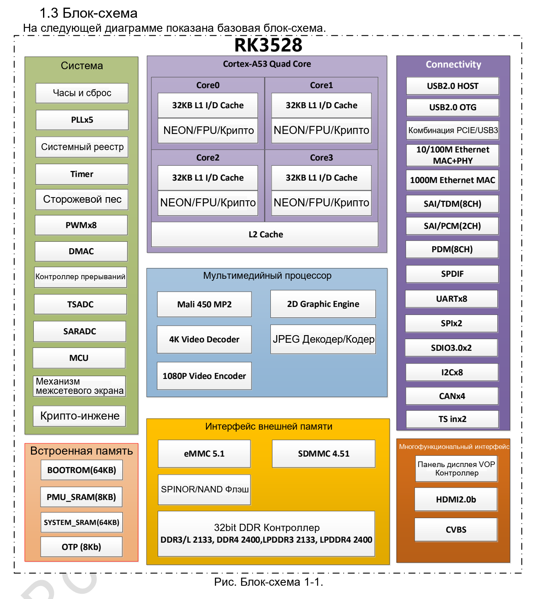

Это тематическое руководство по исходному документу: ключевые параметры, ограничения и оригинальные иллюстрации. Оно не заменяет полный перевод, таблицу выводов или регистров. Примеры производителя не являются измерениями ArmSoM. Перед применением проверьте ревизию платы, схему, SDK/BSP, ядро и драйверы; новых аппаратных испытаний для статьи не проводилось.

**Основной источник：** `Rockchip RK3528 Datasheet V1.0-20230522.pdf` · PDF 28 стр..

## Для каких задач предназначен RK3528

Datasheet V1.0 ориентирует RK3528 на IPTV, OTT и мультимедийное оборудование. Четыре Cortex-A53 выполняют приложения и сетевые задачи, специализированные блоки обрабатывают видео и графику. ArmSoM подтверждает RK3528 для Sige1 — удобной отправной точки для проверки ПО. Блок-схема SoC не является списком разъёмов Sige1.

*Блок-схема RK3528 производителя — Оригинал на английском. `Rockchip RK3528 Datasheet V1.0-20230522.pdf`, PDF p. 14.*

## Характеристики и ограничения

| Параметр | Сведения источника | Что проверить |
| --- | --- | --- |
| CPU / GPU | 4× Cortex-A53; Mali-450; OpenGL ES 1.1/2.0, OpenVG 1.1 | Это не подтверждает совместимость с современными Vulkan-приложениями |
| Память | 32-bit; DDR3(L)/LPDDR3/DDR4/LPDDR4(4X); адресация 4GB | Установленный объём и тип зависят от платы |
| eMMC | eMMC 5.1, HS400, CMD Queue | Возможности контроллера не равны длительной скорости записи флеш-памяти |
| Декодирование | H.264/H.265/AVS2 до 4K×2K@60fps | Согласовать формат, профиль, глубину цвета и путь проигрывателя |
| Кодирование | H.264/H.265 до 1920×1080@60fps; JPEG | Отдельно проверить вход камеры и драйвер |
| Дисплей | HDMI 2.0b; CVBS 480i/576i; HDR10, HLG, Vivid HDR | Проверить монитор, цветовой формат, полосу и ПО совместно |
| Сеть | Gigabit MAC и ресурсы Fast Ethernet MAC/PHY | Ориентироваться на разъёмы и схему Sige1 |

В этой спецификации нет основания заявлять NPU. Поэтому Sige1 здесь не представляется платформой с NPU-ускорением RKNN. Исполнение алгоритма на CPU и работа специализированного NPU различаются.

## Выбор USB или PCIe

Примечание на стр. 13 задаёт два сочетания: `1× USB2 Host + 1× USB2 OTG + PCIe` либо `1× USB2 Host + 1× USB3.0`. USB3 и PCIe нельзя считать независимыми одновременно доступными ресурсами. Для USB-камеры, диска или контроллера расширения сначала проверьте разводку, затем режим PHY в BSP.

Раздел PCIe2.1 упоминает также Base Specification Revision 3.0, но приводит скорости одной линии 2.5/5.0Gbps. Противоречие сохранено; оно не трактуется как поддержка PCIe Gen3 8.0Gbps.

## Три направления для Sige1

**Цифровые вывески и информационные терминалы.** Выберите реальные медиаматериалы, проверьте аппаратное декодирование, субтитры, поворот и синхронизацию звука. Затем испытайте автономное воспроизведение, откат обновления и восстановление. Максимальное разрешение декодера не гарантирует плавную сложную веб-анимацию одновременно с видео.

**Локальные медиасервисы.** Можно оценить обмен файлами, панель состояния оборудования или управление воспроизведением. Раздельно измеряйте сеть, накопитель и протокольные накладные расходы. Определите поведение при заполнении диска, повреждении файлов и отключении питания. Один тест скорости не доказывает длительную надёжность.

**Связь с устройствами и обучение.** Используйте только документированные выводы платы. До подключения проверьте напряжение и мультиплексирование. Включите управление сервисами, ротацию журналов, watchdog и обновление, чтобы устройство оставалось обслуживаемым.

## Условия мультимедийных измерений

Поддержка кодека не означает поддержку всех профилей, глубин цвета и контейнеров. Вместе фиксируйте параметры файла, версию проигрывателя, устройство декодирования, загрузку CPU, пропуски кадров, температуру и длительность. Для кодирования нужны также контроль битрейта, задержка и качество.

В разделе HDMI буквально указано `10.2bps`, что не согласуется с контекстом. Здесь единица не исправляется молча и возможности вывода из этой строки не вычисляются. Нужны актуальная формальная спецификация и проверка выбранного режима.

## Питание, температура и ревизия

В электрических таблицах есть `TBD` и температурные поля `NA`; тепловой раздел отдельно требует температуры кристалла ниже 125℃. Пропуск данных не означает отсутствие ограничений, а температура кристалла не равна окружающей. Подберите питание для конкретной платы и испытайте охлаждение под длительной нагрузкой до выбора корпуса.

Запишите ревизию Sige1, образ, ядро и драйверы; проверьте дисплей, сеть и накопитель по отдельности и совместно. Уже имеющиеся статьи RK3528 посвящены схемам и PCB, а эта — выбору и проверке системы по datasheet.

## Продукты и документация

- **Sige1** — [Продукт](https://www.armsom.org/sige1) · [Документация](https://docs.armsom.org/armsom-sige1)

<!-- datasheet-series-20261110 -->

## Серия по datasheet и исходный PDF

- [RK3528 обзор](/ru/articles/rk3528-datasheet-v10/)
- [Архитектура RK3528: память, видео 4K и общие PHY](/ru/articles/rk3528-architecture-memory-media/)
- [RK3528: корпус и полная таблица 401 шариков](/ru/articles/rk3528-package-pin-reference/)
- [RK3528: питание, I/O и тепловое сопротивление](/ru/articles/rk3528-electrical-power-thermal/)
- [Скачать полный исходный PDF](/assets/datasheet-series-20261110/Rockchip-RK3528-Datasheet-V1.0-20230522.pdf)

<!-- datasheet-related-20261110 -->
## Другие datasheet

Ссылки предназначены для сравнения платформ; электрические условия и выводы не взаимозаменяемы.

- [RK3506B](/ru/articles/rk3506b-datasheet-v10/)
- [RK3576](/ru/articles/rk3576-datasheet-v10/)
- [RK3588](/ru/articles/rk3588-datasheet-v14/)
- [RK3568](/ru/articles/rk3568-datasheet-v12/)
- [RK730](/ru/articles/rk730-audio-codec-design/)
