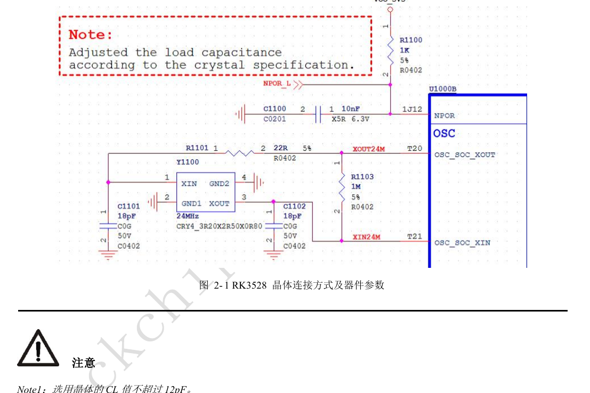
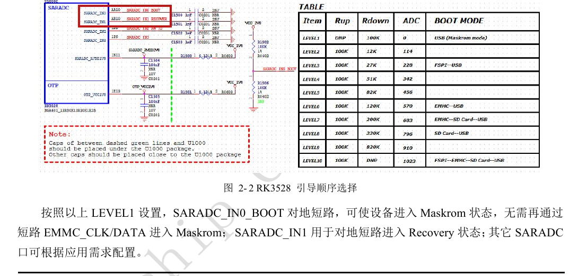
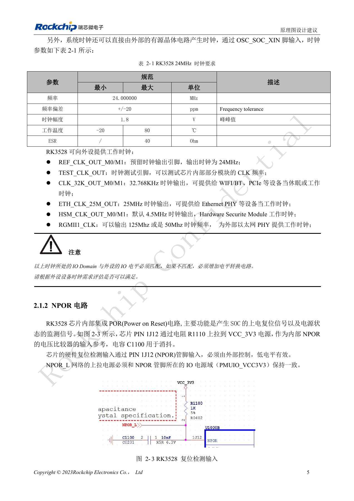
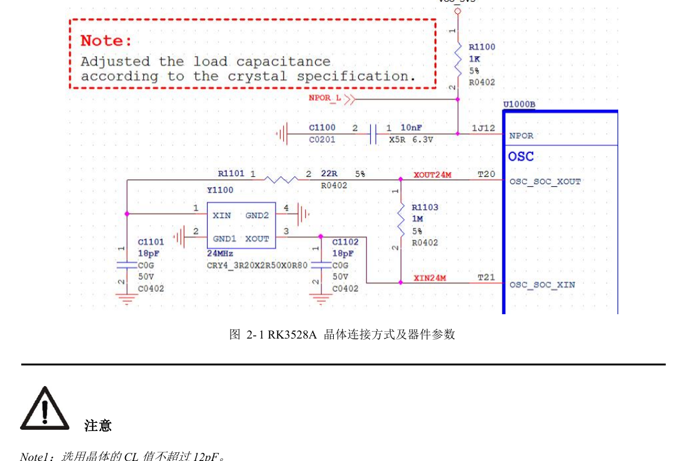
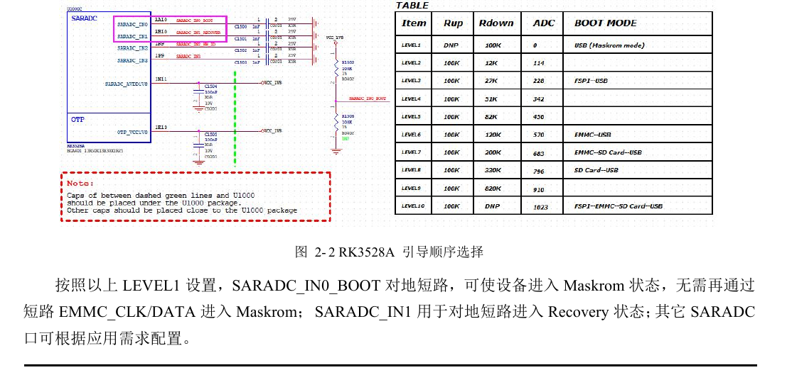
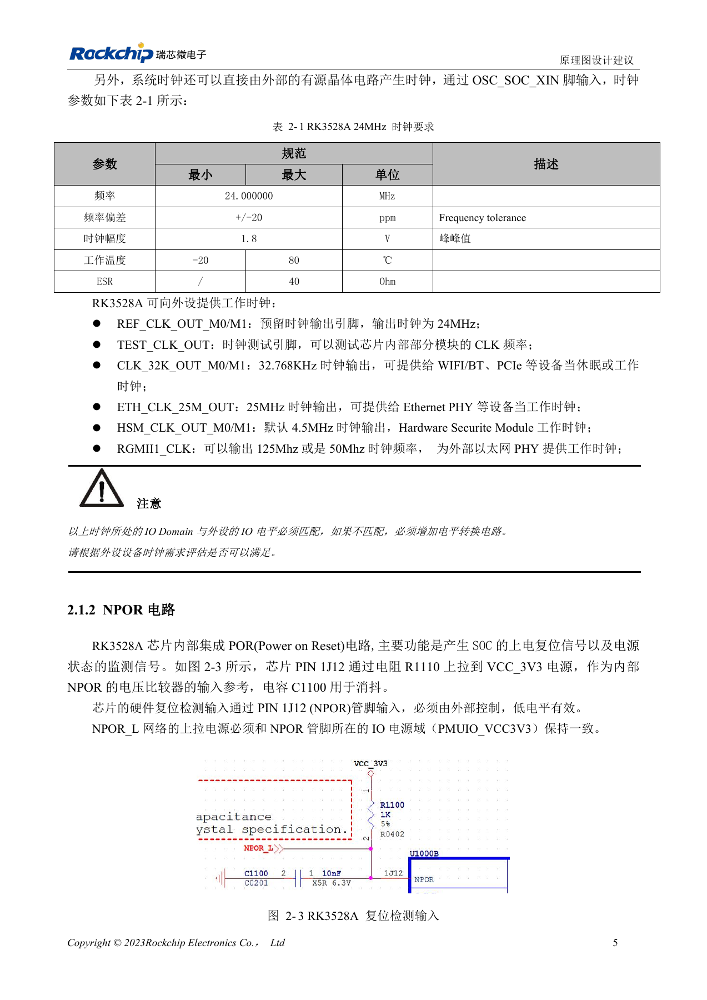

# RK3528 / RK3528A: тактирование, сброс, Maskrom и отладочный UART

Инженерная статья основана на китайских руководствах RK3528 V1.0 (2023-05-25) и RK3528A V1.0 (2023-07-12), а не является их дословным полным переводом. Сходство рассматриваемых глав не доказывает взаимозаменяемость микросхем. Официальная [документация Sige1](https://docs.armsom.org/armsom-sige1) указывает RK3528 в плате ArmSoM [Sige1](https://www.armsom.org/sige1), подходящей для оценки соответствующих приложений. Это не означает, что Sige1 использует RK3528A, и не доказывает взаимозаменяемость микросхем. Эталонные схемы SoC не являются схемами Sige1; выводы, корпус, BSP/SDK, ядро и ревизию платы проверяйте для конкретного изделия. Значения взяты из источников, не из измерений ArmSoM.

**§2.1.1–2.1.5; §2.3.2; PDF 18–23, 54–55**

## Для генератора 24MHz недостаточно проверить запуск

Сохраните резистор 22Ω в XOUT24M и не меняйте произвольно резистор 1MΩ между XOUT24M и XIN24M. CL кварца не должна превышать 12pF. Конденсаторы 18pF на схеме относятся к эталонному кварцу: пересчитайте нагрузку для выбранного компонента и паразитных ёмкостей платы. Рекомендуются C0G/NP0 и четырёхконтактный кварц с надёжным подключением обоих выводов земли. Проверяйте запуск, частоту, амплитуду и температурное поведение; щуп тоже влияет на нагрузку.

## Сохраните восстановление в серийном изделии

NPOR активен низким уровнем; внешняя подтяжка должна питаться от домена PMUIO_VCC3V3. Загрузка возможна с FSPI, eMMC и SDMMC; при отсутствии корректного образа код загружается через USB2 OTG. SARADC_IN0 зарезервирован для порядка загрузки. В конфигурации LEVEL1 его низкий уровень включает Maskrom; SARADC_IN1 используется для Recovery и требует подтяжку 10kΩ к 1.8V. Сохраните доступ к этим сигналам, OTG и VBUSDET после установки корпуса.

## Детектирование SD также выбирает отладочный интерфейс

При снятии сброса низкий SDMMC_DETN выбирает SDMMC, высокий — CPU JTAG; уровень должен установиться до включения. После запуска IOMUX можно передать под управление регистров. Отладочный порт по умолчанию — UART0_RX_M0 / UART0_TX_M0, 1500000bps; обе линии выбираются из одной группы M0. Рекомендуются последовательные 100Ω и разъём 2.54mm либо тестовые площадки более 0.7mm. MCU JTAG в этих версиях руководств недоступен для внешнего использования.

## Справочные параметры

| Параметр | Значение источника |
| --- | --- |
| Предел CL кварца | 12pF |
| Допуск 24MHz | ±20ppm |
| Диапазон SARADC | 0–1.8V; 10bit; 1MS/s |
| Отладочный UART | UART0_M0; 1500000bps |

## Иллюстрации и страницы источника

Английские оригиналы не предоставлены. Во всех языках используются китайские изображения с указанием микросхемы и физической страницы; изображения RK3528 не выдаются за RK3528A.

RK3528 · CN · PDF 18

RK3528 · CN · PDF 20

RK3528 · CN · PDF 19

RK3528A · CN · PDF 18

RK3528A · CN · PDF 20

RK3528A · CN · PDF 19

## Разработка и документация

Выбирайте изделия ArmSoM по их документации; серия не утверждает наличие платы ArmSoM на RK3528/RK3528A. Опыт разработки интерфейсов и ПО других плат полезен как методика, но не делает взаимозаменяемыми напряжения, выводы или PCB-правила.

- [ArmSoM](https://www.armsom.org/) · [ArmSoM Docs](https://docs.armsom.org/)
- [RK3528 / RK3528A: девять тем аппаратного проектирования](/ru/articles/rk3528-rk3528a-hardware-design-series/)
- [RK3528 / RK3528A: дискретное питание, последовательность и нагрузка](/ru/articles/rk3528-rk3528a-power-sequencing/)
